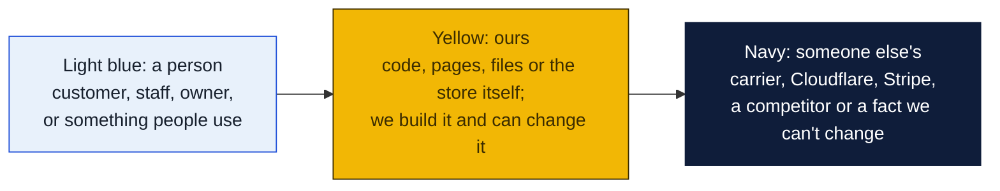
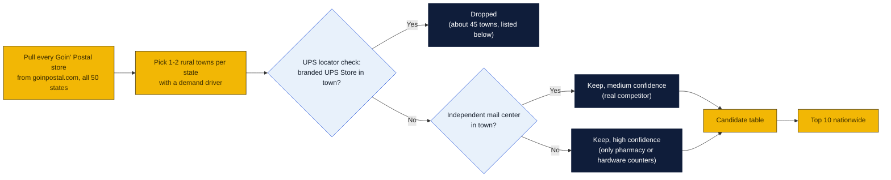
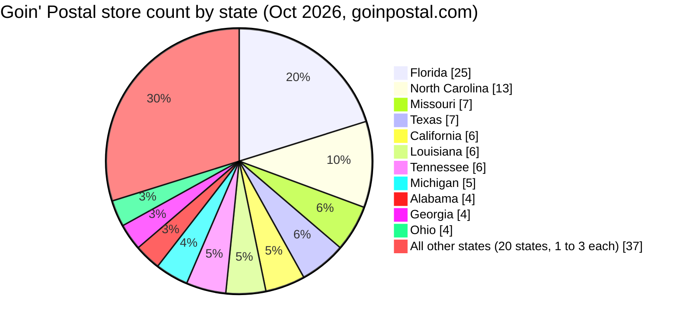
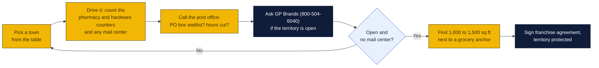

# Goin' Postal site candidates: the other 49 states

Research date: October 18, 2026. Florida is in its own folder, [`../florida/`](../florida/README.md). This folder covers everything else: one or two rural or small-town candidates per state where a pack-and-ship and mailbox store would plausibly fill a gap.

> **Deeper files now exist** for the 23 states with no Goin' Postal: see [`../README.md`](../README.md#state-by-state-the-23-states-with-no-goin-postal) for the index, or open `research/<state>/README.md` directly. This file remains the one-pass view of all 49 states.

## How to read this

Goin' Postal is a low-cost franchise (about $47k to $110k all-in, $525 a month royalty, 15-year term with a protected territory; see [the research overview](../README.md#what-the-franchise-costs)). That changes what counts as a good town. A UPS Store needs a bigger trade area to pay back its build-out. A Goin' Postal can work in a town of 5,000 to 15,000 people if the nearest branded store is 20 or more miles away and the town has a reason people ship: a college, a base, a lake full of second homes, a mine payroll, or a tourism flow.

### How to read the charts

Every chart in this repo uses the same three colors, so once you know them you can read any of them.

| Mark | Meaning |
|---|---|
| Solid arrow `-->` | Data or a person moves this way, or this happens next |
| Dotted arrow `-.->` | Only sometimes: when keys are set, when a condition holds, or a later plan |
| Words on an arrow | What is sent or the condition, for example "when keys set" |
| Cylinder | A database or stored records (KV, D1, a table) |
| Rounded box with `/path` | A page on the website; `/counter/...` pages are staff only |
| Box with a thick or dashed border, or a big frame around boxes | A group: everything inside runs in the same place |
| ✅ 🔨 ⏳ ⏸ in a box | Done, being built, not started, waiting on someone |

Other chart kinds you will meet: a **state diagram** shows the statuses one thing passes through, read along the arrows. A **sequence diagram** reads top to bottom, each vertical line is one party and each arrow is one message. A **gantt** is a calendar of who does what when. A **mindmap** is a topic in the middle with its parts around it. A **pie** or **bar chart** is just numbers. GitHub draws all of these on its own; if a chart shows as plain text, you are viewing the file somewhere that does not render Mermaid, and the raw text still reads top to bottom.

**Confidence key.** H means the UPS locator showed no branded UPS Store in town and named the nearest one with mileage, and the only in-town options are pharmacy or hardware counters. M means the same, but an independent mail center exists in town. L means the town was not spot-checked, or the data was thin.

**What was not done.** PostNet and PakMail were not checked separately in every town. Population and demand-driver notes are general knowledge unless a source is cited. Walterboro SC and Taos NM were not spot-checked.

## Where Goin' Postal already is

Twenty-three states have no Goin' Postal at all. A first store in one of those states gets the territory but no local brand awareness. A store in a state with an existing network (Louisiana, North Carolina, Missouri, Michigan, Texas) can lean on franchisees who already know the system.

| States with no Goin' Postal today |
|---|
| AK, AR, CO, CT, DE, HI, ID, IL, IA, KS, MD, MA, MT, NE, NH, NM, NY, OK, RI, SD, VT, VA, WY |

Existing stores outside Florida, verified October 2026: AL Alexander City, Athens, Harvest, Madison. AZ Gold Canyon. CA Bakersfield, Clovis, Fallbrook, Jackson, Woodlake, Yucaipa. GA Bainbridge, Clayton, Hiawassee, Vidalia. IN Columbia City, Greensburg, Scottsburg. KY Paducah, Walton. LA Benton, Marrero, Monroe, Pineville, West Monroe. ME Auburn, Presque Isle. MI Ann Arbor, Clarkston, Fenton, Plainwell, West Bloomfield. MN Fergus Falls. MS Ocean Springs. MO Chillicothe, Kansas City, Lake St. Louis (2), Platte City, St. Joseph, Warrenton. NV Elko, Las Vegas. NJ Norwood. NC Camp Lejeune, Cary, Clemmons, Franklin, Jacksonville, Kernersville, King, Mocksville, Morrisville, Mount Airy, Sneads Ferry, Whitsett, Winston-Salem. ND Fargo (2). OH Cincinnati, Lima, Mansfield, Piqua. OR Roseburg (2), Albany. PA Easton, Lewistown, Elverson. SC Aiken, North Augusta. TN Brentwood, Camden, Franklin (2), Fairview, Farragut. TX Corsicana, Edinburg, Frisco, Jacksonville, Mission, San Antonio, Vidor. UT Cedar City. WA Bellevue, Ephrata, Lakebay. WV Inwood, Martinsburg, Hurricane. WI Superior, Wausau.

## Top 10 nationwide

```mermaid
flowchart TB
  subgraph COL["College towns"]
    direction TB
    H["3 · Houghton / Hancock, MI<br/>Michigan Tech · nearest UPS Store 66 mi"]
    N["6 · Natchitoches, LA<br/>Northwestern State · 48 mi"]
    FV["7 · Farmville, VA<br/>Longwood + Hampden-Sydney · about 60 mi"]
    DC["8 · Decorah, IA<br/>Luther College · 44 mi"]
    EK["10 · Elkins, WV<br/>Davis & Elkins · 40 mi"]
  end
  subgraph GROW["Fast-growth exurbs"]
    direction TB
    FN["1 · Fernley, NV<br/>Reno / Tesla spillover · about 30 mi"]
    DR["2 · Driggs / Victor, ID<br/>Jackson Hole overflow · 30 to 70 mi"]
  end
  subgraph PAY["Payroll and tourism"]
    direction TB
    SF["4 · Safford / Thatcher, AZ<br/>mine + college · 74 mi"]
    MB["5 · Moab, UT<br/>3M visitors a year · 63 mi"]
    WB["9 · Wellsboro, PA<br/>PA Grand Canyon · 30 mi"]
  end
  classDef store fill:#f2b705,stroke:#3b2c00,color:#3b2c00
  classDef cloud fill:#0f1d3a,stroke:#0f1d3a,color:#ffffff
  classDef you fill:#e8f1fb,stroke:#1d4ed8,color:#17202d
  class FN,DR store
  class H,N,FV,DC,EK you
  class SF,MB,WB cloud
```

1. **Fernley, NV (Lyon County).** About 23,000 people and among the fastest-growing towns in Nevada, fed by Reno and the Tahoe-Reno Industrial Center. No UPS Store and no independent mail center surfaced. Nearest branded store is about 30 miles away. Goin' Postal has only Elko and Las Vegas in the state.
2. **Driggs / Victor, ID (Teton Valley).** Jackson Hole overflow with rapid second-home and remote-worker growth. The only UPS presence is an Access Point inside a print shop. Idaho has zero Goin' Postal stores.
3. **Houghton / Hancock, MI.** Michigan Tech brings 7,000 students, and Keweenaw tourism adds summer flow. The town's only UPS outlet is listed as temporarily closed. Nearest UPS Store is 66 miles away in Marquette.
4. **Safford / Thatcher, AZ.** A 38,000-person county trade area with Eastern Arizona College and the Freeport-McMoRan Morenci mine payroll. Nearest UPS Store is 74 miles away in Tucson. Arizona has only one Goin' Postal, in Gold Canyon.
5. **Moab, UT.** Small resident base but enormous tourism and remote-worker flow. UPS service runs through office-supply counters. Nearest branded store is 63 miles away in Grand Junction. Pair with Kanab for a southern-Utah cluster near the existing Cedar City store.
6. **Natchitoches, LA.** About 18,000 people with Northwestern State University and tourism. Only an independent outlet in town. Nearest UPS Store is 48 miles away in Alexandria. Louisiana already has a franchisee network, including the Forsythe store in Monroe.
7. **Farmville, VA.** Longwood University and Hampden-Sydney College plus retirees. No UPS Store within about 60 miles. Virginia has no Goin' Postal yet.
8. **Decorah, IA.** Luther College town with affluent tourism. Only hardware counters in town. Nearest UPS Store is 44 miles away in La Crosse. Iowa has no Goin' Postal.
9. **Wellsboro, PA.** Tourism hub for the Pennsylvania Grand Canyon with Mansfield University nearby. Nearest UPS Store is 30 miles away in Corning, NY. Pennsylvania franchisees already exist.
10. **Elkins, WV.** College town and Monongahela National Forest gateway. Nearest UPS Store is 40 miles away. West Virginia already has three Goin' Postal stores.

Honorable mentions with verified gaps: Grand Rapids MN, Hayward WI, McCook NE, Littleton NH, Devils Lake ND, Ticonderoga NY, Hartsville SC, Harrison AR, Kanab UT, Thomaston GA.

## Candidate table, all 49 states

| State | Town (County) | Approx pop / trade area | Why (demand driver) | Nearest competitor (name, miles) | Conf. |
|---|---|---|---|---|---|
| AL | Scottsboro (Jackson) | 15k town / ~50k county | Lake Guntersville retirees, TVA, Goose Pond; only pharmacy UPS counters in town | The UPS Store Fort Payne ~22 mi; Guntersville ~20 mi | M |
| AL | Pike Road (Montgomery) | 11k, fastest-growing town in AL | Exurban growth, home businesses (not spot-checked) | Montgomery UPS Stores ~10-12 mi | L |
| AK | Kodiak (Kodiak Island Borough) | 13k / island | USCG Base Kodiak, fishing fleet, island e-commerce dependence | No UPS Store found; nearest Soldotna/Anchorage (air only) | M |
| AK | Ketchikan (Ketchikan Gateway) | 14k | Cruise tourism, island; only UPS Customer Center + independent Frontier Shipping | No UPS Store on island (Juneau nearest) | M |
| AZ | Safford / Thatcher (Graham) | 10k / 38k county | Eastern Arizona College, Freeport-McMoRan Morenci mine, no branded store | The UPS Store Tucson ~74 mi; independent CMI outlet in town | H |
| AZ | Wickenburg (Maricopa/Yavapai) | 8k / winter 15k+ | Snowbird and retiree town, dude ranches | The UPS Store Surprise ~30 mi; independent Wickenburg Shipping in town | M |
| AR | Harrison (Boone) | 13k / 40k | Branson commuter, Buffalo River tourism, retirees; only Ace Hardware UPS counter | No UPS Store; nearest Batesville/Mountain Home 60+ mi | H |
| AR | Heber Springs (Cleburne) | 7k / 25k | Greers Ferry Lake retirees and second homes; only pharmacy UPS counter | The UPS Store Searcy ~23 mi | H |
| CA | Twentynine Palms (San Bernardino) | 26k | MCAGCC Marine base (largest USMC base), military moves and mailboxes | The UPS Store Yucca Valley ~20 mi; two independent postal shops on Adobe Rd | M |
| CA | Oakhurst (Madera) | 3k town / 20k+ foothills | Yosemite gateway, retirees; one independent outlet temporarily closed | The UPS Store Madera ~30 mi; independent Pak & Page | M |
| CO | Salida (Chaffee) | 6k / 20k county | Arkansas River tourism, second homes, remote workers | The UPS Store Woodland Park ~60 mi; independent The Shipping Depot in town | M |
| CO | Craig (Moffat) | 9k | Regional hub; both local UPS outlets listed temporarily closed | The UPS Store Steamboat Springs ~38 mi | M |
| CT | Putnam (Windham) | 9k / Quiet Corner 40k | Retiree and antiques town, northeast CT gap | The UPS Store Smithfield RI ~19 mi; independent Express Shipping in town | M |
| DE | Milford (Kent/Sussex) | 12k, fast growth | Retiree inflow, Bayhealth hospital; no branded store | UPS Stores Dover/Lewes ~18-20 mi; independent The Mail Center in town | M |
| DE | Georgetown (Sussex) | 8k | County seat, Delaware Tech, Sussex growth | Independent Marv's Mailroom; nearest UPS Store Lewes/Millsboro ~15 mi | M |
| GA | Thomaston (Upson) | 9k / 27k | Both local UPS counters temporarily closed; no branded store | UPS Stores Griffin/Macon ~25-30 mi | H |
| GA | Hartwell (Hart) | 4k / lake area 25k | Lake Hartwell retirees | The UPS Store Lavonia 11 mi | L |
| HI | Kaunakakai (Molokai) | 7k island | Island with no pack-and-ship store; not verifiable by search | None on island (Maui by ferry) | L |
| ID | Driggs / Victor (Teton) | 12k county, fast growth | Jackson Hole overflow, remote workers, second homes; only a UPS Access Point | The UPS Store Idaho Falls ~70 mi / Jackson WY ~30 mi | H |
| ID | Emmett (Gem) | 8k | Boise exurb growth | The UPS Store Star ~13 mi | L |
| IL | Effingham (Effingham) | 12k / 35k | I-57/I-70 crossroads, logistics and home business; two independent outlets only | The UPS Store Decatur ~55 mi | M |
| IL | Galena (Jo Daviess) | 3k / tourism | Tourism, Galena Territory second homes | The UPS Store Dubuque ~16 mi | L |
| IN | Jasper (Dubois) | 16k / 43k | Manufacturing (Kimball, MasterBrand), prosperous county | No UPS Store; independent Mailboxes & Parcel Depot + hardware | M |
| IN | Angola (Steuben) | 9k / lakes 35k | Trine University, Lake James second homes | The UPS Store Coldwater MI ~20 mi; independent Priority 1 Postal | M |
| IA | Decorah (Winneshiek) | 8k / 20k | Luther College, tourism; only hardware and co-op counters | The UPS Store La Crosse WI ~44 mi | H |
| IA | Spirit Lake / Okoboji (Dickinson) | 5k / summer 50k+ | Iowa Great Lakes second homes, tourism | The UPS Store Storm Lake ~53 mi; independent KAPCO outlet | H |
| KS | Junction City (Geary) | 23k | Fort Riley (1st Infantry Division) PCS moves; two small independent outlets | The UPS Store Manhattan ~20 mi | M |
| KS | Fort Scott (Bourbon) | 8k | Regional hub, only lumber-yard UPS counter | Nearest UPS location Pittsburg ~27 mi | M |
| KY | Bardstown (Nelson) | 13k, fast growth | Bourbon tourism boom, Louisville exurb | Louisville UPS Stores ~35 mi; independent Mail It Supplies in town | M |
| LA | Natchitoches (Natchitoches) | 18k / 38k | Northwestern State University, tourism; only independent Parcel Express | The UPS Store Alexandria ~48 mi | H |
| LA | Leesville / Fort Johnson (Vernon) | 6k + base | Fort Johnson (JRTC) soldiers and families; independent The Shipping Store | The UPS Store Alexandria ~47 mi | M |
| ME | Bridgton (Cumberland) | 5k / Lakes Region 25k | Second-home and retiree lake region; only storage-unit UPS counter | UPS Stores Windham/Brunswick ~25-30 mi | M |
| ME | Boothbay Harbor / Wiscasset (Lincoln) | 5k / summer 20k | Coastal tourism and retirees | The UPS Store Brunswick ~17 mi; independent Coastal Shipping (Edgecomb) | L |
| MD | Berlin / Ocean Pines (Worcester) | 12k Ocean Pines retirees | Large retiree community, Ocean City adjacent | Staples Ocean City ~8 mi; independent Copy Central; nearest UPS Store Salisbury ~25 mi | M |
| MA | Great Barrington (Berkshire) | 7k / South Berkshires 25k | Second homes, NYC weekenders | Staples + independent Barrington Pack & Ship in town; UPS Store Pittsfield ~20 mi | L |
| MI | Houghton / Hancock (Houghton) | 13k + 7k students | Michigan Tech; local UPS outlet temporarily closed | The UPS Store Marquette ~66 mi | H |
| MI | Ludington (Mason) | 8k / 30k | Lake Michigan tourism, retirees; Ace Hardware only | The UPS Store Muskegon ~47 mi | H |
| MN | Grand Rapids (Itasca) | 11k / 45k | Lake-country second homes, regional hub; Ace Hardware only | The UPS Store Bemidji ~66 mi | H |
| MS | Philadelphia (Neshoba) | 7k / 30k | Pearl River Resort casinos, Choctaw tribal economy; building-supply counter only | The UPS Store Meridian ~35 mi | M |
| MS | Picayune (Pearl River) | 12k, growing | NASA Stennis, New Orleans exurb | The UPS Store Slidell ~17 mi; independent Mail Fast Forward | L |
| MO | Bolivar (Polk) | 11k | Southwest Baptist University, Springfield exurb; two independent outlets | The UPS Store Springfield ~26 mi | M |
| MT | Dillon (Beaverhead) | 4k / 10k | UM Western, ranching, fly-fishing tourism; video-store UPS counter | The UPS Store Belgrade ~80 mi | M |
| MT | Lewistown (Fergus) | 6k / 12k | Central Montana hub; independent Shipping Center | The UPS Store Great Falls ~91 mi | M |
| NE | McCook (Red Willow) | 7k / 20k | Southwest Nebraska hub, hardware counter only | The UPS Store North Platte ~64 mi | H |
| NV | Fernley (Lyon) | 23k, very fast growth | Reno / TRIC (Tesla) exurb, no UPS Store or independent outlet found | Reno/Sparks UPS Stores ~30 mi | H |
| NV | Fallon (Churchill) | 9k / 25k | NAS Fallon (TOPGUN) military; independent 3-Dimension Shipping | No UPS Store; Fernley/Reno 30-60 mi | M |
| NH | Littleton (Grafton) | 6k / North Country 30k | Regional retail hub, tourism; only Staples counter (UPS lists Littleton as an open franchise market) | The UPS Store Plymouth ~38 mi | H |
| NJ | Cape May Court House / Middle Twp (Cape May) | 19k | Shore retirees; Staples only | The UPS Store North Cape May ~12 mi | L |
| NM | Ruidoso (Lincoln) | 8k / summer 30k | Second homes, racetrack, post-fire rebuilding; branded RBS Shipping temporarily closed | The UPS Store El Paso ~53 mi; independent Postal Annex franchise in town | M |
| NM | Taos (Taos) | 6k / 33k county | Tourism and art; UPS franchise site lists Taos as an open market (not spot-checked) | Unknown | L |
| NY | Ticonderoga (Essex) | 5k / 15k | Adirondack and Lake George tourism; only print-shop counter | The UPS Store Rutland VT ~28 mi | H |
| NY | Cooperstown (Otsego) | 2k / tourism 20k | Baseball Hall of Fame tourism, Bassett hospital | The UPS Store Oneonta ~18 mi; independent Copy Shop Plus | L |
| NC | Sylva / Cullowhee (Jackson) | 3k + WCU 12k students | Western Carolina University, tourism; UPS franchise page shows no store | Goin' Postal + UPS Store Franklin ~18 mi (possible cannibalization); independent Eagle Pack & Ship | M |
| ND | Devils Lake (Ramsey) | 7k / 20k | Lake tourism, Spirit Lake casino; Ace UPS counter temporarily closed | The UPS Store Grand Forks ~85 mi | H |
| OH | Logan (Hocking) | 7k / 28k | Hocking Hills cabin and Airbnb boom; hardware counter only | The UPS Store Lancaster ~17 mi | M |
| OH | Port Clinton (Ottawa) | 6k / summer 40k | Lake Erie islands tourism, marinas | The UPS Store Fremont ~16 mi | L |
| OK | Grove (Delaware) | 7k / Grand Lake 40k | Grand Lake retirees and second homes; independent Bandit Business Services | No UPS Store; nearest Joplin MO ~45 mi | M |
| OR | Brookings (Curry) | 7k / 20k | Retiree coast, "banana belt"; two independent mail centers | No UPS Store; Crescent City CA ~25 mi (unverified) | M |
| OR | Florence (Lane) | 10k / 20k | Retiree coast; search found no UPS presence at all (thin data) | Nearest UPS Store Eugene ~60 mi (inferred) | L |
| PA | Wellsboro (Tioga) | 3k / 40k county | PA Grand Canyon tourism, Mansfield University nearby; department-store counter only | The UPS Store Corning NY ~30 mi | H |
| PA | Bedford (Bedford) | 3k / 20k | I-70/I-76 junction, Omni Bedford Springs; independent The Shipping Place | No UPS Store; Altoona/Johnstown ~35 mi | M |
| RI | Westerly (Washington) | 23k / summer 40k | Watch Hill and Misquamicut summer homes; independent Parcel Center + Staples | The UPS Store Narragansett ~18 mi | M |
| SC | Hartsville (Darlington) | 8k / 25k | Coker University, Sonoco HQ; print-shop counter only | Nearest UPS Store Florence ~25 mi | H |
| SD | Hot Springs / Custer (Fall River/Custer) | 3-4k each / Black Hills retirees | VA hospital, retirees, tourism; search returned no UPS presence (thin) | Rapid City ~55 mi (inferred) | L |
| TN | Lawrenceburg (Lawrence) | 11k / 45k | Amish-country tourism, Columbia/Nashville exurb spillover; UPS Customer Center only | Nearest UPS Store Columbia ~30 mi (inferred) | M |
| TX | Llano (Llano) | 3k / 22k county | Hill Country retirees and second homes; independent MailCall Office | The UPS Store Marble Falls ~26 mi | M |
| TX | Port Aransas (Nueces) | 3k / tourism 20k+ | Beach tourism, condo owners; independent Port Aransas Business Center | Corpus Christi UPS Stores ~30 mi | M |
| UT | Moab (Grand) | 5k / 3M visitors | National-park tourism, remote workers; two office-supply UPS outlets only | The UPS Store Grand Junction CO ~63 mi | H |
| UT | Kanab (Kane) | 5k / 15k | Zion and Grand Staircase tourism, Best Friends Sanctuary; print-shop counter open 10-2 only | The UPS Store Hurricane ~39 mi | H |
| VT | Middlebury (Addison) | 9k / 37k | Middlebury College; a local news item says the UPS Store at 105 Court St was closing (date unclear), verify | If closed: Rutland/Burlington ~35 mi | L |
| VT | Newport (Orleans) | 4k / 27k | Northeast Kingdom, Jay Peak; no UPS Store surfaced | St. Albans/St. Johnsbury ~45 mi (inferred) | L |
| VA | Farmville (Prince Edward) | 7k + Longwood / Hampden-Sydney | Two colleges, retirees; independent Midtown Mailboxes only | No UPS Store; Richmond/Lynchburg ~60 mi | H |
| VA | Kilmarnock (Lancaster) | 1.5k / Northern Neck 25k | Retiree and boating region; independent Jeff's Packaging Solutions | The UPS Store Gloucester ~23 mi | M |
| WA | Chelan (Chelan) | 4k / summer 25k | Lake Chelan second homes, wineries; independent Lake Chelan Mail Boxes | The UPS Store Wenatchee ~31 mi | M |
| WV | Elkins (Randolph) | 7k / 28k | Davis & Elkins College, Monongahela NF tourism; hardware counter only | The UPS Store Fairmont ~40 mi | H |
| WI | Hayward (Sawyer) | 2k town / summer 30k | Northwoods lake homes, Birkebeiner tourism; co-op counter only | No UPS Store; Rice Lake/Superior ~50-70 mi (inferred) | H |
| WI | Minocqua (Oneida) | 4k / summer 30k | Lake tourism; independent Postal Express (FedEx ShipCenter) | Rhinelander ~25 mi (inferred) | M |
| WY | Buffalo (Johnson) | 4.5k / 9k | Bighorn retirees, I-25/I-90; Ace counter only | Pack & Mail Sheridan ~32 mi (independent), no UPS Store | M |
| WY | Pinedale (Sublette) | 2k / 9k | Gas-field workers, Wind River tourism; independent Moosely Mailboxes | Lander outlet ~58 mi; no UPS Store | M |

## Towns checked and dropped

These were first choices that turned out to already have a branded UPS Store, so they are out: Ellsworth ME; Hamilton, Polson and Livingston MT; Pierre, Yankton, Spearfish and Huron SD; Chestertown, Leonardtown and North East MD; Jasper GA; Pagosa Springs CO; Lake Placid NY; Lebanon, Camdenton and Farmington MO; Cody WY; Homer AK; Fort Payne, Guntersville and Troy AL; Nantucket MA; Plymouth and North Conway NH; Lillington and Southport NC; Jamestown ND; Tahlequah OK; Crossville and Paris TN; Stowe and St. Albans VT; Port Townsend WA; Alpena MI; Smyrna DE; Hammonton NJ; Murray KY; Sandpoint ID; Columbus NE; Corinth MS; Celina OH; Silver City NM; Pahoa and Kamuela HI; Hardy VA. Lewisburg WV has a PostNet.

## What to do with a pick

## Sources

- [goinpostal.com/locations](https://www.goinpostal.com/locations) and the per-state pages goinpostal.com/stores/AL through /WY, all fetched October 2026.
- [xmap.ai Goin' Postal location report](https://www.xmap.ai/brand-location-intelligence-reports/number-of-goin-postal-locations-in-the-united-states-of-america)
- UPS locator pages for each candidate town, for example [Driggs ID](https://locations.ups.com/id/driggs/access-point-location-115081.html), [Houghton MI](https://locations.ups.com/mi/houghton/authorized-shipping-outlet-244985.html), [Safford AZ](https://locations.ups.com/az/safford/), [Moab UT](https://locations.ups.com/us/en/ut/moab), [Natchitoches LA](https://locations.ups.com/la/natchitoches/), [Farmville VA](https://locations.ups.com/va/farmville/), [Decorah IA](https://locations.ups.com/ia/decorah/authorized-shipping-provider-246393.html), [Wellsboro PA](https://locations.ups.com/us/en/pa/wellsboro/), [Elkins WV](https://locations.ups.com/wv/elkins/authorized-shipping-provider-116775.html), [Fallon NV](https://locations.ups.com/nv/fallon/), [Grand Rapids MN](https://locations.ups.com/mn/grandrapids/), [Hayward WI](https://locations.ups.com/wi/hayward/), [McCook NE](https://locations.ups.com/ne/mccook/authorized-shipping-provider-128784.html), [Littleton NH](https://locations.ups.com/nh/littleton/), [Devils Lake ND](https://locations.ups.com/nd/devilslake/authorized-shipping-provider-296797.html), [Ticonderoga NY](https://locations.ups.com/ny/ticonderoga/authorized-shipping-provider-209174.html), [Hartsville SC](https://locations.ups.com/sc/hartsville/), [Harrison AR](https://locations.ups.com/ar/harrison/), [Kanab UT](https://locations.ups.com/ut/kanab/authorized-shipping-provider-236421.html), [Thomaston GA](https://locations.ups.com/us/en/ga/thomaston).
- [The UPS Store available markets, Vermont and Littleton NH](https://www.theupsstorefranchise.com/available-markets/vermont-2)
- [Addison Independent on the Middlebury UPS Store](https://www.addisonindependent.com/?p=145668)
