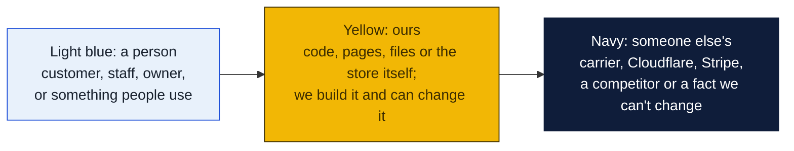
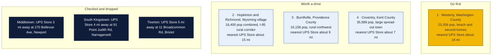
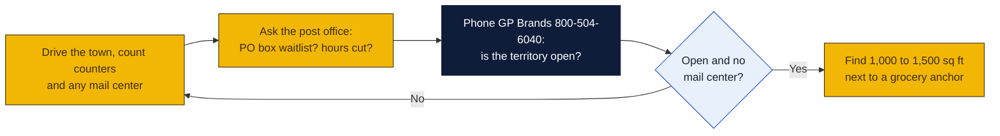

# Rhode Island: Goin' Postal site candidates

Research date: October 18, 2026. There is no Goin' Postal in Rhode Island today; Rhode Island is a franchise registration state, so the franchisor must have its disclosure document registered with the Department of Business Regulation before offering a franchise here.

## The verdict

Rhode Island is small and dense, with 12 UPS Stores and a branded store within about 10 miles of nearly every town, so the only real gap is the southwestern corner. Westerly is the first pick: 23,000 people, a beach and second-home economy, the nearest branded store about 18 miles away in Narragansett, and one independent parcel shop to size up. The Route 3 and Route 138 corridor of Hopkinton, Richmond and Charlestown is the second pick as a rural 5-mile territory with no store at all, and Burrillville in the northwest is the third.

### How to read the charts

Every chart in this repo uses the same three colors, so once you know them you can read any of them.

| Mark | Meaning |
|---|---|
| Solid arrow `-->` | Data or a person moves this way, or this happens next |
| Dotted arrow `-.->` | Only sometimes: when keys are set, when a condition holds, or a later plan |
| Words on an arrow | What is sent or the condition, for example "when keys set" |
| Cylinder | A database or stored records (KV, D1, a table) |
| Diamond with a question in it | A decision. Follow the arrow whose label matches the answer; there is one arrow out per answer |
| Slanted box (parallelogram) | Something typed in or handed out: a form, a scan, a printed slip |
| Circle in the middle of a mindmap | The topic; the branches around it are its parts |
| Rounded box with `/path` | A page on the website; `/counter/...` pages are staff only |
| Box with a thick or dashed border, or a big frame around boxes | A group: everything inside runs in the same place |
| ✅ 🔨 ⏳ ⏸ in a box | Done, being built, not started, waiting on someone |

Other chart kinds you will meet: a **state diagram** shows the statuses one thing passes through, read along the arrows. A **sequence diagram** reads top to bottom, each vertical line is one party and each arrow is one message. A **gantt** is a calendar of who does what when. A **mindmap** is a topic in the middle with its parts around it. A **pie** or **bar chart** is just numbers. GitHub draws all of these on its own; if a chart shows as plain text, you are viewing the file somewhere that does not render Mermaid, and the raw text still reads top to bottom.

## Candidates

| Rank | Town (County) | Pop 2020 to latest | Demand driver | Shipping options in town | Nearest branded competitor | Post office | Gap 1-5 | Confidence |
|---|---|---|---|---|---|---|---|---|
| 1 | Westerly (Washington) | 23,359 in 2020; no later estimate retrieved | Misquamicut and Watch Hill summer trade, second homes, Westerly Hospital, draws Stonington and Pawcatuck CT | Parcel Center Inc, 62 Franklin St, a UPS Authorized Shipping Outlet; Staples and Michaels on Airport Rd and CVS on Granite St are drop-offs; no branded store | The UPS Store, 91 Point Judith Rd, Narragansett, about 18 mi, inferred from map | nothing found | 3 | M |
| 2 | Hopkinton and Richmond, Wyoming village (Washington) | Hopkinton 8,398 in 2020; Richmond about 8,000; no later estimate retrieved | I-95 exit 3 rural corridor, Chariho schools, farms and equestrian sellers | UPS locator lists Wyoming as a town with a location but the page gave no listing types; no mailbox shop found | The UPS Store, 91 Point Judith Rd, Narragansett, about 15 mi, inferred from map | nothing found | 4 | M |
| 3 | Burrillville, Harrisville and Pascoag villages (Providence) | 16,158 in 2020; no later estimate retrieved | Rural northwest, draws Glocester and nearby Massachusetts towns | CVS Access Point only, 20 High St, Pascoag; no counter or mailbox shop found | The UPS Store, 400 Putnam Pike, Smithfield, about 9 mi, inferred from map | nothing found | 2 | H |
| 4 | Coventry (Kent) | 35,688 in 2020; no later estimate retrieved | Largest town in the state without a store; western half is rural and far from Route 2 retail | S and T Hardware counter, 2300 Nooseneck Hill Rd; CVS Access Point, 763 Tiogue Ave; no mailbox shop found | The UPS Store, 5600 Post Rd, East Greenwich, about 7 mi from Tiogue Ave, inferred from map | nothing found | 2 | H |
| 5 | Charlestown (Washington) | 7,997 in 2020; no later estimate retrieved | Beach and pond second homes, Ninigret, seasonal | UPS locator lists Charlestown as a town with a location but no listing types shown; no mailbox shop found | The UPS Store, 91 Point Judith Rd, Narragansett, about 12 mi, inferred from map | nothing found | 4 | M |
| 6 | North Kingstown, Wickford village (Washington) | 27,732 in 2020; no later estimate retrieved | Quonset Point business park and Electric Boat, Wickford tourism | Locator town page returned the generic town list; no mailbox shop found | The UPS Store, 5600 Post Rd, East Greenwich, about 7 mi, inferred from map | nothing found | 2 | M |
| 7 | Middletown (Newport) | 17,075 in 2020; no later estimate retrieved | Naval Station Newport, Navy families, Aquidneck Island retail strip | Post All, 1151 Aquidneck Ave, and Crossroads Business Center, 1364 W Main Rd, both UPS Authorized Shipping Outlets; Staples ship center | The UPS Store, 270 Bellevue Ave, Newport, about 3 mi | nothing found | 1 | H |
| 8 | Tiverton (Newport) | 16,359 in 2020; no later estimate retrieved | Route 24 commuter town, Sakonnet second homes | Locator town page returned the generic town list; no mailbox shop found | The UPS Store, 11 Broadcommon Rd, Bristol, about 5 mi across the Mount Hope Bridge, inferred from map | nothing found | 2 | M |

Gap 5 = big growing town, no store; 4 = no store, smaller or slower; 3 = independent mail center present; 2 = UPS Store within 10 mi; 1 = saturated. Confidence H = UPS locator checked and nearest store named with miles; M = locator checked but an independent exists or data thin; L = not fully checked.

## Why these towns

Westerly is the one Rhode Island town that behaves like a rural hub: it anchors the southwestern corner, pulls shoppers from Pawcatuck and Stonington across the Connecticut line where there is also no branded store, and swells every summer with beach renters and second-home owners who forward mail and ship purchases home. Parcel Center Inc on Franklin Street is the independent to inspect; if it rents mailboxes the gap narrows to a price fight. A 1,200 sq ft bay in the Franklin Street or Granite Street plazas near the Stop and Shop would catch both the year-round and summer trade. The risk is a seasonal revenue curve and the existing independent.

The Wyoming village area where Hopkinton and Richmond meet at I-95 exit 3 is the only place in the state where a 5-mile rural territory has no store of any kind inside it. Chariho families, farms and the horse community ship often and currently drive to Wakefield or Narragansett. A small space in the Route 138 plaza by the grocery would serve both towns and part of Exeter. The risk is a combined population under 17,000 with no large employer.

Burrillville is the rural northwest: Harrisville and Pascoag villages have only a CVS drop-off, and the Smithfield UPS Store is about 9 miles down Route 44. It makes the watch list rather than the go list because that drive is inside the 10-mile test. A storefront near the Harrisville grocery would also draw Glocester and the Massachusetts towns of Douglas and Uxbridge.

## Checked and dropped

- Middletown: no store in town, but The UPS Store at 270 Bellevue Ave, Newport, RI 02840 is about 3 miles away and two independent shipping outlets already serve the town.
- South Kingstown, Wakefield: The UPS Store at 91 Point Judith Rd, Narragansett, RI 02882 is about 4 miles away.
- Tiverton: The UPS Store at 11 Broadcommon Rd, Bristol, RI 02809 is about 5 miles away.
- Woonsocket: at 43,240 it is above the size range, and The UPS Store at 400 Putnam Pike, Smithfield and the Cumberland store are each within about 7 miles.
- Westerly was the prior-pass pick and stays at the top.

## State notes

- Rhode Island is a franchise registration state under the Rhode Island Franchise Investment Act; the Department of Business Regulation must have the franchisor's registration effective before a sale. Ask GP Brands whether its Rhode Island registration is current, since a brand with no stores in the state may have let it lapse.
- The UPS Store lists 12 Rhode Island locations in Barrington, Bristol, Cranston, Cumberland, East Greenwich, Narragansett, Newport, Providence, Smithfield and Warwick. Pak Mail and PostNet have no Rhode Island stores.
- Rhode Island sales tax is 7 percent on goods; confirm how packaging and mailbox fees are treated with the Division of Taxation.
- Anchors: Naval Station Newport and the Naval War College in Newport and Middletown, the University of Rhode Island in Kingston, Quonset Point in North Kingstown, and beach tourism from Westerly to Narragansett.
- Rhode Island population barely grew between 2010 and 2020 and the state's towns are close together, so a 5-mile rural territory is only available in the southwest and northwest corners.
- Nearest Goin' Postal store is Norwood, New Jersey, roughly 170 miles away; there are none in Massachusetts or Connecticut.

## How to verify a pick

## Not verified

- Road mileages are inferred from the map, not measured on the locator.
- Whether Parcel Center Inc in Westerly, Post All or Crossroads Business Center in Middletown rent private mailboxes.
- Post-2020 population estimates; only 2020 census figures were retrieved. Richmond's figure is approximate from memory and should be checked.
- Post office hours, PO box waitlists and relocations: the shared web search budget ran out before these checks, so every post office cell says nothing found.
- Commercial rent per square foot: not checked.
- The locator town pages for North Kingstown and Tiverton returned the generic town list rather than listings.

## Sources

- [The UPS Store locations in Rhode Island](https://locations.theupsstore.com/ri)
- [The UPS Store, Narragansett](https://locations.theupsstore.com/ri/narragansett)
- [The UPS Store, Newport](https://locations.theupsstore.com/ri/newport)
- [The UPS Store, East Greenwich](https://locations.theupsstore.com/ri/east-greenwich)
- [The UPS Store, Smithfield](https://locations.theupsstore.com/ri/smithfield)
- [The UPS Store, Bristol](https://locations.theupsstore.com/ri/bristol)
- [UPS locations in Westerly, RI](https://locations.ups.com/ri/westerly/)
- [UPS locations in Coventry, RI](https://locations.ups.com/ri/coventry/)
- [UPS locations in Wakefield, RI](https://locations.ups.com/ri/wakefield/)
- [UPS locations in Middletown, RI](https://locations.ups.com/ri/middletown/)
- [UPS locations in Pascoag, RI](https://locations.ups.com/ri/pascoag/)
- [UPS locations in North Kingstown, RI](https://locations.ups.com/ri/northkingstown/)
- [UPS locations in Tiverton, RI](https://locations.ups.com/ri/tiverton/)
- [Wikipedia: List of municipalities in Rhode Island, 2020 census](https://en.wikipedia.org/wiki/List_of_municipalities_in_Rhode_Island)
- [Pak Mail stores in Rhode Island](https://www.pakmail.com/shipping-stores/rhode-island)
- [PostNet locations](https://locations.postnet.com/)
- [Goin' Postal stores in New Jersey](https://www.goinpostal.com/stores/NJ)
- [Goin' Postal stores in Massachusetts](https://www.goinpostal.com/stores/MA)
