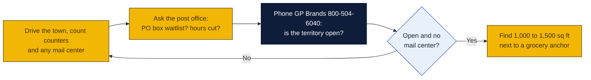

# South Dakota: Goin' Postal site candidates

Research date: October 18, 2026. South Dakota has no Goin' Postal store today. South Dakota is a franchise registration state: the franchisor must register its Franchise Disclosure Document with the Division of Insurance's Securities Regulation office before it can offer or sell a franchise here, so confirm with GP Brands that its South Dakota registration is current before any money changes hands.

## The verdict

The UPS Store has 13 South Dakota locations in ten cities and they cover every town above 12,000 people except two. Vermillion is the top pick: 11,700 people, up 10.6 percent in the 2010s, the University of South Dakota with its law and medical schools, and the only UPS point is an Ace Hardware counter, with Yankton's store 25 miles away. Sturgis is second: 7,000 residents, the Fort Meade veterans hospital, a world-famous rally that fills the town every August, and only a hardware counter, with Spearfish 20 miles away. The Sioux Falls and Rapid City fringe towns, Harrisburg, Tea and Box Elder, are the fastest-growing places in the state and have nothing but hardware counters, but each is within about 10 miles of a branded store, so they are 1-mile urban-radius plays rather than clean gaps.

```mermaid
flowchart TB
  subgraph GO["Go first"]
    direction TB
    A1["1 · Vermillion, Clay County<br/>11,695 in 2020, University of South Dakota, counter only<br/>nearest UPS Store about 25 mi"]
    A2["2 · Sturgis, Meade County<br/>7,020 in 2020, rally and Fort Meade VA, counter only<br/>nearest UPS Store about 20 mi"]
  end
  subgraph WATCH["Worth a drive"]
    direction TB
    B1["3 · Harrisburg, Lincoln County<br/>10,203 in 2024, up 52 percent since 2020<br/>nearest UPS Store about 8 mi in Sioux Falls"]
    B2["4 · Box Elder, Pennington and Meade<br/>13,887 in 2024, Ellsworth Air Force Base<br/>nearest UPS Store about 10 mi in Rapid City"]
    B3["5 · Madison, Lake County<br/>6,191 in 2020, Dakota State University cyber hub<br/>nearest UPS Store about 45 mi"]
    B4["6 · Hot Springs, Fall River County<br/>3,395 in 2020, VA hospital and tourism, no UPS point at all<br/>nearest UPS Store about 55 mi"]
    B5["7 · Belle Fourche, Butte County<br/>5,855 in 2024, ranch trade center<br/>nearest UPS Store about 10 mi in Spearfish"]
    B6["8 · Chamberlain, Brule County<br/>2,473 in 2020, I-90 and Missouri River<br/>nearest UPS Store about 70 mi"]
  end
  subgraph NO["Checked and dropped"]
    direction TB
    C1["Pierre: UPS Store at 502 Island Dr, Fort Pierre"]
    C2["Yankton: UPS Store at 3013 Broadway Ave"]
    C3["Spearfish: UPS Store at 810 N Main St"]
    C4["Huron: UPS Store at 1741 Dakota Ave S"]
  end
  classDef store fill:#f2b705,stroke:#3b2c00,color:#3b2c00
  classDef cloud fill:#0f1d3a,stroke:#0f1d3a,color:#ffffff
  classDef you fill:#e8f1fb,stroke:#1d4ed8,color:#17202d
  class A1,A2 store
  class B1,B2,B3,B4,B5,B6 you
  class C1,C2,C3,C4 cloud
```

## Candidates

| Rank | Town (County) | Pop 2020 to latest | Demand driver | Shipping options in town | Nearest branded competitor | Post office | Gap 1-5 | Confidence |
|---|---|---|---|---|---|---|---|---|
| 1 | Vermillion (Clay) | 10,571 (2010) to 11,695 (2020); no later estimate found | University of South Dakota, the state's only law and medical schools, about 800 university jobs, Sanford Health, 10.6 percent growth 2010 to 2020, county seat | UPS Authorized Shipping Provider counter at Vermillion Ace Hardware, 812 Cottage Ave; no mail center found. A branded UPS Store at 1104 E Cherry St is listed as closed on the UPS Store locator (checked Oct 18, 2026) | The UPS Store, 3013 Broadway Ave, Yankton, about 25 mi (inferred from map) | Nothing found | 4 | H |
| 2 | Sturgis (Meade) | 6,627 (2010) to 7,020 (2020); no later estimate found | Sturgis Motorcycle Rally, ten days each August with hundreds of thousands of visitors; Fort Meade VA medical center; county seat; 5.9 percent growth 2010 to 2020 | UPS Authorized Shipping Provider counter at Sturgis Hardware, 2222 Junction Ave; no mail center found | The UPS Store, 810 N Main St, Spearfish, about 20 mi, or Rapid City about 30 mi (inferred from map) | Nothing found | 4 | H |
| 3 | Harrisburg (Lincoln) | 6,732 (2020) to 10,203 (2024 est.); city estimate about 12,000 in February 2026 | Fastest-growing city in the state, up 64.6 percent 2010 to 2020 and 51.6 percent 2020 to 2024, Sioux Falls suburb 2.7 mi from the city edge | UPS Authorized Shipping Provider counter at Harrisburg Ace Hardware, 200 W Willow St; no mail center found | The UPS Store in south Sioux Falls, about 8 mi (inferred from map; Sioux Falls addresses not shown on the state page) | Nothing found | 2 | M |
| 4 | Box Elder (Pennington, Meade) | 11,746 (2020) to 13,887 (2024 est.) | Ellsworth Air Force Base on three sides, B-21 bomber beddown underway, 18.2 percent growth 2020 to 2024 after 50.6 percent in the 2010s; airmen and families need a civilian street address | UPS Authorized Shipping Provider counter at Box Elder Hardware, 540 N Ellsworth Rd; no mail center found | The UPS Store in Rapid City, about 10 mi (inferred from map; Rapid City addresses not shown on the state page) | Nothing found | 2 | M |
| 5 | Madison (Lake) | 6,474 (2010) to 6,191 (2020); no later estimate found | Dakota State University, a cybersecurity and computer-technology center; county seat; Lake Herman and Lake Madison cabins | UPS Authorized Shipping Provider counter at Madison Ace Hardware, 800 S Washington Ave; no mail center found | The UPS Store, 120 22nd Ave S, Brookings, about 45 mi, or Sioux Falls about 50 mi (inferred from map) | Nothing found | 4 | H |
| 6 | Hot Springs (Fall River) | 3,711 (2010) to 3,395 (2020); no later estimate found | VA Black Hills hospital campus, Evans Plunge, Mammoth Site, Wind Cave gateway, 33.5 percent of residents 65 or older; named with Custer in the first pass | No UPS point of any kind: Hot Springs is absent from the UPS state city list; Custer, 1,919 people, has only a Carson Drug counter at 521 Mount Rushmore Rd | The UPS Store in Rapid City, about 55 mi (inferred from map) | Nothing found | 4 | H |
| 7 | Belle Fourche (Butte) | 5,617 (2020) to 5,855 (2024 est.) | County seat serving a large ranch trade area, bentonite and cattle, 4.2 percent growth since 2020 | UPS Authorized Shipping Provider counter at Office Emporium, 612 State St; no mail center found | The UPS Store, 810 N Main St, Spearfish, about 10 mi (inferred from map) | Nothing found | 2 | H |
| 8 | Chamberlain (Brule) | 2,258 (1980) to 2,473 (2020); no later estimate found | County seat on the Missouri River at Interstate 90, Dignity statue and Hall of Fame tourism, serves Lower Brule and Crow Creek reservations | UPS Authorized Shipping Provider counter at Chamberlain Hardware, 1951 E King St; no mail center found | The UPS Store, 204 W Havens Ave, Mitchell, about 70 mi (inferred from map) | Nothing found | 4 | H |

Gap 5 = big growing town, no store; 4 = no store, smaller or slower; 3 = independent mail center present; 2 = UPS Store within 10 mi; 1 = saturated. Confidence H = UPS locator checked and nearest store named with miles; M = locator checked but an independent exists or data thin; L = not fully checked.

Also checked and open, ranked below the table: Tea, 7,699 in 2024 and up 37.5 percent since 2020, has only a Tea Ace Hardware counter at 701 N Heritage Pkwy but sits about 8 miles from Sioux Falls stores. Brandon, 11,048 in 2020, has only a Brandon Ace Hardware counter at 304 S Splitrock Blvd and is about 5 miles east of Sioux Falls. Winner, 2,921 in 2020, has only a Buche Ace Hardware counter and is the hub for Tripp and Todd counties with Mitchell's store about 110 miles away. Lead has only an Ace Hardware counter and Spearfish is about 15 miles away. Milbank has Valley Office Products as an outlet and Mobridge has a Buche Foods counter; both are small.

## Why these towns

**Vermillion.** A university town of 11,700 that grew 10.6 percent in the 2010s, with the state's law and medical schools, a Sanford hospital and a Hy-Vee, and the only shipping counter is in an Ace Hardware on Cottage Avenue. Students arriving and leaving, faculty, the medical school and the small online sellers that cluster near every campus all need a pack-and-ship counter and a street-address mailbox. Yankton's store is 25 miles west and Sioux Falls is 60 miles north. A 1,000 to 1,500 square foot bay on Cherry Street or Cottage Avenue near the Hy-Vee and Walmart would be the first dedicated store in Clay County. The risk is a summer lull when the campus empties.

**Sturgis.** Seven thousand residents, the Fort Meade veterans hospital next door, Black Hills second-home owners and a rally that brings hundreds of thousands of visitors who ship purchases home every August. The only counter is at Sturgis Hardware on Junction Avenue. Spearfish's store is 20 miles away and Rapid City's about 30. Look along Junction Avenue or Lazelle Street near the Grocery Mart and the Walmart site. The risk is the seasonal swing, which a mailbox base of veterans, retirees and rally vendors would smooth.

**Harrisburg and the Sioux Falls fringe.** Harrisburg went from 6,700 to roughly 12,000 people in six years and still has nothing but a hardware counter. Tea and Box Elder tell the same story. The problem is the protected radius: these are urban-radius towns at 1 mile, and a Sioux Falls or Rapid City UPS Store sits about 8 to 10 miles away, so the territory would be the suburb itself. That is still thousands of new rooftops with no store. Ask GP Brands whether Harrisburg is treated as rural for the 5-mile radius; if yes, it moves up to the top of the list.

## Checked and dropped

- Pierre: The UPS Store at 502 Island Dr, Fort Pierre, dropped in the first pass.
- Yankton: The UPS Store at 3013 Broadway Ave, dropped in the first pass.
- Spearfish: The UPS Store at 810 N Main St, dropped in the first pass.
- Huron: The UPS Store at 1741 Dakota Ave S, dropped in the first pass.
- No candidate in this pass has a branded The UPS Store on the locator.

## State notes

- South Dakota is a franchise registration state. The franchisor registers its FDD with the Division of Insurance, Securities Regulation, and renews annually. Confirm GP Brands' registration status before signing.
- South Dakota had an estimated 935,094 people in 2025, up 5.5 percent from 886,667 in 2020 (Wikipedia), the fastest growth of the six states in this set. Growth is in Sioux Falls, Rapid City and their suburbs; many rural counties keep losing young adults.
- No state income tax, a 4.2 percent state sales tax plus local rates, and a reputation for mail-forwarding and vehicle-registration services aimed at full-time RV travelers, which is a mailbox-rental market in its own right. Verify how shipping charges are taxed with the Department of Revenue.
- The UPS Store lists 13 locations in Aberdeen, Brookings, Fort Pierre, Huron, Mitchell, Rapid City, Sioux Falls, Spearfish, Watertown and Yankton. Every town in this table except the Sioux Falls and Rapid City suburbs is 20 or more miles from one.
- Anchors: Ellsworth Air Force Base at Box Elder, with the B-21 program expected to add personnel; Fort Meade VA at Sturgis; VA Black Hills at Hot Springs; University of South Dakota at Vermillion; Dakota State at Madison; the Sturgis rally and the Black Hills tourism corridor.
- Nearest existing Goin' Postal stores: Fargo, North Dakota, two stores, about 240 miles north of Sioux Falls; Fergus Falls, Minnesota. None is within 60 miles of any candidate.

## How to verify a pick

## Not verified

- Why the UPS Store at 1104 E Cherry St in Vermillion closed is unknown. A branded store failing in a college town is a warning as much as an opening: ask around town and ask GP Brands before committing.

- Post-2020 estimates for Vermillion, Sturgis, Madison, Hot Springs and Chamberlain: the pages read gave only 2020 figures.
- Exact Sioux Falls and Rapid City The UPS Store addresses and distances to Harrisburg, Tea, Brandon and Box Elder; the state page did not print them.
- Whether the B-21 beddown at Ellsworth is adding population: the Box Elder page did not mention it, so that line is general knowledge, not a sourced fact.
- All mileages are inferred from a map, not read from the UPS locator.
- PostNet and Pak Mail were not checked through their own locators; none appeared in the UPS listings.
- Post office conditions: nothing found, because the session's web search budget was exhausted before this state and all checks were done by fetching locator and Wikipedia pages directly.
- No commercial rent listings were checked.

## Sources

- [The UPS Store locations in South Dakota](https://locations.theupsstore.com/sd)
- [UPS locations in Vermillion, SD](https://locations.ups.com/sd/vermillion/)
- [UPS locations in Sturgis, SD](https://locations.ups.com/sd/sturgis/)
- [UPS locations in Harrisburg, SD](https://locations.ups.com/sd/harrisburg/)
- [UPS locations in Box Elder, SD](https://locations.ups.com/sd/boxelder/)
- [UPS locations in Madison, SD](https://locations.ups.com/sd/madison/)
- [UPS locations in Custer, SD](https://locations.ups.com/sd/custer/)
- [UPS locations in Belle Fourche, SD](https://locations.ups.com/sd/bellefourche/)
- [UPS locations in Chamberlain, SD](https://locations.ups.com/sd/chamberlain/)
- [UPS locations in Tea, SD](https://locations.ups.com/sd/tea/)
- [UPS locations in Brandon, SD](https://locations.ups.com/sd/brandon/)
- [UPS locations in Winner, SD](https://locations.ups.com/sd/winner/)
- [UPS locations in Lead, SD](https://locations.ups.com/sd/lead/)
- [UPS locations in Milbank, SD](https://locations.ups.com/sd/milbank/)
- [UPS locations in Mobridge, SD](https://locations.ups.com/sd/mobridge/)
- [UPS city list for South Dakota, Hot Springs absent](https://locations.ups.com/sd/hotsprings/)
- [Wikipedia: Vermillion, South Dakota](https://en.wikipedia.org/wiki/Vermillion,_South_Dakota)
- [Wikipedia: Sturgis, South Dakota](https://en.wikipedia.org/wiki/Sturgis,_South_Dakota)
- [Wikipedia: Harrisburg, South Dakota](https://en.wikipedia.org/wiki/Harrisburg,_South_Dakota)
- [Wikipedia: Box Elder, South Dakota](https://en.wikipedia.org/wiki/Box_Elder,_South_Dakota)
- [Wikipedia: Madison, South Dakota](https://en.wikipedia.org/wiki/Madison,_South_Dakota)
- [Wikipedia: Hot Springs, South Dakota](https://en.wikipedia.org/wiki/Hot_Springs,_South_Dakota)
- [Wikipedia: Custer, South Dakota](https://en.wikipedia.org/wiki/Custer,_South_Dakota)
- [Wikipedia: Belle Fourche, South Dakota](https://en.wikipedia.org/wiki/Belle_Fourche,_South_Dakota)
- [Wikipedia: Chamberlain, South Dakota](https://en.wikipedia.org/wiki/Chamberlain,_South_Dakota)
- [Wikipedia: Tea, South Dakota](https://en.wikipedia.org/wiki/Tea,_South_Dakota)
- [Wikipedia: Brandon, South Dakota](https://en.wikipedia.org/wiki/Brandon,_South_Dakota)
- [Wikipedia: Winner, South Dakota](https://en.wikipedia.org/wiki/Winner,_South_Dakota)
- [Wikipedia: South Dakota](https://en.wikipedia.org/wiki/South_Dakota)
- [The UPS Store locator page for the closed Vermillion store](https://locations.theupsstore.com/6751)
