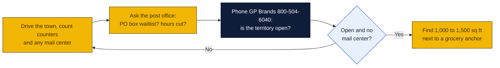

# Vermont: Goin' Postal site candidates

Research date: October 18, 2026. There is no Goin' Postal in Vermont today (the franchisor's own Vermont page says it has no locations in the state yet), and Vermont has no state franchise registration.

## The verdict

Bennington, Barre and Brattleboro lead. All three are regional centers of 8,000 to 15,000 people, each with a hospital and a wide rural trade area, and none has a branded UPS Store, PostNet or Pak Mail. The UPS Store has only five Vermont locations, all in the Burlington area, Rutland, St. Albans and Stowe, so the whole southern half of the state and the Barre-Montpelier capital region are served only by Staples counters and hardware stores. Bennington ranks first because the hospital is the county's largest employer at about 1,300 workers and the college adds mailbox demand.

```mermaid
flowchart TB
  subgraph GO["Go first"]
    direction TB
    A1["1 · Bennington, Bennington County<br/>15,333, hospital and college hub<br/>nearest UPS Store 13 mi in Massachusetts"]
    A2["2 · Barre, Washington County<br/>8,491 city plus Montpelier 8,074<br/>nearest UPS Store 20 mi"]
    A3["3 · Brattleboro, Windham County<br/>12,184 to 12,106, gateway town<br/>nearest UPS Store 14 mi in New Hampshire"]
  end
  subgraph WATCH["Worth a drive"]
    direction TB
    B1["4 · St. Johnsbury, Caledonia County<br/>7,364, Northeast Kingdom hub<br/>nearest UPS Store 34 mi, independent present"]
    B2["5 · Middlebury, Addison County<br/>9,152, Middlebury College<br/>nearest UPS Store 29 mi"]
    B3["6 · Springfield, Windsor County<br/>9,062, mill town and hospital<br/>nearest UPS Store 24 mi"]
    B4["7 · Manchester, Bennington County<br/>4,484, resort and outlets<br/>nearest UPS Store 30 mi, independent present"]
    B5["8 · Derby and Newport, Orleans County<br/>Newport earlier pick<br/>nearest UPS Store 33 mi in Quebec"]
  end
  subgraph NO["Checked and dropped"]
    direction TB
    C1["Waterbury: UPS Store 8 mi away in Stowe<br/>and independent Pack and Send Plus"]
    C2["Morrisville: UPS Store 7 mi away in Stowe"]
  end
  classDef store fill:#f2b705,stroke:#3b2c00,color:#3b2c00
  classDef cloud fill:#0f1d3a,stroke:#0f1d3a,color:#ffffff
  classDef you fill:#e8f1fb,stroke:#1d4ed8,color:#17202d
  class A1,A2,A3 store
  class B1,B2,B3,B4,B5 you
  class C1,C2 cloud
```

## Candidates

| Rank | Town (County) | Pop 2020 to latest | Demand driver | Shipping options in town | Nearest branded competitor | Post office | Gap 1-5 | Confidence |
|---|---|---|---|---|---|---|---|---|
| 1 | Bennington (Bennington) | 15,333 (2020 Census); no later estimate found | County seat, Southwestern Vermont Medical Center with about 1,300 workers, Bennington College, Battle Monument tourism | Staples Ship Center (UPS Alliance Shipping Partner) at 5 Kocher Dr; UPS Access Points at CVS 8 Kocher Dr and Staples 95 Bennington Sq. No independent mail center found | The UPS Store, 228 Main St, Williamstown, Massachusetts, 13.3 mi per UPS locator | Nothing found | 4 | H |
| 2 | Barre (Washington) | 8,491 city (2020 Census); Montpelier 8,074 (2020 Census) 7 miles west with daytime population of about 21,000 | Granite industry, state government and insurers in Montpelier, Central Vermont Medical Center, Norwich University in nearby Northfield | UPS Authorized Shipping Provider at Nelson's Ace Hardware, 188 N Main St, open seven days; Staples Ship Center at 168 Ames Dr. No independent mail center found in Barre; the UPS locator for Montpelier could not be read | The UPS Store, 998 S Main St, Stowe, 20.0 mi per UPS locator | Nothing found | 4 | H |
| 3 | Brattleboro (Windham) | 12,184 (2020 Census) to 12,106 (2022 Census estimate per Wikipedia) | Health care, Brattleboro Memorial Hospital and the Brattleboro Retreat, manufacturing, Interstate 91 gateway and tourism | Staples Ship Center (UPS Alliance Shipping Partner) at 768 Putney Rd; UPS Access Points at Staples and Michaels. No independent mail center found | The UPS Store, 417 West St, Keene, New Hampshire, 14.1 mi per UPS locator | Nothing found | 4 | H |
| 4 | St. Johnsbury (Caledonia) | 7,364 (2020 Census); no later estimate found | County seat and commercial hub of the Northeast Kingdom, Northeastern Vermont Regional Hospital, St. Johnsbury Academy, maple products firms | 802 Notarize, 75 Eastern Ave, an independent notary and shipping shop that is a UPS Authorized Shipping Outlet with Saturday morning hours; mailbox rental not confirmed. Lyndonville Hardware counter 7.7 mi | The UPS Store, 998 S Main St, Stowe, 33.5 mi per UPS locator | Nothing found | 3 | M |
| 5 | Middlebury (Addison) | 9,152 (2020 Census); no later estimate found | Middlebury College and its summer language schools, Addison County shire town, regional commercial hub | UPS Authorized Shipping Provider at Aubuchon Hardware, 859 Route 7 S, open seven days; Main Street Stationer outlet in Bristol 9.9 mi. No mail center found in Middlebury | The UPS Store, 188 Shopping Plaza Rd, Rutland, 28.5 mi per UPS locator | Nothing found | 4 | H |
| 6 | Springfield (Windsor) | 9,062 (2020 Census); no later estimate found | Former machine tool center, Springfield Hospital, Interstate 91 exit serving Chester, Ludlow and Okemo ski traffic | UPS Authorized Shipping Provider at Bibens Home Center, 362 River St, open seven days; One Stop Postal Shop in Claremont, New Hampshire, 9.6 mi, is an independent | The UPS Store, 10 Benning St, West Lebanon, New Hampshire, 23.6 mi per UPS locator | Nothing found | 4 | H |
| 7 | Manchester (Bennington) | 4,484 (2020 Census); no later estimate found | Resort town with outlet shopping, Hildene, second homes, Stratton and Bromley ski areas | I Ship Express, 5018 Main St, an independent that is a UPS Authorized Shipping Outlet with Saturday hours; mailbox rental not confirmed | The UPS Store, 188 Shopping Plaza Rd, Rutland, 29.7 mi per UPS locator | Nothing found | 3 | M |
| 8 | Derby and Newport (Orleans) | Newport was an earlier pick; Derby population not pulled | Lake Memphremagog, North Country Hospital, border crossing, Jay Peak traffic | UPS Authorized Shipping Provider at The Farmyard Store, 3262 US Route 5, Derby, Monday to Saturday. No mail center found | The UPS Store 437, Sherbrooke, Quebec, 32.7 mi per UPS locator, across the border; nearest in Vermont is St. Albans or Stowe, each about 50 mi (inferred) | Nothing found | 4 | M |

Gap 5 = big growing town, no store; 4 = no store, smaller or slower; 3 = independent mail center present; 2 = UPS Store within 10 mi; 1 = saturated. Confidence H = UPS locator checked and nearest store named with miles; M = locator checked but an independent exists or data thin; L = not fully checked.

## Why these towns

Bennington is the largest town in Vermont without a branded pack-and-ship store. Southwestern Vermont Medical Center is the county's largest employer, Bennington College and the Community College of Vermont bring students who want mailboxes, and the nearest UPS Store is across the Massachusetts line in Williamstown. The only full-service counter is a Staples on Kocher Drive. A 1,000 to 1,500 square foot space on Northside Drive or Kocher Drive near the Hannaford, Price Chopper and Walmart anchors would sit in the town's retail core. The risk is that Williamstown is a short drive for the southern part of the county and that the town is not growing.

Barre and Montpelier form a two-town market of about 16,500 residents and 21,000 daytime workers in the capital, and neither has a UPS Store, PostNet or Pak Mail. The UPS counters are an Ace Hardware on North Main Street and a Staples on Ames Drive. State workers, insurers, Norwich University families and granite shippers all need parcel service. The Berlin Mall corridor on Route 62 between the two towns, near the Shaw's and Walmart anchors, is the logical site. The risk is that the Stowe UPS Store is 20 miles away and that the Montpelier locator page could not be read, so an independent there would have been missed.

Brattleboro is the southeastern gateway to Vermont, with two hospitals, manufacturing, a Putney Road retail strip and tourist traffic from Interstate 91. The only full-service UPS counter is the Staples on Putney Road. The Keene, New Hampshire UPS Store is 14 miles away but across the river and the state line, which matters for Vermonters avoiding New Hampshire's lack of sales tax only on retail goods. Putney Road near Hannaford and Price Chopper is the spot. The risk is a slowly shrinking population and the Keene store's pull on the Route 9 corridor.

## Checked and dropped

- Waterbury: no store in town, but The UPS Store at 998 S Main St, Stowe is 8.3 miles away and Pack and Send Plus at 38 N Main St is an independent, so the gap is too thin.
- Morrisville: no store in town, but The UPS Store at 998 S Main St, Stowe is 7.2 miles away.
- Stowe and St. Albans were dropped in the earlier pass; both appear on The UPS Store's Vermont list along with Essex, Rutland and South Burlington.

## State notes

- Vermont has no state franchise registration or filing requirement. Standard federal Franchise Disclosure Document rules apply.
- Vermont's population fell by about 1,900 people, or 0.29 percent, from July 2024 to July 2025: deaths exceeded births by about 1,800, domestic migration lost about 726 and international migration added about 623. No town on this list is growing, so each pick depends on the service gap rather than on new residents.
- Vermont charges a 6 percent sales tax on goods and some services; whether mailbox rental is taxable was not checked. New Hampshire has no sales tax, which pulls retail shoppers east from Brattleboro and Springfield but does not affect mailbox or shipping demand much.
- Anchors: Bennington College, Middlebury College, Norwich University near Barre, state government in Montpelier, hospitals in every top-three town. No military base of size. Ski and lake tourism at Manchester, Stowe, Okemo and Lake Memphremagog.
- The UPS Store lists only five Vermont stores, so Vermont has the thinnest branded coverage of any state in this set. Several independents exist, including 802 Notarize in St. Johnsbury, I Ship Express in Manchester Center, Pack and Send Plus in Waterbury, Main Street Stationer in Bristol and Copies and More in Wells River.
- Nearest existing Goin' Postal stores: Auburn, Maine at 9 N River Rd, about 140 miles from St. Johnsbury; Easton, Pennsylvania; Norwood, New Jersey. None in Vermont, New Hampshire, Massachusetts, New York or Connecticut.

## How to verify a pick

## Not verified

- The Montpelier, Woodstock and White River Junction pages on the UPS locator could not be read, so any independent in Montpelier was not seen.
- Whether 802 Notarize, I Ship Express or Pack and Send Plus rent private mailboxes. The shared web search budget ran out before their websites could be checked.
- Post-2020 population estimates for every town except Brattleboro.
- Derby and Newport populations and the Newport village counters; the earlier pass covered Newport.
- PostNet and Pak Mail presence. PostNet's locator shows no Vermont centers.
- Post office hours and PO box waitlists in every town.
- Commercial rent in every town.

## Sources

- [Goin' Postal, Vermont store page](https://www.goinpostal.com/stores/VT)
- [Goin' Postal, Maine stores](https://www.goinpostal.com/stores/ME)
- [The UPS Store, Vermont locations list](https://locations.theupsstore.com/vt)
- [UPS locator, Bennington VT, Staples Ship Center](https://locations.ups.com/us/en/vt/bennington/alliance-shipping-partner-007099.html)
- [UPS locator, Brattleboro VT, Staples Ship Center](https://locations.ups.com/us/en/vt/brattleboro/alliance-shipping-partner-064278.html)
- [UPS locator, Barre VT, Nelson's Ace Hardware](https://locations.ups.com/us/en/vt/barre/authorized-shipping-provider-127081.html)
- [UPS locator, Saint Johnsbury VT, 802 Notarize](https://locations.ups.com/us/en/vt/saintjohnsbury/authorized-shipping-outlet-262251.html)
- [UPS locator, Springfield VT, Bibens Home Center](https://locations.ups.com/us/en/vt/springfield/authorized-shipping-provider-144313.html)
- [UPS locator, Manchester Center VT, I Ship Express](https://locations.ups.com/us/en/vt/manchestercenter/authorized-shipping-outlet-295653.html)
- [UPS locator, Waterbury VT, Pack and Send Plus](https://locations.ups.com/us/en/vt/waterbury/authorized-shipping-outlet-249062.html)
- [UPS locator, Morrisville VT, CVS Access Point](https://locations.ups.com/us/en/vt/morrisville/access-point-location-170498.html)
- [UPS locator, Middlebury VT, Aubuchon Hardware](https://locations.ups.com/us/en/vt/middlebury/authorized-shipping-provider-250568.html)
- [UPS locator, Derby VT, The Farmyard Store](https://locations.ups.com/us/en/vt/derby/authorized-shipping-provider-120232.html)
- [UPS locator, Lyndonville VT](https://locations.ups.com/us/en/vt/lyndonville/)
- [UPS locator, Randolph VT](https://locations.ups.com/us/en/vt/randolph/)
- [Wikipedia, Bennington, Vermont](https://en.wikipedia.org/wiki/Bennington,_Vermont)
- [Wikipedia, Brattleboro, Vermont](https://en.wikipedia.org/wiki/Brattleboro,_Vermont)
- [Wikipedia, Barre (city), Vermont](https://en.wikipedia.org/wiki/Barre_(city),_Vermont)
- [Wikipedia, Montpelier, Vermont](https://en.wikipedia.org/wiki/Montpelier,_Vermont)
- [Wikipedia, St. Johnsbury, Vermont](https://en.wikipedia.org/wiki/St._Johnsbury,_Vermont)
- [Wikipedia, Middlebury, Vermont](https://en.wikipedia.org/wiki/Middlebury,_Vermont)
- [Wikipedia, Springfield, Vermont](https://en.wikipedia.org/wiki/Springfield,_Vermont)
- [Wikipedia, Manchester, Vermont](https://en.wikipedia.org/wiki/Manchester,_Vermont)
- [Wikipedia, Waterbury, Vermont](https://en.wikipedia.org/wiki/Waterbury,_Vermont)
- [Wikipedia, Morristown, Vermont](https://en.wikipedia.org/wiki/Morristown,_Vermont)
- [USAFacts, Vermont population change](https://usafacts.org/answers/is-the-population-growing-or-shrinking/state/vermont/)
- [PostNet locator](https://locations.postnet.com/)
