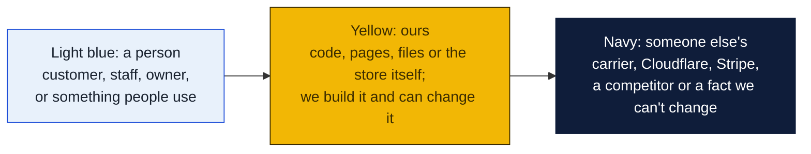
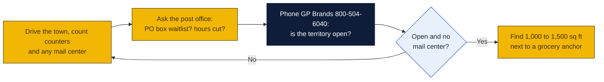

# Virginia: Goin' Postal site candidates

Research date: October 18, 2026. There is no Goin' Postal in Virginia today; Virginia is a franchise registration state, so the franchisor must have its disclosure document registered with the State Corporation Commission before offering a franchise here.

## The verdict

Virginia's 152 UPS Stores cluster in Northern Virginia, Richmond, Hampton Roads and the I-81 college towns, leaving Southside and the Southwest coalfields with only independents and hardware counters. South Boston is the first pick: the Halifax County hub of 8,000 with only a hardware counter and the nearest branded store about 30 miles away in Danville. Bedford is second, a county seat on the Lynchburg to Smith Mountain Lake corridor with nothing but two CVS drop-offs. Martinsville is the largest town in the state with no branded store, but Wrap Pack and Mail already serves it, so it is third pending an in-person check.

### How to read the charts

Every chart in this repo uses the same three colors, so once you know them you can read any of them.

| Mark | Meaning |
|---|---|
| Solid arrow `-->` | Data or a person moves this way, or this happens next |
| Dotted arrow `-.->` | Only sometimes: when keys are set, when a condition holds, or a later plan |
| Words on an arrow | What is sent or the condition, for example "when keys set" |
| Cylinder | A database or stored records (KV, D1, a table) |
| Rounded box with `/path` | A page on the website; `/counter/...` pages are staff only |
| Box with a thick or dashed border, or a big frame around boxes | A group: everything inside runs in the same place |
| ✅ 🔨 ⏳ ⏸ in a box | Done, being built, not started, waiting on someone |

Other chart kinds you will meet: a **state diagram** shows the statuses one thing passes through, read along the arrows. A **sequence diagram** reads top to bottom, each vertical line is one party and each arrow is one message. A **gantt** is a calendar of who does what when. A **mindmap** is a topic in the middle with its parts around it. A **pie** or **bar chart** is just numbers. GitHub draws all of these on its own; if a chart shows as plain text, you are viewing the file somewhere that does not render Mermaid, and the raw text still reads top to bottom.

```mermaid
flowchart TB
  subgraph GO["Go first"]
    direction TB
    A1["1 · South Boston, Halifax County<br/>7,966 pop, county hub and plants<br/>nearest UPS Store about 30 mi"]
    A2["2 · Bedford, Bedford County<br/>6,657 pop, county seat and lake corridor<br/>nearest UPS Store about 25 mi"]
  end
  subgraph WATCH["Worth a drive"]
    direction TB
    B1["3 · Martinsville, independent city<br/>13,800 pop, regional hub<br/>nearest UPS Store about 30 mi"]
    B2["4 · Wytheville, Wythe County<br/>8,265 pop, I-81 and I-77 crossroads<br/>nearest UPS Store about 30 mi"]
    B3["5 · Farmville, Prince Edward County<br/>7,846 pop, two colleges<br/>nearest UPS Store about 55 mi"]
    B4["6 · Norton, independent city<br/>3,687 pop, coalfield hub<br/>nearest UPS Store about 40 mi"]
  end
  subgraph NO["Checked and dropped"]
    direction TB
    C1["Radford: UPS Store 10 mi away at 125 N Main St, Blacksburg"]
    C2["Smithfield: UPS Store 10 mi away at 3575 Bridge Rd, Suffolk"]
  end
  classDef store fill:#f2b705,stroke:#3b2c00,color:#3b2c00
  classDef cloud fill:#0f1d3a,stroke:#0f1d3a,color:#ffffff
  classDef you fill:#e8f1fb,stroke:#1d4ed8,color:#17202d
  class A1,A2 store
  class B1,B2,B3,B4 you
  class C1,C2 cloud
```

## Candidates

| Rank | Town (County) | Pop 2020 to latest | Demand driver | Shipping options in town | Nearest branded competitor | Post office | Gap 1-5 | Confidence |
|---|---|---|---|---|---|---|---|---|
| 1 | South Boston (Halifax) | 7,966 in 2020; no later estimate retrieved | Halifax County hub, Sentara Halifax hospital, Microporous and other plant payroll, Southern Virginia Higher Education Center, Kerr Lake second homes | Finchers Inc hardware counter, 520 N Main St, a UPS Authorized Shipping Provider; CVS Access Point on Halifax Rd; no mailbox shop found | The UPS Store, 3308 Riverside Dr, Danville, about 30 mi, inferred from map | nothing found | 4 | H |
| 2 | Bedford (Bedford) | 6,657 in 2020; no later estimate retrieved | County seat, National D-Day Memorial, Smith Mountain Lake retirees and second homes to the south, Lynchburg exurb growth | Two CVS Access Points only, 1515 Longwood Ave and 1217 E Main St; no counter or mailbox shop found | The UPS Store, 21430 Timberlake Rd, Lynchburg, about 25 mi, inferred from map; Hardy store to the southwest was dropped in the prior pass and is about 20 mi | nothing found | 4 | H |
| 3 | Martinsville (independent city, Henry County) | 13,849 per Wikipedia city table; year not labeled | Regional hub for Henry and Patrick counties, Sovah hospital, speedway, New College Institute, Hooker Furniture and e-commerce furniture returns | Wrap Pack and Mail, 806 Memorial Blvd N, a UPS Authorized Shipping Outlet; two CVS Access Points | The UPS Store, 3308 Riverside Dr, Danville, about 30 mi, inferred from map | nothing found | 3 | M |
| 4 | Wytheville (Wythe) | 8,265 in 2020; no later estimate retrieved | I-81 and I-77 interchange, truck stops and hotels, Wytheville Community College, county seat | The Mail Box Store Wytheville, 800 E Main St, a UPS Authorized Shipping Outlet; CVS Access Point | The UPS Store, 974 E Stuart Ave, Galax, about 30 mi, inferred from map | nothing found | 3 | M |
| 5 | Farmville (Prince Edward) | 7,846 in 2020; no later estimate retrieved | Longwood University and Hampden-Sydney College, county seat, Centra Southside hospital, Green Front furniture shipping | Midtown Mailboxes, 308 S Main St, a UPS Authorized Shipping Outlet; CVS Access Point | The UPS Store, 21430 Timberlake Rd, Lynchburg, about 55 mi, inferred from map; Richmond area stores about 65 mi | nothing found | 3 | M |
| 6 | Norton (independent city, Wise County) | 3,687 in 2020; no later estimate retrieved | Retail hub for Wise County and the coalfields, Norton Community Hospital, UVA Wise nearby | Southwest Tool Rental counter, 1675 Park Ave SW, a UPS Authorized Shipping Provider; CVS Access Point; no mailbox shop found | The UPS Store, 448 Cummings St, Abingdon, about 40 mi, inferred from map | nothing found | 4 | H |
| 7 | Kilmarnock (Lancaster) | 1,445 in 2020; no later estimate retrieved | Northern Neck retiree and boating hub, draws Lancaster and Northumberland counties of about 23,000 combined | Jeff's Packaging Solutions, 465 N Main St, a UPS Authorized Shipping Outlet; CVS and Ace Hardware Access Points | The UPS Store in Gloucester, about 35 mi, inferred from map | nothing found | 3 | M |
| 8 | Marion (Smyth) | 5,751 in 2020; no later estimate retrieved | County seat, Smyth County hospital, Hungry Mother State Park, Mount Rogers tourism | A and B Printing, 425 S Main St, a UPS Authorized Shipping Outlet; CVS Access Point | The UPS Store, 448 Cummings St, Abingdon, about 25 mi, inferred from map | nothing found | 3 | M |

Gap 5 = big growing town, no store; 4 = no store, smaller or slower; 3 = independent mail center present; 2 = UPS Store within 10 mi; 1 = saturated. Confidence H = UPS locator checked and nearest store named with miles; M = locator checked but an independent exists or data thin; L = not fully checked.

## Why these towns

South Boston is the shopping and hospital town for all of Halifax County, about 34,000 people, and the locator shows nothing but a hardware counter and a CVS drop-off. Shippers are the plant workforce, hospital staff, Kerr Lake second-home owners and the tobacco-country online sellers. A 1,200 sq ft bay on Route 501 near the Food Lion or Walmart would catch the whole county's traffic. The risk is slow population growth in Southside and the chance that Finchers hardware already handles most drop-off demand cheaply.

Bedford is the county seat for a county of about 80,000 that is filling with Lynchburg commuters and Smith Mountain Lake retirees, yet the town has only two CVS drop-offs. Mailbox rental sells well to lake residents who need a street address, and the D-Day Memorial brings tourist traffic. A space in the Bedford Plaza or near the Kroger on Independence Boulevard would serve the town and the Route 460 corridor. The risk is that the Hardy UPS Store, about 20 miles southwest, already pulls the lake's western shore.

Martinsville is the largest Virginia city without a branded UPS Store and sits 30 miles from Danville and 45 from Roanoke. Furniture makers, the speedway and the hospital generate business shipping, and a working-class population rents mailboxes. Wrap Pack and Mail on Memorial Boulevard is the incumbent and must be inspected first. A storefront near the Kroger or Walmart on Commonwealth Boulevard would be the second shop in town, and the value is the lower price point the flat royalty allows. The risk is a shrinking city population and the incumbent.

## Checked and dropped

- Radford: no store in the city, but The UPS Store at 125 N Main St, #500, Blacksburg, VA 24060 is about 10 miles away and NRV Shipping at 1804 E Main St is an independent outlet.
- Smithfield: no store in town, but The UPS Store at 3575 Bridge Rd, Ste 8, Suffolk, VA 23435 is about 10 miles away and Office Express Plus at 912 S Church St is an independent outlet.
- Christiansburg: the Blacksburg store is about 5 miles away.
- Hardy was dropped in the prior pass; the locator confirms a store there.
- Galax, Abingdon, Lexington, Emporia, Culpeper, Front Royal, Gloucester and Onley each have a branded store and were not considered.

## State notes

- Virginia is a franchise registration state under the Virginia Retail Franchising Act; the State Corporation Commission's Division of Securities and Retail Franchising must have the franchisor's registration effective before a sale. Ask GP Brands whether its Virginia registration is current.
- The UPS Store lists 152 Virginia stores. The gaps are Southside between Danville and Emporia, the Southwest coalfields west of Abingdon, the Northern Neck, and the Farmville area in the middle of the state.
- Pak Mail has five listed Virginia stores, all in Hampton Roads, Richmond's west end and Prince William County. PostNet has eight, all in Northern Virginia, Richmond and Virginia Beach. None is near any candidate.
- Virginia sales tax is 5.3 percent statewide plus regional additions of up to 1.7 percent; confirm treatment of packaging and mailbox fees with the Department of Taxation.
- Anchors: Longwood and Hampden-Sydney in Farmville, Virginia Tech and Radford University in the New River Valley, UVA Wise near Norton, Emory and Henry near Marion, Liberty University in Lynchburg, Smith Mountain Lake, Kerr Lake, and the Northern Neck retiree belt.
- Nearest Goin' Postal stores are in Martinsburg and Inwood, West Virginia, about 20 miles from Winchester, and in Mount Airy and King, North Carolina, about 35 miles from Martinsville and Galax, plus Teays Valley, West Virginia west of Charleston.

## How to verify a pick

## Not verified

- Road mileages are inferred from the map, not measured on the locator.
- Whether Wrap Pack and Mail, The Mail Box Store Wytheville, Midtown Mailboxes, Jeff's Packaging Solutions or A and B Printing rent private mailboxes; the names of three of them suggest they do.
- Martinsville's population: the Wikipedia city table did not label the column year, and the 2020 census figure may be lower. Radford's figure in the same table was 17,243.
- Post-2020 estimates for every town; only census or unlabeled table figures were retrieved.
- Post office hours, PO box waitlists and relocations: the shared web search budget ran out before these checks, so every post office cell says nothing found.
- Commercial rent per square foot: not checked.
- South Hill, Tappahannock, Luray, Covington and Franklin were not checked on the locator.

## Sources

- [The UPS Store locations in Virginia](https://locations.theupsstore.com/va)
- [The UPS Store, Danville](https://locations.theupsstore.com/va/danville)
- [The UPS Store, Lynchburg](https://locations.theupsstore.com/va/lynchburg)
- [The UPS Store, Galax](https://locations.theupsstore.com/va/galax)
- [The UPS Store, Abingdon](https://locations.theupsstore.com/va/abingdon)
- [The UPS Store, Blacksburg](https://locations.theupsstore.com/va/blacksburg)
- [The UPS Store, Suffolk](https://locations.theupsstore.com/va/suffolk)
- [UPS locations in South Boston, VA](https://locations.ups.com/va/southboston/)
- [UPS locations in Bedford, VA](https://locations.ups.com/va/bedford/)
- [UPS locations in Martinsville, VA](https://locations.ups.com/va/martinsville/)
- [UPS locations in Wytheville, VA](https://locations.ups.com/va/wytheville/)
- [UPS locations in Farmville, VA](https://locations.ups.com/va/farmville/)
- [UPS locations in Norton, VA](https://locations.ups.com/va/norton/)
- [UPS locations in Kilmarnock, VA](https://locations.ups.com/va/kilmarnock/)
- [UPS locations in Marion, VA](https://locations.ups.com/va/marion/)
- [UPS locations in Radford, VA](https://locations.ups.com/va/radford/)
- [UPS locations in Smithfield, VA](https://locations.ups.com/va/smithfield/)
- [Wikipedia: List of towns in Virginia, 2020 census](https://en.wikipedia.org/wiki/List_of_towns_in_Virginia)
- [Wikipedia: List of cities in Virginia](https://en.wikipedia.org/wiki/List_of_cities_in_Virginia)
- [Pak Mail stores in Virginia](https://www.pakmail.com/shipping-stores/virginia)
- [PostNet locations in Virginia](https://locations.postnet.com/va)
- [Goin' Postal stores in West Virginia](https://www.goinpostal.com/stores/WV)
- [Goin' Postal stores in North Carolina](https://www.goinpostal.com/stores/NC)
