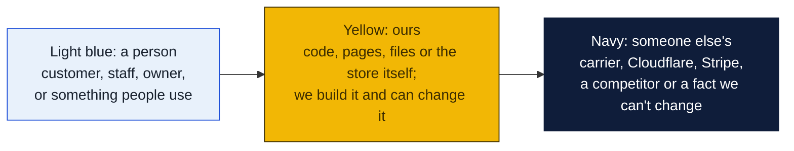
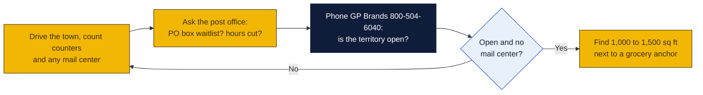

# Wyoming: Goin' Postal site candidates

Research date: October 18, 2026. There is no Goin' Postal in Wyoming today, and Wyoming has no state franchise registration.

## The verdict

Riverton is the largest Wyoming town without a branded UPS Store, with 10,700 people, Central Wyoming College, a regional hospital and the Wind River Reservation trade, and the nearest store 120 miles away in Casper. Evanston on I-80 is nearly as large and sits 100 miles from the Rock Springs store. Lander, 25 miles from Riverton, has NOLS headquarters and a growing outdoor economy and could be a second territory once Riverton is open. The UPS Store covers only nine Wyoming locations and no other pack-and-ship franchise lists a single Wyoming store.

### How to read the charts

Every chart in this repo uses the same three colors, so once you know them you can read any of them.

| Mark | Meaning |
|---|---|
| Solid arrow `-->` | Data or a person moves this way, or this happens next |
| Dotted arrow `-.->` | Only sometimes: when keys are set, when a condition holds, or a later plan |
| Words on an arrow | What is sent or the condition, for example "when keys set" |
| Cylinder | A database or stored records (KV, D1, a table) |
| Rounded box with `/path` | A page on the website; `/counter/...` pages are staff only |
| Box with a thick or dashed border, or a big frame around boxes | A group: everything inside runs in the same place |
| ✅ 🔨 ⏳ ⏸ in a box | Done, being built, not started, waiting on someone |

Other chart kinds you will meet: a **state diagram** shows the statuses one thing passes through, read along the arrows. A **sequence diagram** reads top to bottom, each vertical line is one party and each arrow is one message. A **gantt** is a calendar of who does what when. A **mindmap** is a topic in the middle with its parts around it. A **pie** or **bar chart** is just numbers. GitHub draws all of these on its own; if a chart shows as plain text, you are viewing the file somewhere that does not render Mermaid, and the raw text still reads top to bottom.

```mermaid
flowchart TB
  subgraph GO["Go first"]
    direction TB
    A1["1 · Riverton, Fremont County<br/>10,682, Central Wyoming College and hospital<br/>nearest UPS Store about 120 mi, Casper"]
    A2["2 · Evanston, Uinta County<br/>11,747 to 11,807, I-80 and Utah commuters<br/>nearest UPS Store about 100 mi, Rock Springs"]
    A3["3 · Lander, Fremont County<br/>7,546 to 7,615, NOLS and outdoor economy<br/>nearest UPS Store about 150 mi, Casper"]
  end
  subgraph WATCH["Worth a drive"]
    direction TB
    B1["4 · Powell, Park County<br/>6,419 to 6,488, Northwest College<br/>nearest UPS Store about 24 mi, Cody"]
    B2["5 · Douglas, Converse County<br/>6,386 to 6,449, energy and state fair<br/>nearest UPS Store about 50 mi, Casper"]
    B3["6 · Rawlins, Carbon County<br/>8,221 to 7,968, state prison and I-80<br/>nearest UPS Store about 108 mi, Rock Springs"]
    B4["7 · Buffalo, Johnson County<br/>4,415 to 4,621, retirees and I-25 I-90 junction<br/>nearest UPS Store about 35 mi, Sheridan"]
    B5["8 · Torrington, Goshen County<br/>6,119 to 6,212, Eastern Wyoming College<br/>nearest UPS Store about 85 mi, Cheyenne"]
  end
  subgraph NO["Checked and dropped"]
    direction TB
    C1["Cody: UPS Store at 1108 14th St"]
    C2["Sheridan: UPS Store at 51 Coffeen Ave"]
    C3["Rock Springs: UPS Store at 1993 Dewar Dr"]
    C4["Jackson: UPS Store at 970 W Broadway"]
    C5["Laramie: UPS Store at 514 Grand Ave"]
  end
  classDef store fill:#f2b705,stroke:#3b2c00,color:#3b2c00
  classDef cloud fill:#0f1d3a,stroke:#0f1d3a,color:#ffffff
  classDef you fill:#e8f1fb,stroke:#1d4ed8,color:#17202d
  class A1,A2,A3 store
  class B1,B2,B3,B4,B5 you
  class C1,C2,C3,C4,C5 cloud
```

## Candidates

| Rank | Town (County) | Pop 2020 to latest | Demand driver | Shipping options in town | Nearest branded competitor | Post office | Gap 1-5 | Confidence |
|---|---|---|---|---|---|---|---|---|
| 1 | Riverton (Fremont County) | 10,682 (2020); no later estimate on page | Central Wyoming College main campus, SageWest hospital, trade center for the Wind River Reservation and Fremont County | No UPS Store (locator page returns not found); no PostNet, Pak Mail or PostalAnnex in Wyoming; independent mail centers not checked | The UPS Store, Casper, 301 Thelma Dr, about 120 road miles (inferred) | Nothing found | 5 | M |
| 2 | Evanston (Uinta County) | 11,747 (2020) to 11,807 (2023) | I-80 truck stop town, Utah commuters, state hospital, oil and gas | No UPS Store (locator page returns not found); independents not checked | The UPS Store, Rock Springs, 1993 Dewar Dr, about 100 road miles; Utah stores in the Park City area are about 75 miles and were not checked | Nothing found | 4 | M |
| 3 | Lander (Fremont County) | 7,546 (2020) to 7,615 (2023) | National Outdoor Leadership School headquarters, outdoor retailers and online sellers, county seat, retirees | No UPS Store (locator page returns not found); independents not checked | The UPS Store, Casper, about 150 road miles (inferred) | Nothing found | 4 | M |
| 4 | Powell (Park County) | 6,419 (2020) to 6,488 (2023) | Northwest College residential campus, farm town, Yellowstone gateway traffic | No UPS Store or franchise shop found | The UPS Store, Cody, 1108 14th St, about 24 road miles (inferred) | Nothing found | 4 | M |
| 5 | Douglas (Converse County) | 6,386 (2020) to 6,449 (2023) | Oil, gas and uranium payroll, Wyoming State Fair, I-25 | No UPS Store or franchise shop found | The UPS Store, Casper, about 50 road miles (inferred) | Nothing found | 4 | M |
| 6 | Rawlins (Carbon County) | 8,221 (2020) to 7,968 (2025) | Wyoming State Penitentiary, I-80, wind farm construction | No UPS Store (locator page returns not found); independents not checked | The UPS Store, Rock Springs, about 108 road miles (inferred) | Nothing found | 4 | M |
| 7 | Buffalo (Johnson County) | 4,415 (2020) to 4,621 (2023) | Retiree inflow, Bighorn Mountains tourism, I-25 and I-90 junction, hospital | No UPS Store or franchise shop found | The UPS Store, Sheridan, 51 Coffeen Ave, about 35 road miles (inferred) | Nothing found | 4 | M |
| 8 | Torrington (Goshen County) | 6,119 (2020) to 6,212 (2023) | Eastern Wyoming College, sugar and farm trade, state prison | No UPS Store or franchise shop found | The UPS Store, Cheyenne, 1740 Dell Range Blvd, about 85 road miles; Scottsbluff, Nebraska is about 35 miles and was not checked | Nothing found | 4 | L |

## Why these towns

Riverton is the service town for all of central Wyoming: a college with students from across the state, a hospital, a Walmart and the only big-box retail for the Wind River Reservation and the Dubois and Shoshoni outskirts. Students, ranch families, oil and gas crews and tribal businesses all ship, and nobody within two hours offers a branded counter or private mailboxes. A 1,000 to 1,500 square foot bay near the Smith's grocery on North Federal Boulevard or the Walmart on North Federal would sit in the main retail corridor. The risk is a flat population and a town where incomes are modest, so pricing has to stay low.

Evanston is the first Wyoming town on I-80 from Utah, with a state hospital, oil and gas offices, trucking, and a growing share of residents who commute to the Wasatch Front. Shoppers already drive to Utah for retail, so a local shipping and mailbox counter wins on convenience. A space on Front Street or near the Smith's on Harrison Drive would serve the town. The risk is that Utah stores are an easy 75 minutes away and the town is not growing much.

Lander is a small county seat with an outsized outdoor economy: NOLS headquarters, climbing and gear businesses, and retirees and remote workers who moved for the mountains. These residents ship gear, returns and online sales every week. A space on Main Street near the Safeway would be the spot. The risk is the 25-mile overlap with Riverton; under the 5-mile rural territory rule both can be franchised, but the first store to open will draw some of the other town's traffic.

## Checked and dropped

- Cody: The UPS Store at 1108 14th St (dropped in the earlier pass).
- Sheridan: The UPS Store at 51 Coffeen Ave.
- Rock Springs: The UPS Store at 1993 Dewar Dr; Green River, 11,825 people and about 15 miles away, is therefore a gap 2 town and was not ranked.
- Jackson: The UPS Store at 970 W Broadway, plus Wilson: The UPS Store at 3465 N Pines Way.
- Laramie: The UPS Store at 514 Grand Ave.
- Gillette: The UPS Store at 900 Camel Drive.
- Casper and Cheyenne have UPS Stores and were not considered.

## State notes

- No state franchise registration or filing requirement in Wyoming.
- Wyoming sales tax is 4 percent statewide with county options of up to 2 percent more; packing supplies are taxable.
- The UPS Store locator lists nine Wyoming stores in nine cities. PostNet, Pak Mail and PostalAnnex list no Wyoming locations, so outside those nine cities the competition is independents and the post office only.
- Anchors: F. E. Warren Air Force Base in Cheyenne (covered), University of Wyoming in Laramie (covered), Central Wyoming College in Riverton, Northwest College in Powell and Eastern Wyoming College in Torrington (not covered), Yellowstone gateways Cody and Jackson (covered).
- Energy and prison payrolls are stable in Douglas, Rawlins, Torrington and Gillette; the earlier pick Pinedale, 2,005 to 2,034 people and 77 miles from the Jackson store, remains open but is small.
- Nearest existing Goin' Postal store: Cedar City, Utah, about 330 road miles from Evanston; Fargo, North Dakota, about 600 miles from Gillette.

## How to verify a pick

## Not verified

- Independent mail centers in Riverton, Evanston, Lander and Rawlins were not searched because the session's web search budget ran out; only the franchise locators were checked.
- Utah UPS Stores near Evanston and the Scottsbluff, Nebraska store near Torrington were not fetched from the locator.
- A post-2020 estimate for Riverton was not on the Wikipedia page fetched.
- Distances are read from a map and marked inferred.
- Post office conditions: nothing found in any town.
- Commercial rent: no listings pulled.

## Sources

- [The UPS Store locations in Wyoming](https://locations.theupsstore.com/wy)
- [The UPS Store locator, Riverton page (returns not found)](https://locations.theupsstore.com/wy/riverton)
- [The UPS Store locator, Evanston page (returns not found)](https://locations.theupsstore.com/wy/evanston)
- [The UPS Store locator, Lander page (returns not found)](https://locations.theupsstore.com/wy/lander)
- [The UPS Store locator, Rawlins page (returns not found)](https://locations.theupsstore.com/wy/rawlins)
- [Wikipedia: Riverton, Wyoming](https://en.wikipedia.org/wiki/Riverton,_Wyoming)
- [Wikipedia: Evanston, Wyoming](https://en.wikipedia.org/wiki/Evanston,_Wyoming)
- [Wikipedia: Lander, Wyoming](https://en.wikipedia.org/wiki/Lander,_Wyoming)
- [Wikipedia: Powell, Wyoming](https://en.wikipedia.org/wiki/Powell,_Wyoming)
- [Wikipedia: Douglas, Wyoming](https://en.wikipedia.org/wiki/Douglas,_Wyoming)
- [Wikipedia: Rawlins, Wyoming](https://en.wikipedia.org/wiki/Rawlins,_Wyoming)
- [Wikipedia: Buffalo, Wyoming](https://en.wikipedia.org/wiki/Buffalo,_Wyoming)
- [Wikipedia: Torrington, Wyoming](https://en.wikipedia.org/wiki/Torrington,_Wyoming)
- [Wikipedia: Pinedale, Wyoming](https://en.wikipedia.org/wiki/Pinedale,_Wyoming)
- [Wikipedia: Green River, Wyoming](https://en.wikipedia.org/wiki/Green_River,_Wyoming)
- [Wikipedia: Afton, Wyoming](https://en.wikipedia.org/wiki/Afton,_Wyoming)
- [PostNet locations](http://locations.postnet.com/)
- [Pak Mail locations](https://www.pakmail.com/locations)
- [PostalAnnex locations](https://www.postalannex.com/locations)
- [Goin' Postal stores in Utah](https://www.goinpostal.com/stores/UT)
- [Goin' Postal stores in North Dakota](https://www.goinpostal.com/stores/ND)
