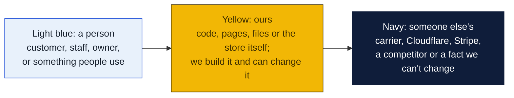
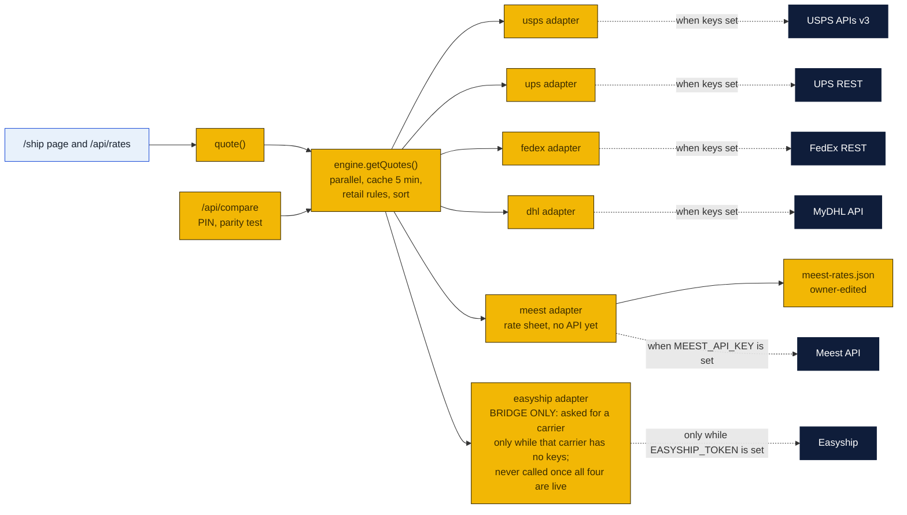
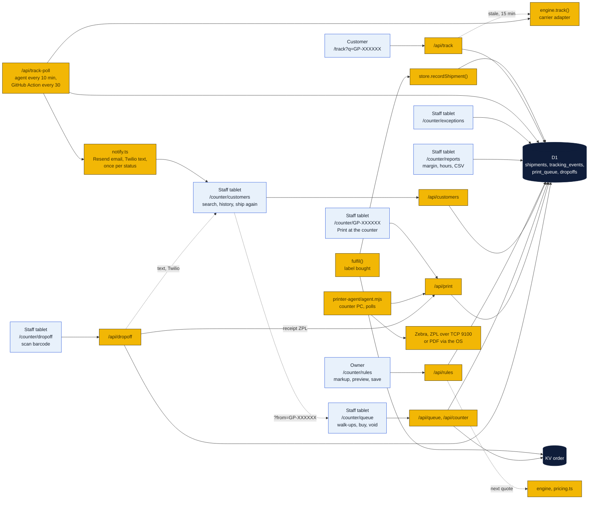
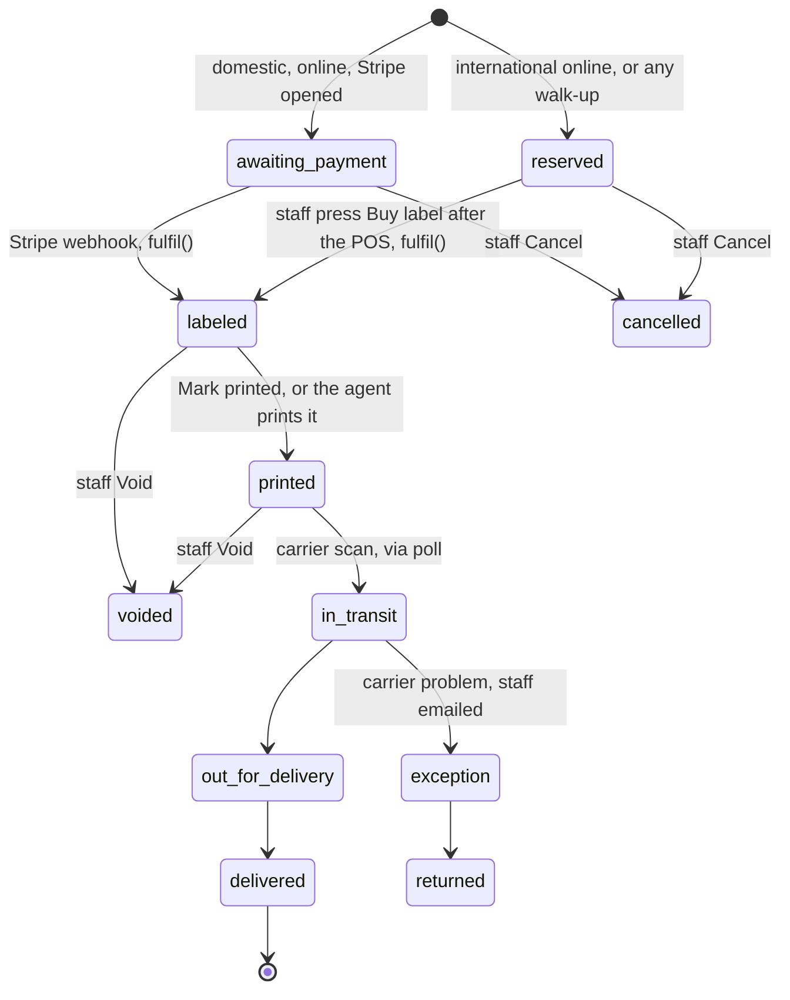
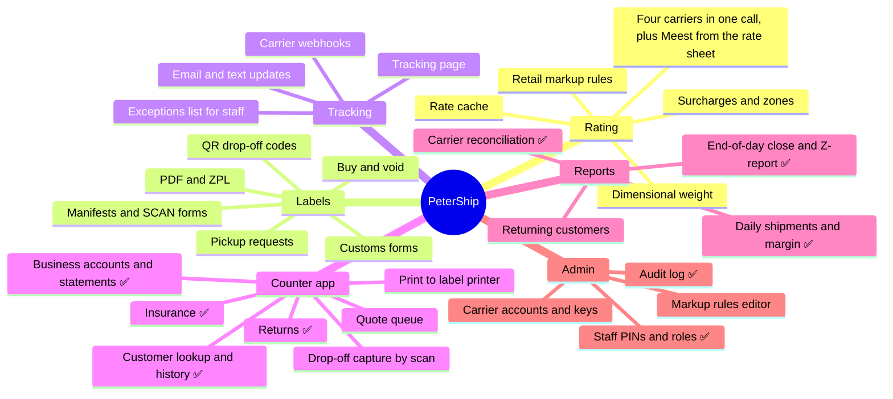
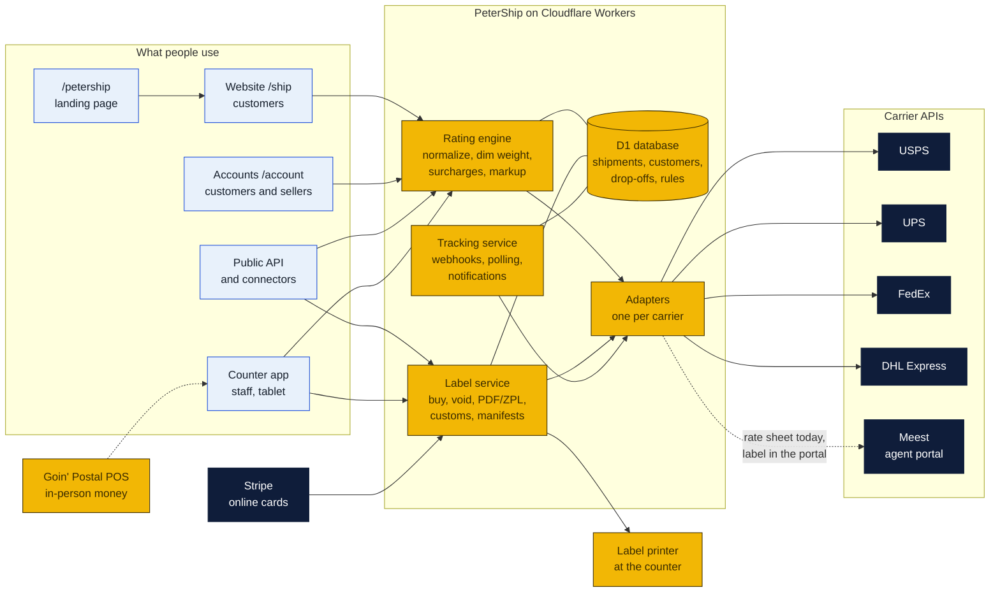
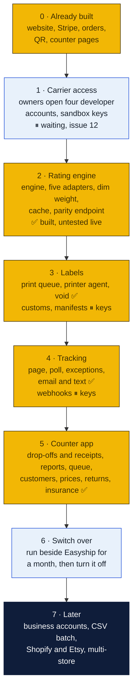
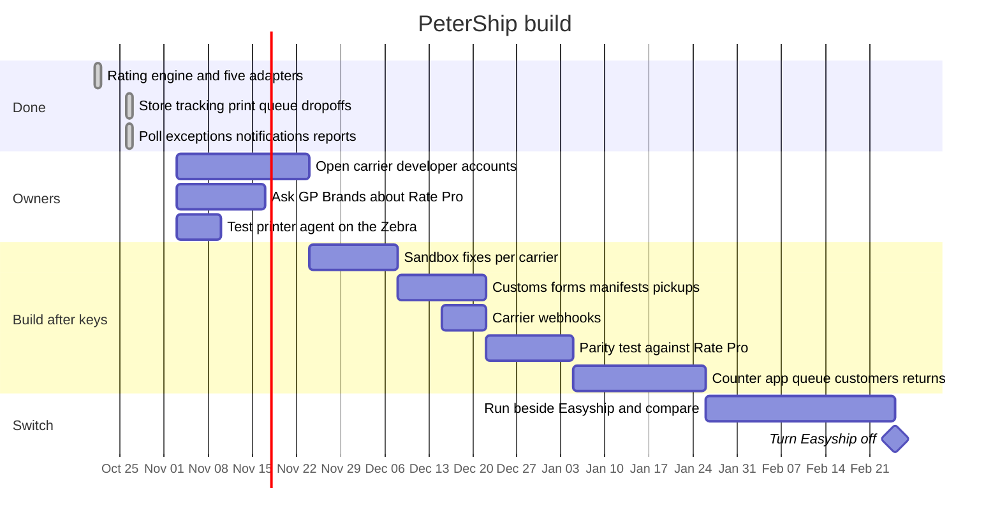

# PeterShip

PeterShip is the store's own shipping client. A plan for replacing Easyship with software the store owns: rating, labels, tracking, drop-offs and reports for USPS, UPS, FedEx, DHL and Meest, built on the same Cloudflare stack as the website. The same thing ShippingEasy, Easyship and GP Rate Pro do, but ours. PeterShip is proprietary, see [LICENSE](LICENSE); it is not under the repository's Apache license.

Item 44 in [`AGENDA.md`](../AGENDA.md) tracks it. Everything that can be built without carrier keys is built and running in mock mode: the rating engine (Phase 2), the print queue and printer agent (Phase 3), tracking, poll, exceptions and customer updates (Phase 4), and drop-off capture, reports, the quote queue, customer lookup, the price rules editor, drop-off receipts, returns, insurance and add-ons (Phase 5), then the revenue batch, batch shipping, claims, pickups, customer accounts, fulfillment, the public API and the marketplace connectors. Since v1.71.0 Meest America is a fifth carrier, quoted from an owner-edited rate sheet. The counter app that needs no carrier keys is complete. Releases v1.16.0 through v1.71.0, October 21 to November 4, 2026. See [What is built so far](#what-is-built-so-far). What remains waits on the owners' carrier accounts (Phase 1).

New to this? [Instructions](#instructions-how-to-run-and-test-petership) right below says how to run it and has the screen-by-screen test script. [The long version](#the-long-version-how-petership-works-and-how-to-run-it) further down explains every word, every file, what happens to one shipment from quote to delivery, and the go-live list in order. It is written for Peter, Rin and William and assumes none of this has been seen before.

## Instructions: how to run and test PeterShip

### Run it

You need Node.js 22 or newer and Git (section 4 of the long version says how to install them and how to open a terminal). Then, in a terminal:

```
git clone https://github.com/wbp318/goin-postal-forsythe.git
cd goin-postal-forsythe/site
npm install
cp .dev.vars.example .dev.vars
npm run db:local
npm run dev
```

Open http://localhost:4321. The staff PIN on every `/counter/` page is **1234** (`COUNTER_PIN=1234` in `.dev.vars`). On Windows PowerShell, if `cp` complains, use `Copy-Item .dev.vars.example .dev.vars`.

| Command | When |
|---|---|
| `npm run db:local` | Once at the start, and again after any change to `site/db/schema.sql`. It is safe to repeat. |
| `npm test` | Before pushing: `astro check`, the Vitest suite and the build, the same as CI. `npm run test:unit` runs only the tests, in a few seconds. |
| `git pull` then `npm run dev` | Coming back later, to pick up changes and start again. |

**What mock mode means.** `.dev.vars.example` has every key blank except the PIN, so nothing real is reached. Rates are demo rates with a note saying so; labels are fake; the Pay button skips Stripe and lands on the paid page; emails and texts are written to the terminal window as `[mock email]` and `[mock text]`; the Meest rates come from the placeholder sheet; and no money moves anywhere. Every screen still works, which is the point: the whole counter can be tried before a single carrier account exists. Without `npm run db:local` the store falls back to memory and forgets everything when the server stops.

### Walk through every screen

Do these in order the first time; each one leaves something for the next to find. Everything is fake. The customer pages are listed first, then the counter pages. "PIN" means type 1234 in the Staff PIN box.

**Customer pages**

**1. Home, `/`.** The PeterShip panel is at the top: "Compare every carrier and buy your label online", three steps, and the buttons Ship a package and Everything PeterShip does. Below it the services (Shipping, Meest to Ukraine and Eastern Europe, Returns drop-off, Mailbox rental, Printing, Notary on call, Shredding), and a sidebar on the right with PeterShip links, Hours and directions, and Find us. In the header: the language picker (14 languages), the store picker, text size A− to A+++, and a High contrast button. Press High contrast: the page changes and stays that way on this device; press it again to go back.

**2. The landing page, `/petership`.** Press the PeterShip tab. Six cards: For anyone with a box, For online sellers, Your shop connected, We can hold your stock, Built for developers too (Read the API docs), For other shipping stores. Under "What is inside", eight lines. Buttons Ship a package and Ask about a business account.

**3. A customer quotes and pays, `/ship`.** Fill in any US address, weight 2 lb, 10 by 8 by 4 inches, press **Get rates**. Demo rates appear under Rates with a note saying they are demo rates, one card per carrier and service. Pick one: the buy form opens with your email, Insure it for the full value, the online convenience fee line, the total, and Text me when it ships. Press **Pay and get label**. In mock mode Stripe is skipped and you land on `/ship/done`: "Paid. Your label is ready", a pickup code like `GP-7K3M9Q`, Download label (PDF), the tracking number with Track this package, and a QR code under "Can't print? Show this at the counter". Go back, do it again with Canada as the country: the button reads **Reserve and pay at the counter** and the done page says "Reserved. See you at the counter". That reserved order is what the queue is for.

**4. A Meest parcel, `/ship`.** Quote a 5 lb box to Kyiv, country Ukraine (under "Meest (air or sea, at the agent rate)" in the country list). The rates include **Meest Air** (7 to 14 days) and **Meest Economy (sea)** (30 to 45 days) beside USPS, UPS, FedEx and DHL. Pick Meest Air and press Reserve and pay at the counter. The done page says Reserved. Now open `/counter/GP-XXXXXX` for that code, PIN, and press **Rung up on the POS. Buy label**: a red line appears under the buttons, "Meest parcel: finished at the counter in the Meest agent portal (customs list, recipient phone). Bring the box in." Reload the customer's done page: it now says "Meest parcels are finished at the counter: bring the box in and we enter it in the Meest system with the customs list. Your payment is on file under the code below." There is no PDF label for Meest; the label is made in the portal. Poland, the Baltics and Moldova offer both services; the other countries offer Meest Air only.

**5. Tracking, `/track`.** Type the pickup code from step 3 in "Pickup code or tracking number" and press **Track**. The status (Label created, In transit, Out for delivery, Delivered) and a History list. In mock mode a fake scan advances once an hour. `/track?q=GP-XXXXXX` is the link customers get on the done page.

**6. Your account, `/account`.** Type the email you used in step 3 and press **Email me a sign-in link**. "Check your email for the link", and on the dev server a "(dev: open it)" link beside it; press it. Signed in: the You card with Save and Sign out; Saved addresses with Add address and Ship to this address; Your orders with the order from step 3 and **Email me the label again** (the email goes to the terminal). If the email belongs to a business account (step 23) a Business account section follows: discount, Unbilled so far, Statements, Pickups, Your returns link, Your stock on our shelf, Orders we ship for you, API keys.

**7. Returns drop-off, `/returns`.** Name, phone, email, which carrier the return label is for, how the label is (on the package, on my phone, a QR code), I need a box, press **I'm coming in**. The done page says "We're expecting you", gives a code, what to pay at the counter, and a QR. Step 20 serves it.

**8. Mailbox, `/mailbox`.** Pick a box size and Monthly or Yearly, type name, email and phone, tick the Form 1583 box, press **Pay and reserve my box**. Stripe is skipped; the done page says "Paid. Come in to finish setting it up" with a code and a QR. Step 21 finishes it.

**9. Business cards, `/cards`.** Pick a color and a layout. Click text on the card and type; drag it; try the Back tab, Undo, Download PNG (free). Under "3. Order and pay": quantity, paper, finish, corners, Ready when, your name and email, **Pay and order**. The done page says "Paid. We are printing your cards" with a code like `CD-3DBY5A`. Step 30 prints them.

**10. A merchant's return link, `/return/TOKEN`.** Needs a link from step 23. Open it: "Return an item to BUSINESS", order number, what is coming back, box size, where the package is, press **Email me the label**. "Your label is on its way to your email" with Download label (PDF); the email is in the terminal. The label lands on the account's statement.

**11. Developers, `/developers` and `/openapi.json`.** The public API, one card per endpoint (me, rates, shipments, batches, stock, fulfillment orders, pickups) with request and response tables, the webhook, and the objects. OpenAPI 3.1 JSON opens `/openapi.json`; `tests/openapi.test.ts` fails if the two disagree with the route.

**12. Contact, `/contact`.** Name, email, phone, what are you shipping, **Send**. It posts to Formspree, so sending fails until the Formspree ID is set (issue 6). That is expected.

**Counter pages**

**13. The queue, `/counter/queue`.** PIN, your initials, **Show queue**. The first line says whether the printer agent is online, OFFLINE, or not set up. The Canadian reservation from step 3 is listed with how long it has waited (red after twenty minutes). Press **Rung up. Buy label** (pretending the POS took the money): "label bought" and three buttons appear. **Print at the counter** queues it for the agent. **Mark printed** finishes it. **Email label** asks for an address and the email goes to the terminal. **Void** and **Cancel** each ask for a reason first. Finished orders sit under Finished in the last day.

**14. A walk-up.** Scroll to Walk-up. Customer name and mobile, the recipient, the box, **Get rates**, pick one, **Add to queue**: the row appears at the top with your initials, at exactly the website's price. Under the rates: the Pirate Ship line ("Pirate Ship would charge about $X ... ours is $Y"), the packing advisor (quote 2 lb in a 20 by 16 by 12 box: billed as 24 lb by USPS, 28 by UPS, with **Use this box** which fills the medium box and re-quotes), and Add-ons (type value 650: Insurance for the declared value with its fee, then boxes and packing with quantities and Total to ring up on the POS). Address checks: 1 Main St, Dallas, LA 75201 gives a red line that 75201 belongs to TX, with Use this address anyway; PO Box 9, Monroe, LA 71201 gives USPS only.

**15. A return label.** Tick **This is a return**. Type a Dallas address as the sender, leave Comes back to on Us, Get rates, Add to queue: the row reads "Return from Dallas, TX to Goin' Postal Forsythe". Buy label, then Email label to the sender.

**16. The order page, `/counter/GP-XXXXXX`.** What scanning the customer's QR opens. The same buttons as the queue row plus Open label to print, the Email the label to field, Lost or damaged? Open a claim, Notes with **Add note**, and Photos: pick a file, a caption, **Add photo**. A Meest order shows the red note from step 4.

**17. Batch shipping, `/counter/batch`.** PIN, pick an account (from step 23), a service for every row, the default box, then **Blank template** to download the CSV, fill two rows (or paste them), **Check and rate**: "N rows read as a Shopify/Etsy/our-columns file, N ready to buy, $X in labels", one row per line with its price, the Pirate Ship price and OK or the error in red. **Buy N labels** confirms, buys them, bills the account, prints them in file order and offers Download the results CSV. eBay, Amazon, Square and WooCommerce order files are read the same way.

**18. Fulfillment, `/counter/fulfillment`.** PIN, the account, **Show**. Under Stock on the shelf, Add a product (SKU, name, bin A3, weight, size, value), then **Receive** a quantity. Under Add an order by hand, a recipient and "SKU × 2", **Add an order by hand**. **Pick list** shows what to pull by bin; **Pick, pack and ship** buys the label on the store's rates and reports "shipped as GP-..., service $price, pick and pack $fee". **Charge this month's storage** bills the bins. Low stock is emailed to the account when a product runs down.

**19. Pickups, `/counter/pickups`.** PIN, the account, a date, Morning or Afternoon, packages, the address and phone, **Schedule a pickup**: "Pickup PK-... scheduled". Under Route for, pick the date and **Show**: the day's stops with **On the way** (texts the account, in the terminal), **Picked up** (asks how many packages came back), **Missed** and **Cancel**.

**20. Drop-offs, `/counter/dropoff`.** PIN, type a tracking number (a UPS one starts with `1Z`, 18 characters; a USPS one is 22 digits starting with 9), Carrier on Guess from the barcode (or pick USPS, UPS, FedEx, DHL, Meest or Amazon), a name and phone, leave **Print a receipt at the counter** ticked, tick **Text the receipt**, press **Accept drop-off**: "Accepted UPS 1Z..., receipt no. N", the receipt queued for the agent, the text in the terminal. Under Returns coming in, the request from step 7 has **Use**, which fills the form and says what to charge on the POS. At the end of the day press **UPS picked up** (or USPS, FedEx, DHL, Meest): every drop-off for that carrier is stamped as handed over. Each recent row has Print again, Text again and a Receipt link.

**21. The receipt, `/counter/receipt/ID`.** Press the Receipt link from step 20. PIN, **Show**: the slip with the store, the carrier, the receipt number, the barcode and the "we handed this package to the carrier" text. **Print this page** for the browser, **Print at the counter** for the agent.

**22. Mailboxes, `/counter/mailboxes` and `/counter/mailbox/CODE`.** The box from step 8 is under Paid, waiting on the counter as "needs Form 1583". Open it: PIN, type the IDs seen, **Record Form 1583**; then a box number and **Give this box**; the page now shows the holder's new address. **Mail in** and **Package in** (with "2 boxes from Amazon" as the note) text and email the holder, in the terminal, and the list page shows the last notice. **Cancel the subscription** asks for a reason. Under **Log what came in**, pick Package, type Amazon, take or pick a photo, leave notify ticked, **Put it in the box**: the row appears under In the box with its photo and the terminal shows the text and email ending in the account link. **Picked up** moves it to Left the box. Then sign in on `/account` as the holder's email (the dev link in the terminal) and see **Your mailbox** with the photo and the history. Press **Ask for a scan ($2.00)** on the letter; back on the counter page the row says SCAN REQUESTED and the list page has it under Scans asked for; **Upload scan** with any image or PDF, and the account page now says **Read the scan**.

**23. Business accounts, `/counter/accounts`.** PIN, **Show**. Under Open an account: a business name, 10 percent, a contact with an email, **Open an account**. Open it: Discount with Save, Issue the statement for a month (emails it, raises a Stripe invoice with a pay link once Stripe is set up, Mark paid when the cheque comes), Unbilled shipments, API keys (**Make a key**: the `psk_` key and the webhook secret are shown once), and Returns portal (**Make a returns link** gives the `/return/TOKEN` address for step 10). Back on the queue, type a walk-up and pick the account under Bill to a business account: the price drops and the button reads **Bill to account. Buy label**; nothing is rung up on the POS and the shipment sits under Unbilled.

**24. Customers, `/counter/customers`.** PIN, part of the walk-up's name or phone, **Search**. One row with the number of shipments and a returning badge after two. **Open**: contact details, Notes with Add note, Addresses with **Ship here again** (jumps to the queue with the walk-up form filled from that order) and every shipment with a Track link. **Download CSV of everyone** is keyed by phone, the key the Coupon Counter uses. Walk-ups with no phone and no email are listed separately, found by name only.

**25. Exceptions, `/counter/exceptions`.** PIN, **Show list**: carrier problems, returns to sender, labels not scanned after three days, nothing moving for seven. A fresh install says "Nothing needs attention". **Check carriers now** runs the tracking refresh and reports how many were checked.

**26. Claims, `/counter/claims` and `/counter/claim/CODE`.** PIN, a code from step 13, What happened (Lost, Damaged, Contents missing), an amount, **Open a claim**. On the claim page: a carrier claim number and **Filed with the carrier**; then the amount the carrier paid and **Approved** or **Denied**; then Refund, Refund via (POS, Stripe, Account credit, Check), Email the customer, **Record the refund**; **Close the claim**. The list turns a filed claim yellow after thirty days with "call the carrier". The photos from step 16 show on the claim.

**27. Reports, `/counter/reports`.** PIN, **Today** or a range, **Run report**. Tiles for shipments, what customers paid, what carriers charged, margin, add-ons sold and agent payments; tables by day, carrier and service; busiest hours and days; customers and returning customers; drop-offs; **Download CSV**. Under "The numbers a buyer asks for": business accounts, mailbox revenue and churn, claims, and **At or under Pirate Ship** with the average difference on USPS ground quotes; then by week, where it was paid, and by business account. In mock mode the margin is zero because the fake adapter reports its price as its cost.

**28. End of day, `/counter/close`.** PIN, **Show the day**. Four tiles: POS should show, Paid online (Stripe), Labels sold, Refunds owed; the tables under them list every void with where to refund it. Under Cash drawer type the opening float, POS cash and card sales, paid out, cash and card tips, and the cash counted: it says Over or Short and the deposit. A note, leave Print the Z-report ticked, **Close the day**: the figures freeze under your name and the Z-report goes to the counter printer. Past closes have Open and Print again. Closing needs a manager or owner.

**29. Carrier invoices, `/counter/invoices`.** PIN, **Download a sample invoice to try**, open it in Invoice CSV: "N rows read". Check the guessed columns and the Carrier (USPS, UPS, FedEx, DHL or Meest), name the audit, **Check the invoice**: Carrier billed, We expected, To dispute, flagged lines first. **Save this audit**, then **Dispute** on a line with the claim number, and **Download flagged lines** for the carrier.

**30. Prices, `/counter/rules`.** PIN, **Show rules**. The Default and carriers table has a row each for USPS, UPS, FedEx, DHL and Meest. Put 20 in Default percent and 1 in Default flat fee, tick Rules are on, **Preview**: each sample rate's carrier cost, price now and price after. **Save rules**, then quote on `/ship` again: the new prices. Untick and Save to go back. Under Add-ons and insurance: the four insurance numbers, the online fee, the sales tax percent, and the catalog of boxes and packing; change the small box, **Save add-ons**, and the next walk-up quote shows it. A counter PIN can look but not save.

**31. People, `/counter/staff`.** PIN, **Show**: "Signed in as Counter (shared PIN)". Under Add a person, add Rin as owner, Peter as manager, a counter person as counter, each with a PIN. Sign in on the queue with the counter PIN and run a walk-up: the Audit log here shows it with that name. Reset PIN and Deactivate take effect on the next request.

**32. Export, `/counter/export`.** Owner PIN, **Show what is there**: every table with its row count and a CSV button each. **Download everything (JSON)** is the whole database plus the online orders. Both land in the audit log.

**33. Cards at the counter, `/counter/card/CD-XXXXXX` and its sheet.** Open the code from step 9: status, the number of cards, paid online, and a Print it line suggesting the printer. Pick the Printer (In the shop, Trade printer, Sir Speedy), an order number, **Sent to the printer**; later **Cards arrived, mark printed**, then **Picked up**. **Open print sheet (10 up, letter)** shows ten fronts on a letter page and the backs on a second, with Print, Front SVG and Back SVG.

**34. The printer agent.** Read [`printer-agent/README.md`](printer-agent/README.md): copy the folder to the counter PC, put the site address and `PRINTER_KEY` in its JSON file, `node agent.mjs --test` prints a test label, `node agent.mjs` leaves it running. The queue page's first line turns to "Printer agent online" and the jobs from steps 13, 20 and 28 print.

## What is built so far

Started October 21, 2026. The website now runs on PeterShip's rating engine, with Easyship as one adapter among five, so nothing changes for customers until the direct carriers are switched on.

### How to read the charts

Every chart in this repo uses the same three colors, so once you know them you can read any of them.



| Mark | Meaning |
|---|---|
| Solid arrow `-->` | Data or a person moves this way, or this happens next |
| Dotted arrow `-.->` | Only sometimes: when keys are set, when a condition holds, or a later plan |
| Words on an arrow | What is sent or the condition, for example "when keys set" |
| Cylinder | A database or stored records (KV, D1, a table) |
| Diamond with a question in it | A decision. Follow the arrow whose label matches the answer; there is one arrow out per answer |
| Slanted box (parallelogram) | Something typed in or handed out: a form, a scan, a printed slip |
| Circle in the middle of a mindmap | The topic; the branches around it are its parts |
| Rounded box with `/path` | A page on the website; `/counter/...` pages are staff only |
| Box with a thick or dashed border, or a big frame around boxes | A group: everything inside runs in the same place |
| ✅ 🔨 ⏳ ⏸ in a box | Done, being built, not started, waiting on someone |

Other chart kinds you will meet: a **state diagram** shows the statuses one thing passes through, read along the arrows. A **sequence diagram** reads top to bottom, each vertical line is one party and each arrow is one message. A **gantt** is a calendar of who does what when. A **mindmap** is a topic in the middle with its parts around it. A **pie** or **bar chart** is just numbers. GitHub draws all of these on its own; if a chart shows as plain text, you are viewing the file somewhere that does not render Mermaid, and the raw text still reads top to bottom.



| Piece | Where | State |
|---|---|---|
| Shared shapes: Address, Parcel, Rate, Label, TrackingEvent, Provider | `site/src/shipping/types.ts` | Done |
| Billable weight: dimensional divisors per carrier, USPS one-cubic-foot rule, ounce and pound rounding, length-plus-girth oversize check | `site/src/shipping/dim.ts` | Done |
| OAuth client-credentials tokens cached in KV, JSON calls with carrier-tagged errors | `site/src/shipping/http.ts` | Done |
| USPS adapter: OAuth, total-rates search (domestic and international), label with payment authorization, void, tracking | `site/src/shipping/providers/usps.ts` | Written to the published reference, not yet sent to USPS |
| UPS adapter: OAuth, Shop rating with negotiated rates and transit times, ship, void, track | `site/src/shipping/providers/ups.ts` | Same |
| FedEx adapter: OAuth, rate quotes with account rates, ship, cancel, track | `site/src/shipping/providers/fedex.ts` | Same |
| DHL Express adapter: rates, shipments with export declaration, tracking | `site/src/shipping/providers/dhl.ts` | Same |
| Easyship adapter wrapping the existing client | `site/src/shipping/providers/easyship.ts` | Done, carries the site today |
| Rating engine: every configured carrier in parallel, Easyship fills gaps, retail rules from the table, five-minute cache of cost, sorted, errors logged not shown | `site/src/shipping/engine.ts` | Done |
| Label routing by rate id prefix, so Stripe and the counter never know which adapter bought the label | `site/src/shipping/engine.ts`, `site/src/lib/fulfil.ts` | Done |
| Parity endpoint: every provider's rates side by side for one shipment | `POST /api/compare`, staff PIN | Done |
| D1 schema: customers, shipments, tracking events, drop-offs, retail rules, staff, print queue | `site/db/schema.sql` | Applied locally by `npm run db:local`, in production by `npm run db:remote`. Orders stay in KV; shipments are mirrored into D1 |
| Carrier keys and sandbox switches | `site/.dev.vars.example`, `site/wrangler.jsonc` | Done, all blank until issue 12 |
| PeterShip store: shipments, tracking events, print queue, drop-offs in D1, with a memory fallback when no database is bound | `site/src/shipping/store.ts` | Done. Every bought label is recorded here as well as in KV |
| Tracking: `track()` and `voidLabel()` routed by label id prefix, public page at `/track`, `GET /api/track` refreshes from the carrier when events are older than fifteen minutes | `site/src/pages/track/`, `site/src/pages/api/track.ts` | Done in mock mode. Linked from the done page, in all 14 languages |
| Staff pages in 14 languages: the header picker on every `/counter/` page, the same languages as the website plus Quebec French, which was added to the website at the same time. About 290 staff strings, dynamic messages included; tables re-render when the language changes. Receipts and emails stay in English | `site/src/i18n/staff.ts`, `staff2.ts`, `staff3.ts` | Done. Native-speaker review wanted (issue 10) |
| Print queue and printer agent: staff tap Print at the counter, a small Node program on the counter PC prints ZPL to a Zebra or a PDF through the OS | `POST /api/print`, [`printer-agent/`](printer-agent/README.md) | Done, untested against a real Zebra ([issue 5](https://github.com/wbp318/goin-postal-forsythe/issues/5)) |
| Drop-off capture: scan a prepaid or return package's barcode, carrier guessed from the number, "carrier picked up" marks the day's hand-over | `/counter/dropoff`, `POST /api/dropoff` | Done |
| Tracking poll: refreshes every open shipment older than fifteen minutes from its carrier adapter. Run by the printer agent every ten minutes while the shop PC is on, by a scheduled GitHub Action every thirty minutes, or by staff on demand | `site/src/shipping/poll.ts`, `POST /api/track-poll`, `.github/workflows/track-poll.yml` | Done in mock mode |
| Exceptions list for staff: carrier exceptions, returns to sender, labels not scanned after three days, no movement for seven days, with Check carriers now | `/counter/exceptions`, `POST /api/exceptions` | Done |
| Reports for staff: shipments, what customers paid, what carriers charged and the margin, by day, carrier and service; busiest hours and weekdays; returning customers; drop-offs by carrier; CSV of every shipment for reconciling the carrier invoice | `/counter/reports`, `POST /api/reports`, `store.report()` | Done. Margin reads zero in mock mode because the fallback adapter reports its price as the cost |
| Quote queue for the counter: every online reservation and every walk-up on one screen, oldest first, waiting time in red after twenty minutes, with buy, print, mark printed, void and cancel. Walk-ups are typed in on the same page and quoted by the same engine as the website, so counter and site prices agree. A `quotes` table mirrors every order save, since KV cannot be listed cheaply | `/counter/queue`, `POST /api/queue`, `quotes` table | Done |
| x402 gate (monetization plan, agenda item 53): `/api/x402` lets software and agents pay the store per request in USDC with no account: store facts, rates, tracking and labels, each answering 402 with its price until a payment header arrives, verified and settled by a facilitator before the work; labels void within 24 hours with the refund listed for the owner on the reports page; off until the owner sets the receiving address, mock on the dev server. Plan, prices and the Kraken/facilitator split in `monetization/x402/` | `src/lib/x402.ts`, `src/pages/api/x402/[...path].ts`, `x402_payments` table | Done in code; live needs a Kraken address and the accountant's method |
| Full data export (to-do T10): `/counter/export` lists every table in the database with its row count and a CSV button each, and one button downloads everything, every table plus the online orders, as a single JSON file. Owner PIN only, every download audited, PIN hashes, key hashes and webhook secrets blanked. CSV has a UTF-8 BOM so Excel reads accents. So the store is never locked in and a buyer's diligence, an accountant or the next system gets the real records | `src/lib/export.ts`, `POST /api/export`, `/counter/export`, `store.exportTable()` | Done |
| Public API and Shopify connector (to-do T9): `/api/v1` with a Bearer API key per business account, made and revoked on the accounts page and shown once; `rates`, `shipments` (create buys the label and bills the account at its discount, list, get with tracking events, void with a reason), `me`; signed `shipment.tracking` webhooks from the poll; a reference with curl examples in `shipping-client/api/`; and a Shopify connector that runs beside the printer agent, pulls a shop's unfulfilled orders, buys labels through the API and writes the tracking back as fulfilments | `src/lib/apikeys.ts`, `src/pages/api/v1/[...path].ts`, `api_keys` table, `shipping-client/api/`, `shipping-client/shopify-connector/` | Done; a listed Shopify app (OAuth, app store) is the later step |
| eBay connector: a seller's paid, unshipped orders from the Sell Fulfillment API, labels through the public API, the order marked shipped on eBay with carrier and tracking; needs an eBay application keyset (the LLC's) and the seller's one-time consent for a refresh token | [`ebay-connector/`](ebay-connector/README.md) | Done Oct 29, v1.66.0, untested until the developer account exists |
| Etsy connector: a shop's paid, unshipped receipts from the Open API v3, labels through the public API, carrier and tracking posted back to the receipt so Etsy marks it shipped and emails the buyer; refresh tokens rotate and are kept in `token.json`; needs an approved Etsy app (the LLC's) and the seller's one-time consent | [`etsy-connector/`](etsy-connector/README.md) | Done Nov 4, v1.69.0, untested until the app is approved |
| Square connector: a Square Online seller's open shipment orders bought as labels through the public API and the tracking written back onto the Square order; a seller's own token, no app review | [`square-connector/`](square-connector/README.md) | Done Oct 29, v1.64.0, untested against a live seller |
| Selling PeterShip to Goin' Postal as the GP Rate Pro replacement: what Rate Pro is, where PeterShip is past it, the pitch, four deal shapes, what to have ready, risks, decisions | [`gp-brands/`](gp-brands/README.md) | Plan, Oct 29 |
| Marketplace connectors and the fulfillment play: Shopify, eBay, Etsy, Square, Amazon, Walmart, WooCommerce and the resale apps, what each allows, the ShipBob-style fulfillment the store could offer at Monroe scale, the rates it depends on, the build order | [`connectors/`](connectors/README.md) | Plan, Oct 29; the CSV half shipped as v1.62.1 |
| PeterShip LLC: the plan to put the software in a Louisiana company owned by the three license holders (Peter Ho and Rin Ho of Ouachita Parish, William Parker of East Carroll Parish), with drafts of the operating agreement, the IP assignment, the software license back to the store and the filing checklist; attorney review before signing | [`llc/`](llc/README.md) | Plan and drafts, Oct 29 |
| Rates below Pirate Ship: where a single store can and cannot beat platform rates, the levers (own UPS and FedEx account, USPS Connect Local, cubic tiers, DHL for international, labels at cost for accounts), the build order and the decisions for Peter and Rin | [`rates/`](rates/README.md) | Plan, Oct 29 |
| Multi-store (to-do T8, first form): one deployment per store, same code. Store facts (name, address, phone, ship-from, hours, services) come from the `STORE_JSON` secret laid over the Forsythe defaults; each store has its own KV, D1 and secrets through a `wrangler.jsonc` environment or its own Cloudflare project; `scripts/new-store.py` writes the facts file and prints the commands. Prices, add-ons, staff, accounts and every record are per store because they live in that store's database. A shared database with a store column (true tenancy, for a franchisor dashboard across stores) is the second form and waits until there is a second store | `src/data/store.ts`, `stores/`, `scripts/new-store.py`, `wrangler.jsonc` | Done in its first form |
| Automated tests (to-do T7): a Vitest suite in `site/tests/`, 115 tests across 21 files, run by `npm run test:unit` and by CI on every push beside the type-check and the build. The libraries are tested directly and the store is tested against its memory fallback, so the same code the pages call runs with no database. Writing it caught one bug: the Z-report's POS line wrapped on a narrow receipt printer | `site/tests/`, `vitest.config.ts`, `.github/workflows/ci.yml` | Done; grows with every feature |
| Offline resilience (to-do T6): the staff pages open from the browser's last copy when the shop's internet is down (a service worker on `/counter/` only); the queue shows its last list with the time and a warning; drop-off scans go into an outbox on the device with their real time and are sent in order when the connection returns, marked "scanned while offline". Buying labels still needs the internet | `public/counter-sw.js`, queue and drop-off pages, `scanned_at` on `POST /api/dropoff` | Done |
| Printer agent hardening (to-do T5): the agent sends a heartbeat every twenty seconds and the queue page says online with the printer and the last job, or OFFLINE after two minutes; a job that fails five times is reported and set aside instead of silently skipped, listed on the queue page with its error and a Retry button; receipts and Z-reports can go to a till-roll receipt printer as ESC/POS when `RECEIPT_FORMAT=escpos` is set (`node agent.mjs --test-receipt` prints a test slip), otherwise they stay 4 by 6 ZPL on the Zebra | `agent.mjs`, `print_failures` table, `status`, `retry`, `heartbeat` and `failed` on `POST /api/print`, `escpos()` in `receipt.ts` | Done, untested against a real printer (issue 5) |
| Address validation (to-do T4): on every quote and before every label, with no carrier account: ZIP shape, ZIP prefix against the state typed (USPS prefix ranges per state, so 75201 with LA is caught), PO boxes (UPS and FedEx dropped from the rates, with a note), military and territory addresses, a street line with no number, an apartment building with no unit number. Errors stop an online order; at the counter staff can override after reading. The carriers' address APIs plug into `validateWithCarrier()` when issue 12 is done | `src/lib/address.ts`, `address` in `POST /api/rates`, checks in `/api/orders` and `/api/queue` | Done; carrier-standardized addresses wait on issue 12 |
| Notes and reasons (to-do T3): free-text notes on a customer (customer page) and on an order (order page), each with who wrote it and when, and a required reason on every void and cancel, typed in the confirmation, saved on the order, shown on the order page and written to the audit log | `notes` table, `POST /api/notes`, `reason` on `POST /api/counter` | Done |
| Packing advisor (to-do T2): with every quote, the billable weight per carrier from the size typed (USPS over a cubic foot, UPS and FedEx at 139), whether size rather than weight is setting the price, the smallest stocked box the parcel fits in with its price, and the largest smaller box that would cut the billed weight by a pound or more. Customers see one plain line on the Ship page when it matters; staff see the figures under the walk-up rates with Use this box, which fills the box add-on and the dimensions and re-quotes. Box sizes come from the catalog names, so the owners add boxes on the Prices page | `src/lib/packing.ts`, `packing` in `POST /api/rates` | Done |
| Business accounts (agenda 28, to-do T1): an account on top of a customer with a business name, a discount and notes, managed at `/counter/accounts`. The walk-up form has Bill to a business account: the discount comes off the label before the total, and Buy label becomes Bill to account, which buys the label and puts it on the next statement instead of the POS. The Ship page applies the discount when the account's email is used (the card is still charged). Issue the statement for a month sums every unbilled shipment, emails it, raises a Stripe invoice with a hosted pay link when Stripe is set up, and Mark paid closes it. Statements and bill-to shipments show in the end-of-day close as their own bucket | `/counter/accounts`, `POST /api/accounts`, `accounts`, `account_statements`, `shipment_billing` tables, `createInvoice()` in `stripe.ts` | Done |
| End-of-day close: one screen per day at `/counter/close`. Labels sold and their add-ons, carrier cost and margin, paid at the counter against paid online, what the POS drawer should show for PeterShip's part (counter-paid labels and extras less counter refunds owed that day), every void with where its refund has to be made, drop-offs accepted, handed over and still here, walk-ups, returns, cancelled quotes, open quotes and exceptions. A manager or owner closes the day, which freezes the figures under their name with a note (drawer over or short), prints the Z-report on the counter printer or from the browser, and past closes can be reopened and reprinted. The shop's day runs midnight to midnight on the tablet's clock | `src/lib/close.ts`, `/counter/close`, `POST /api/close`, `day_closes` table | Done |
| Carrier invoice audit: open the carrier's weekly invoice CSV at `/counter/invoices`, the columns are guessed from the headers and can be changed, surcharge lines are folded into their tracking number, and every number is matched to our shipment by tracking number. Each line is one of: OK, overcharged (dimensional adjustment, address correction, surcharge added after the fact), under, voided but billed, billed twice, or not ours; the summary says what the carrier billed, what we expected and what to dispute. Save the audit, mark lines disputed with the claim number, download the flagged lines to send to the carrier. A sample invoice built from our own shipments lets the owners try it before a real one exists | `src/lib/invoices.ts`, `/counter/invoices`, `POST /api/invoices`, `invoices` and `invoice_lines` tables | Done. Real invoices arrive once the carrier accounts exist |
| Staff logins and the audit log: everyone gets their own PIN with a role (counter, manager, owner), managed by an owner at `/counter/staff`; every buy, print, mark printed, void, cancel, email, walk-up, drop-off, pickup, receipt reprint, price save, add-on save and staff change is written to `audit_log` with the name and the time, readable newest first and filterable by person. The two shared PINs still work and are named as such, so nothing breaks on day one; the page tells a shared-PIN user to add themselves and retire the shared secrets. The walk-up and drop-off forms fill the staff name from the login | `src/lib/auth.ts`, `/counter/staff`, `POST /api/staff`, `audit_log` table | Done |
| Insurance and packaging add-ons: declared-value insurance (free up to the carrier's included cover, then per $100 with a minimum and a cap) and a catalog of boxes, packing and services, all priced on the server from a table the owners edit on the Prices page. The Ship page offers insurance and shows the running total; the walk-up form offers insurance and the catalog with quantities and shows the total to ring up; Stripe gets one line per item; the done and order pages show the breakdown; the queue shows the total; reports show add-ons sold. Seed prices in `addons.json` are placeholders for the owners (issue 9) | `src/lib/addons.ts`, `POST /api/addons`, `addons` and `order_addons` tables | Done |
| Returns at the counter: the walk-up form's return mode. The sender's US address is typed in as the origin, the package comes to the store (a local business collects it here) or to any other address such as the business's own shop, the label is paid on the POS and bought like any walk-up, then Email label sends the label link, tracking number, drop-off instructions and the tracking page to the sender. Email label also works for any bought label, for customers who want to print at home. Returns show as "Return from City, ST to Name" in the queue and on the customer's history | queue return mode, `POST /api/queue` `kind: return`, `POST /api/counter` `email` | Done. Emails log until the Resend key is set |
| Drop-off receipts: when a drop-off is scanned a 4 by 6 receipt goes to the counter printer through the print queue (store name, time, carrier, receipt number, customer, who accepted it, the tracking barcode in Code 128, and what to do next), and, if the customer gave a mobile number, the same receipt as a text. Print again and Text again on every recent drop-off, and a browser-printable copy at `/counter/receipt/ID` for when the agent is not running | `src/shipping/receipt.ts`, `/api/dropoff` `receipt` and `text`, `/counter/receipt/[id]` | Done. Texts log until the Twilio keys are set |
| Price rules editor: the markup between carrier cost and customer price, edited by the owners at `/counter/rules` and stored in the `retail_rules` table; the JSON file is only the starting point. On/off and round-to-.99 switches, a Default row, a row per carrier, any number of service rows, each percent plus flat fee or a fixed price. Preview applies a draft to a real quote for a sample box and shows cost, price now and price after, before anything is saved. The rate cache stores cost, so a save shows on the very next quote online and at the counter. Optional `OWNER_PIN` so staff can view but only the owner can save | `/counter/rules`, `POST /api/rules`, `src/lib/pricing.ts` | Done. Numbers still to be copied from Rate Pro (issue 11) |
| Customer lookup: search by any part of a name, an email or phone digits; every shipment newest first with tracking status; address book from past orders with Ship here again, which fills the walk-up form; returning badge after two shipments; CSV of everyone keyed by phone for the Coupon Counter. A `customers` row is created or refreshed on every order save, matched on email, else mobile; walk-ups with neither stay unlinked and are found by name | `/counter/customers`, `POST /api/customers`, `customers` table, `shipments.customer_id` | Done |
| Void and cancel: a bought label is voided with its carrier (Easyship cancel, USPS, UPS, FedEx, DHL void routed by label id) and the shipment marked voided so it leaves the reports; an unbought quote is cancelled | `POST /api/counter` `void` and `cancel` | Done in mock mode |
| Customer updates: email through Resend and text through Twilio when a shipment is first scanned, out for delivery, delivered, in trouble or returned. One message per status. Opt-in box and mobile number on the ship form. Staff email on exceptions | `site/src/shipping/notify.ts`, `shipment_contacts` and `notifications` tables | Done, logs instead of sending until the Resend and Twilio keys are set |
| Online convenience fee and a paid text-updates line, two fast wins from the monetization plan (agenda 45) | `src/lib/addons.ts`, `/ship` | Done Oct 29, v1.43.0 |
| Card designer upsells: paper stock, finish, rounded corners and rush pickup, priced on the server, each a line on the Stripe checkout and the counter print sheet | `/cards`, `src/lib/cards.ts` | Done Oct 29, v1.44.0 |
| Sales tax on online orders (cards, boxes, packing), needed before the first real card order (agenda 50) | `src/lib/tax.ts`, Stripe checkout | Done Oct 29, v1.45.0. The rate is an owner follow-up |
| Returns drop-off form online and the counter's returns-coming-in list, the online half of agenda 27 | `/returns`, `/returns/done`, `/counter/dropoff` | Done Oct 29, v1.46.0 |
| Mailbox subscriptions sold online, monthly or yearly through Stripe, box number given at the counter after Form 1583 (agenda 24 and 29) | `/mailbox`, `/counter/mailboxes`, `/counter/mailbox/CODE`, `mailboxes` table | Done Oct 29, v1.47.0 |
| Batch shipping (to-do T11): a business account's orders as one CSV, every row checked and priced, labels bought in one click and printed in order, billed to the account | `/counter/batch`, `src/lib/batch.ts`, `POST /api/batch` | Done Oct 29, v1.49.0 |
| Mailbox mail notices (to-do T12): Mail in and Package in buttons on the box page send the text or email the `/mailbox` page promises | `/counter/mailbox/CODE`, `notify.ts` | Done Oct 29, v1.50.0 |
| Mailbox mail log (to-do T33): every piece in a box is a row with a photo, the holder sees it signed in on the account page, Informed Delivery for Goin' Postal boxes | `/counter/mailbox/CODE`, `/account`, `mailbox_items` table, plan in [`mailboxes/`](mailboxes/README.md) | Done Nov 5, v1.75.0; open-and-scan v1.76.0 |
| Claims (to-do T13): lost, damaged or short packages from open to refunded, with a thirty-day flag | `/counter/claims`, `/counter/claim/CODE`, `claims` table | Done Oct 29, v1.51.0 |
| Pickup scheduling for business accounts (to-do T15): a pickup list per day, the driver's route and On the way texts | `/counter/pickups`, `POST /api/pickups`, `pickups` table | Done Oct 29, v1.52.0 |
| Intake photos (to-do T17): photos taken before packing, kept on the order and shown on the claim page | `/counter/CODE`, `photos` table | Done Oct 29, v1.53.0 |
| Cash drawer and tips in the end-of-day close (to-do T18) | `/counter/close`, `src/lib/close.ts` | Done Oct 29, v1.54.0 |
| Customer accounts online (to-do T20): magic-link login, saved addresses, order history, repeat orders in two clicks | `/account`, `src/lib/session.ts`, `POST /api/account` | Done Oct 29, v1.55.0 |
| Delivered email asks for a Google review once `reviewUrl` is set in the store facts (to-do T21, agenda 25) | `notify.ts`, `src/data/store.ts` | Done Oct 29, v1.56.0 |
| Merchant returns portal (to-do T22): a return link per business account, its customers make prepaid return labels from it and the labels go on the statement | `/return/TOKEN`, `/counter/accounts` | Done Oct 29, v1.57.0 |
| Store switcher (to-do T23): a store select in the counter header when the store facts list siblings, opening the same page on the other store's deployment | `src/data/store.ts`, counter pages, `scripts/new-store.py` | Done Oct 29, v1.58.0 |
| The numbers a buyer asks for (to-do T24): volume, revenue, margin, repeat rate and accounts for a date range, under the reports | `/counter/reports`, `store.report()` | Done Oct 29, v1.59.0 |
| OpenAPI spec and a developers page for the public API (to-do T25); a test fails if the spec and the route disagree | `public/openapi.json`, `/developers`, `tests/openapi.test.ts` | Done Oct 29, v1.60.0 |
| Pirate Ship benchmark on every quote (to-do T26, rates plan step 6): the difference against Pirate Ship's published price, logged and shown on the reports page | `src/lib/benchmark.ts`, `/counter/reports` | Done Oct 29, v1.61.0 |
| Card print routing (to-do T27): the counter card page suggests the printer (shop, trade printer or Sir Speedy), Sent to the printer with a reference, Cards arrived marks printed; Front and Back SVG downloads on the sheet | `/counter/card/CODE` | Done Oct 29, v1.62.0 |
| Marketplace CSV imports: eBay, Amazon, Square and WooCommerce order files on the batch page, beside the plan for the connectors (agenda 58) | `/counter/batch`, `src/lib/batch.ts`, [`connectors/`](connectors/README.md) | Done Oct 29, v1.62.1 |
| Fulfillment at the store (to-do T29): a business account keeps stock on the shelf, its orders come in, the store picks, packs and ships on its rates and the fees go on the statement | `/counter/fulfillment`, `src/lib/fulfillment.ts` | Done Oct 29, v1.63.0 |
| Seller dashboard (to-do T30): everything the counter keeps for a business account, shown to the account's contact on `/account` | `/account`, `POST /api/account` | Done Oct 29, v1.65.0 |
| Low-stock alerts and label resend from the account page (to-do T31) | `/account`, `/counter/fulfillment`, `notify.ts` | Done Oct 29, v1.67.0 |
| PeterShip on the home page, a `/petership` landing page and a PeterShip nav tab, the Fireworks look across the site, high contrast as an opt-in | `/`, `/petership`, `src/layouts/Base.astro`, `src/styles/global.css` | Done Nov 4, v1.70.0 |
| The older look: one light theme, no dark mode, a 1200 px page with thin gutters, tabs in one row with a utility bar, 3 px corners and hard shadows, a sidebar on the home page | `src/layouts/Base.astro`, `src/styles/global.css`, `/` | Done Nov 4, v1.70.1 |
| Meest America as a fifth carrier: rates from the owner-edited sheet `meest-rates.json` (base plus per pound per country: Ukraine, Poland, the Baltics, Moldova, Georgia, Armenia, Kazakhstan, Uzbekistan, Kyrgyzstan, Czechia, Slovakia, Hungary, Romania, Bulgaria; Meest Air 7 to 14 days and Meest Economy by sea 30 to 45 days where offered), quoted on every international quote beside USPS, UPS, FedEx and DHL; the label is finished at the counter in the Meest agent portal until Meest grants API access, when `MEEST_API_URL` and `MEEST_API_KEY` switch the adapter to the API. Meest is also in the price rules carrier list, the drop-off carrier select and picked up button, the invoice carrier select and the OpenAPI enum. The notary service is now on call | `src/shipping/providers/meest.ts`, `src/data/meest-rates.json`, `tests/meest.test.ts` | Done Nov 4, v1.71.0. The real rate sheet is issue 17 |

Customers see service, price and days only. Cost and the provider that answered stay on the server.

**About the Easyship box in that chart.** PeterShip does not depend on Easyship and is not built around it. Easyship is the account the store already has, and it answers for all four carriers with one key, so it is the scaffolding that lets every screen work today, before the owners have opened a single carrier developer account. The engine's rule is strict: it asks Easyship only for a carrier that no direct adapter answered for, and only while the `EASYSHIP_TOKEN` secret exists. The day the USPS keys go in, USPS rates and labels come from USPS directly and Easyship is never asked about USPS again; the same for each of the other three. When all four are live, no quote ever reaches the Easyship adapter. Remove the token and the adapter is dead code: the engine simply shows the carriers that answered. In plain `npm run dev` with no keys at all, the same adapter supplies the fake rates, which is why it is also the mock. The goal in the phase chart below is exactly that: Phase 6 runs the direct carriers beside Easyship for a month to compare prices, then turns Easyship off for good.

| Carrier keys present | Who answers for USPS | Who answers for UPS, FedEx, DHL | Is Easyship called? |
|---|---|---|---|
| None, no Easyship token (mock mode) | fake rates | fake rates | Yes, as the mock |
| Easyship token only (today's live option) | Easyship | Easyship | Yes, for all four |
| USPS keys and Easyship token | USPS directly | Easyship | Yes, for three |
| All four carriers and Easyship token | USPS directly | each directly | No, never |
| All four carriers, token removed | USPS directly | each directly | No, and cannot be |



**Next:** the owners open the four developer accounts (issue 12). The first sandbox call to each carrier will need field adjustments; that is expected and is why the adapters are isolated. Then the parity test. Meanwhile the printer agent can be tried against the shop's thermal printer with `node agent.mjs --test` (issue 5). Customer updates need a Resend account (free) and, for texts, a Twilio number (decision 4 for Rin). Carrier webhooks, customs forms and manifests wait on the keys.

## The long version: how PeterShip works and how to run it

This section is for Peter, Rin and William. It assumes you can read code but have not built a shipping system or a Cloudflare site before. It goes slowly on purpose. Skip what you already know; nothing later depends on reading it all in order.

### 1. The idea in one paragraph

A shipping client is the software between a person with a box and the carriers. It asks each carrier "what would you charge to take this box from here to there?", shows the answers, lets someone pick one, pays the carrier, gets a label back, prints it, and then watches the tracking number until the box is delivered. Easyship, ShippingEasy, Pirate Ship and GP Rate Pro are all this. PeterShip is the same thing, written by us, running on the same Cloudflare account as the store website, with the store's own records in the store's own database. The website's Ship page is its customer face; the `/counter/` pages are its staff face.

### 2. Words you will meet

| Word | What it means here |
|---|---|
| **Rate** or **quote** | One carrier's price for one box to one address with one service, for example "USPS Ground Advantage, $9.65, 2 to 5 days". A quote request returns several rates. |
| **Service** | The carrier's product name: Ground Advantage, Priority Mail, UPS Ground, FedEx Home Delivery, DHL Express Worldwide. |
| **Label** | The 4 by 6 inch sticker with the barcode. Buying a label is paying the carrier. Every label has a **tracking number**. |
| **Void** | Cancelling a bought label so the carrier refunds the postage. Only possible before the package is scanned. |
| **ZPL** | Zebra Programming Language, the plain-text format thermal label printers understand. Carriers can send the label as ZPL or as a PDF. |
| **Billable weight** | Carriers charge by the greater of actual weight and **dimensional weight** (length times width times height divided by a carrier-specific number). Big light boxes cost more than they weigh. |
| **Address check** | The ZIP, state, PO box and apartment checks run before a label is bought. The carriers have their own address services that also correct spelling and confirm the address exists; those connect once the carrier accounts do. |
| **Dimensional weight** | What a carrier charges for a box's size instead of its weight: length times width times height divided by 139 (166 for USPS, and only over a cubic foot). A big light box costs more than it weighs. The packing advisor shows it on every quote. |
| **Add-ons** and **declared value** | Boxes, packing and services sold with the label, and the value the customer says the contents are worth. Carriers include some cover (usually $100); insurance above that is sold per $100 of declared value. |
| **Retail rules** or **markup** | What the store adds on top of the carrier's cost. Cost is what the carrier bills us; **price** is what the customer pays. The difference is the margin. |
| **Adapter** or **provider** | One file per carrier that translates between our shapes and that carrier's API. Swap or fix one without touching the others. |
| **Mock mode** | How everything runs today. With no carrier keys, the Easyship adapter invents plausible rates and a fake label, so every screen can be tested without spending money. |
| **Worker** | Cloudflare's name for a small program that runs on their servers in response to a web request. The whole site, PeterShip included, is one Worker. |
| **KV** | Cloudflare's key-value store. Orders live here under the key `order:GP-XXXXXX`. Fast to read one, awkward to list many. |
| **D1** | Cloudflare's SQL database (SQLite). PeterShip's own tables live here: shipments, tracking events, customers, quotes, drop-offs, print queue. Easy to list and report on. |
| **Secret** | A password or API key. Never in the code. Locally in `site/.dev.vars`, in production set with `npx wrangler secret put NAME`. |
| **PIN** and **role** | Each staff member's own 4-to-8-digit code, typed on every `/counter/` page. It says who they are and what they may do: **counter** runs the queue, drop-offs, customers and reports; **manager** also reads the audit log; **owner** also saves prices and add-ons and manages people at `/counter/staff`. Two shared codes, the secrets `COUNTER_PIN` and `OWNER_PIN`, work as stop-gaps until everyone has their own. |
| **Business account** and **statement** | A customer who ships often enough to get a discount and pay monthly instead of per label. Their labels are billed to the account at the counter and added up on a statement once a month. |
| **Z-report** and **close** | The end-of-day slip and the act of freezing the day's figures under a name. The POS has its own Z-report for everything it rang up; PeterShip's covers the shipping part, and the two should agree on the counter-paid labels. |
| **Invoice audit** | Matching what the carrier billed to what we quoted, line by line, and disputing the difference. Carriers adjust charges after the fact (dimensional weight, address corrections, residential surcharges) and the only defence is checking. |
| **Audit log** | One line per action with the name, the time, what was done and to what. Who voided that label, who changed the UPS markup, who accepted that drop-off. Read at `/counter/staff`. |
| **Printer agent** | A small Node program on the counter PC that watches the print queue and sends labels to the Zebra. |
| **Drop-off** | A package a customer brings in that already has a label (an Amazon return, a prepaid label). We do not sell anything; we scan it so there is a record it was handed to us, and the customer leaves with a receipt that says so. |
| **Manifest** or **SCAN form** | One barcode the carrier driver scans to accept every package of the day at once. Waits on carrier keys. |

### 3. Where everything lives

Everything is inside `site/`, because PeterShip is part of the website's Worker. Nothing runs anywhere else except the printer agent on the counter PC.

```
site/
  db/schema.sql                 the D1 tables. Re-runnable: every statement is CREATE IF NOT EXISTS
  wrangler.jsonc                Cloudflare bindings: the KV namespace and the D1 database
  .dev.vars.example             every secret and switch, with comments. Copy to .dev.vars locally
  src/data/store.ts             the shop: name, address, hours, the ship-from address
  src/data/ratepro.json         the starting retail rules (markup); the live ones are in the retail_rules table
    src/data/addons.json          the starting add-on catalog and insurance terms; the live ones are in the addons table
  src/shipping/                 PeterShip proper
    types.ts                    the shared shapes: Address, Parcel, Rate, Label, TrackingEvent, Provider
    dim.ts                      billable weight: dimensional divisors, rounding, oversize checks
    http.ts                     OAuth tokens cached in KV, JSON calls with the carrier's name on errors
    engine.ts                   the rating engine: ask every configured carrier at once, cache, sort,
                                apply retail rules; route buy, void and track to the right adapter
    providers/usps.ts           one adapter per carrier, each the same shape (Provider in types.ts)
    providers/ups.ts
    providers/fedex.ts
    providers/dhl.ts
    providers/meest.ts          Meest America: prices from src/data/meest-rates.json, the API when its keys exist
    providers/easyship.ts       the fallback that covers all four with one account, and mock mode
    store.ts                    every read and write to D1, with an in-memory copy when D1 is absent
    poll.ts                     refresh tracking for open shipments and send customer updates
    notify.ts                   email (Resend) and text (Twilio) templates and sending
    receipt.ts                  the drop-off receipt, as ZPL for the Zebra and as one text message
  src/lib/
    orders.ts                   the Order record in KV and its statuses
    quote.ts                    thin wrapper: pages call quote(), quote() calls the engine
    fulfil.ts                   "the money arrived, buy the label now", shared by Stripe and the POS step
    addons.ts                   insurance fee and add-on pricing, always on the server, from the catalog
    packing.ts                  billable weight by carrier, which stocked box fits, which smaller box saves
    address.ts                  ZIP, state, PO box, military and apartment checks; hook for the carrier address APIs
    auth.ts                     who a PIN belongs to, roles, what each role may do
    invoices.ts                 the invoice matcher: group surcharges, compare with our cost, flag
    close.ts                    the end-of-day figures, the POS expectation, the Z-report
    validate.ts                 turn form input into a clean Address and Parcel, or a clear error
    stripe.ts                   Stripe Checkout for online card payments
    easyship.ts                 the raw Easyship HTTP client and the mock rates and label
  src/pages/
    ship/                       customer: quote form, done page with QR code
    track/                      customer: tracking page, 14 languages
    counter/                    staff, PIN: queue, customers, accounts, dropoff, exceptions, reports, close, invoices, rules, staff, [code]
    api/                        the JSON endpoints every page calls (table in site/README.md)
shipping-client/
  printer-agent/                the counter PC program, its own README, plus Windows and macOS installers
  counter-pc/                   the plan for the counter machines: Windows 11 now, Mac minis next, the POS question
  api/                          the public API reference for business accounts' software
  shopify-connector/            a small program that ships a Shopify store's orders through the API
  costs/                        what Cloudflare and the carriers charge us
  for-other-stores/             the plan for running it for other Goin' Postal stores
```

If you only read three files, read `types.ts` (the shapes), `engine.ts` (how a quote happens) and `store.ts` (what we remember).

### 4. Run it on your own computer

You need Node.js 22 or newer and Git. The root README's first section shows how to install both, with the exact commands for Windows and Mac. Check they are there before going on: open a terminal (below) and type `node -v` and `git --version`; each should print a version number.

**Open a terminal and go to the folder you want the code in.** A terminal always has a "current folder", and `git clone` puts the code inside whatever folder you are in at that moment. So the first job is to get to a sensible place, like the Desktop. `cd` means "change directory", `pwd` prints where you are, and `ls` lists what is there, on both systems.

*Windows.* Press the Start key, type `PowerShell`, press Enter. A blue or black window opens, usually starting in `C:\Users\YourName`. Go to the Desktop and confirm:

```
cd $HOME\Desktop
pwd
```

It should print something like `C:\Users\Peter\Desktop`. If you would rather keep code elsewhere, make a folder first: `mkdir $HOME\Code` then `cd $HOME\Code`. If OneDrive moved your Desktop, `cd $HOME\Desktop` still works because `$HOME` follows it; if it says the path does not exist, try `cd $HOME\OneDrive\Desktop`. Spaces in a folder name need quotes: `cd "C:\Users\Rin Ho\Desktop"`.

*Mac.* Open Finder, go to Applications, Utilities, Terminal, or press Command and Space, type `Terminal`, press Enter. It starts in your home folder, `/Users/yourname`. Go to the Desktop and confirm:

```
cd ~/Desktop
pwd
```

It should print `/Users/peter/Desktop` or similar. `~` is short for your home folder on a Mac.

**Now get the code and start it.** The same six lines work on both systems, in that terminal, in that folder:

```
git clone https://github.com/wbp318/goin-postal-forsythe.git
cd goin-postal-forsythe/site
npm install
cp .dev.vars.example .dev.vars
npm run db:local
npm run dev
```

The first line creates a folder named `goin-postal-forsythe` inside the folder you were in (so on the Desktop, you will see it appear there). The second line moves into its `site` subfolder, which is where every later command runs. If `git clone` says the folder already exists, you cloned before; just `cd goin-postal-forsythe/site` and run `git pull` to get the latest. On Windows PowerShell, `cp` works; if it complains use `Copy-Item .dev.vars.example .dev.vars`. On Windows a backslash works in place of the forward slash in `goin-postal-forsythe/site`.

**Coming back later.** Open a terminal, `cd` to where the folder is (`cd $HOME\Desktop\goin-postal-forsythe\site` on Windows, `cd ~/Desktop/goin-postal-forsythe/site` on a Mac), then `git pull` to pick up changes and `npm run dev` to start. If you are ever lost, `pwd` says where you are and `cd ..` goes up one folder.

What each line does:

| Command | What happens | What you should see |
|---|---|---|
| `npm install` | Downloads Astro, the Cloudflare adapter, Stripe's library and the QR code library into `node_modules/`. Once per computer, and again after a big update. | A minute of scrolling, then `added N packages`. |
| `cp .dev.vars.example .dev.vars` | Makes your local secrets file. The example has `COUNTER_PIN=1234` and everything else blank, which is mock mode. `.dev.vars` is ignored by Git so you cannot commit it by accident. | Nothing printed. |
| `npm run db:local` | Creates PeterShip's tables in a local SQLite file under `.wrangler/`. Run it again after any change to `schema.sql`; it is safe to repeat. | A JSON blob ending in `"success": true`. |
| `npm run dev` | Starts the website on your computer. Leave the window open. | `astro v7 ready` and `Local http://localhost:4321/`. |

Open http://localhost:4321 in a browser. The PIN for every staff page is **1234**.

If `npm run dev` says something about `D1_ERROR: no such table`, you skipped `npm run db:local`. If it says a port is in use, run `npm run dev -- --port 4399` and use that number instead.

### 5. Walk through every screen

The screen-by-screen test script now lives at the top of this file, under [Instructions: how to run and test PeterShip](#instructions-how-to-run-and-test-petership).

### 6. What happens to one shipment, start to finish



The first six states live on the **order** in KV (`src/lib/orders.ts`). From `labeled` on, the **shipment** row in D1 carries the carrier states, written by the tracking poll. The order page, the queue and the customer page show whichever is further along.

`fulfil()` in `src/lib/fulfil.ts` is the one place a label is bought. Stripe's webhook calls it when a card clears; the counter calls it when staff press Buy label. It buys through the engine, saves the label on the order, writes the shipment row, the first tracking event and the customer's contact details, all in that order, and is safe to call twice.

#### When staff void a label, and what the customer gets back

A label is money. The moment it is bought the carrier has been paid, so a label that will never be used is postage thrown away unless it is **voided**: told to the carrier as cancelled, so they credit the postage back to the store's account. The order page and the queue both have a Void button, with a confirmation, for exactly these cases:

| Why | What happened | Do |
|---|---|---|
| Wrong details | Address typo, wrong recipient, wrong ZIP, parcel weighed or measured wrong, so the label is for the wrong thing | Void, then quote it again correctly (Ship here again on the customer page keeps the typing short) and buy a fresh label |
| Wrong service | Customer picked Priority and wanted Ground, or needs it faster than what was bought | Void, buy the right one |
| Customer changed their mind | Paid online, then decided not to send it, or never brought the package in | Void within the carrier's window; the label was never scanned so it is refundable |
| Printed twice or printed wrong | The agent printed it, the Zebra jammed, a second copy was made by hand. Only one label per box may ever ship | Do **not** void: the label is fine, destroy the extra copy. Void only if the label itself is unusable |
| Package never got to the carrier | Label printed, box left at the counter or lost before the driver came | Void if it is still inside the window, then sort out the box |
| Refund request after it shipped | Customer asks for money back once the carrier has scanned it | Cannot void; a scanned label is used postage. File a claim with the carrier instead, which is a Phase 7 item |

What void does inside PeterShip: the order becomes `voided`, the shipment row is marked voided so it drops out of the reports and the exceptions list, the carrier is told through the same adapter that bought the label, and the page reminds you to refund. Easyship credits the postage to the store's Easyship balance; USPS, UPS, FedEx and DHL credit the store's account on their own schedule, usually within a billing cycle, and only if the label is unused and inside their window (roughly 28 days for UPS and FedEx, 30 for USPS, shorter for DHL). An Easyship label bought before v1.22.0 says it cannot be voided from here; void it in the Easyship dashboard.

**The customer's money is separate from the carrier's.** PeterShip never moves money back by itself, because the money came in two different ways and each has its own refund button:

| How they paid | Where the money is | How to give it back |
|---|---|---|
| Online by card | Stripe | Stripe dashboard, Payments, find the charge by the `GP-` code or the email, Refund. Full or partial. It lands on their card in 5 to 10 days |
| At the counter | The Goin' Postal POS | Refund on the POS the way the store already does for anything else, to the same card or in cash |

**If a replacement label is bought the same day,** the simplest thing is usually no refund at all: void the wrong label, buy the right one, and settle only the difference. If the new one costs more, take the difference on the POS; if less, refund the difference. Tell the customer the number on the new label, because the tracking link on their first email or text now points at a dead label. Their done page and the `/track` page follow the order code, so the `GP-` code they were given still works and shows the new tracking once it is bought.

**If they already paid and printed and the package is still here,** nothing is lost: void, refund or re-buy as above, hand them the new label or print it at the counter. **If they printed at home and the package is already gone**, the label cannot be voided; it is in use. Their money bought what it bought.

A voided order stays visible under Finished in the last day on the queue and forever on the customer's history, marked Voided, so there is always an answer to "what happened to that one". Since v1.34.0 the void asks for a reason, which is saved on the order and in the audit log, and both the order page and the customer page take free-text notes.

### 7. How a quote happens, in detail

1. The page sends the destination and parcel to `POST /api/rates`.
2. `validate.ts` cleans them: two-letter state, weight between 0.1 and 150 lb, dimensions between 1 and 108 inches, or a plain-English error.
3. `engine.getQuotes()` looks at which adapters are **configured**, meaning their keys are present. Today that is only Easyship, which is always configured so mock mode works.
4. It computes the billable weight per carrier (`dim.ts`) and asks every configured adapter at the same time, with a five-minute cache keyed on the whole request so repeated quotes for the same box are free.
5. Any carrier that errors is logged and skipped; the customer sees the carriers that answered. Easyship fills in any carrier that has no direct adapter yet.
6. The retail rules turn each cost into a price. They come from the `retail_rules` table, edited at `/counter/rules`; until the owners save there for the first time, `ratepro.json` stands in. A service rule beats a carrier rule, which beats the default. With the switch off (today) price equals cost.
7. The rates are sorted by price. The customer sees carrier, service, price and days. Cost and which adapter answered stay on the server.
8. When the customer picks one, `POST /api/orders` quotes **again** on the server and only accepts the rate if it is still there at that price. Nothing the browser sends about money is trusted.

### 8. Going live, in order

This is the owners' list. Each step is independent; stop anywhere and the site keeps working at the previous level.

1. **Cloudflare account** (free). Create the KV namespace and D1 database and paste their ids into `wrangler.jsonc`:
   ```
   npx wrangler login
   npx wrangler kv namespace create ORDERS
   npx wrangler d1 create goin-postal
   npm run db:remote
   ```
2. **Secrets.** For each: `npx wrangler secret put NAME` and paste the value when asked. Start with `COUNTER_PIN` (pick something longer than 1234) and `PRINTER_KEY` (any long random string). Set `SITE_URL` in `wrangler.jsonc` to the real domain. Then open `/counter/staff` with that shared PIN, add each owner, manager and counter person with their own PIN, and once everyone has one, delete the `COUNTER_PIN` and `OWNER_PIN` secrets (`npx wrangler secret delete COUNTER_PIN`) so every line in the audit log carries a real name.
3. **Deploy.** In the Cloudflare dashboard, Workers, connect the GitHub repo, root directory `site`, build command `npm run build`. Every push to `main` deploys. The site is now live in mock mode, which is fine for the counter pages, the queue, drop-offs and customers; only rates and labels are fake.
4. **Easyship** (fast). One account covers all four carriers through a middleman. Dashboard, APIs and Webhooks, Create API Connection, version 2024-09, the three scopes in `site/README.md`. `npx wrangler secret put EASYSHIP_TOKEN` with the `prod_` token. Rates and labels are now real. This is the fallback forever, so it is worth doing first.
5. **Stripe.** Live secret key and a webhook for `checkout.session.completed` pointed at `/api/stripe-webhook`. Online card payments are now real.
6. **Printer agent** on the counter PC with the same `PRINTER_KEY`. Print at the counter now reaches the Zebra.
7. **Customer updates.** A free Resend account and a verified sending domain for email; a Twilio number for texts. Without them the messages are written to the log instead of sent.
8. **Direct carriers** (the slow part, issue 12). One developer account per carrier in the store's name. As each one's keys go in, its adapter switches on by itself and takes over its own carrier; Easyship keeps the rest. Expect the first sandbox call to each to need field fixes; that is why each adapter is one file. Then run the parity endpoint (`POST /api/compare`) on a handful of real boxes to see every provider side by side before trusting it.
9. **Retail rules.** Read the markups off GP Rate Pro's screens (issue 11), type them into `/counter/rules`, Preview against a box you have just quoted in Rate Pro, tick Rules are on, Save. Online and counter prices now match. No deploy, and the owner can adjust them any time.
10. **Switch over.** Run beside Easyship a month, compare the reports, then stop paying Easyship's per-label fee.
11. **A second store** (West Carroll, or another Goin' Postal): `python scripts/new-store.py <slug> --name ... --address ... --phone ... --email ... --site ...` writes `site/stores/<slug>.json` and prints the Cloudflare project, storage and secret commands for that store. Same code, its own data; nothing about Forsythe changes.

### 9. Everyday operations

| Need | Do |
|---|---|
| Look at the database in production | `npx wrangler d1 execute goin-postal --remote --command "SELECT id, status, price FROM shipments ORDER BY created_at DESC LIMIT 20"`. Add `--local` instead of `--remote` for your computer's copy. Any SQL works; it is SQLite. |
| Open a business account, change its discount, issue or settle a statement | `/counter/accounts` as a manager or owner. Statements go out by email; with Stripe set up they carry a pay link, otherwise collect at the counter and Mark paid. |
| Close the day | `/counter/close` at closing time: compare POS should show with the drawer, note any difference, Close the day, keep the Z-report with the till roll. |
| Check a carrier invoice | `/counter/invoices`: open the CSV, check the columns, Check the invoice, Save, dispute the flagged lines with the carrier and mark them as you go. Weekly, when the invoice arrives. |
| Add a person, change a role, reset or revoke a PIN | `/counter/staff` as an owner. A deactivated person's PIN stops working on the next request. |
| See who did what | `/counter/staff`, the Audit log, newest first, filter by person. Managers and owners. |
| Change a shared PIN | `npx wrangler secret put COUNTER_PIN`. Takes effect on the next request. Better: retire the shared PINs once everyone has their own. |
| Add a table or column | Add it to `schema.sql` as a new `CREATE TABLE IF NOT EXISTS` (new tables, not new columns on old ones, so the file stays re-runnable), then `npm run db:local` and `npm run db:remote`. |
| Change a box price or the insurance terms | `/counter/rules`, the Add-ons and insurance section, Save add-ons. Same owner PIN rule as prices. |
| Change a price rule | `/counter/rules`: change the number, Preview to see cost against price for a sample box, Save. The next quote uses it, online and at the counter. No deploy. Set `OWNER_PIN` so only the owner can save. |
| See why a carrier call failed | Cloudflare dashboard, the Worker, Logs. Every carrier error is logged with the carrier's name in front. Customers never see it. |
| Refund a voided label | By hand: Stripe dashboard for online orders, the POS for counter ones. The order page reminds you. |
| Tracking is stale | The printer agent refreshes every ten minutes while the PC is on; a GitHub Action every thirty minutes otherwise; Check carriers now on the exceptions page right now. |
| Run the tests | In `site/`: `npm run test:unit` for the unit tests in a few seconds, `npm test` for the type-check, tests and build together. CI runs the same on every push and blocks a broken one. |
| Test a new change without touching the live site | `npm run dev` on your computer uses its own local KV and D1 under `.wrangler/`. Nothing you do there reaches production. |

### 10. How to read the code

Every API file in `src/pages/api/` has the same shape: read the JSON body, check the PIN, do one thing per `action`, return JSON or an error with a plain sentence. Every page in `src/pages/counter/` has the same shape: a PIN box, a form or a button, a `<script>` that calls one API and fills a table. Every `store.ts` function has an `if (env.DB)` branch for D1 and an `else` branch for memory, doing the same thing both ways. Every adapter implements the `Provider` interface from `types.ts`: `configured`, `rates`, `buyLabel`, and optionally `voidLabel` and `track`. Once you have read one of each you have read them all.

Comments at the top of each file say what it is for and who calls it. The site README has the full table of pages and endpoints. The agenda's next-up table says what is being built next and in what order.

### 11. When something goes wrong

| What you see | What it means |
|---|---|
| `Wrong PIN` on every staff page | The PIN is not a personal one in the staff table and does not match a shared secret, or the person was deactivated. Locally check `.dev.vars`; in production an owner checks `/counter/staff`. |
| `Managing staff needs an owner` or `needs the owner PIN` | The PIN belongs to a counter or manager account. Ask an owner, or use the shared `OWNER_PIN` if one is still set. |
| `D1_ERROR: no such table` | Run `npm run db:local` (or `db:remote`). Also after pulling a change to `schema.sql`. |
| `Demo rates` note on the Ship page | No `EASYSHIP_TOKEN` and no carrier keys. Expected until step 4 above. |
| `That rate is no longer available` | More than five minutes passed between quoting and buying, or the carrier changed its price. Quote again. |
| `easyship labels cannot be voided` or similar | A label bought before this version. Void it in the Easyship dashboard. |
| Queue page says printer agent OFFLINE | The counter PC is off, `node agent.mjs` is not running, or it cannot reach the site. The agent window shows the reason. |
| The queue page shows a red "No connection" line | The shop's internet is down. The list shown is the last one this device saw. Drop-offs can still be scanned and will send themselves later. Labels wait. |
| A print job sits under "could not do" | The printer was off, out of labels, or the PDF could not be fetched. Fix that, press Retry. |
| `Queued, but no printer agent is set up yet` | `PRINTER_KEY` is not set on the site, or the agent is not running. Use Open label to print meanwhile. |
| Margin reads zero in reports | Mock mode: the fake adapter's cost equals its price. Real carriers report real cost. Also check that Rules are on at `/counter/rules`; off means price equals cost by design. |
| A price change does not show | Wait up to a minute: each running copy of the site re-reads the rules every sixty seconds. Then quote again. |
| `Saving prices needs the owner PIN` | `OWNER_PIN` is set and the PIN typed was the staff one. Owners use theirs; or leave `OWNER_PIN` blank and the staff PIN can save. |
| An order is missing from the queue | Orders from before v1.22.0 were never mirrored into the `quotes` table. They still open at `/counter/GP-XXXXXX`. |

## Why build it

| Reason | What it buys the store |
|---|---|
| No middleman fee | Easyship charges a few cents a label on linked accounts and a cent a quote. Ours charges nothing per label. |
| Own retail pricing | Rate Pro's markup rules live in our file, not in a vendor's screens. Online and counter always agree. |
| Own the data | Every shipment, customer and drop-off in our database, exportable, for the reports in agenda item 36. |
| One screen at the counter | Staff quote, print, capture drop-offs and look up customers in one app instead of Rate Pro plus a browser. |
| Franchise angle | Built once for Forsythe, it could run for other Goin' Postal stores on a per-store basis. GP Brands may or may not allow it; that is a question for them. Forsythe is meant to be the model store the others copy. |
| The end goal | PeterShip is being built to be the best shipping client on the market and, in time, to be sold to a company like Auctane (ShipStation, ShipEngine, Stamps.com) or Shopify. That is why it owns its data, depends on no middleman once the carriers are live, is designed multi-store, and is documented to this depth: an acquirer's engineers should be able to read it in a weekend. See the goals table at the top of [`AGENDA.md`](../AGENDA.md). |

What it does not replace: the Goin' Postal POS. In-person money still runs there. Stripe still takes online cards.

## What it has to do



## How it fits together



The website already has the customer side, Stripe, orders in KV, the done page with QR codes, and the counter pages. The shipping client grows out of the `quote()` and `buyLabel()` functions that today call Easyship: each carrier gets an adapter behind the same two functions, and the pages do not change.

## What each carrier needs

| Carrier | Account | API | Approval | Label formats | Notes |
|---|---|---|---|---|---|
| USPS | Business account with an Enterprise Payment System account | USPS APIs (OAuth 2.0): Prices, Labels, Tracking, SCAN forms | Self-serve developer portal, then a payment account for live labels | PDF, ZPL | Web Tools retired January 2026, so only the new APIs are an option. |
| UPS | UPS account number in the store's name | UPS Developer Portal (OAuth 2.0): Rating, Shipping, Tracking, Pickup | Self-serve, production access after a test | PDF, ZPL, GIF | Negotiated rates need the account linked to the app. |
| FedEx | FedEx account number | FedEx Developer Portal REST: Rates, Ship, Track, Pickup | Self-serve, production keys after certification checklist | PDF, ZPL, PNG | Web Services goes maintenance-only July 2026, REST is the target. |
| DHL Express | DHL Express account | MyDHL API: Rates, Shipments, Tracking, Pickups | DHL approves API access per account, slowest of the four | PDF, ZPL | Customs documents are built into the shipment call. |
| Meest America | Meest agent account | None yet. Rates come from `site/src/data/meest-rates.json`, which the owners edit (issue 17); `MEEST_API_URL` and `MEEST_API_KEY` switch the adapter to the API when Meest grants access | Meest grants API access per agent | Printed from the agent portal | Ukraine, Poland, the Baltics, Moldova, Georgia, Armenia, Kazakhstan, Uzbekistan, Kyrgyzstan, Czechia, Slovakia, Hungary, Romania and Bulgaria. Meest Air 7 to 14 days, Meest Economy by sea 30 to 45 days where offered. The label is finished at the counter in the portal. |

All four carrier APIs are free to call. Costs are postage only. Meest costs nothing to quote either; the rate sheet is a file.

## Phases



### Phase 0: already built

Website, 14 languages, Stripe Checkout, orders in KV, done page with QR and pickup code, counter page with PIN, print sheet pattern, the `quote()` and `buyLabel()` seams, and the Rate Pro markup rules file. Everything below plugs into these.

### Phase 1: carrier access (owners, 1 to 3 weeks of waiting)

- [ ] USPS: Business Customer Gateway account, developer portal app, Enterprise Payment System account funded for labels.
- [ ] UPS: developer portal app linked to the store's account number, production access.
- [ ] FedEx: developer portal project linked to the account, pass the certification checklist.
- [ ] DHL Express: request MyDHL API access through the account rep.
- [ ] Confirm with GP Brands that a franchisee may ship outside Rate Pro. Rin said the POS is required for money; this asks whether the quoting system is too.

Nothing can be tested until each one lands. They can be requested in parallel on day one.

### Phase 2: rating engine (2 to 3 weeks)

- [x] One `Rate` model for all carriers, already defined in the site.
- [x] Adapter per carrier that maps our address and parcel to the carrier's request and back. Written to each carrier's published reference; the first sandbox call will need field fixes.
- [x] Dimensional weight per carrier rule and the length-plus-girth oversize check. Surcharges and zones come back inside each carrier's rate response.
- [ ] Retail markup from `ratepro.json`, moved into the database (`retail_rules` table exists) with an editor screen.
- [x] Rate cache keyed on origin, destination ZIP, weight band and dimensions, five-minute TTL.
- [ ] Parity test: 50 real quotes compared against Easyship and against Rate Pro's screen (`POST /api/compare` is ready). Must match Rate Pro to the cent before Phase 6.

### Phase 3: labels (2 to 3 weeks)

- [x] Buy and void per carrier, routed by the label id prefix, with the carrier's own QR drop-off code where it exists (USPS Label Broker, UPS and FedEx QR return codes). Untested live.
- [x] PDF for home printing, ZPL for the counter's thermal printer. The adapters request both.
- [ ] Customs forms for international: CN22, CN23, commercial invoice, built from the item list the customer already types. Waits on keys.
- [ ] End-of-day: USPS SCAN form, UPS and FedEx manifests, pickup requests. Waits on keys.
- [x] Printer agent: [`printer-agent/`](printer-agent/README.md), a small Node program on the counter PC that watches the `print_queue` table, so a staff tap on the tablet prints at the counter. Needs a test on the shop's Zebra (issue 5).

### Phase 4: tracking (1 to 2 weeks)

- [ ] Register carrier webhooks where offered. Waits on keys.
- [x] Poll: `/api/track-poll` from the printer agent every ten minutes and a GitHub Action every thirty, events stored per shipment.
- [x] Tracking page `/track`, same look as the done page, 14 languages, no login.
- [x] Email and text updates: in transit, out for delivery, delivered, exception, returned, once per status. Resend for email, Twilio for text, logged until the keys exist. Opt-in box on the ship form.
- [x] Exceptions list for staff at `/counter/exceptions`: carrier exceptions, returns, never scanned, not moving.

### Phase 5: counter app (3 to 4 weeks)

- [ ] Replaces the counter pages with one staff app on the tablet: PIN login, roles (`staff` table exists). Today the counter pages share one PIN and a staff navigation line.
- [ ] Quote queue: everything customers reserved online, plus walk-ups entered by staff.
- [x] Drop-off capture at `/counter/dropoff`: scan the barcode, carrier guessed from the number, customer name and phone, "carrier picked up" marks the hand-over. Receipt printing not yet.
- [ ] Customer lookup and history, address book, returning customer flag, which feeds the Coupon Counter.
- [ ] Returns: generate return labels for online retailers' customers.
- [ ] Third-party insurance quote and purchase.
- [x] Reports at `/counter/reports`: daily shipments and margin, by carrier and service, busiest hours and days, returning customers, drop-offs, CSV for reconciling the carrier invoice.

### Phase 6: switch over (1 month of running both)

- Website quotes both ways and logs the difference. Staff see both prices at the counter.
- When a month passes with no mismatch complaints, Easyship is turned off and its key deleted.
- Keep the Easyship adapter in the code as a fallback switch.

### Phase 7: later

- Business accounts for local shops and Etsy sellers: monthly invoice, pickup schedule, CSV batch upload. Agenda item 28.
- Shopify, Etsy and eBay order import.
- Multi-store mode: one install, many Goin' Postal locations, each with its own accounts and markup. The franchise conversation.

## Timeline



The first two months of the original plan were done in two sessions, October 21 and 26, 2026, because none of it needed carrier keys. About three months from carrier access to switch-over now, holiday season excluded from the risky parts. The build weeks assume Claude Code doing most of the typing with one person reviewing; a traditional team would quote two to three times longer.

## What it costs

| Item | Cost |
|---|---|
| Carrier APIs | $0. Postage only. |
| Cloudflare D1 database | $0 on the free plan up to 5 GB and 5 million reads a day; $5 a month Workers Paid if exceeded. |
| Text updates | about $0.01 a message through Twilio or similar. 300 shipments a month with three texts each is about $9. |
| Email updates | $0 with Cloudflare Email Workers; a transactional service like Resend is free to 3,000 a month. |
| Thermal label printer | $0. The shop already has one. The printer agent test against it is issue 5. |
| Barcode scanner for drop-offs | $30 to $80 one time, or the tablet camera. |
| Third-party insurance | per policy, passed to the customer. |
| Saved | Easyship's per-label and per-quote fees, and any Easyship or Rate Pro subscription the store pays today. |

What the store saves against Easyship and Rate Pro, with payback at three volumes, is in [`costs/README.md`](costs/README.md). The plan for selling PeterShip to other pack-and-ship stores, with the market, the incumbents, the features still missing, the features nobody else has, pricing and revenue at 25, 100 and 400 stores, is in [`for-other-stores/README.md`](for-other-stores/README.md). Full site costs are in [`site/costs/README.md`](../site/costs/README.md).

## Risks

- **Approvals.** DHL is slow and sometimes declines small accounts. Start with USPS, UPS and FedEx; DHL can stay on Easyship longer.
- **Carrier API churn.** USPS retired Web Tools in January 2026 and FedEx is retiring Web Services. Adapters isolate this, but each carrier will change something every year.
- **Rate parity.** If the counter and the website disagree by a dollar, customers notice. Phase 2's parity test is the gate.
- **Franchise rules.** GP Brands may require Rate Pro for franchisee shipping. Ask before building Phase 5.
- **Hazmat and restricted goods.** The customer form needs the carrier's hazmat questions before labels go live. Lithium batteries are the common case.
- **Printer plumbing.** Printing from a browser to a thermal printer is the fiddliest part of any shipping client. The printer agent is written and waits for a test on the shop's Zebra (issue 5); until it passes, staff print from the label PDF.
- **Support burden.** Easyship answers "why did my label fail" today. After switch-over, we do.

## Decisions for Peter and Rin before Phase 2

1. Which carrier accounts does the store hold in its own name today, and which are through Goin' Postal's master accounts?
2. Is a franchisee allowed to quote and ship outside Rate Pro?
3. Should DHL be in scope for version one, or stay on Easyship?
4. Text updates to customers: yes or no, and from what number?
5. Is the goal Forsythe only, or something other Goin' Postal stores could run?
