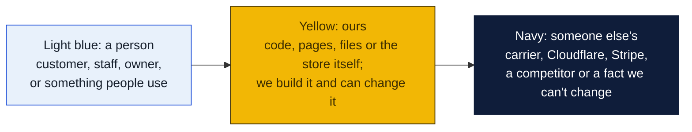
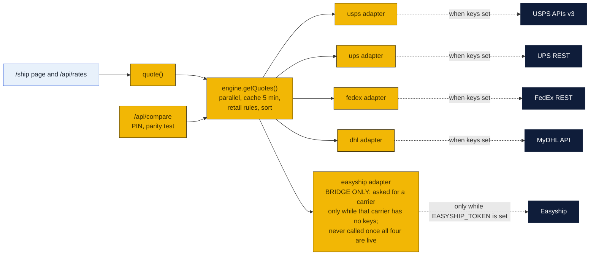
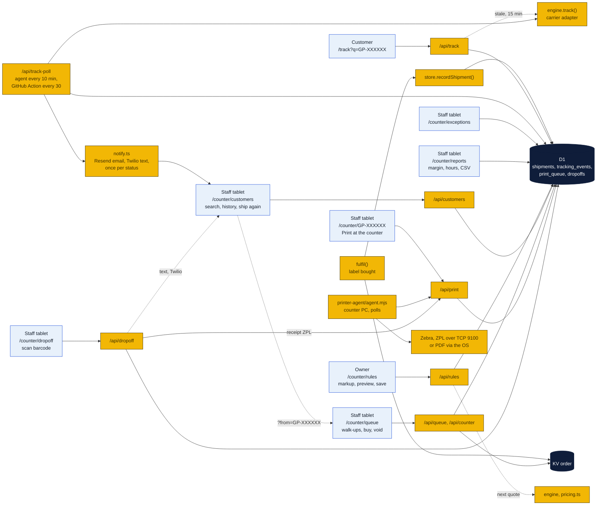
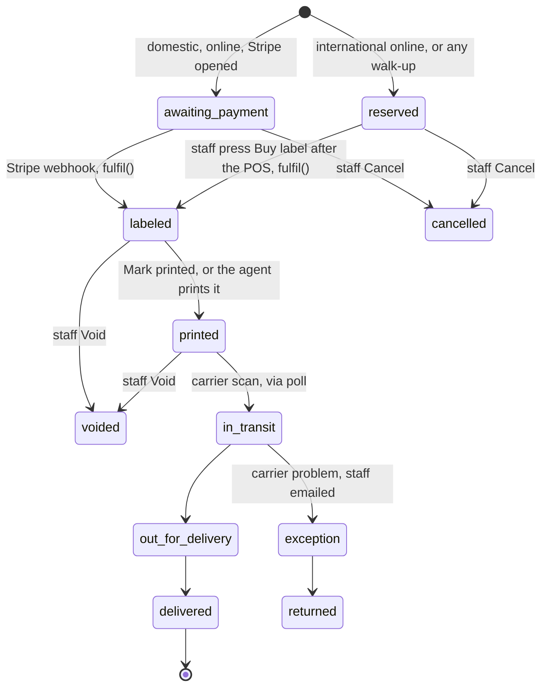
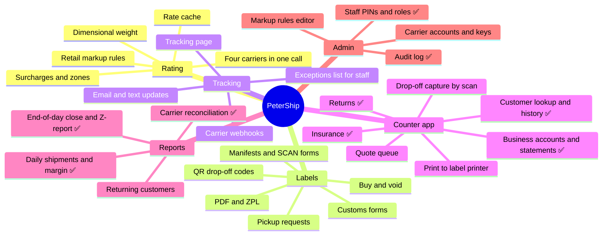
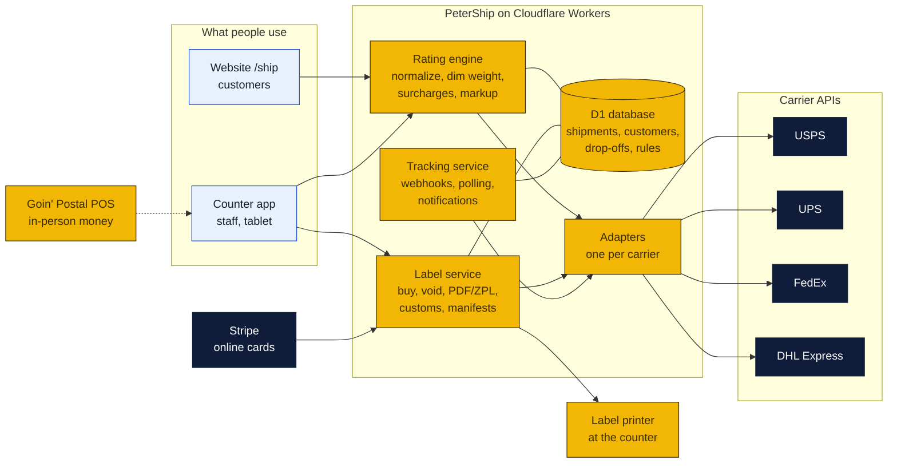
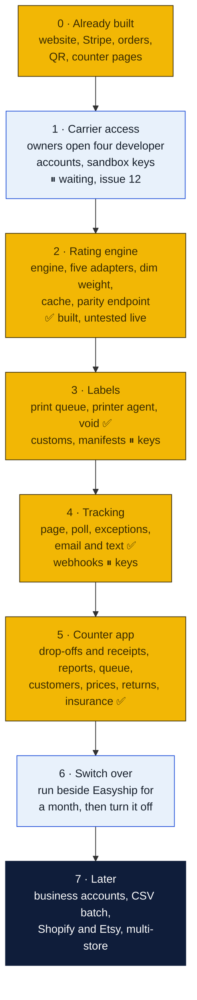
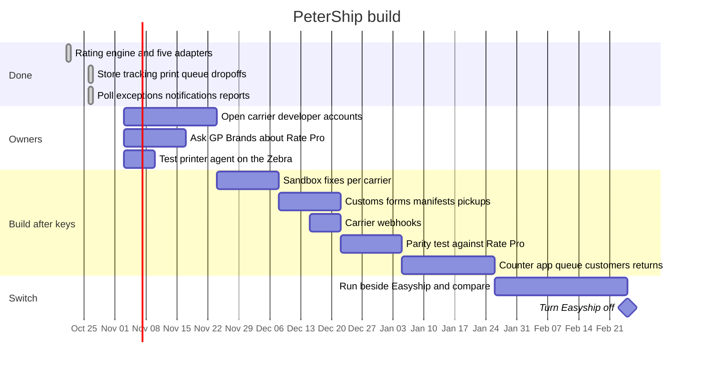

# PeterShip

PeterShip is the store's own shipping client. A plan for replacing Easyship with software the store owns: rating, labels, tracking, drop-offs and reports for USPS, UPS, FedEx and DHL, built on the same Cloudflare stack as the website. The same thing ShippingEasy, Easyship and GP Rate Pro do, but ours. PeterShip is proprietary, see [LICENSE](LICENSE); it is not under the repository's Apache license.

Item 44 in [`AGENDA.md`](../AGENDA.md) tracks it. Everything that can be built without carrier keys is built and running in mock mode: the rating engine (Phase 2), the print queue and printer agent (Phase 3), tracking, poll, exceptions and customer updates (Phase 4), and drop-off capture, reports, the quote queue, customer lookup, the price rules editor, drop-off receipts, returns, insurance and add-ons (Phase 5). The counter app that needs no carrier keys is complete. Releases v1.16.0 through v1.42.0, October 21 to 28, 2026. See [What is built so far](#what-is-built-so-far). What remains waits on the owners' carrier accounts (Phase 1).

New to this? [The long version](#the-long-version-how-petership-works-and-how-to-run-it) further down explains every word, every file, how to run it on your own computer, a screen-by-screen test script, what happens to one shipment from quote to delivery, and the go-live list in order. It is written for Peter, Rin and William and assumes none of this has been seen before.

## What is built so far

Started October 21, 2026. The website now runs on PeterShip's rating engine, with Easyship as one adapter among five, so nothing changes for customers until the direct carriers are switched on.

### How to read the charts

Every chart in this repo uses the same three colors, so once you know them you can read any of them.



| Mark | Meaning |
|---|---|
| Solid arrow `-->` | Data or a person moves this way, or this happens next |
| Dotted arrow `-.->` | Only sometimes: when keys are set, when a condition holds, or a later plan |
| Words on an arrow | What is sent or the condition, for example "when keys set" |
| Cylinder | A database or stored records (KV, D1, a table) |
| Diamond with a question in it | A decision. Follow the arrow whose label matches the answer; there is one arrow out per answer |
| Slanted box (parallelogram) | Something typed in or handed out: a form, a scan, a printed slip |
| Circle in the middle of a mindmap | The topic; the branches around it are its parts |
| Rounded box with `/path` | A page on the website; `/counter/...` pages are staff only |
| Box with a thick or dashed border, or a big frame around boxes | A group: everything inside runs in the same place |
| ✅ 🔨 ⏳ ⏸ in a box | Done, being built, not started, waiting on someone |

Other chart kinds you will meet: a **state diagram** shows the statuses one thing passes through, read along the arrows. A **sequence diagram** reads top to bottom, each vertical line is one party and each arrow is one message. A **gantt** is a calendar of who does what when. A **mindmap** is a topic in the middle with its parts around it. A **pie** or **bar chart** is just numbers. GitHub draws all of these on its own; if a chart shows as plain text, you are viewing the file somewhere that does not render Mermaid, and the raw text still reads top to bottom.



| Piece | Where | State |
|---|---|---|
| Shared shapes: Address, Parcel, Rate, Label, TrackingEvent, Provider | `site/src/shipping/types.ts` | Done |
| Billable weight: dimensional divisors per carrier, USPS one-cubic-foot rule, ounce and pound rounding, length-plus-girth oversize check | `site/src/shipping/dim.ts` | Done |
| OAuth client-credentials tokens cached in KV, JSON calls with carrier-tagged errors | `site/src/shipping/http.ts` | Done |
| USPS adapter: OAuth, total-rates search (domestic and international), label with payment authorization, void, tracking | `site/src/shipping/providers/usps.ts` | Written to the published reference, not yet sent to USPS |
| UPS adapter: OAuth, Shop rating with negotiated rates and transit times, ship, void, track | `site/src/shipping/providers/ups.ts` | Same |
| FedEx adapter: OAuth, rate quotes with account rates, ship, cancel, track | `site/src/shipping/providers/fedex.ts` | Same |
| DHL Express adapter: rates, shipments with export declaration, tracking | `site/src/shipping/providers/dhl.ts` | Same |
| Easyship adapter wrapping the existing client | `site/src/shipping/providers/easyship.ts` | Done, carries the site today |
| Rating engine: every configured carrier in parallel, Easyship fills gaps, retail rules from the table, five-minute cache of cost, sorted, errors logged not shown | `site/src/shipping/engine.ts` | Done |
| Label routing by rate id prefix, so Stripe and the counter never know which adapter bought the label | `site/src/shipping/engine.ts`, `site/src/lib/fulfil.ts` | Done |
| Parity endpoint: every provider's rates side by side for one shipment | `POST /api/compare`, staff PIN | Done |
| D1 schema: customers, shipments, tracking events, drop-offs, retail rules, staff, print queue | `site/db/schema.sql` | Applied locally by `npm run db:local`, in production by `npm run db:remote`. Orders stay in KV; shipments are mirrored into D1 |
| Carrier keys and sandbox switches | `site/.dev.vars.example`, `site/wrangler.jsonc` | Done, all blank until issue 12 |
| PeterShip store: shipments, tracking events, print queue, drop-offs in D1, with a memory fallback when no database is bound | `site/src/shipping/store.ts` | Done. Every bought label is recorded here as well as in KV |
| Tracking: `track()` and `voidLabel()` routed by label id prefix, public page at `/track`, `GET /api/track` refreshes from the carrier when events are older than fifteen minutes | `site/src/pages/track/`, `site/src/pages/api/track.ts` | Done in mock mode. Linked from the done page, in all 14 languages |
| Staff pages in 14 languages: the header picker on every `/counter/` page, the same languages as the website plus Quebec French, which was added to the website at the same time. About 290 staff strings, dynamic messages included; tables re-render when the language changes. Receipts and emails stay in English | `site/src/i18n/staff.ts`, `staff2.ts`, `staff3.ts` | Done. Native-speaker review wanted (issue 10) |
| Print queue and printer agent: staff tap Print at the counter, a small Node program on the counter PC prints ZPL to a Zebra or a PDF through the OS | `POST /api/print`, [`printer-agent/`](printer-agent/README.md) | Done, untested against a real Zebra ([issue 5](https://github.com/wbp318/goin-postal-forsythe/issues/5)) |
| Drop-off capture: scan a prepaid or return package's barcode, carrier guessed from the number, "carrier picked up" marks the day's hand-over | `/counter/dropoff`, `POST /api/dropoff` | Done |
| Tracking poll: refreshes every open shipment older than fifteen minutes from its carrier adapter. Run by the printer agent every ten minutes while the shop PC is on, by a scheduled GitHub Action every thirty minutes, or by staff on demand | `site/src/shipping/poll.ts`, `POST /api/track-poll`, `.github/workflows/track-poll.yml` | Done in mock mode |
| Exceptions list for staff: carrier exceptions, returns to sender, labels not scanned after three days, no movement for seven days, with Check carriers now | `/counter/exceptions`, `POST /api/exceptions` | Done |
| Reports for staff: shipments, what customers paid, what carriers charged and the margin, by day, carrier and service; busiest hours and weekdays; returning customers; drop-offs by carrier; CSV of every shipment for reconciling the carrier invoice | `/counter/reports`, `POST /api/reports`, `store.report()` | Done. Margin reads zero in mock mode because the fallback adapter reports its price as the cost |
| Quote queue for the counter: every online reservation and every walk-up on one screen, oldest first, waiting time in red after twenty minutes, with buy, print, mark printed, void and cancel. Walk-ups are typed in on the same page and quoted by the same engine as the website, so counter and site prices agree. A `quotes` table mirrors every order save, since KV cannot be listed cheaply | `/counter/queue`, `POST /api/queue`, `quotes` table | Done |
| x402 gate (monetization plan, agenda item 53): `/api/x402` lets software and agents pay the store per request in USDC with no account: store facts, rates, tracking and labels, each answering 402 with its price until a payment header arrives, verified and settled by a facilitator before the work; labels void within 24 hours with the refund listed for the owner on the reports page; off until the owner sets the receiving address, mock on the dev server. Plan, prices and the Kraken/facilitator split in `monetization/x402/` | `src/lib/x402.ts`, `src/pages/api/x402/[...path].ts`, `x402_payments` table | Done in code; live needs a Kraken address and the accountant's method |
| Full data export (to-do T10): `/counter/export` lists every table in the database with its row count and a CSV button each, and one button downloads everything, every table plus the online orders, as a single JSON file. Owner PIN only, every download audited, PIN hashes, key hashes and webhook secrets blanked. CSV has a UTF-8 BOM so Excel reads accents. So the store is never locked in and a buyer's diligence, an accountant or the next system gets the real records | `src/lib/export.ts`, `POST /api/export`, `/counter/export`, `store.exportTable()` | Done |
| Public API and Shopify connector (to-do T9): `/api/v1` with a Bearer API key per business account, made and revoked on the accounts page and shown once; `rates`, `shipments` (create buys the label and bills the account at its discount, list, get with tracking events, void with a reason), `me`; signed `shipment.tracking` webhooks from the poll; a reference with curl examples in `shipping-client/api/`; and a Shopify connector that runs beside the printer agent, pulls a shop's unfulfilled orders, buys labels through the API and writes the tracking back as fulfilments | `src/lib/apikeys.ts`, `src/pages/api/v1/[...path].ts`, `api_keys` table, `shipping-client/api/`, `shipping-client/shopify-connector/` | Done; a listed Shopify app (OAuth, app store) is the later step |
| Marketplace connectors and the fulfillment play: Shopify, eBay, Etsy, Square, Amazon, Walmart, WooCommerce and the resale apps, what each allows, the ShipBob-style fulfillment the store could offer at Monroe scale, the rates it depends on, the build order | [`connectors/`](connectors/README.md) | Plan, Oct 29; the CSV half shipped as v1.62.1 |
| PeterShip LLC: the plan to put the software in a Louisiana company owned by the three license holders (Peter Ho and Rin Ho of Ouachita Parish, William Parker of East Carroll Parish), with drafts of the operating agreement, the IP assignment, the software license back to the store and the filing checklist; attorney review before signing | [`llc/`](llc/README.md) | Plan and drafts, Oct 29 |
| Rates below Pirate Ship: where a single store can and cannot beat platform rates, the levers (own UPS and FedEx account, USPS Connect Local, cubic tiers, DHL for international, labels at cost for accounts), the build order and the decisions for Peter and Rin | [`rates/`](rates/README.md) | Plan, Oct 29 |
| Multi-store (to-do T8, first form): one deployment per store, same code. Store facts (name, address, phone, ship-from, hours, services) come from the `STORE_JSON` secret laid over the Forsythe defaults; each store has its own KV, D1 and secrets through a `wrangler.jsonc` environment or its own Cloudflare project; `scripts/new-store.py` writes the facts file and prints the commands. Prices, add-ons, staff, accounts and every record are per store because they live in that store's database. A shared database with a store column (true tenancy, for a franchisor dashboard across stores) is the second form and waits until there is a second store | `src/data/store.ts`, `stores/`, `scripts/new-store.py`, `wrangler.jsonc` | Done in its first form |
| Automated tests (to-do T7): a Vitest suite in `site/tests/`, 46 tests across six files, run by `npm run test:unit` and by CI on every push beside the type-check and the build. The libraries are tested directly and the store is tested against its memory fallback, so the same code the pages call runs with no database. Writing it caught one bug: the Z-report's POS line wrapped on a narrow receipt printer | `site/tests/`, `vitest.config.ts`, `.github/workflows/ci.yml` | Done; grows with every feature |
| Offline resilience (to-do T6): the staff pages open from the browser's last copy when the shop's internet is down (a service worker on `/counter/` only); the queue shows its last list with the time and a warning; drop-off scans go into an outbox on the device with their real time and are sent in order when the connection returns, marked "scanned while offline". Buying labels still needs the internet | `public/counter-sw.js`, queue and drop-off pages, `scanned_at` on `POST /api/dropoff` | Done |
| Printer agent hardening (to-do T5): the agent sends a heartbeat every twenty seconds and the queue page says online with the printer and the last job, or OFFLINE after two minutes; a job that fails five times is reported and set aside instead of silently skipped, listed on the queue page with its error and a Retry button; receipts and Z-reports can go to a till-roll receipt printer as ESC/POS when `RECEIPT_FORMAT=escpos` is set (`node agent.mjs --test-receipt` prints a test slip), otherwise they stay 4 by 6 ZPL on the Zebra | `agent.mjs`, `print_failures` table, `status`, `retry`, `heartbeat` and `failed` on `POST /api/print`, `escpos()` in `receipt.ts` | Done, untested against a real printer (issue 5) |
| Address validation (to-do T4): on every quote and before every label, with no carrier account: ZIP shape, ZIP prefix against the state typed (USPS prefix ranges per state, so 75201 with LA is caught), PO boxes (UPS and FedEx dropped from the rates, with a note), military and territory addresses, a street line with no number, an apartment building with no unit number. Errors stop an online order; at the counter staff can override after reading. The carriers' address APIs plug into `validateWithCarrier()` when issue 12 is done | `src/lib/address.ts`, `address` in `POST /api/rates`, checks in `/api/orders` and `/api/queue` | Done; carrier-standardized addresses wait on issue 12 |
| Notes and reasons (to-do T3): free-text notes on a customer (customer page) and on an order (order page), each with who wrote it and when, and a required reason on every void and cancel, typed in the confirmation, saved on the order, shown on the order page and written to the audit log | `notes` table, `POST /api/notes`, `reason` on `POST /api/counter` | Done |
| Packing advisor (to-do T2): with every quote, the billable weight per carrier from the size typed (USPS over a cubic foot, UPS and FedEx at 139), whether size rather than weight is setting the price, the smallest stocked box the parcel fits in with its price, and the largest smaller box that would cut the billed weight by a pound or more. Customers see one plain line on the Ship page when it matters; staff see the figures under the walk-up rates with Use this box, which fills the box add-on and the dimensions and re-quotes. Box sizes come from the catalog names, so the owners add boxes on the Prices page | `src/lib/packing.ts`, `packing` in `POST /api/rates` | Done |
| Business accounts (agenda 28, to-do T1): an account on top of a customer with a business name, a discount and notes, managed at `/counter/accounts`. The walk-up form has Bill to a business account: the discount comes off the label before the total, and Buy label becomes Bill to account, which buys the label and puts it on the next statement instead of the POS. The Ship page applies the discount when the account's email is used (the card is still charged). Issue the statement for a month sums every unbilled shipment, emails it, raises a Stripe invoice with a hosted pay link when Stripe is set up, and Mark paid closes it. Statements and bill-to shipments show in the end-of-day close as their own bucket | `/counter/accounts`, `POST /api/accounts`, `accounts`, `account_statements`, `shipment_billing` tables, `createInvoice()` in `stripe.ts` | Done |
| End-of-day close: one screen per day at `/counter/close`. Labels sold and their add-ons, carrier cost and margin, paid at the counter against paid online, what the POS drawer should show for PeterShip's part (counter-paid labels and extras less counter refunds owed that day), every void with where its refund has to be made, drop-offs accepted, handed over and still here, walk-ups, returns, cancelled quotes, open quotes and exceptions. A manager or owner closes the day, which freezes the figures under their name with a note (drawer over or short), prints the Z-report on the counter printer or from the browser, and past closes can be reopened and reprinted. The shop's day runs midnight to midnight on the tablet's clock | `src/lib/close.ts`, `/counter/close`, `POST /api/close`, `day_closes` table | Done |
| Carrier invoice audit: open the carrier's weekly invoice CSV at `/counter/invoices`, the columns are guessed from the headers and can be changed, surcharge lines are folded into their tracking number, and every number is matched to our shipment by tracking number. Each line is one of: OK, overcharged (dimensional adjustment, address correction, surcharge added after the fact), under, voided but billed, billed twice, or not ours; the summary says what the carrier billed, what we expected and what to dispute. Save the audit, mark lines disputed with the claim number, download the flagged lines to send to the carrier. A sample invoice built from our own shipments lets the owners try it before a real one exists | `src/lib/invoices.ts`, `/counter/invoices`, `POST /api/invoices`, `invoices` and `invoice_lines` tables | Done. Real invoices arrive once the carrier accounts exist |
| Staff logins and the audit log: everyone gets their own PIN with a role (counter, manager, owner), managed by an owner at `/counter/staff`; every buy, print, mark printed, void, cancel, email, walk-up, drop-off, pickup, receipt reprint, price save, add-on save and staff change is written to `audit_log` with the name and the time, readable newest first and filterable by person. The two shared PINs still work and are named as such, so nothing breaks on day one; the page tells a shared-PIN user to add themselves and retire the shared secrets. The walk-up and drop-off forms fill the staff name from the login | `src/lib/auth.ts`, `/counter/staff`, `POST /api/staff`, `audit_log` table | Done |
| Insurance and packaging add-ons: declared-value insurance (free up to the carrier's included cover, then per $100 with a minimum and a cap) and a catalog of boxes, packing and services, all priced on the server from a table the owners edit on the Prices page. The Ship page offers insurance and shows the running total; the walk-up form offers insurance and the catalog with quantities and shows the total to ring up; Stripe gets one line per item; the done and order pages show the breakdown; the queue shows the total; reports show add-ons sold. Seed prices in `addons.json` are placeholders for the owners (issue 9) | `src/lib/addons.ts`, `POST /api/addons`, `addons` and `order_addons` tables | Done |
| Returns at the counter: the walk-up form's return mode. The sender's US address is typed in as the origin, the package comes to the store (a local business collects it here) or to any other address such as the business's own shop, the label is paid on the POS and bought like any walk-up, then Email label sends the label link, tracking number, drop-off instructions and the tracking page to the sender. Email label also works for any bought label, for customers who want to print at home. Returns show as "Return from City, ST to Name" in the queue and on the customer's history | queue return mode, `POST /api/queue` `kind: return`, `POST /api/counter` `email` | Done. Emails log until the Resend key is set |
| Drop-off receipts: when a drop-off is scanned a 4 by 6 receipt goes to the counter printer through the print queue (store name, time, carrier, receipt number, customer, who accepted it, the tracking barcode in Code 128, and what to do next), and, if the customer gave a mobile number, the same receipt as a text. Print again and Text again on every recent drop-off, and a browser-printable copy at `/counter/receipt/ID` for when the agent is not running | `src/shipping/receipt.ts`, `/api/dropoff` `receipt` and `text`, `/counter/receipt/[id]` | Done. Texts log until the Twilio keys are set |
| Price rules editor: the markup between carrier cost and customer price, edited by the owners at `/counter/rules` and stored in the `retail_rules` table; the JSON file is only the starting point. On/off and round-to-.99 switches, a Default row, a row per carrier, any number of service rows, each percent plus flat fee or a fixed price. Preview applies a draft to a real quote for a sample box and shows cost, price now and price after, before anything is saved. The rate cache stores cost, so a save shows on the very next quote online and at the counter. Optional `OWNER_PIN` so staff can view but only the owner can save | `/counter/rules`, `POST /api/rules`, `src/lib/pricing.ts` | Done. Numbers still to be copied from Rate Pro (issue 11) |
| Customer lookup: search by any part of a name, an email or phone digits; every shipment newest first with tracking status; address book from past orders with Ship here again, which fills the walk-up form; returning badge after two shipments; CSV of everyone keyed by phone for the Coupon Counter. A `customers` row is created or refreshed on every order save, matched on email, else mobile; walk-ups with neither stay unlinked and are found by name | `/counter/customers`, `POST /api/customers`, `customers` table, `shipments.customer_id` | Done |
| Void and cancel: a bought label is voided with its carrier (Easyship cancel, USPS, UPS, FedEx, DHL void routed by label id) and the shipment marked voided so it leaves the reports; an unbought quote is cancelled | `POST /api/counter` `void` and `cancel` | Done in mock mode |
| Customer updates: email through Resend and text through Twilio when a shipment is first scanned, out for delivery, delivered, in trouble or returned. One message per status. Opt-in box and mobile number on the ship form. Staff email on exceptions | `site/src/shipping/notify.ts`, `shipment_contacts` and `notifications` tables | Done, logs instead of sending until the Resend and Twilio keys are set |

Customers see service, price and days only. Cost and the provider that answered stay on the server.

**About the Easyship box in that chart.** PeterShip does not depend on Easyship and is not built around it. Easyship is the account the store already has, and it answers for all four carriers with one key, so it is the scaffolding that lets every screen work today, before the owners have opened a single carrier developer account. The engine's rule is strict: it asks Easyship only for a carrier that no direct adapter answered for, and only while the `EASYSHIP_TOKEN` secret exists. The day the USPS keys go in, USPS rates and labels come from USPS directly and Easyship is never asked about USPS again; the same for each of the other three. When all four are live, no quote ever reaches the Easyship adapter. Remove the token and the adapter is dead code: the engine simply shows the carriers that answered. In plain `npm run dev` with no keys at all, the same adapter supplies the fake rates, which is why it is also the mock. The goal in the phase chart below is exactly that: Phase 6 runs the direct carriers beside Easyship for a month to compare prices, then turns Easyship off for good.

| Carrier keys present | Who answers for USPS | Who answers for UPS, FedEx, DHL | Is Easyship called? |
|---|---|---|---|
| None, no Easyship token (mock mode) | fake rates | fake rates | Yes, as the mock |
| Easyship token only (today's live option) | Easyship | Easyship | Yes, for all four |
| USPS keys and Easyship token | USPS directly | Easyship | Yes, for three |
| All four carriers and Easyship token | USPS directly | each directly | No, never |
| All four carriers, token removed | USPS directly | each directly | No, and cannot be |



**Next:** the owners open the four developer accounts (issue 12). The first sandbox call to each carrier will need field adjustments; that is expected and is why the adapters are isolated. Then the parity test. Meanwhile the printer agent can be tried against the shop's thermal printer with `node agent.mjs --test` (issue 5). Customer updates need a Resend account (free) and, for texts, a Twilio number (decision 4 for Rin). Carrier webhooks, customs forms and manifests wait on the keys.

## The long version: how PeterShip works and how to run it

This section is for Peter, Rin and William. It assumes you can read code but have not built a shipping system or a Cloudflare site before. It goes slowly on purpose. Skip what you already know; nothing later depends on reading it all in order.

### 1. The idea in one paragraph

A shipping client is the software between a person with a box and the carriers. It asks each carrier "what would you charge to take this box from here to there?", shows the answers, lets someone pick one, pays the carrier, gets a label back, prints it, and then watches the tracking number until the box is delivered. Easyship, ShippingEasy, Pirate Ship and GP Rate Pro are all this. PeterShip is the same thing, written by us, running on the same Cloudflare account as the store website, with the store's own records in the store's own database. The website's Ship page is its customer face; the `/counter/` pages are its staff face.

### 2. Words you will meet

| Word | What it means here |
|---|---|
| **Rate** or **quote** | One carrier's price for one box to one address with one service, for example "USPS Ground Advantage, $9.65, 2 to 5 days". A quote request returns several rates. |
| **Service** | The carrier's product name: Ground Advantage, Priority Mail, UPS Ground, FedEx Home Delivery, DHL Express Worldwide. |
| **Label** | The 4 by 6 inch sticker with the barcode. Buying a label is paying the carrier. Every label has a **tracking number**. |
| **Void** | Cancelling a bought label so the carrier refunds the postage. Only possible before the package is scanned. |
| **ZPL** | Zebra Programming Language, the plain-text format thermal label printers understand. Carriers can send the label as ZPL or as a PDF. |
| **Billable weight** | Carriers charge by the greater of actual weight and **dimensional weight** (length times width times height divided by a carrier-specific number). Big light boxes cost more than they weigh. |
| **Address check** | The ZIP, state, PO box and apartment checks run before a label is bought. The carriers have their own address services that also correct spelling and confirm the address exists; those connect once the carrier accounts do. |
| **Dimensional weight** | What a carrier charges for a box's size instead of its weight: length times width times height divided by 139 (166 for USPS, and only over a cubic foot). A big light box costs more than it weighs. The packing advisor shows it on every quote. |
| **Add-ons** and **declared value** | Boxes, packing and services sold with the label, and the value the customer says the contents are worth. Carriers include some cover (usually $100); insurance above that is sold per $100 of declared value. |
| **Retail rules** or **markup** | What the store adds on top of the carrier's cost. Cost is what the carrier bills us; **price** is what the customer pays. The difference is the margin. |
| **Adapter** or **provider** | One file per carrier that translates between our shapes and that carrier's API. Swap or fix one without touching the others. |
| **Mock mode** | How everything runs today. With no carrier keys, the Easyship adapter invents plausible rates and a fake label, so every screen can be tested without spending money. |
| **Worker** | Cloudflare's name for a small program that runs on their servers in response to a web request. The whole site, PeterShip included, is one Worker. |
| **KV** | Cloudflare's key-value store. Orders live here under the key `order:GP-XXXXXX`. Fast to read one, awkward to list many. |
| **D1** | Cloudflare's SQL database (SQLite). PeterShip's own tables live here: shipments, tracking events, customers, quotes, drop-offs, print queue. Easy to list and report on. |
| **Secret** | A password or API key. Never in the code. Locally in `site/.dev.vars`, in production set with `npx wrangler secret put NAME`. |
| **PIN** and **role** | Each staff member's own 4-to-8-digit code, typed on every `/counter/` page. It says who they are and what they may do: **counter** runs the queue, drop-offs, customers and reports; **manager** also reads the audit log; **owner** also saves prices and add-ons and manages people at `/counter/staff`. Two shared codes, the secrets `COUNTER_PIN` and `OWNER_PIN`, work as stop-gaps until everyone has their own. |
| **Business account** and **statement** | A customer who ships often enough to get a discount and pay monthly instead of per label. Their labels are billed to the account at the counter and added up on a statement once a month. |
| **Z-report** and **close** | The end-of-day slip and the act of freezing the day's figures under a name. The POS has its own Z-report for everything it rang up; PeterShip's covers the shipping part, and the two should agree on the counter-paid labels. |
| **Invoice audit** | Matching what the carrier billed to what we quoted, line by line, and disputing the difference. Carriers adjust charges after the fact (dimensional weight, address corrections, residential surcharges) and the only defence is checking. |
| **Audit log** | One line per action with the name, the time, what was done and to what. Who voided that label, who changed the UPS markup, who accepted that drop-off. Read at `/counter/staff`. |
| **Printer agent** | A small Node program on the counter PC that watches the print queue and sends labels to the Zebra. |
| **Drop-off** | A package a customer brings in that already has a label (an Amazon return, a prepaid label). We do not sell anything; we scan it so there is a record it was handed to us, and the customer leaves with a receipt that says so. |
| **Manifest** or **SCAN form** | One barcode the carrier driver scans to accept every package of the day at once. Waits on carrier keys. |

### 3. Where everything lives

Everything is inside `site/`, because PeterShip is part of the website's Worker. Nothing runs anywhere else except the printer agent on the counter PC.

```
site/
  db/schema.sql                 the D1 tables. Re-runnable: every statement is CREATE IF NOT EXISTS
  wrangler.jsonc                Cloudflare bindings: the KV namespace and the D1 database
  .dev.vars.example             every secret and switch, with comments. Copy to .dev.vars locally
  src/data/store.ts             the shop: name, address, hours, the ship-from address
  src/data/ratepro.json         the starting retail rules (markup); the live ones are in the retail_rules table
    src/data/addons.json          the starting add-on catalog and insurance terms; the live ones are in the addons table
  src/shipping/                 PeterShip proper
    types.ts                    the shared shapes: Address, Parcel, Rate, Label, TrackingEvent, Provider
    dim.ts                      billable weight: dimensional divisors, rounding, oversize checks
    http.ts                     OAuth tokens cached in KV, JSON calls with the carrier's name on errors
    engine.ts                   the rating engine: ask every configured carrier at once, cache, sort,
                                apply retail rules; route buy, void and track to the right adapter
    providers/usps.ts           one adapter per carrier, each the same shape (Provider in types.ts)
    providers/ups.ts
    providers/fedex.ts
    providers/dhl.ts
    providers/easyship.ts       the fallback that covers all four with one account, and mock mode
    store.ts                    every read and write to D1, with an in-memory copy when D1 is absent
    poll.ts                     refresh tracking for open shipments and send customer updates
    notify.ts                   email (Resend) and text (Twilio) templates and sending
    receipt.ts                  the drop-off receipt, as ZPL for the Zebra and as one text message
  src/lib/
    orders.ts                   the Order record in KV and its statuses
    quote.ts                    thin wrapper: pages call quote(), quote() calls the engine
    fulfil.ts                   "the money arrived, buy the label now", shared by Stripe and the POS step
    addons.ts                   insurance fee and add-on pricing, always on the server, from the catalog
    packing.ts                  billable weight by carrier, which stocked box fits, which smaller box saves
    address.ts                  ZIP, state, PO box, military and apartment checks; hook for the carrier address APIs
    auth.ts                     who a PIN belongs to, roles, what each role may do
    invoices.ts                 the invoice matcher: group surcharges, compare with our cost, flag
    close.ts                    the end-of-day figures, the POS expectation, the Z-report
    validate.ts                 turn form input into a clean Address and Parcel, or a clear error
    stripe.ts                   Stripe Checkout for online card payments
    easyship.ts                 the raw Easyship HTTP client and the mock rates and label
  src/pages/
    ship/                       customer: quote form, done page with QR code
    track/                      customer: tracking page, 14 languages
    counter/                    staff, PIN: queue, customers, accounts, dropoff, exceptions, reports, close, invoices, rules, staff, [code]
    api/                        the JSON endpoints every page calls (table in site/README.md)
shipping-client/
  printer-agent/                the counter PC program, its own README, plus Windows and macOS installers
  counter-pc/                   the plan for the counter machines: Windows 11 now, Mac minis next, the POS question
  api/                          the public API reference for business accounts' software
  shopify-connector/            a small program that ships a Shopify store's orders through the API
  costs/                        what Cloudflare and the carriers charge us
  for-other-stores/             the plan for running it for other Goin' Postal stores
```

If you only read three files, read `types.ts` (the shapes), `engine.ts` (how a quote happens) and `store.ts` (what we remember).

### 4. Run it on your own computer

You need Node.js 22 or newer and Git. The root README's first section shows how to install both, with the exact commands for Windows and Mac. Check they are there before going on: open a terminal (below) and type `node -v` and `git --version`; each should print a version number.

**Open a terminal and go to the folder you want the code in.** A terminal always has a "current folder", and `git clone` puts the code inside whatever folder you are in at that moment. So the first job is to get to a sensible place, like the Desktop. `cd` means "change directory", `pwd` prints where you are, and `ls` lists what is there, on both systems.

*Windows.* Press the Start key, type `PowerShell`, press Enter. A blue or black window opens, usually starting in `C:\Users\YourName`. Go to the Desktop and confirm:

```
cd $HOME\Desktop
pwd
```

It should print something like `C:\Users\Peter\Desktop`. If you would rather keep code elsewhere, make a folder first: `mkdir $HOME\Code` then `cd $HOME\Code`. If OneDrive moved your Desktop, `cd $HOME\Desktop` still works because `$HOME` follows it; if it says the path does not exist, try `cd $HOME\OneDrive\Desktop`. Spaces in a folder name need quotes: `cd "C:\Users\Rin Ho\Desktop"`.

*Mac.* Open Finder, go to Applications, Utilities, Terminal, or press Command and Space, type `Terminal`, press Enter. It starts in your home folder, `/Users/yourname`. Go to the Desktop and confirm:

```
cd ~/Desktop
pwd
```

It should print `/Users/peter/Desktop` or similar. `~` is short for your home folder on a Mac.

**Now get the code and start it.** The same six lines work on both systems, in that terminal, in that folder:

```
git clone https://github.com/wbp318/goin-postal-forsythe.git
cd goin-postal-forsythe/site
npm install
cp .dev.vars.example .dev.vars
npm run db:local
npm run dev
```

The first line creates a folder named `goin-postal-forsythe` inside the folder you were in (so on the Desktop, you will see it appear there). The second line moves into its `site` subfolder, which is where every later command runs. If `git clone` says the folder already exists, you cloned before; just `cd goin-postal-forsythe/site` and run `git pull` to get the latest. On Windows PowerShell, `cp` works; if it complains use `Copy-Item .dev.vars.example .dev.vars`. On Windows a backslash works in place of the forward slash in `goin-postal-forsythe/site`.

**Coming back later.** Open a terminal, `cd` to where the folder is (`cd $HOME\Desktop\goin-postal-forsythe\site` on Windows, `cd ~/Desktop/goin-postal-forsythe/site` on a Mac), then `git pull` to pick up changes and `npm run dev` to start. If you are ever lost, `pwd` says where you are and `cd ..` goes up one folder.

What each line does:

| Command | What happens | What you should see |
|---|---|---|
| `npm install` | Downloads Astro, the Cloudflare adapter, Stripe's library and the QR code library into `node_modules/`. Once per computer, and again after a big update. | A minute of scrolling, then `added N packages`. |
| `cp .dev.vars.example .dev.vars` | Makes your local secrets file. The example has `COUNTER_PIN=1234` and everything else blank, which is mock mode. `.dev.vars` is ignored by Git so you cannot commit it by accident. | Nothing printed. |
| `npm run db:local` | Creates PeterShip's tables in a local SQLite file under `.wrangler/`. Run it again after any change to `schema.sql`; it is safe to repeat. | A JSON blob ending in `"success": true`. |
| `npm run dev` | Starts the website on your computer. Leave the window open. | `astro v7 ready` and `Local http://localhost:4321/`. |

Open http://localhost:4321 in a browser. The PIN for every staff page is **1234**.

If `npm run dev` says something about `D1_ERROR: no such table`, you skipped `npm run db:local`. If it says a port is in use, run `npm run dev -- --port 4399` and use that number instead.

### 5. Walk through every screen

Do these in order the first time; each one leaves something for the next to find. Everything is fake: no money moves and no label is real.

**5a. A customer quotes and reserves online.** Open `/ship`. Fill in any US address, weight 2 lb, 10 by 8 by 4 inches, Get rates. Five demo rates appear with a note saying they are demo rates. Pick one, type an email, Continue. In mock mode Stripe is skipped and you land on the done page with a pickup code like `GP-7K3M9Q` and a QR code. Now go back, do it again with Canada as the country: the button reads Reserve, and the done page says the order is reserved for payment at the counter. That reserved order is what the queue is for.

**5b. The queue.** Open `/counter/queue`, PIN 1234, Show queue. The Canadian reservation is listed with how long it has been waiting. This is the screen the tablet should sit on all day. Press **Rung up. Buy label** on it (pretending the POS took the money): the status changes to Label bought and three buttons appear. **Print at the counter** puts it in the print queue for the printer agent. **Mark printed** finishes it. **Void** cancels the label with the carrier and asks you to confirm first; the order then shows under Finished in the last day as Voided.

**5c. A walk-up.** Still on `/counter/queue`, scroll down to Walk-up. This is the form for a person standing at the counter. Type their name and mobile number, the recipient, the box. Get rates, pick one, Add to queue. The new row appears at the top of the queue in a few seconds with your initials on it, and the price is exactly what the website would have quoted, because it is the same code. Ring it up on the POS, press Buy label, print.

**5c-2. A return label.** Still in the walk-up form, tick **This is a return**. The form now asks where the package is now (the sender, US only) and where it comes back to: us, or another address such as a local shop's. Type a Dallas address as the sender, leave Comes back to on Us, Get rates, pick one, Add to queue. The queue row reads "Return from Dallas, TX to Goin' Postal Forsythe". Ring it up on the POS as usual (the business standing at the counter is paying for their customer's return), press Buy label, then **Email label**: it asks for the address, and the sender gets the label link, the tracking number, what to do with the box and the tracking page. In mock mode the email is written to the terminal window instead. Email label is on every bought label, for anyone who would rather print at home.

**5c-5. Address checks.** Type a walk-up to 1 Main St, Dallas, LA 75201 and Get rates: a red line says ZIP 75201 belongs to TX, not LA, and Add to queue refuses until you fix it or press Use this address anyway after the customer confirms. Try PO Box 9, Monroe, LA 71201: only USPS rates appear, with a note that UPS and FedEx cannot deliver to a PO box. Try 500 Riverside Apartments with no apartment number: a warning asks for the unit. On the Ship page customers see the same lines and cannot override an error.

**5c-4. The packing advisor.** Quote a walk-up at 2 lb in a 20 by 16 by 12 box. Under the rates a line says the actual weight is 2 lb but USPS bills 24 lb and UPS 28 lb, that size is setting the price, that the large box fits, and that a medium box would cut the billed weight by about 14 lb if the item fits. Press Use this box: the medium box goes on the add-ons at one, the dimensions change to 16 by 12 by 10, and the rates refresh at the lower weight. On the Ship page a customer typing the same box sees one line saying the same thing in plain words. This is the conversation a good counter has anyway; now the numbers are on the screen.

**5c-3. Insurance and a box.** Quote a walk-up with a value of $650. Under the rates an Add-ons box appears: insurance for the declared value with its fee (the carrier covers the first $100 free, then $1.25 per $100 with a $2.75 minimum, until the owners change those numbers), and the catalog of boxes, packing and services with a quantity each. Tick insurance, put 1 on a medium box and 1 on Pack it for me, and the Total to ring up on the POS updates as you go. Add to queue: the queue row shows the total, the order page lists every line with the total to ring up, and after Buy label the reports' Add-ons sold card counts them. On the Ship page the same insurance box appears to customers with the running total; boxes are not offered online because the customer is printing at home. Quote a $30 box instead and the insurance line is replaced by a note that the carrier covers it.

**5d. Customers.** Open `/counter/customers` (each customer has a Notes box in their detail: "always wants signature", "pays by cheque"), PIN, type part of the name or phone number you used in 5c. One row comes back with the number of shipments and a returning badge once they have two. Open shows contact details, every shipment with its status, and the address book. **Ship here again** jumps to the queue with the walk-up form already filled in from that earlier order; check the weight and size, Get rates, done. **Download CSV of everyone** gives a spreadsheet keyed by phone number, the same key the Coupon Counter uses, so the owners can see who is a regular.

A walk-up with no phone and no email cannot be tied to a person (two John Smiths must not merge), so those appear in a separate list under the search results, found by name only.

**5e. The order page.** Any `GP-` code opens `/counter/GP-XXXXXX`. This is what scanning the customer's QR code opens on the tablet. It has the same buttons as the queue row plus Open label to print, for a browser print when the agent is not running.

**5f. Drop-offs.** Open `/counter/dropoff`. Type a tracking number (a UPS one starts with `1Z`, 18 characters; a USPS one is 22 digits starting with 9) and Accept. The carrier is guessed from the number's shape. Leave **Print a receipt** ticked and a 4 by 6 slip with the barcode comes out of the counter printer as soon as you accept (in mock mode it is queued and the message says no agent is running; the Receipt link under the entry shows the same slip for the browser). Tick **Text the receipt** when the customer typed a mobile number and they get it as a message too; until the Twilio keys are set it is written to the terminal instead. Each recent entry has Print again and Text again. At the end of the day press the carrier's **picked up** button and every drop-off for that carrier is stamped as handed over. When a customer calls saying their return never moved, this page and their receipt are the answer to "did you really drop it here?"

**5g. Tracking.** Open `/track?q=GP-XXXXXX` with the code from 5b or 5c after its label was bought. In mock mode a fake sequence of scans advances once an hour so the page has something to show. Customers get this link on the done page in all 14 languages. The staff pages follow the same picker, so a counter worker who prefers Spanish or Vietnamese sees the queue in it.

**5h. Exceptions.** Open `/counter/exceptions`. It lists anything a human should look at: carrier exceptions, returns to sender, labels bought three days ago and never scanned, no movement for a week. Nothing will be there on a fresh install. **Check carriers now** runs the tracking refresh on demand.

**5i. Reports.** Open `/counter/reports`, pick today. Shipments, what customers paid, what carriers charged, margin, by day, carrier and service; busiest hours and weekdays; returning customers; drop-offs; and a CSV of every shipment for reconciling the carrier's invoice. In mock mode the margin is zero because the fake adapter reports its price as its cost.

**5j. Prices.** Open `/counter/rules`. Below the price rules is Add-ons and insurance: the four insurance numbers and the catalog, with Save add-ons. Change the small box to $2.99, save, quote a walk-up, and the new price is in the list. It says nothing has been saved yet and shows the file's rules: everything at zero, switched off. Put 20 in Default percent and 1 in Default flat fee, tick Rules are on, press Preview: the table shows each sample rate's carrier cost, the price now (equal to cost) and the price after (cost plus 20 percent plus a dollar, rounded up to .99). Save, then go back to `/ship` and quote the same box: the new prices. Come back, untick Rules are on, Save, and the Ship page is back to cost. In real life the numbers are copied from Rate Pro so that the website and the counter can never disagree.

**5h-2. Business accounts.** Open `/counter/accounts` as a manager or owner and open an account for a local shop: business name, 10 percent, a contact with an email. Back on the queue, type a walk-up for them and pick the account under Bill to a business account: the rate list is the normal one, but the queue row shows the discounted price with the business name in front, and the Buy label button reads Bill to account. Press it and the label is bought with nothing rung up on the POS. On the account page the shipment sits under Unbilled; Issue the statement for this month emails it to the contact (in mock mode, to the terminal window) and, once Stripe is set up, raises a Stripe invoice with a pay link. Mark paid when the cheque arrives. The end-of-day close shows these under Billed to business accounts, separate from the POS figure.

**5i-2. End of day.** Open `/counter/close`. The four cards are what matter at closing time: what the POS should show from PeterShip (the counter-paid labels and extras, less any counter refund owed today), what Stripe took online, labels sold, and refunds owed. The tables under them break the day down and list every void with where to refund it (POS or the Stripe dashboard). Compare the POS card with the drawer, type a note if they differ, tick Print the Z-report and press Close the day: the figures are frozen under your name and the Z-report prints. Past closes stay in the list below with Open and Print again. Closing is for managers and owners; anyone can look.

**5j-2. Carrier invoices.** Open `/counter/invoices` with a manager or owner PIN and press Download a sample invoice: a CSV built from your own test shipments with a few deliberate overcharges. Open it with the Invoice CSV field, check that the tracking and amount columns were guessed right, press Check the invoice. The three cards say what the carrier billed, what we expected and what to dispute; the table lists the flagged lines first. Press Save this audit, then Dispute on a line and type a claim number; Download flagged lines gives the spreadsheet to send the carrier. In real life the CSV comes from the carrier's billing site every week, and this is the ten-minute job that catches the $18 address corrections and the labels they billed after we voided them.

**5k-0. People.** Open `/counter/staff` with the shared PIN 1234. It says you are signed in as Counter (shared PIN) and asks you to add yourself. Add Rin as an owner with a PIN of her choosing, Peter as a manager, a counter person as counter. Sign out by clearing the PIN box, sign in with the counter PIN on `/counter/queue`, and run a walk-up: the Audit log on the staff page now shows that walk-up with that person's name. Try the counter PIN on `/counter/rules`: it can look but not save. Reset a PIN, deactivate someone, and watch the old PIN stop working at once.

**5k. The printer agent.** Read `shipping-client/printer-agent/README.md`. The queue page's first line says whether the agent is online and when it last printed; a job the printer could not do appears there with a Retry button. In short: copy the folder to the counter PC, put the site address and the `PRINTER_KEY` in its JSON file, `node agent.mjs --test` prints a test label, `node agent.mjs` leaves it running. It polls the print queue every three seconds and refreshes tracking every ten minutes. Nothing inbound reaches the shop; the agent only makes outbound requests.

**5l. Export.** Open `/counter/export` with the owner PIN and press Show what is there: every table, what it holds in plain words, and how many rows. CSV on a row downloads that table for Excel or Numbers; Download everything gives one JSON file with every table and the website orders. Both land in the audit log. Keep a copy somewhere outside Cloudflare now and then; it is the store's own records.

### 6. What happens to one shipment, start to finish



The first six states live on the **order** in KV (`src/lib/orders.ts`). From `labeled` on, the **shipment** row in D1 carries the carrier states, written by the tracking poll. The order page, the queue and the customer page show whichever is further along.

`fulfil()` in `src/lib/fulfil.ts` is the one place a label is bought. Stripe's webhook calls it when a card clears; the counter calls it when staff press Buy label. It buys through the engine, saves the label on the order, writes the shipment row, the first tracking event and the customer's contact details, all in that order, and is safe to call twice.

#### When staff void a label, and what the customer gets back

A label is money. The moment it is bought the carrier has been paid, so a label that will never be used is postage thrown away unless it is **voided**: told to the carrier as cancelled, so they credit the postage back to the store's account. The order page and the queue both have a Void button, with a confirmation, for exactly these cases:

| Why | What happened | Do |
|---|---|---|
| Wrong details | Address typo, wrong recipient, wrong ZIP, parcel weighed or measured wrong, so the label is for the wrong thing | Void, then quote it again correctly (Ship here again on the customer page keeps the typing short) and buy a fresh label |
| Wrong service | Customer picked Priority and wanted Ground, or needs it faster than what was bought | Void, buy the right one |
| Customer changed their mind | Paid online, then decided not to send it, or never brought the package in | Void within the carrier's window; the label was never scanned so it is refundable |
| Printed twice or printed wrong | The agent printed it, the Zebra jammed, a second copy was made by hand. Only one label per box may ever ship | Do **not** void: the label is fine, destroy the extra copy. Void only if the label itself is unusable |
| Package never got to the carrier | Label printed, box left at the counter or lost before the driver came | Void if it is still inside the window, then sort out the box |
| Refund request after it shipped | Customer asks for money back once the carrier has scanned it | Cannot void; a scanned label is used postage. File a claim with the carrier instead, which is a Phase 7 item |

What void does inside PeterShip: the order becomes `voided`, the shipment row is marked voided so it drops out of the reports and the exceptions list, the carrier is told through the same adapter that bought the label, and the page reminds you to refund. Easyship credits the postage to the store's Easyship balance; USPS, UPS, FedEx and DHL credit the store's account on their own schedule, usually within a billing cycle, and only if the label is unused and inside their window (roughly 28 days for UPS and FedEx, 30 for USPS, shorter for DHL). An Easyship label bought before v1.22.0 says it cannot be voided from here; void it in the Easyship dashboard.

**The customer's money is separate from the carrier's.** PeterShip never moves money back by itself, because the money came in two different ways and each has its own refund button:

| How they paid | Where the money is | How to give it back |
|---|---|---|
| Online by card | Stripe | Stripe dashboard, Payments, find the charge by the `GP-` code or the email, Refund. Full or partial. It lands on their card in 5 to 10 days |
| At the counter | The Goin' Postal POS | Refund on the POS the way the store already does for anything else, to the same card or in cash |

**If a replacement label is bought the same day,** the simplest thing is usually no refund at all: void the wrong label, buy the right one, and settle only the difference. If the new one costs more, take the difference on the POS; if less, refund the difference. Tell the customer the number on the new label, because the tracking link on their first email or text now points at a dead label. Their done page and the `/track` page follow the order code, so the `GP-` code they were given still works and shows the new tracking once it is bought.

**If they already paid and printed and the package is still here,** nothing is lost: void, refund or re-buy as above, hand them the new label or print it at the counter. **If they printed at home and the package is already gone**, the label cannot be voided; it is in use. Their money bought what it bought.

A voided order stays visible under Finished in the last day on the queue and forever on the customer's history, marked Voided, so there is always an answer to "what happened to that one". Since v1.34.0 the void asks for a reason, which is saved on the order and in the audit log, and both the order page and the customer page take free-text notes.

### 7. How a quote happens, in detail

1. The page sends the destination and parcel to `POST /api/rates`.
2. `validate.ts` cleans them: two-letter state, weight between 0.1 and 150 lb, dimensions between 1 and 108 inches, or a plain-English error.
3. `engine.getQuotes()` looks at which adapters are **configured**, meaning their keys are present. Today that is only Easyship, which is always configured so mock mode works.
4. It computes the billable weight per carrier (`dim.ts`) and asks every configured adapter at the same time, with a five-minute cache keyed on the whole request so repeated quotes for the same box are free.
5. Any carrier that errors is logged and skipped; the customer sees the carriers that answered. Easyship fills in any carrier that has no direct adapter yet.
6. The retail rules turn each cost into a price. They come from the `retail_rules` table, edited at `/counter/rules`; until the owners save there for the first time, `ratepro.json` stands in. A service rule beats a carrier rule, which beats the default. With the switch off (today) price equals cost.
7. The rates are sorted by price. The customer sees carrier, service, price and days. Cost and which adapter answered stay on the server.
8. When the customer picks one, `POST /api/orders` quotes **again** on the server and only accepts the rate if it is still there at that price. Nothing the browser sends about money is trusted.

### 8. Going live, in order

This is the owners' list. Each step is independent; stop anywhere and the site keeps working at the previous level.

1. **Cloudflare account** (free). Create the KV namespace and D1 database and paste their ids into `wrangler.jsonc`:
   ```
   npx wrangler login
   npx wrangler kv namespace create ORDERS
   npx wrangler d1 create goin-postal
   npm run db:remote
   ```
2. **Secrets.** For each: `npx wrangler secret put NAME` and paste the value when asked. Start with `COUNTER_PIN` (pick something longer than 1234) and `PRINTER_KEY` (any long random string). Set `SITE_URL` in `wrangler.jsonc` to the real domain. Then open `/counter/staff` with that shared PIN, add each owner, manager and counter person with their own PIN, and once everyone has one, delete the `COUNTER_PIN` and `OWNER_PIN` secrets (`npx wrangler secret delete COUNTER_PIN`) so every line in the audit log carries a real name.
3. **Deploy.** In the Cloudflare dashboard, Workers, connect the GitHub repo, root directory `site`, build command `npm run build`. Every push to `main` deploys. The site is now live in mock mode, which is fine for the counter pages, the queue, drop-offs and customers; only rates and labels are fake.
4. **Easyship** (fast). One account covers all four carriers through a middleman. Dashboard, APIs and Webhooks, Create API Connection, version 2024-09, the three scopes in `site/README.md`. `npx wrangler secret put EASYSHIP_TOKEN` with the `prod_` token. Rates and labels are now real. This is the fallback forever, so it is worth doing first.
5. **Stripe.** Live secret key and a webhook for `checkout.session.completed` pointed at `/api/stripe-webhook`. Online card payments are now real.
6. **Printer agent** on the counter PC with the same `PRINTER_KEY`. Print at the counter now reaches the Zebra.
7. **Customer updates.** A free Resend account and a verified sending domain for email; a Twilio number for texts. Without them the messages are written to the log instead of sent.
8. **Direct carriers** (the slow part, issue 12). One developer account per carrier in the store's name. As each one's keys go in, its adapter switches on by itself and takes over its own carrier; Easyship keeps the rest. Expect the first sandbox call to each to need field fixes; that is why each adapter is one file. Then run the parity endpoint (`POST /api/compare`) on a handful of real boxes to see every provider side by side before trusting it.
9. **Retail rules.** Read the markups off GP Rate Pro's screens (issue 11), type them into `/counter/rules`, Preview against a box you have just quoted in Rate Pro, tick Rules are on, Save. Online and counter prices now match. No deploy, and the owner can adjust them any time.
10. **Switch over.** Run beside Easyship a month, compare the reports, then stop paying Easyship's per-label fee.
11. **A second store** (West Carroll, or another Goin' Postal): `python scripts/new-store.py <slug> --name ... --address ... --phone ... --email ... --site ...` writes `site/stores/<slug>.json` and prints the Cloudflare project, storage and secret commands for that store. Same code, its own data; nothing about Forsythe changes.

### 9. Everyday operations

| Need | Do |
|---|---|
| Look at the database in production | `npx wrangler d1 execute goin-postal --remote --command "SELECT id, status, price FROM shipments ORDER BY created_at DESC LIMIT 20"`. Add `--local` instead of `--remote` for your computer's copy. Any SQL works; it is SQLite. |
| Open a business account, change its discount, issue or settle a statement | `/counter/accounts` as a manager or owner. Statements go out by email; with Stripe set up they carry a pay link, otherwise collect at the counter and Mark paid. |
| Close the day | `/counter/close` at closing time: compare POS should show with the drawer, note any difference, Close the day, keep the Z-report with the till roll. |
| Check a carrier invoice | `/counter/invoices`: open the CSV, check the columns, Check the invoice, Save, dispute the flagged lines with the carrier and mark them as you go. Weekly, when the invoice arrives. |
| Add a person, change a role, reset or revoke a PIN | `/counter/staff` as an owner. A deactivated person's PIN stops working on the next request. |
| See who did what | `/counter/staff`, the Audit log, newest first, filter by person. Managers and owners. |
| Change a shared PIN | `npx wrangler secret put COUNTER_PIN`. Takes effect on the next request. Better: retire the shared PINs once everyone has their own. |
| Add a table or column | Add it to `schema.sql` as a new `CREATE TABLE IF NOT EXISTS` (new tables, not new columns on old ones, so the file stays re-runnable), then `npm run db:local` and `npm run db:remote`. |
| Change a box price or the insurance terms | `/counter/rules`, the Add-ons and insurance section, Save add-ons. Same owner PIN rule as prices. |
| Change a price rule | `/counter/rules`: change the number, Preview to see cost against price for a sample box, Save. The next quote uses it, online and at the counter. No deploy. Set `OWNER_PIN` so only the owner can save. |
| See why a carrier call failed | Cloudflare dashboard, the Worker, Logs. Every carrier error is logged with the carrier's name in front. Customers never see it. |
| Refund a voided label | By hand: Stripe dashboard for online orders, the POS for counter ones. The order page reminds you. |
| Tracking is stale | The printer agent refreshes every ten minutes while the PC is on; a GitHub Action every thirty minutes otherwise; Check carriers now on the exceptions page right now. |
| Run the tests | In `site/`: `npm run test:unit` for the unit tests in a few seconds, `npm test` for the type-check, tests and build together. CI runs the same on every push and blocks a broken one. |
| Test a new change without touching the live site | `npm run dev` on your computer uses its own local KV and D1 under `.wrangler/`. Nothing you do there reaches production. |

### 10. How to read the code

Every API file in `src/pages/api/` has the same shape: read the JSON body, check the PIN, do one thing per `action`, return JSON or an error with a plain sentence. Every page in `src/pages/counter/` has the same shape: a PIN box, a form or a button, a `<script>` that calls one API and fills a table. Every `store.ts` function has an `if (env.DB)` branch for D1 and an `else` branch for memory, doing the same thing both ways. Every adapter implements the `Provider` interface from `types.ts`: `configured`, `rates`, `buyLabel`, and optionally `voidLabel` and `track`. Once you have read one of each you have read them all.

Comments at the top of each file say what it is for and who calls it. The site README has the full table of pages and endpoints. The agenda's next-up table says what is being built next and in what order.

### 11. When something goes wrong

| What you see | What it means |
|---|---|
| `Wrong PIN` on every staff page | The PIN is not a personal one in the staff table and does not match a shared secret, or the person was deactivated. Locally check `.dev.vars`; in production an owner checks `/counter/staff`. |
| `Managing staff needs an owner` or `needs the owner PIN` | The PIN belongs to a counter or manager account. Ask an owner, or use the shared `OWNER_PIN` if one is still set. |
| `D1_ERROR: no such table` | Run `npm run db:local` (or `db:remote`). Also after pulling a change to `schema.sql`. |
| `Demo rates` note on the Ship page | No `EASYSHIP_TOKEN` and no carrier keys. Expected until step 4 above. |
| `That rate is no longer available` | More than five minutes passed between quoting and buying, or the carrier changed its price. Quote again. |
| `easyship labels cannot be voided` or similar | A label bought before this version. Void it in the Easyship dashboard. |
| Queue page says printer agent OFFLINE | The counter PC is off, `node agent.mjs` is not running, or it cannot reach the site. The agent window shows the reason. |
| The queue page shows a red "No connection" line | The shop's internet is down. The list shown is the last one this device saw. Drop-offs can still be scanned and will send themselves later. Labels wait. |
| A print job sits under "could not do" | The printer was off, out of labels, or the PDF could not be fetched. Fix that, press Retry. |
| `Queued, but no printer agent is set up yet` | `PRINTER_KEY` is not set on the site, or the agent is not running. Use Open label to print meanwhile. |
| Margin reads zero in reports | Mock mode: the fake adapter's cost equals its price. Real carriers report real cost. Also check that Rules are on at `/counter/rules`; off means price equals cost by design. |
| A price change does not show | Wait up to a minute: each running copy of the site re-reads the rules every sixty seconds. Then quote again. |
| `Saving prices needs the owner PIN` | `OWNER_PIN` is set and the PIN typed was the staff one. Owners use theirs; or leave `OWNER_PIN` blank and the staff PIN can save. |
| An order is missing from the queue | Orders from before v1.22.0 were never mirrored into the `quotes` table. They still open at `/counter/GP-XXXXXX`. |

## Why build it

| Reason | What it buys the store |
|---|---|
| No middleman fee | Easyship charges a few cents a label on linked accounts and a cent a quote. Ours charges nothing per label. |
| Own retail pricing | Rate Pro's markup rules live in our file, not in a vendor's screens. Online and counter always agree. |
| Own the data | Every shipment, customer and drop-off in our database, exportable, for the reports in agenda item 36. |
| One screen at the counter | Staff quote, print, capture drop-offs and look up customers in one app instead of Rate Pro plus a browser. |
| Franchise angle | Built once for Forsythe, it could run for other Goin' Postal stores on a per-store basis. GP Brands may or may not allow it; that is a question for them. Forsythe is meant to be the model store the others copy. |
| The end goal | PeterShip is being built to be the best shipping client on the market and, in time, to be sold to a company like Auctane (ShipStation, ShipEngine, Stamps.com) or Shopify. That is why it owns its data, depends on no middleman once the carriers are live, is designed multi-store, and is documented to this depth: an acquirer's engineers should be able to read it in a weekend. See the goals table at the top of [`AGENDA.md`](../AGENDA.md). |

What it does not replace: the Goin' Postal POS. In-person money still runs there. Stripe still takes online cards.

## What it has to do



## How it fits together



The website already has the customer side, Stripe, orders in KV, the done page with QR codes, and the counter pages. The shipping client grows out of the `quote()` and `buyLabel()` functions that today call Easyship: each carrier gets an adapter behind the same two functions, and the pages do not change.

## What each carrier needs

| Carrier | Account | API | Approval | Label formats | Notes |
|---|---|---|---|---|---|
| USPS | Business account with an Enterprise Payment System account | USPS APIs (OAuth 2.0): Prices, Labels, Tracking, SCAN forms | Self-serve developer portal, then a payment account for live labels | PDF, ZPL | Web Tools retired January 2026, so only the new APIs are an option. |
| UPS | UPS account number in the store's name | UPS Developer Portal (OAuth 2.0): Rating, Shipping, Tracking, Pickup | Self-serve, production access after a test | PDF, ZPL, GIF | Negotiated rates need the account linked to the app. |
| FedEx | FedEx account number | FedEx Developer Portal REST: Rates, Ship, Track, Pickup | Self-serve, production keys after certification checklist | PDF, ZPL, PNG | Web Services goes maintenance-only July 2026, REST is the target. |
| DHL Express | DHL Express account | MyDHL API: Rates, Shipments, Tracking, Pickups | DHL approves API access per account, slowest of the four | PDF, ZPL | Customs documents are built into the shipment call. |

All four are free to call. Costs are postage only.

## Phases



### Phase 0: already built

Website, 14 languages, Stripe Checkout, orders in KV, done page with QR and pickup code, counter page with PIN, print sheet pattern, the `quote()` and `buyLabel()` seams, and the Rate Pro markup rules file. Everything below plugs into these.

### Phase 1: carrier access (owners, 1 to 3 weeks of waiting)

- [ ] USPS: Business Customer Gateway account, developer portal app, Enterprise Payment System account funded for labels.
- [ ] UPS: developer portal app linked to the store's account number, production access.
- [ ] FedEx: developer portal project linked to the account, pass the certification checklist.
- [ ] DHL Express: request MyDHL API access through the account rep.
- [ ] Confirm with GP Brands that a franchisee may ship outside Rate Pro. Rin said the POS is required for money; this asks whether the quoting system is too.

Nothing can be tested until each one lands. They can be requested in parallel on day one.

### Phase 2: rating engine (2 to 3 weeks)

- [x] One `Rate` model for all carriers, already defined in the site.
- [x] Adapter per carrier that maps our address and parcel to the carrier's request and back. Written to each carrier's published reference; the first sandbox call will need field fixes.
- [x] Dimensional weight per carrier rule and the length-plus-girth oversize check. Surcharges and zones come back inside each carrier's rate response.
- [ ] Retail markup from `ratepro.json`, moved into the database (`retail_rules` table exists) with an editor screen.
- [x] Rate cache keyed on origin, destination ZIP, weight band and dimensions, five-minute TTL.
- [ ] Parity test: 50 real quotes compared against Easyship and against Rate Pro's screen (`POST /api/compare` is ready). Must match Rate Pro to the cent before Phase 6.

### Phase 3: labels (2 to 3 weeks)

- [x] Buy and void per carrier, routed by the label id prefix, with the carrier's own QR drop-off code where it exists (USPS Label Broker, UPS and FedEx QR return codes). Untested live.
- [x] PDF for home printing, ZPL for the counter's thermal printer. The adapters request both.
- [ ] Customs forms for international: CN22, CN23, commercial invoice, built from the item list the customer already types. Waits on keys.
- [ ] End-of-day: USPS SCAN form, UPS and FedEx manifests, pickup requests. Waits on keys.
- [x] Printer agent: [`printer-agent/`](printer-agent/README.md), a small Node program on the counter PC that watches the `print_queue` table, so a staff tap on the tablet prints at the counter. Needs a test on the shop's Zebra (issue 5).

### Phase 4: tracking (1 to 2 weeks)

- [ ] Register carrier webhooks where offered. Waits on keys.
- [x] Poll: `/api/track-poll` from the printer agent every ten minutes and a GitHub Action every thirty, events stored per shipment.
- [x] Tracking page `/track`, same look as the done page, 14 languages, no login.
- [x] Email and text updates: in transit, out for delivery, delivered, exception, returned, once per status. Resend for email, Twilio for text, logged until the keys exist. Opt-in box on the ship form.
- [x] Exceptions list for staff at `/counter/exceptions`: carrier exceptions, returns, never scanned, not moving.

### Phase 5: counter app (3 to 4 weeks)

- [ ] Replaces the counter pages with one staff app on the tablet: PIN login, roles (`staff` table exists). Today the counter pages share one PIN and a staff navigation line.
- [ ] Quote queue: everything customers reserved online, plus walk-ups entered by staff.
- [x] Drop-off capture at `/counter/dropoff`: scan the barcode, carrier guessed from the number, customer name and phone, "carrier picked up" marks the hand-over. Receipt printing not yet.
- [ ] Customer lookup and history, address book, returning customer flag, which feeds the Coupon Counter.
- [ ] Returns: generate return labels for online retailers' customers.
- [ ] Third-party insurance quote and purchase.
- [x] Reports at `/counter/reports`: daily shipments and margin, by carrier and service, busiest hours and days, returning customers, drop-offs, CSV for reconciling the carrier invoice.

### Phase 6: switch over (1 month of running both)

- Website quotes both ways and logs the difference. Staff see both prices at the counter.
- When a month passes with no mismatch complaints, Easyship is turned off and its key deleted.
- Keep the Easyship adapter in the code as a fallback switch.

### Phase 7: later

- Business accounts for local shops and Etsy sellers: monthly invoice, pickup schedule, CSV batch upload. Agenda item 28.
- Shopify, Etsy and eBay order import.
- Multi-store mode: one install, many Goin' Postal locations, each with its own accounts and markup. The franchise conversation.

## Timeline



The first two months of the original plan were done in two sessions, October 21 and 26, 2026, because none of it needed carrier keys. About three months from carrier access to switch-over now, holiday season excluded from the risky parts. The build weeks assume Claude Code doing most of the typing with one person reviewing; a traditional team would quote two to three times longer.

## What it costs

| Item | Cost |
|---|---|
| Carrier APIs | $0. Postage only. |
| Cloudflare D1 database | $0 on the free plan up to 5 GB and 5 million reads a day; $5 a month Workers Paid if exceeded. |
| Text updates | about $0.01 a message through Twilio or similar. 300 shipments a month with three texts each is about $9. |
| Email updates | $0 with Cloudflare Email Workers; a transactional service like Resend is free to 3,000 a month. |
| Thermal label printer | $0. The shop already has one. The printer agent test against it is issue 5. |
| Barcode scanner for drop-offs | $30 to $80 one time, or the tablet camera. |
| Third-party insurance | per policy, passed to the customer. |
| Saved | Easyship's per-label and per-quote fees, and any Easyship or Rate Pro subscription the store pays today. |

What the store saves against Easyship and Rate Pro, with payback at three volumes, is in [`costs/README.md`](costs/README.md). The plan for selling PeterShip to other pack-and-ship stores, with the market, the incumbents, the features still missing, the features nobody else has, pricing and revenue at 25, 100 and 400 stores, is in [`for-other-stores/README.md`](for-other-stores/README.md). Full site costs are in [`site/costs/README.md`](../site/costs/README.md).

## Risks

- **Approvals.** DHL is slow and sometimes declines small accounts. Start with USPS, UPS and FedEx; DHL can stay on Easyship longer.
- **Carrier API churn.** USPS retired Web Tools in January 2026 and FedEx is retiring Web Services. Adapters isolate this, but each carrier will change something every year.
- **Rate parity.** If the counter and the website disagree by a dollar, customers notice. Phase 2's parity test is the gate.
- **Franchise rules.** GP Brands may require Rate Pro for franchisee shipping. Ask before building Phase 5.
- **Hazmat and restricted goods.** The customer form needs the carrier's hazmat questions before labels go live. Lithium batteries are the common case.
- **Printer plumbing.** Printing from a browser to a thermal printer is the fiddliest part of any shipping client. The printer agent is written and waits for a test on the shop's Zebra (issue 5); until it passes, staff print from the label PDF.
- **Support burden.** Easyship answers "why did my label fail" today. After switch-over, we do.

## Decisions for Peter and Rin before Phase 2

1. Which carrier accounts does the store hold in its own name today, and which are through Goin' Postal's master accounts?
2. Is a franchisee allowed to quote and ship outside Rate Pro?
3. Should DHL be in scope for version one, or stay on Easyship?
4. Text updates to customers: yes or no, and from what number?
5. Is the goal Forsythe only, or something other Goin' Postal stores could run?
