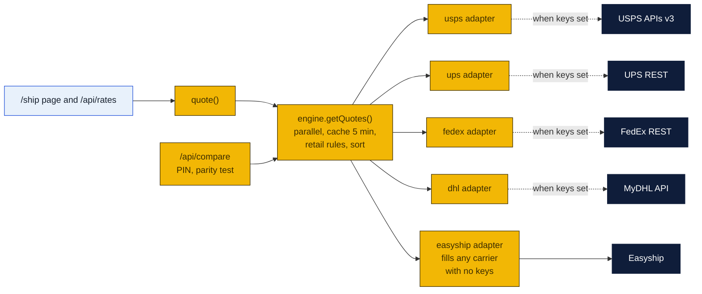
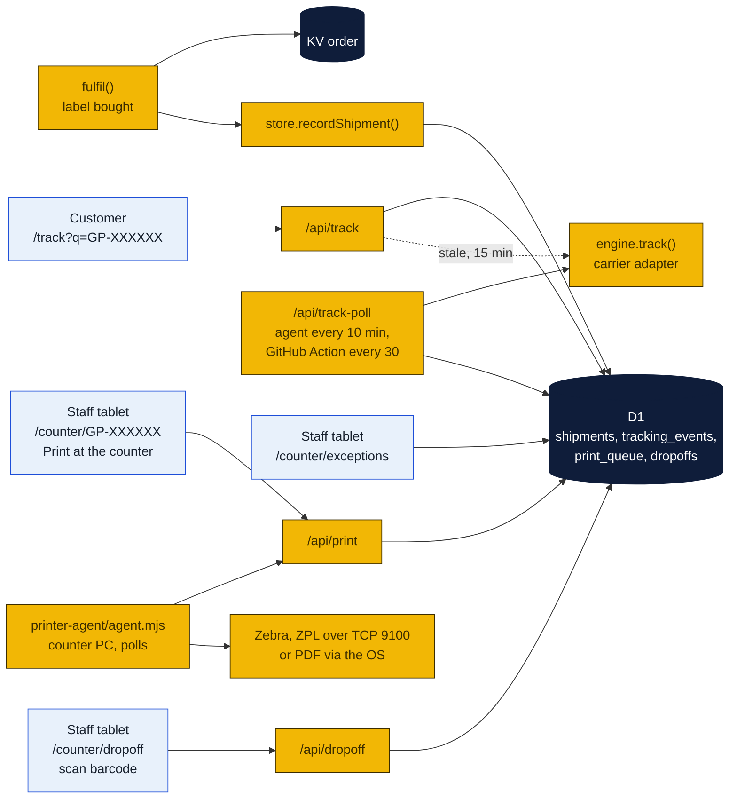
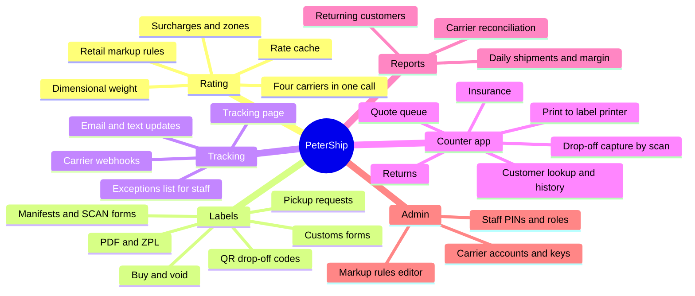
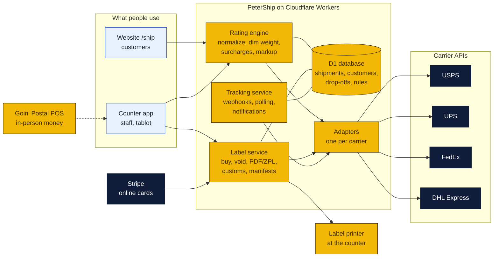
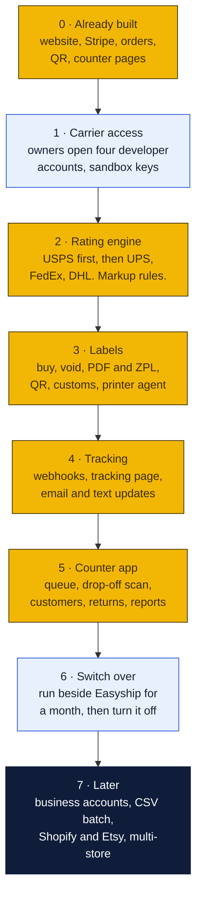
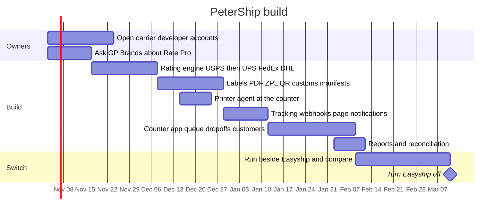

# PeterShip

PeterShip is the store's own shipping client. A plan for replacing Easyship with software the store owns: rating, labels, tracking, drop-offs and reports for USPS, UPS, FedEx and DHL, built on the same Cloudflare stack as the website. The same thing ShippingEasy, Easyship and GP Rate Pro do, but ours. PeterShip is proprietary, see [LICENSE](LICENSE); it is not under the repository's Apache license.

Item 44 in [`AGENDA.md`](../AGENDA.md) tracks it. Phase 2's foundation is built and running in mock mode, and the first pieces of Phases 3, 4 and 5 (print queue and printer agent, tracking page, drop-off capture) landed October 26; see [What is built so far](#what-is-built-so-far).

## What is built so far

Started October 21, 2026. The website now runs on PeterShip's rating engine, with Easyship as one adapter among five, so nothing changes for customers until the direct carriers are switched on.

| Piece | Where | State |
|---|---|---|
| Shared shapes: Address, Parcel, Rate, Label, TrackingEvent, Provider | `site/src/shipping/types.ts` | Done |
| Billable weight: dimensional divisors per carrier, USPS one-cubic-foot rule, ounce and pound rounding, length-plus-girth oversize check | `site/src/shipping/dim.ts` | Done |
| OAuth client-credentials tokens cached in KV, JSON calls with carrier-tagged errors | `site/src/shipping/http.ts` | Done |
| USPS adapter: OAuth, total-rates search (domestic and international), label with payment authorization, void, tracking | `site/src/shipping/providers/usps.ts` | Written to the published reference, not yet sent to USPS |
| UPS adapter: OAuth, Shop rating with negotiated rates and transit times, ship, void, track | `site/src/shipping/providers/ups.ts` | Same |
| FedEx adapter: OAuth, rate quotes with account rates, ship, cancel, track | `site/src/shipping/providers/fedex.ts` | Same |
| DHL Express adapter: rates, shipments with export declaration, tracking | `site/src/shipping/providers/dhl.ts` | Same |
| Easyship adapter wrapping the existing client | `site/src/shipping/providers/easyship.ts` | Done, carries the site today |
| Rating engine: every configured carrier in parallel, Easyship fills gaps, retail rules, five-minute cache, sorted, errors logged not shown | `site/src/shipping/engine.ts` | Done |
| Label routing by rate id prefix, so Stripe and the counter never know which adapter bought the label | `site/src/shipping/engine.ts`, `site/src/lib/fulfil.ts` | Done |
| Parity endpoint: every provider's rates side by side for one shipment | `POST /api/compare`, staff PIN | Done |
| D1 schema: customers, shipments, tracking events, drop-offs, retail rules, staff, print queue | `site/db/schema.sql` | Applied locally by `npm run db:local`, in production by `npm run db:remote`. Orders stay in KV; shipments are mirrored into D1 |
| Carrier keys and sandbox switches | `site/.dev.vars.example`, `site/wrangler.jsonc` | Done, all blank until issue 12 |
| PeterShip store: shipments, tracking events, print queue, drop-offs in D1, with a memory fallback when no database is bound | `site/src/shipping/store.ts` | Done. Every bought label is recorded here as well as in KV |
| Tracking: `track()` and `voidLabel()` routed by label id prefix, public page at `/track`, `GET /api/track` refreshes from the carrier when events are older than fifteen minutes | `site/src/pages/track/`, `site/src/pages/api/track.ts` | Done in mock mode. Linked from the done page, in all 13 languages |
| Print queue and printer agent: staff tap Print at the counter, a small Node program on the counter PC prints ZPL to a Zebra or a PDF through the OS | `POST /api/print`, [`printer-agent/`](printer-agent/README.md) | Done, untested against a real Zebra ([issue 5](https://github.com/wbp318/goin-postal-forsythe/issues/5)) |
| Drop-off capture: scan a prepaid or return package's barcode, carrier guessed from the number, "carrier picked up" marks the day's hand-over | `/counter/dropoff`, `POST /api/dropoff` | Done |
| Tracking poll: refreshes every open shipment older than fifteen minutes from its carrier adapter. Run by the printer agent every ten minutes while the shop PC is on, by a scheduled GitHub Action every thirty minutes, or by staff on demand | `site/src/shipping/poll.ts`, `POST /api/track-poll`, `.github/workflows/track-poll.yml` | Done in mock mode |
| Exceptions list for staff: carrier exceptions, returns to sender, labels not scanned after three days, no movement for seven days, with Check carriers now | `/counter/exceptions`, `POST /api/exceptions` | Done |

Customers see service, price and days only. Cost and the provider that answered stay on the server.

**Next:** the owners open the four developer accounts (issue 12). The first sandbox call to each carrier will need field adjustments; that is expected and is why the adapters are isolated. Then the parity test. Meanwhile the printer agent can be tried against the shop's thermal printer with `node agent.mjs --test` (issue 5). Customer email and text updates are the next piece that needs no carrier keys; carrier webhooks, customs forms and manifests wait on the keys.

## Why build it

| Reason | What it buys the store |
|---|---|
| No middleman fee | Easyship charges a few cents a label on linked accounts and a cent a quote. Ours charges nothing per label. |
| Own retail pricing | Rate Pro's markup rules live in our file, not in a vendor's screens. Online and counter always agree. |
| Own the data | Every shipment, customer and drop-off in our database, exportable, for the reports in agenda item 36. |
| One screen at the counter | Staff quote, print, capture drop-offs and look up customers in one app instead of Rate Pro plus a browser. |
| Franchise angle | Built once for Forsythe, it could run for other Goin' Postal stores on a per-store basis. GP Brands may or may not allow it; that is a question for them. |

What it does not replace: the Goin' Postal POS. In-person money still runs there. Stripe still takes online cards.

## What it has to do

## How it fits together

The website already has the customer side, Stripe, orders in KV, the done page with QR codes, and the counter pages. The shipping client grows out of the `quote()` and `buyLabel()` functions that today call Easyship: each carrier gets an adapter behind the same two functions, and the pages do not change.

## What each carrier needs

| Carrier | Account | API | Approval | Label formats | Notes |
|---|---|---|---|---|---|
| USPS | Business account with an Enterprise Payment System account | USPS APIs (OAuth 2.0): Prices, Labels, Tracking, SCAN forms | Self-serve developer portal, then a payment account for live labels | PDF, ZPL | Web Tools retired January 2026, so only the new APIs are an option. |
| UPS | UPS account number in the store's name | UPS Developer Portal (OAuth 2.0): Rating, Shipping, Tracking, Pickup | Self-serve, production access after a test | PDF, ZPL, GIF | Negotiated rates need the account linked to the app. |
| FedEx | FedEx account number | FedEx Developer Portal REST: Rates, Ship, Track, Pickup | Self-serve, production keys after certification checklist | PDF, ZPL, PNG | Web Services goes maintenance-only July 2026, REST is the target. |
| DHL Express | DHL Express account | MyDHL API: Rates, Shipments, Tracking, Pickups | DHL approves API access per account, slowest of the four | PDF, ZPL | Customs documents are built into the shipment call. |

All four are free to call. Costs are postage only.

## Phases

### Phase 0: already built

Website, 13 languages, Stripe Checkout, orders in KV, done page with QR and pickup code, counter page with PIN, print sheet pattern, the `quote()` and `buyLabel()` seams, and the Rate Pro markup rules file. Everything below plugs into these.

### Phase 1: carrier access (owners, 1 to 3 weeks of waiting)

- [ ] USPS: Business Customer Gateway account, developer portal app, Enterprise Payment System account funded for labels.
- [ ] UPS: developer portal app linked to the store's account number, production access.
- [ ] FedEx: developer portal project linked to the account, pass the certification checklist.
- [ ] DHL Express: request MyDHL API access through the account rep.
- [ ] Confirm with GP Brands that a franchisee may ship outside Rate Pro. Rin said the POS is required for money; this asks whether the quoting system is too.

Nothing can be tested until each one lands. They can be requested in parallel on day one.

### Phase 2: rating engine (2 to 3 weeks)

- One `Rate` model for all carriers, already defined in the site.
- Adapter per carrier that maps our address and parcel to the carrier's request and back.
- Dimensional weight per carrier rule, residential and delivery-area surcharges, fuel surcharge pass-through, zone lookup.
- Retail markup from `ratepro.json`, moved into the database with an editor screen.
- Rate cache keyed on origin, destination ZIP, weight band and dimensions, five-minute TTL, so one customer re-quoting does not hit four carriers four times.
- Parity test: 50 real quotes compared against Easyship and against Rate Pro's screen. Must match Rate Pro to the cent before Phase 6.

### Phase 3: labels (2 to 3 weeks)

- Buy and void per carrier, with the carrier's own QR drop-off code where it exists (USPS Label Broker, UPS and FedEx QR return codes).
- PDF for home printing, ZPL for the counter's thermal printer.
- Customs forms for international: CN22, CN23, commercial invoice, built from the item list the customer already types.
- End-of-day: USPS SCAN form, UPS and FedEx manifests, pickup requests.
- Printer agent: a tiny program on the counter PC or a networked Zebra that watches a print queue in the database, so a staff tap on the tablet prints at the counter.

### Phase 4: tracking (1 to 2 weeks)

- Register carrier webhooks where offered, poll where not, store events per shipment.
- Tracking page on the site, same look as the done page, no login needed.
- Email and text updates: shipped, out for delivery, delivered, exception. Text costs about a cent a message through a provider like Twilio; email is free through Cloudflare Email Workers or a transactional service.
- Exceptions list for staff: anything stuck, returned or damaged.

### Phase 5: counter app (3 to 4 weeks)

- Replaces the counter pages with one staff app on the tablet: PIN login, roles.
- Quote queue: everything customers reserved online, plus walk-ups entered by staff.
- Drop-off capture: scan an incoming prepaid package's barcode, record it, print a receipt, so "I dropped it off and it never moved" has an answer. Rate Pro does this and it matters.
- Customer lookup and history, address book, returning customer flag, which feeds the Coupon Counter.
- Returns: generate return labels for online retailers' customers.
- Third-party insurance quote and purchase.
- Reports: daily shipments and margin, carrier reconciliation against the carrier invoice, returning customers, busiest hours. Agenda items 15 and 36 come free.

### Phase 6: switch over (1 month of running both)

- Website quotes both ways and logs the difference. Staff see both prices at the counter.
- When a month passes with no mismatch complaints, Easyship is turned off and its key deleted.
- Keep the Easyship adapter in the code as a fallback switch.

### Phase 7: later

- Business accounts for local shops and Etsy sellers: monthly invoice, pickup schedule, CSV batch upload. Agenda item 28.
- Shopify, Etsy and eBay order import.
- Multi-store mode: one install, many Goin' Postal locations, each with its own accounts and markup. The franchise conversation.

## Timeline

About four months from carrier access to switch-over, holiday season excluded from the risky parts. The build weeks assume Claude Code doing most of the typing with one person reviewing; a traditional team would quote two to three times longer.

## What it costs

| Item | Cost |
|---|---|
| Carrier APIs | $0. Postage only. |
| Cloudflare D1 database | $0 on the free plan up to 5 GB and 5 million reads a day; $5 a month Workers Paid if exceeded. |
| Text updates | about $0.01 a message through Twilio or similar. 300 shipments a month with three texts each is about $9. |
| Email updates | $0 with Cloudflare Email Workers; a transactional service like Resend is free to 3,000 a month. |
| Thermal label printer | $150 to $400 one time if the shop does not already have a 4x6 thermal printer (issue 5). |
| Barcode scanner for drop-offs | $30 to $80 one time, or the tablet camera. |
| Third-party insurance | per policy, passed to the customer. |
| Saved | Easyship's per-label and per-quote fees, and any Easyship or Rate Pro subscription the store pays today. |

Full site costs are in [`site/costs/README.md`](../site/costs/README.md).

## Risks

- **Approvals.** DHL is slow and sometimes declines small accounts. Start with USPS, UPS and FedEx; DHL can stay on Easyship longer.
- **Carrier API churn.** USPS retired Web Tools in January 2026 and FedEx is retiring Web Services. Adapters isolate this, but each carrier will change something every year.
- **Rate parity.** If the counter and the website disagree by a dollar, customers notice. Phase 2's parity test is the gate.
- **Franchise rules.** GP Brands may require Rate Pro for franchisee shipping. Ask before building Phase 5.
- **Hazmat and restricted goods.** The customer form needs the carrier's hazmat questions before labels go live. Lithium batteries are the common case.
- **Printer plumbing.** Printing from a browser to a thermal printer is the fiddliest part of any shipping client. The printer agent in Phase 3 is the fix and should be prototyped early.
- **Support burden.** Easyship answers "why did my label fail" today. After switch-over, we do.

## Decisions for Rin before Phase 2

1. Which carrier accounts does the store hold in its own name today, and which are through Goin' Postal's master accounts?
2. Is a franchisee allowed to quote and ship outside Rate Pro?
3. Should DHL be in scope for version one, or stay on Easyship?
4. Text updates to customers: yes or no, and from what number?
5. Is the goal Forsythe only, or something other Goin' Postal stores could run?
