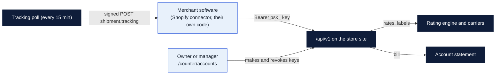

# PeterShip public API (version 1)

The way a business account's own software ships through the store without anyone at the counter typing. A Shopify or Etsy shop, a warehouse laptop, a clinic's billing system: each gets an **API key** tied to its account, quotes and buys labels, and the labels land on that account's next statement with its discount already applied. Tracking changes are pushed back to the software by **webhook**.

This is the piece a buyer like Auctane or Shopify looks for first. It is also what the [Shopify connector](../shopify-connector/README.md) uses.

## How it fits



Chart legend: a **rectangle** is a step or a thing; **dark blue** runs in Cloudflare, **gold** runs in the store, **light blue** is a person or someone else's software; an **arrow** is data moving, and its label says what.

## Getting a key

1. A manager or owner opens **Staff → Accounts** on the counter pages and picks the business account (make one first if the business has none; it needs a customer record).
2. In **API keys**, type a label (say `Shopify`) and, if the software wants tracking pushed to it, an `https://` webhook address. Press **Make a key**.
3. The key (`psk_...`) and, with a webhook, the signing secret (`whsec_...`) appear **once**. Copy both into the software now. The store keeps only a hash of the key, so a lost key means a new key.
4. **Revoke** cuts a key off at once. Closing the account does too.

Every call made with a key is logged in the audit log under `API <business> (<label>)`.

## Calling it

Base URL: the store site, for example `https://goinpostalforsythe.com/api/v1`. Every request carries `Authorization: Bearer psk_...`. Bodies are JSON. Errors are `{ "error": "a plain sentence" }` with the usual status codes: 400 for a bad request, 401 for a missing or revoked key, 404 for a shipment that is not on this account.

### `GET /me`

Who this key belongs to.

```bash
curl -s https://goinpostalforsythe.com/api/v1/me -H "Authorization: Bearer $PSK"
```
```json
{ "account": { "id": 3, "business_name": "Bayou Candles", "discount_percent": 10 }, "key": { "id": 7, "label": "Shopify", "prefix": "psk_4fGh2k", "webhook_url": "https://example.com/petership" } }
```

### `POST /rates`

Prices for a parcel to an address, with the account's discount already taken off.

```bash
curl -s https://goinpostalforsythe.com/api/v1/rates -H "Authorization: Bearer $PSK" -H "Content-Type: application/json" -d '{
  "to": { "name": "Ana Reyes", "line_1": "415 Lamar St", "city": "Dallas", "state": "TX", "postal_code": "75202", "country_alpha2": "US", "phone": "2145550100" },
  "parcel": { "length_in": 10, "width_in": 8, "height_in": 4, "weight_lb": 2.5, "value_usd": 40 }
}'
```
```json
{ "rates": [ { "id": "usps-ground-advantage", "carrier": "USPS", "service": "Ground Advantage", "price": 8.91, "currency": "USD", "min_days": 2, "max_days": 5 } ],
  "demo": false, "address": { "errors": [], "warnings": [] } }
```

Address fields: `name`, `line_1`, `line_2` (optional), `city`, `state` (two-letter code), `postal_code`, `country_alpha2`, `phone` (optional), `email` (optional). The internal names `contact_name`, `contact_phone` and `contact_email` are accepted too. Lines are cut to 35 characters, the carrier limit. Parcel: `length_in`, `width_in`, `height_in`, `weight_lb`, `value_usd` (optional, used for insurance). `demo: true` means the store is quoting in mock mode (no carrier keys yet); the prices are sample prices and no real label is bought.

A PO Box or military address gets USPS rates only. `address.warnings` lists things like a missing apartment line; `address.errors` would stop a purchase.

### `POST /shipments`

Buys the label now and bills the account. Send back the `rate_id` you chose from `/rates`.

```bash
curl -s https://goinpostalforsythe.com/api/v1/shipments -H "Authorization: Bearer $PSK" -H "Content-Type: application/json" -d '{
  "to": { "name": "Ana Reyes", "line_1": "415 Lamar St", "city": "Dallas", "state": "TX", "postal_code": "75202", "country_alpha2": "US", "phone": "2145550100" },
  "parcel": { "length_in": 10, "width_in": 8, "height_in": 4, "weight_lb": 2.5, "value_usd": 40 },
  "rate_id": "usps-ground-advantage",
  "reference": "Shopify #1042",
  "insure": true,
  "addons": ["signature"],
  "email": "ana@example.com"
}'
```
```json
{ "shipment": { "id": "GP-7K2M9Q", "status": "labeled", "carrier": "USPS", "service": "Ground Advantage", "tracking_number": "9400...",
    "price": 8.91, "total": 11.41, "label_url": "https://goinpostalforsythe.com/labels/GP-7K2M9Q.pdf", "label_zpl": "^XA...^XZ",
    "track_url": "https://goinpostalforsythe.com/track?q=GP-7K2M9Q", "reference": "Shopify #1042", "created_at": "2026-10-28T15:04:11.000Z" } }
```

Status 201. `reference` is your own order number and is written into the audit log. `insure: true` adds the store's insurance add-on; `addons` are the add-on codes the store offers (see Staff → Prices → Add-ons). `email` is the recipient's address for tracking emails, optional. International destinations are refused for now: customs forms are done at the counter.

Prices are rated again at purchase time, so if the parcel changed since `/rates` the `rate_id` may no longer match; call `/rates` again.

### `GET /shipments?since=2026-10-01T00:00:00Z`

This account's shipments, newest first, up to 500. `since` is optional.

### `GET /shipments/:id`

One shipment with its tracking `events` (`[{ at, status, description, location }]`).

### `POST /shipments/:id/void`

```bash
curl -s https://goinpostalforsythe.com/api/v1/shipments/GP-7K2M9Q/void -H "Authorization: Bearer $PSK" -H "Content-Type: application/json" -d '{ "reason": "Customer cancelled the order" }'
```

Voids an unshipped label; the charge comes off the statement the same way a counter void does. A reason is required and is audited. A shipment the carrier has already scanned cannot be voided.

### `POST /batches`

```bash
curl -s https://goinpostalforsythe.com/api/v1/batches -H "Authorization: Bearer $PSK" -H "Content-Type: application/json" -d '{
  "pick": "cheapest",
  "dry_run": true,
  "rows": [
    { "reference": "#1001", "to": { "name": "Ann Lee", "line_1": "5 Oak St", "city": "Shreveport", "state": "LA", "postal_code": "71101", "country_alpha2": "US" }, "parcel": { "weight_lb": 2, "length_in": 10, "width_in": 8, "height_in": 4 } },
    { "reference": "#1002", "to": { "name": "Bo Kim", "line_1": "9 Pine Rd", "line_2": "Unit 4", "city": "Austin", "state": "TX", "postal_code": "78701", "country_alpha2": "US" }, "parcel": { "weight_lb": 1, "length_in": 10, "width_in": 8, "height_in": 4 } }
  ]
}'
```

Up to 200 rows. Every row is address-checked and rated with the account's discount; `pick` is `cheapest` (default), `fastest`, or a service name such as `USPS Ground Advantage` or `UPS Ground`. With `dry_run: true` nothing is bought and each row comes back with its chosen service and price, so a shop can show the customer the cost first. Without it, every good row is bought and billed to the account, and the call returns `201` with a `batch` id and one result per row:

```json
{ "batch": "B-MVTLQKNI", "bought": 2, "failed": 0, "total": 17.38,
  "results": [ { "line": 1, "reference": "#1001", "id": "GP-SW2UL8", "carrier": "USPS", "service": "USPS Ground Advantage", "tracking_number": "9400...", "price": 8.69, "label_url": "https://.../labels/GP-SW2UL8.pdf", "error": null } ] }
```

A row with a bad address or no rate is skipped with its `error` filled in; the others still go through. `insure: true` adds declared-value insurance on every row from each row's `parcel.value_usd`. International rows are refused.

## Webhooks

When the tracking poll finds new events on a shipment billed to the account, it POSTs to every active key on that account that has a webhook address:

```
POST https://example.com/petership
Content-Type: application/json
X-PeterShip-Event: shipment.tracking
X-PeterShip-Signature: sha256=<hex HMAC-SHA256 of the raw body, keyed with the whsec_ secret>

{ "type": "shipment.tracking", "shipment_id": "GP-7K2M9Q", "tracking_number": "9400...", "carrier": "USPS", "service": "Ground Advantage",
  "status": "in_transit", "event": { "at": "...", "status": "in_transit", "description": "Arrived at USPS facility", "location": "Dallas TX" },
  "events": [ "...the new events only..." ], "sent_at": "..." }
```

Check the signature before trusting a delivery (Node):

```js
import { createHmac, timingSafeEqual } from 'node:crypto';
const expected = 'sha256=' + createHmac('sha256', process.env.WHSEC).update(rawBody).digest('hex');
const ok = expected.length === sig.length && timingSafeEqual(Buffer.from(expected), Buffer.from(sig));
```

Answer with any 2xx within 8 seconds. A failed delivery is logged on the store side and not retried; `GET /shipments/:id` always has the full picture, so poll it if a webhook was missed.

## Limits and what is not here yet

- No rate limit beyond Cloudflare's; keys are per account and revocable, which is enough for the first merchants.
- International shipments, returns and multi-piece shipments go through the counter for now. Batches are domestic only for the same reason.
- Webhooks cover tracking only. `shipment.voided` and `statement.issued` events are the natural next ones.
- A listed Shopify app (OAuth, the App Store) would replace the custom-app token the connector uses today. See the connector README.
