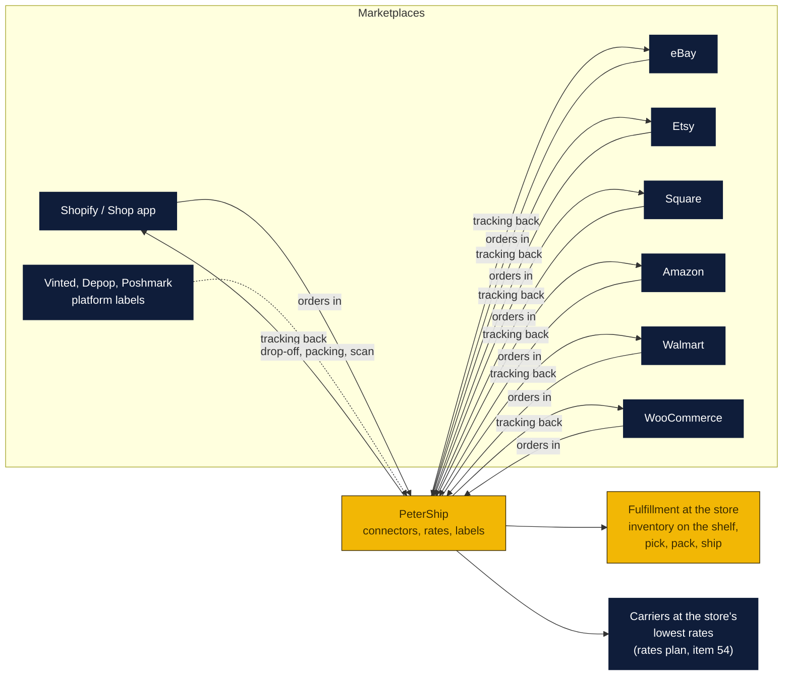

# Marketplace connectors and the fulfillment play

What it takes for PeterShip to take orders from Shopify, eBay, Etsy, Square, Amazon, Walmart, WooCommerce and the resale apps (Vinted, Depop, Poshmark), ship them at the lowest rate the store can get, and do what ShipBob does for the Shop app seller: hold the goods and ship each order as it comes in. Written October 29, 2026 at the owners' request; the aim is the one in the agenda, a product an Auctane or a Shopify buys.

### How to read the charts

| Color | Meaning |
|---|---|
| Yellow | PeterShip and the store |
| Navy | Marketplaces, carriers, 3PLs and their APIs |
| Light blue | Decisions for Peter and Rin |

## What ShipBob is, and what the store can be

When a Shop app order ships "via USPS from ShipBob", the seller keeps stock in ShipBob's warehouse; ShipBob's software takes the order from Shopify, picks and packs it, buys a USPS label on its own negotiated rates, and pushes the tracking number back so the Shop app shows it. ShipBob charges receiving, storage (about $5 a bin or $10 a shelf a month), pick and pack (about $2.50 to $3.50 an order plus $0.20 to $0.30 an extra item), and shipping at a markup, with a minimum around 400 orders a month and a four-figure onboarding fee. That minimum is the gap: a Monroe seller doing 40 orders a month cannot use ShipBob at all.

PeterShip already has most of the software side: the public API, the Shopify connector, batch shipping, business accounts with monthly statements, pickups, the returns portal. What is missing is the two halves of fulfillment: **taking orders automatically** from more marketplaces, and **inventory**: the store holding a seller's goods and shipping from the shelf. Both are below.

## The marketplaces, one by one

| Marketplace | Can PeterShip pull orders? | Can it push tracking back? | Labels | What to build | Today |
|---|---|---|---|---|---|
| **Shopify** (and the Shop app) | Yes, Admin API, custom-app token today, a listed app with OAuth later | Yes, fulfillment with tracking | Ours | Already built: `shipping-client/shopify-connector/`. A listed app is T25's leftover | ✅ Connector |
| **eBay** | Yes, Sell Fulfillment API (OAuth app, eBay developer program) | Yes, `createShippingFulfillment` | Ours (eBay sells its own labels too, at commercial rates, so ours must match the rates plan) | An eBay app registration in the company's name, OAuth, order poll every few minutes, tracking push | CSV: the Seller Hub orders report imports in the batch page (v1.62.1) |
| **Etsy** | Yes, Open API v3 (OAuth, app approval takes days) | Yes, `createReceiptShipment` | Ours (Etsy sells labels too) | Same shape as eBay | CSV: the Etsy orders export imports (v1.49.0) |
| **Square** (Square Online) | Yes, Orders API with a seller access token | Yes, fulfillment update with tracking | Ours | Token-based connector, simpler than eBay: no app review for a seller's own token | CSV: the Square orders export imports (v1.62.1) |
| **Amazon** | Yes, Selling Partner API (registration, approval, strict) | Yes, feeds | Amazon pushes Buy Shipping hard; merchant-fulfilled sellers can use ours | The heaviest integration; do it when a seller asks, or take the order report CSV | CSV: the merchant order report imports (v1.62.1) |
| **Walmart Marketplace** | Yes, Marketplace API (seller keys) | Yes | Ours | Similar to Square in effort | CSV import once a seller asks for the column names |
| **WooCommerce** | Yes, REST API with per-site keys | Yes, order meta or a shipment plugin | Ours | Key-based, per site, easy | CSV: the orders export imports (v1.62.1) |
| **Vinted** | API only for approved luxury and designer sellers; labels are Vinted's | No need | Vinted's prepaid label | Nothing to integrate. The store's part is packing, printing the label from the seller's phone, drop-off with a receipt: `/returns` already does that shape | ✅ Drop-off |
| **Depop** | Partner API for managed shipping; sellers may buy their own label elsewhere and upload the tracking | Seller uploads the number | Depop's, or ours | Sellers who want cheaper than Depop's label buy ours and paste the tracking; the drop-off receipt gives them the number | ✅ Drop-off and label |
| **Poshmark** | No public API; labels come prepaid through Endicia, Priority Mail only | No | Poshmark's prepaid label | Nothing to integrate; drop-off and packing only | ✅ Drop-off |

The resale apps are a drop-off business, not a label business, and the store already has the drop-off page, the receipt, the returns form and the mailbox. The money there is packing, boxes, and the mailbox a reseller rents to keep their address off the app.

## Fulfillment at the store, the way ShipBob does it, at Monroe scale

A seller sends the store a box of stock; the store shelves it; every order that comes through a connector is picked, packed and shipped the same day on the store's rates; the seller sees it on their statement. PeterShip needs four things it does not have:

1. **Inventory**: a `products` table per account (SKU, name, weight, dimensions, quantity on hand, bin), receiving (count in, photo), and a stock line on every connector order.
2. **Order ingestion**: the connectors above writing orders into a queue the counter can see ("12 Shopify orders to pack"), with the SKUs each needs, and a pick list for the morning.
3. **Pick, pack, ship**: the batch page already rates and buys; add the pick list, a packing station flow (scan the SKU, scan the box, label prints, tracking pushes back), and the intake photo the claims page wants.
4. **Fees on the statement**: receiving, storage per bin per month, pick and pack per order and per extra item, the label at cost plus the account's rule. All of this is the business accounts statement, which exists; the lines are new.

Pricing to undercut ShipBob at small volume: no minimum, no onboarding fee, $1.50 to $2.50 pick and pack, $4 a bin a month, labels at the store's cost plus the account markup from the rates plan. A seller doing 60 orders a month pays about $150 plus postage, instead of nothing (because ShipBob will not take them) or an afternoon a week at the post office.

## The rates, because that is the whole fight

Every marketplace above sells its own labels at commercial rates (eBay, Etsy, Shopify Shipping, Amazon Buy Shipping). A connector is only worth using if the store's label is as cheap or the service is better. That is the rates plan in [`../rates/`](../rates/README.md): match USPS through a postage platform adapter, beat on UPS and FedEx with the store's own account, win local with Connect Local, and let the benchmark line (v1.61.0) prove it on every quote. Nothing in this document works at a loss on labels; the fulfillment fees and the account's add-ons are the margin.

## Build order

| Step | What | Effort | Needs |
|---|---|---|---|
| 1 ✅ v1.62.1 | eBay, Square, WooCommerce and Amazon order exports read by the batch importer, so any seller on those platforms ships a stack today by CSV | Done | Nothing |
| 2 ✅ v1.64.0 | Square connector (seller token, orders poll, tracking push), the easiest live one | Done: `shipping-client/square-connector/` | A Square seller to test with |
| 3 | eBay connector (developer account, OAuth, Sell Fulfillment API) | A week | eBay developer program approval in the company's name (the LLC, item 57) |
| 4 | Etsy connector (OAuth, app approval) | 3 days once approved | Etsy app approval |
| 5 ✅ v1.63.0 | Inventory and the pick list: `products`, receiving, stock per order | Done | A first fulfillment customer to use it |
| 6 ✅ v1.63.0 (first form) | Packing station: Pick, pack and ship buys the label, takes the stock and prints; scanning the SKU and the box barcode comes with the scanner (issue 5) | Done | |
| 7 ✅ v1.63.0 | Fulfillment fees on the statement | Done | |
| 8 | Amazon SP-API and Walmart | When a seller asks | Registrations |
| 9 | The listed Shopify app (OAuth) | A week | A second Shopify merchant |

Steps 2 to 4 are to-do T28; 5 to 7 are T29; 8 and 9 stay where they are.

## Decisions for Peter and Rin

1. Offer fulfillment (holding stock) at all, or only labels and drop-offs? It needs shelf space at the store and someone packing every morning.
2. Which connector first after Square: eBay (most local resellers) or Etsy (most local makers)?
3. The fulfillment price list: pick and pack, storage per bin, receiving. The numbers above are a starting point under ShipBob.
4. Register the developer accounts (eBay, Etsy, Amazon) under the LLC once it exists, so the integrations belong to the company a buyer buys.

Sources: [ShipBob review and pricing, 2026](https://dupple.com/reviews/shipbob), [ShipBob pricing calculator](https://www.fulfyld.com/tools/shipbob-pricing-calculator/), [3PL pick and pack costs by order size, 2026](https://eightx.co/blog/average-ecommerce-3pl-pick-pack-cost-by-order-size-2026), [Vinted pro integrations](https://vinted.co.uk/pro/integrations), [Depop partner API, managing shipping](https://partnerapi.depop.com/api-docs/how-to-guides/managing-shipping/), [Endicia and Poshmark](https://endicia.com/why-us/success-stories/poshmark), [marketplace shipping in 2026](https://listperfectly.com/selling/2026-shipping-fees-for-resellers/), [eBay Seller Hub orders report](https://www.ebay.ca/help/selling/selling-tools/seller-hub?id=4095), [Shopify order export](https://help.shopify.com/en/manual/orders/export-orders).
