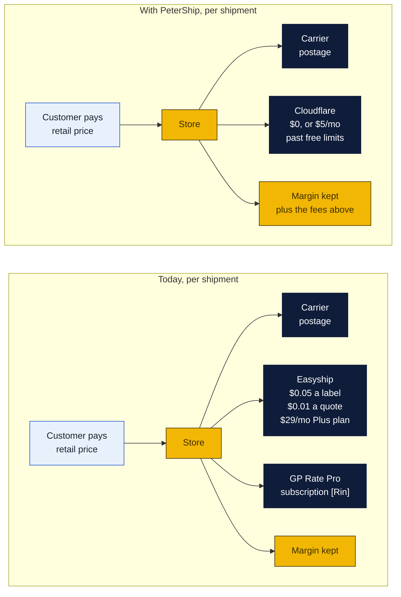
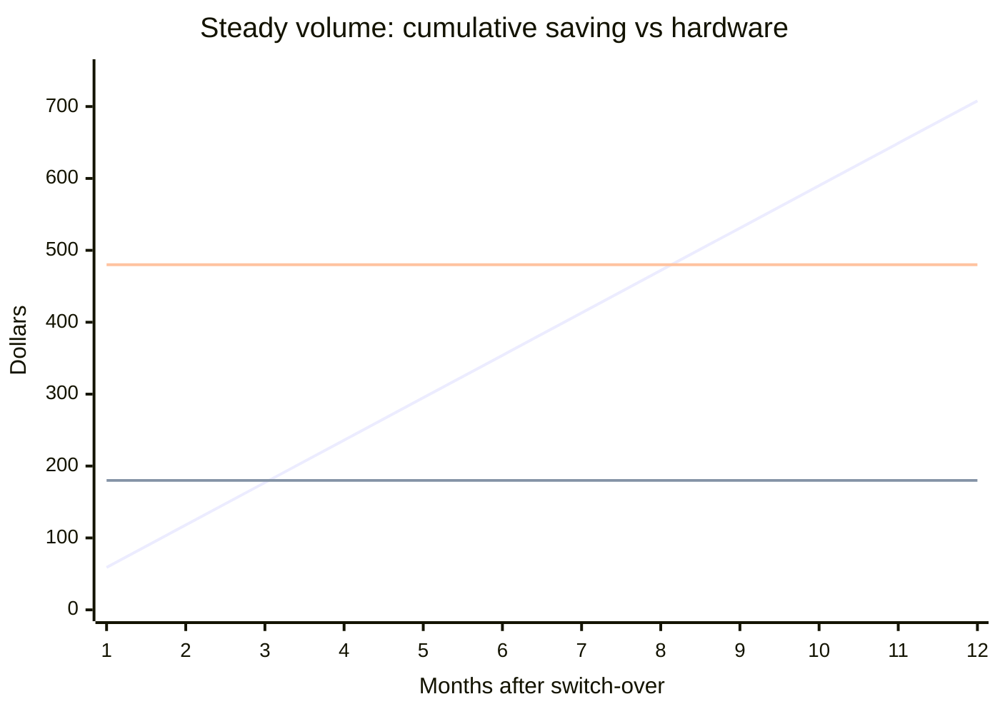
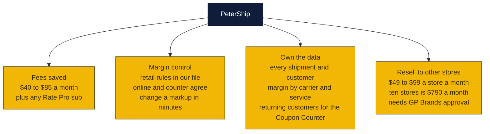

# What PeterShip saves

The question: how much does the store save each month by rating, labelling and tracking through its own client instead of Easyship and GP Rate Pro?

Short answer: on fees alone, between about **$40 and $85 a month** depending on volume, which pays off the one-time hardware in three to twelve months. Whatever the store pays today for a Rate Pro or Easyship subscription comes on top of that, dollar for dollar. The bigger wins are not on this page: the margin on every label is set in our own file, the data is ours, and the counter and the website always quote the same number.

Every figure below is an estimate from public pricing. The two numbers only Rin can fill in are marked **[Rin]**.

## Where the money goes today, and after

Postage is the same either way: the carrier APIs are free and the store keeps its own carrier accounts. What changes is the middle column.

## Monthly cost, side by side

Three volumes, counting every shipment the store rates, online and at the counter. Quotes run about five per shipment because customers compare before they buy.

| Monthly volume | Easyship today | Rate Pro today | PeterShip | Saving a month | Saving a year |
|---|---|---|---|---|---|
| Quiet: 100 shipments, 500 quotes | $39 | [Rin] | $0 | **$39** + Rate Pro | $468 + Rate Pro |
| Steady: 300 shipments, 1,500 quotes | $59 | [Rin] | $0 | **$59** + Rate Pro | $708 + Rate Pro |
| Busy: 600 shipments, 3,000 quotes | $89 | [Rin] | $5 | **$84** + Rate Pro | $1,008 + Rate Pro |

How each line is worked out:

- Easyship: the $29 Plus plan, which is the tier that allows the store's own carrier accounts to be linked, plus $0.05 a label and $0.01 a quote. Quiet: 29 + 100 × 0.05 + 500 × 0.01 = $39. Steady: 29 + 15 + 15 = $59. Busy: 29 + 30 + 30 = $89.
- Rate Pro: GP Brands does not publish a price. If the store pays monthly for it and PeterShip replaces it at the counter, add that figure to every row. If Rate Pro is bundled into the franchise royalty and cannot be dropped, add nothing.
- PeterShip: Cloudflare Workers and D1 stay on the free plan until roughly 600 shipments a month, then the $5 Workers Paid plan. Email updates are free through Resend. Carrier APIs are free.

```mermaid
xychart-beta
  title "Fees a month, before any Rate Pro subscription"
  x-axis ["Quiet 100", "Steady 300", "Busy 600"]
  y-axis "Dollars a month" 0 --> 100
  bar [39, 59, 89]
  bar [0, 0, 5]
```

The tall bars are Easyship today. The short bars are PeterShip.

## What it costs to get there

| One-time item | Cost | Note |
|---|---|---|
| Thermal label printer | $150 to $400 | Skip if the shop already has a 4x6 thermal printer. Issue 5. |
| Barcode scanner for drop-offs | $30 to $80 | Or use the tablet camera for $0. |
| Build time | [Rin] | About three months from carrier keys to switch-over, with Claude Code doing most of the typing and one person reviewing. Count it at whatever that person's time is worth. |
| **Hardware total** | **$180 to $480** | $0 to $80 if the printer is already there. |

Optional running cost that is new, not a replacement: text updates at about $0.01 a message. Three texts per shipment is $3, $9 or $18 a month at the three volumes. The monetization plan prices this as a customer add-on, so it can pay for itself.

## Payback

Cumulative fee saving against the hardware, month by month, at the steady volume of 300 shipments and with no Rate Pro subscription counted.

The rising line is the saving. The two flat lines are the cheap and expensive hardware cases.

| Volume | Cheap hardware, $180 | Expensive hardware, $480 | Printer already owned |
|---|---|---|---|
| Quiet, $39 a month | 5 months | 13 months | immediate |
| Steady, $59 a month | 4 months | 9 months | immediate |
| Busy, $84 a month | 3 months | 6 months | immediate |

Every $25 a month of Rate Pro subscription that gets dropped shortens each of these by roughly a third.

## Where the real money is

The fee saving is modest. A store doing 300 shipments a month saves about the price of one dinner out. These three are worth more and are harder to put a number on:

- **Margin.** Today the markup lives in Rate Pro's screens and Easyship's rates. With PeterShip it is one rules file. If UPS raises a surcharge, the store's prices follow the same day. One extra dollar of margin on 300 shipments is $300 a month, more than three times the fee saving.
- **Data.** The staff reports page already shows what customers paid, what carriers charged and the margin by carrier and service. None of that leaves the store's database.
- **Resale.** The monetization plan puts PeterShip for other Goin' Postal stores at $49 to $99 a store a month. That is the only line here that turns the client from a cost saver into revenue.

## What Rin needs to fill in

1. What the store pays Easyship a month today, and on which plan.
2. What, if anything, the store pays for GP Rate Pro, and whether a franchisee is allowed to quote and ship without it.
3. Whether the shop already has a 4x6 thermal printer.
4. Roughly how many shipments the counter does a month, so the right row above is the real one.

## Sources

- Easyship plans and fees: the [site costs page](../../site/costs/README.md) sources, Plus $29 a month, $0.05 a label on linked carrier accounts, $0.01 a rate call on the free API. The per-label fee is the figure to confirm with Easyship.
- Cloudflare Workers and D1 limits: [What it costs](../README.md#what-it-costs) in the PeterShip plan.
- Resale pricing: [monetization/README.md](../../monetization/README.md).
- GP Rate Pro: no public price found. Ask GP Brands or read the franchise agreement.
