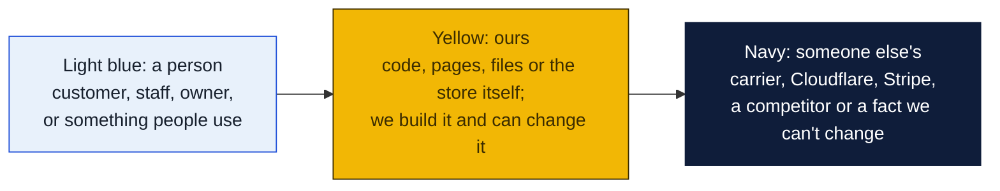
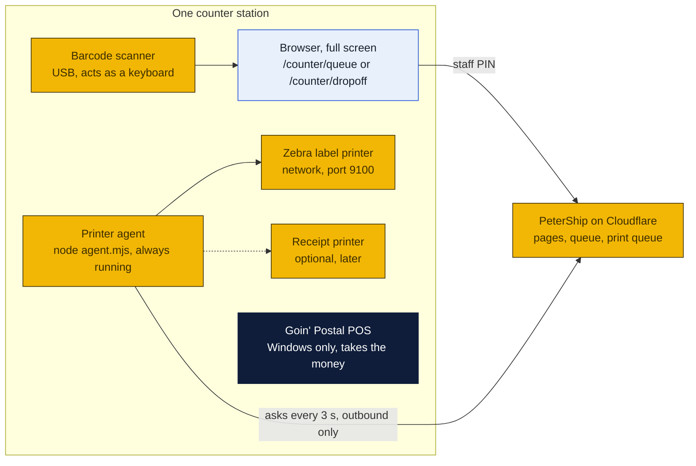
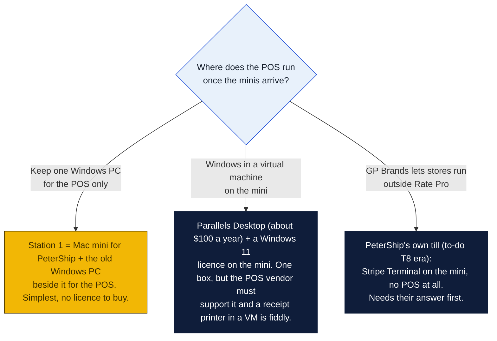

# Counter PCs: the plan for Windows 11 today and Mac minis tomorrow

What runs at the counter, on which machine, how it is set up, and how to move from the two Windows 11 PCs the store has now to the two Mac minis the owners want. Written for Peter, Rin and William; step by step, nothing assumed. The short version: PeterShip does not care which it is. The one thing that does care is the Goin' Postal POS, which is Windows software, so at least one Windows machine (or a Windows virtual machine) stays until GP Brands says otherwise.

### How to read the charts

Every chart in this repo uses the same three colors, so once you know them you can read any of them.



| Mark | Meaning |
|---|---|
| Solid arrow `-->` | Data or a person moves this way, or this happens next |
| Dotted arrow `-.->` | Only sometimes: when keys are set, when a condition holds, or a later plan |
| Cylinder | A database or stored records |
| Diamond with a question in it | A decision; follow the arrow whose label matches the answer |
| Big frame around boxes | A group: everything inside runs in the same place |

## 1. What a counter machine actually does

PeterShip lives on Cloudflare. The counter machine is a window onto it plus a hand for the printer. That is all.



Three consequences:

- **The machine needs almost nothing.** A browser, Node.js for the agent, and a network connection. A 2015 laptop would do; a Mac mini is luxury, which is fine.
- **Nothing is stored on it.** If a counter machine dies, plug in another, install Node and the agent, type the PIN, and the shop is back. Every record is in Cloudflare.
- **The agent talks out, never in.** No port forwarding, no firewall holes, no remote access needed. The agent asks the site for work; the site never calls the shop.

## 2. The two stations and what each does

Both stations run the same software. What differs is which page sits open all day and which printer the agent drives.

| | Station 1: shipping counter | Station 2: drop-offs and front |
|---|---|---|
| Page open all day | `/counter/queue` (walk-ups, buy, print, void) | `/counter/dropoff` (scan returns), `/counter/customers` |
| Printer agent | Yes, `printer: "counter"`, drives the Zebra | Optional, `printer: "front"`, drives a second Zebra or a receipt printer if bought |
| Scanner | Yes, for the customers' QR codes and tracking numbers | Yes, drop-offs are all scanning |
| POS | The Goin' Postal POS runs here, or on a third machine beside it | No |
| Also handles | End of day, reports, prices, invoices (manager or owner PIN) | Customers, accounts, exceptions |

If only one agent runs, give it `printer: "counter"` and every print job from either station goes to it; the queue page on station 2 still works. Two agents on two printers need the second station's jobs sent to `printer: "front"`, which is a one-line change on the print call and is not done yet; ask when the second printer arrives.

## 3. Route A: the two Windows 11 PCs you have now

Nothing to buy. About an hour per machine.

### 3a. Prepare the machine

1. Windows Update until it says up to date, then **Settings, Windows Update, Advanced options, Active hours** set to the shop's open hours so it never restarts mid-day.
2. **Settings, System, Power**: screen off never, sleep never when plugged in. A sleeping PC stops the agent and the queue page says OFFLINE.
3. Make a local account named `counter` with a simple password, standard user, not administrator. Set it to sign in automatically: `netplwiz`, untick "Users must enter a user name and password", enter the counter password. The PC boots straight to the counter desktop after a power cut.
4. Give the PC a name you will recognise, `COUNTER-1` and `COUNTER-2` (Settings, System, About, Rename this PC).
5. Install Chrome or Edge. Either is fine; the steps below say Chrome.

### 3b. Printers

6. **Zebra on the network** (preferred): plug its Ethernet cable into the shop switch, print a configuration label (hold the feed button at power-on, or Settings on a touch model) and read its IP address. In the router, reserve that address for the printer's MAC so it never changes. Write the address on a sticker on the printer.
7. **Zebra on USB** (if no Ethernet port): install Zebra's driver (Zebra Setup Utilities), then share the printer: Settings, Bluetooth and devices, Printers, the Zebra, Printer properties, Sharing, Share this printer, share name `Zebra`. The agent will send raw ZPL to `\\COUNTER-1\Zebra`.
8. **Barcode scanner**: any USB 2D scanner that reads QR codes (the customers' done page shows a QR). It acts as a keyboard, needs no driver, and should be set to send Enter after each scan (the manual has a barcode to scan for that). Test in Notepad: scan something, see the text and a new line.
9. **Receipt printer** (optional, later): an Epson TM-T20 or Star TSP143 on the network, static IP the same way. Set `RECEIPT_FORMAT=escpos` on the site and `receipt.host` in the agent.

### 3c. Node.js and the printer agent

10. Open PowerShell **as the counter user** and install Node.js:
    ```
    winget install --id OpenJS.NodeJS.LTS -e --source winget
    ```
    Close and reopen PowerShell, then `node -v` should print `v22` or higher.
11. Copy the folder `shipping-client/printer-agent` from this repo to `C:\PeterShip\printer-agent` (download the repo ZIP from GitHub, or `git clone` and copy the folder).
12. Copy `printer-agent.example.json` to `printer-agent.json` in that folder and fill in `site` (the real website address), `key` (the `PRINTER_KEY` secret from the Cloudflare dashboard; an owner has it), `printer` (`counter` on station 1), and either `zebra.host` (the IP from step 6) or `zebra.share` (`\\\\COUNTER-1\\Zebra` from step 7).
13. Test the printer without the website:
    ```
    cd C:\PeterShip\printer-agent
    node agent.mjs --test
    ```
    A label reading "PeterShip test label" comes out. If not, the problem is between the PC and the printer, not the site: wrong IP, printer asleep, wrong share name.
14. Install the agent so it starts with Windows and restarts if it crashes. In the same PowerShell:
    ```
    powershell -ExecutionPolicy Bypass -File install-windows.ps1
    ```
    That registers a Task Scheduler task called **PeterShip printer agent** that runs at sign-in, restarts every minute if it stops, and writes its log to `C:\PeterShip\printer-agent\agent.log`. Open Task Scheduler to see it running, or open the queue page: the first line should say "Printer agent online".
15. To stop it: Task Scheduler, the task, End. To remove it: `install-windows.ps1 -Uninstall`.

### 3d. The browser as the counter screen

16. Make a shortcut that opens the counter page full screen with no address bar. Right-click the desktop, New, Shortcut, target:
    ```
    "C:\Program Files\Google\Chrome\Application\chrome.exe" --kiosk --app=https://YOURSITE/counter/queue
    ```
    Name it **Counter**. Station 2 uses `/counter/dropoff`. Alt+F4 leaves kiosk mode when an owner needs the desktop.
17. Put that shortcut in the Startup folder so it opens after auto sign-in: press Win+R, type `shell:startup`, Enter, drag the shortcut in.
18. In Chrome, open the site once, click the lock icon, allow Notifications if asked, and set the language picker to what that counter's staff prefer; it is remembered per machine.
19. The staff PIN is typed each time the page opens. That is deliberate; it is what puts a name on every action.

### 3e. Recovery

If a Windows PC dies: another PC, steps 1 to 5, 10 to 14, 16 to 17, and a PIN. Forty minutes. Nothing was on the dead machine except the agent's JSON file, which the owner can re-type from the Cloudflare dashboard.

## 4. Route B: two Mac minis

A Mac mini is quiet, small, draws about 7 watts idle, is silent, gets macOS updates for seven or eight years, and the M-series chips are far more than this needs. For a machine that runs a browser and a tiny Node program all day it is close to ideal, and it is why the owners want them. The one hard fact is in the next section.

### 4a. The POS stays on Windows

The Goin' Postal POS and GP Rate Pro are Windows programs. They do not run on macOS. So:



Recommendation: the first branch. Buy the minis, run PeterShip and the browser on them, keep the better of the two Windows PCs beside station 1 for the POS only, and retire the other Windows PC. Revisit when GP Brands answers the Rate Pro question, because the day the store can run its own till, the last Windows box goes too.

### 4b. Which mini

Any current Mac mini with the base chip, 16 GB, 256 GB. Nothing here uses the storage or the memory. Buy the two at once so they match. Each needs a monitor (any HDMI or USB-C screen; a touch screen is not needed, the tablet covers that), a keyboard and mouse, and the same scanner and printers as Route A. Budget about $600 per mini plus whatever screens the store does not already have.

### 4c. Prepare the machine

1. First boot: create an administrator account for the owner, then **System Settings, Users and Groups**, add a Standard user named `counter`. Under **Login Options** (the ⓘ next to Automatic login) set automatic login to `counter`.
2. **System Settings, Energy** (or Displays): prevent automatic sleeping when the display is off, on; start up automatically after a power failure, on. **Lock Screen**: start screen saver never, turn display off never (the screen is the counter).
3. **System Settings, General, Software Update**: automatic updates on, but turn off "Install macOS updates" automatically so a restart never happens mid-day; the owner installs those on a Sunday.
4. **System Settings, General, Sharing**: computer name `COUNTER-1` or `COUNTER-2`. Nothing else in Sharing needs to be on.

### 4d. Printers on a Mac

5. **Zebra on the network**: same as Windows step 6, a reserved IP. The agent talks to port 9100 directly; macOS needs no driver for that.
6. **Zebra on USB**: macOS can still do it, through a raw CUPS queue. Open Terminal and run `lpstat -p` after plugging it in to see its name, or add it in System Settings, Printers and Scanners with the **Generic** driver. Then in the agent config set `zebra.share` to the queue name, and the agent will use `lp -d <name> -o raw`. (Network is simpler; use network if the printer has the port.)
7. **PDF labels**: macOS prints PDFs with `lp` to the default printer, which the agent already does on macOS. Set the default printer in Printers and Scanners to the one with the 4 by 6 label stock, or to the Zebra with the Zebra driver installed from Zebra's site.
8. **Scanner**: identical to Windows, keyboard emulation, no driver.

### 4e. Node.js and the printer agent

9. Install Node.js 22 from the macOS installer at nodejs.org (the .pkg), or with Homebrew if an owner already uses it. Open Terminal, `node -v`.
10. Make the folder and copy the agent in:
    ```
    mkdir -p ~/PeterShip
    cp -R /path/to/repo/shipping-client/printer-agent ~/PeterShip/printer-agent
    cd ~/PeterShip/printer-agent
    cp printer-agent.example.json printer-agent.json
    ```
    Fill in `printer-agent.json` exactly as in Windows step 12.
11. Test: `node agent.mjs --test`.
12. Install it as a launchd service that starts at login and restarts if it stops:
    ```
    cp com.petership.printer-agent.plist ~/Library/LaunchAgents/
    launchctl load ~/Library/LaunchAgents/com.petership.printer-agent.plist
    ```
    The file in this folder assumes the agent is at `~/PeterShip/printer-agent` and Node at `/usr/local/bin/node`; `which node` shows the real path, and if it differs (Homebrew on Apple silicon puts it at `/opt/homebrew/bin/node`) edit the plist first. Log: `~/PeterShip/printer-agent/agent.log`. Stop: `launchctl unload` the same file.

### 4f. The browser as the counter screen

13. Chrome on macOS kiosk mode: in Terminal, `open -a "Google Chrome" --args --kiosk --app=https://YOURSITE/counter/queue`. To run it at login, save that line as an Automator "Application" (Run Shell Script) and add it under **Login Items** in System Settings; or use Safari full screen, which is fine too since the staff pages need nothing special. Cmd+Q leaves kiosk mode.
14. Same as Windows 18 and 19: language per machine, PIN per use.

### 4g. Recovery

Identical to Windows: nothing is on the mini. A spare mini, or the old Windows PC with Route A, takes over in under an hour.

## 5. Network, in both routes

| Item | Setting | Why |
|---|---|---|
| Printers | Reserved IP addresses in the router (DHCP reservation by MAC) | The agent's config holds the address; it must not change on a reboot |
| Counter machines | Ordinary DHCP is fine | Nothing connects to them |
| Wi-Fi versus cable | Cable for the printers, cable for station 1 if a socket is near | A Wi-Fi hiccup during a print leaves a half label |
| Internet down | Labels cannot be bought (the carriers are online). The staff pages still open, the queue shows its last state, drop-off scans are kept on the device and sent when the connection returns; the POS keeps selling | Know what still works: say so to the customer rather than guess |
| Guest Wi-Fi | Keep the counter machines and printers off it | Customers' phones should not see the printer on port 9100 |

## 6. Costs

| | Route A, Windows PCs you own | Route B, two Mac minis |
|---|---|---|
| Hardware | $0 | About $1,200 for two base minis, plus screens if needed |
| Software | $0 (Node, Chrome, the agent are free) | $0, unless Parallels for the POS: about $100 a year plus a Windows licence |
| Scanner | $40 to $80 each if not owned | Same |
| Zebra network printer | Already owned per the agenda; a second about $300 used | Same |
| Receipt printer (optional) | $150 to $250 | Same |
| Time | About an hour per machine | About an hour per machine, plus whatever the POS decision takes |
| Running cost | A desktop PC draws 40 to 80 W all day | A mini draws about 7 W idle, 20 W busy: roughly $60 a year less electricity per station |

## 7. Migration, in order

```mermaid
flowchart LR
  A["1 · Now<br/>Route A on both Windows PCs,<br/>agent on station 1, kiosk shortcuts"]:::local --> B["2 · Run it a month<br/>catch printer and scanner issues<br/>while the Windows PCs are familiar"]:::local
  B --> C["3 · Buy the minis<br/>set up station 2 first (drop-offs, no POS),<br/>run both machines side by side a week"]:::you
  C --> D["4 · Station 1<br/>mini for PeterShip, the better Windows PC<br/>kept beside it for the POS only"]:::you
  D --> E["5 · Retire the second Windows PC<br/>wipe it, keep as a spare"]:::local
  E -.->|"GP Brands allows a non-Rate Pro till"| F["6 · PeterShip till on the mini,<br/>last Windows box goes"]:::cloud
  classDef local fill:#f2b705,stroke:#3b2c00,color:#3b2c00
  classDef cloud fill:#0f1d3a,stroke:#0f1d3a,color:#ffffff
  classDef you fill:#e8f1fb,stroke:#1d4ed8,color:#17202d
```



Why station 2 first: it has no POS and nothing to lose, so the first mini can be learned on without touching the money side.

## 8. Checklist per station, either route

- [ ] Machine named, auto sign-in as a standard `counter` user, never sleeps, updates outside open hours
- [ ] Zebra reachable: test label prints with `node agent.mjs --test`
- [ ] Agent installed as a service (Task Scheduler or launchd) and the queue page says online
- [ ] Scanner tested in a text editor: scan, text, new line
- [ ] Browser opens the right counter page full screen at sign-in
- [ ] Language picker set for that counter's staff
- [ ] `printer-agent.json` values written down in the owner's folder, not just on the machine
- [ ] Printers on reserved IP addresses, off the guest Wi-Fi

## Files in this folder

| File | What it is |
|---|---|
| `README.md` | This plan |
| `../printer-agent/install-windows.ps1` | Registers the agent as a Task Scheduler task on Windows (`-Uninstall` removes it) |
| `../printer-agent/com.petership.printer-agent.plist` | The launchd service file for macOS |
