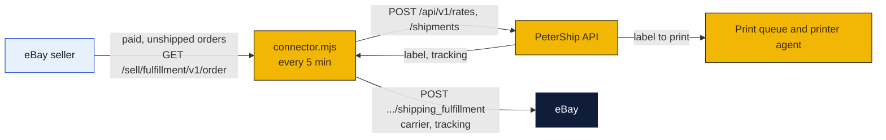

# eBay connector

A small program that ships an eBay seller's orders through PeterShip (to-do T28, the third connector after Shopify and Square). It runs on any machine with Node 24. Every five minutes it asks eBay for paid orders not yet shipped, buys each label through the PeterShip public API at the seller's account rates, and marks the order shipped on eBay with the carrier and tracking number so the buyer sees it.

### How to read the charts

| Color | Meaning |
|---|---|
| Yellow | Ours: this program, PeterShip |
| Navy | eBay and the carriers |
| Light blue | People |



## What is needed, and why this one needs more than Square

eBay only talks to registered applications, so the connector needs an **eBay developer account** with an application keyset, and the seller's one-time **consent** that gives the application a refresh token for their account. The keyset should belong to the company ([PeterShip, LLC](../llc/README.md)), not to a person, so every seller the store serves runs through the same application and a buyer gets it with the company.

1. **A PeterShip API key** for the seller's business account, made on Staff → Accounts (label it `eBay`).
2. **An eBay application**: developer.ebay.com, Application Keys, a production keyset (App ID is the client id, Cert ID is the client secret). Under User Tokens, set an accepted redirect (RuName).
3. **The seller's consent**: open eBay's authorization URL for the application with the scope `https://api.ebay.com/oauth/api_scope/sell.fulfillment`, the seller signs in and accepts, eBay returns a code, and exchanging the code (`grant_type=authorization_code`) gives a **refresh token** good for about eighteen months. Paste it into the config. The connector mints short-lived access tokens from it on its own.
4. **A parcel rule.** eBay orders carry no weights; the connector uses a default box and a weight per item, with overrides by SKU or title in the config.

Until a developer account exists, `dry_run` against the sandbox (`ebay_env: "sandbox"`, sandbox keys and a sandbox seller) is the way to try it.

## Setup

```bash
cd shipping-client/ebay-connector
cp config.example.json config.json      # fill it in
node connector.mjs --once               # ship whatever is waiting, print what happened, exit
node connector.mjs                      # keep running, every 5 minutes
```

| Key | Meaning |
|---|---|
| `petership_url`, `petership_key` | The store site and the `psk_...` key |
| `ebay_env` | `production` or `sandbox` |
| `ebay_client_id`, `ebay_client_secret`, `ebay_refresh_token` | The application keyset and the seller's refresh token |
| `service` | `cheapest` (default), `fastest`, or a `rate_id` |
| `default_parcel`, `products` | Box, floor weight and weight per item; overrides by SKU or title |
| `insure_over_usd` | Insure orders worth more than this (0 turns it off) |
| `dry_run` | `true` quotes but never buys or marks shipped |

Secrets can come from the environment: `PETERSHIP_KEY`, `EBAY_CLIENT_ID`, `EBAY_CLIENT_SECRET`, `EBAY_REFRESH_TOKEN`.

## What one pass does

1. `GET /sell/fulfillment/v1/order?filter=orderfulfillmentstatus:{NOT_STARTED|IN_PROGRESS}`: orders not yet shipped, paid, not cancelled, fifty at a time.
2. Skips orders in `shipped.json` beside the config.
3. Builds the recipient from `fulfillmentStartInstructions[0].shippingStep.shipTo` and the parcel from the config; calls `/rates`, picks by `service`, calls `/shipments` with `reference: "eBay <order id>"`.
4. `POST /sell/fulfillment/v1/order/{orderId}/shipping_fulfillment` with every line item, the shipped date, eBay's carrier code and the tracking number. eBay marks the order shipped and tells the buyer.
5. One line per order; a failure is skipped with the reason and tried again next pass.

## Limits

- Domestic only. eBay International Shipping orders are routed by eBay to its own hub anyway; they are skipped.
- Whole orders only; no partial fulfillment.
- eBay also sells its own labels at commercial rates. The connector earns its keep only where the store's label is as cheap or the service better: the [rates plan](../rates/README.md).

Sources: [eBay Sell Fulfillment API](https://developer.ebay.com/api-docs/sell/fulfillment/overview.html), [eBay OAuth, authorization code grant](https://developer.ebay.com/api-docs/static/oauth-authorization-code-grant.html).
