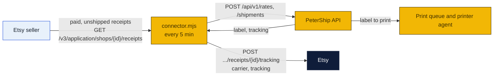

# Etsy connector

A small program that ships an Etsy shop's orders through PeterShip (to-do T28, the fourth connector after Shopify, Square and eBay). It runs on any machine with Node 24. Every five minutes it asks Etsy for paid receipts not yet shipped, buys each label through the PeterShip public API at the seller's account rates, and posts the carrier and tracking number back to the receipt so Etsy marks it shipped and emails the buyer.

### How to read the charts

| Color | Meaning |
|---|---|
| Yellow | Ours: this program, PeterShip |
| Navy | Etsy and the carriers |
| Light blue | People |



## What is needed

Etsy's Open API v3 only talks to approved applications, so the connector needs an **Etsy app** (a keystring, approved by Etsy after a short review) and the seller's one-time **consent** that gives the app a refresh token for their shop. The app should belong to the company ([PeterShip, LLC](../llc/README.md)), not to a person, so every maker the store serves runs through the same app and a buyer gets it with the company.

1. **A PeterShip API key** for the seller's business account, made on Staff → Accounts (label it `Etsy`).
2. **An Etsy app**: etsy.com/developers, create an app, note the keystring (there is no secret: Etsy's OAuth uses PKCE). Etsy grants provisional access at once and full access after review.
3. **The seller's consent**: open Etsy's `https://www.etsy.com/oauth/connect` URL for the app with the scopes `transactions_r transactions_w` and a PKCE challenge, the seller signs in and accepts, Etsy returns a code, and exchanging the code (`grant_type=authorization_code` at `/v3/public/oauth/token`) gives an access token and a **refresh token**. Paste the refresh token into the config. From then on the connector refreshes on its own and keeps the newest refresh token in `token.json` beside the config: Etsy hands out a new one on every refresh, so do not copy the config's value anywhere else.
4. **A parcel rule.** Etsy receipts carry no weights; the connector uses a default box and a weight per item, with overrides by SKU or listing title in the config.

Until the app is approved, `dry_run` with the provisional keystring and the owner's own shop is the way to try it.

## Setup

```bash
cd shipping-client/etsy-connector
cp config.example.json config.json      # fill it in
node connector.mjs --once               # ship whatever is waiting, print what happened, exit
node connector.mjs                      # keep running, every 5 minutes
```

| Key | Meaning |
|---|---|
| `petership_url`, `petership_key` | The store site and the `psk_...` key |
| `etsy_keystring` | The app's keystring (client id and API key in one) |
| `etsy_refresh_token` | The seller's first refresh token; later ones live in `token.json` |
| `etsy_shop_id` | The shop; blank means ask Etsy for the signed-in user's shop |
| `service` | `cheapest` (default), `fastest`, or a `rate_id` |
| `default_parcel`, `products` | Box, floor weight and weight per item; overrides by SKU or title |
| `insure_over_usd` | Insure orders worth more than this (0 turns it off) |
| `notify_buyer` | `true` lets Etsy email the buyer the tracking number |
| `dry_run` | `true` quotes but never buys or marks shipped |

Secrets can come from the environment: `PETERSHIP_KEY`, `ETSY_KEYSTRING`, `ETSY_REFRESH_TOKEN`.

## What one pass does

1. `GET /v3/application/shops/{shop_id}/receipts?was_paid=true&was_shipped=false&was_canceled=false`: paid receipts not yet shipped, a hundred at a time; receipts still in payment processing are left for the next pass.
2. Skips receipts in `shipped.json` beside the config.
3. Builds the recipient from the receipt's address lines and the parcel from the config; calls `/rates`, picks by `service`, calls `/shipments` with `reference: "Etsy <receipt id>"`.
4. `POST /v3/application/shops/{shop_id}/receipts/{receipt_id}/tracking` with Etsy's carrier name and the tracking number. Etsy marks the receipt shipped and, with `send_bcc`, emails the buyer.
5. One line per receipt; a failure is skipped with the reason and tried again next pass.

## Limits

- Domestic only. International receipts are skipped for the counter.
- Whole receipts only; no partial shipment.
- Etsy also sells its own labels at commercial rates. The connector earns its keep only where the store's label is as cheap or the service better: the [rates plan](../rates/README.md).

Sources: [Etsy Open API v3 reference](https://developers.etsy.com/documentation/reference), [Etsy OAuth authentication](https://developers.etsy.com/documentation/essentials/authentication), [Etsy app approval](https://developers.etsy.com/documentation/essentials/requests).
