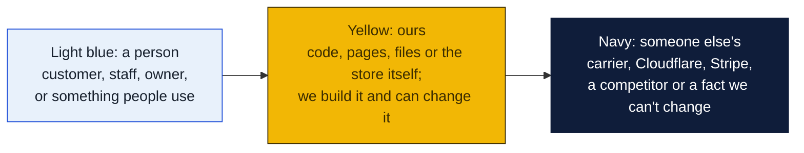
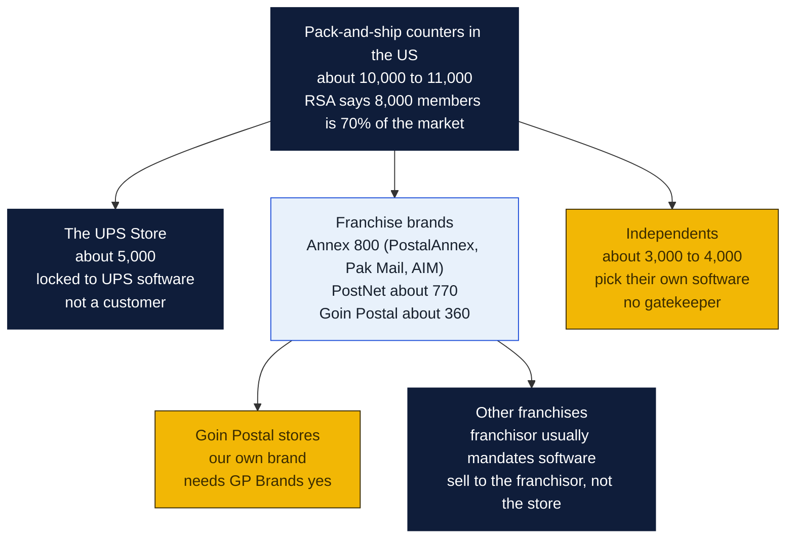
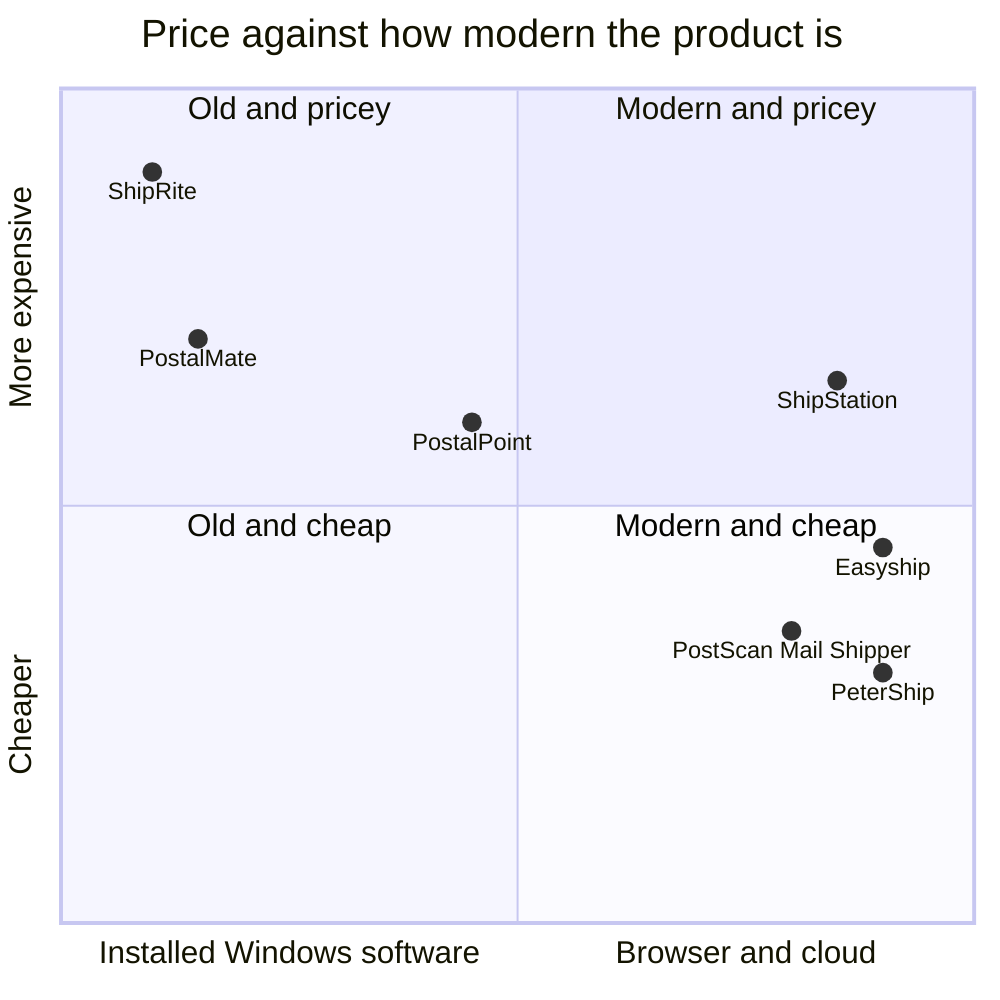
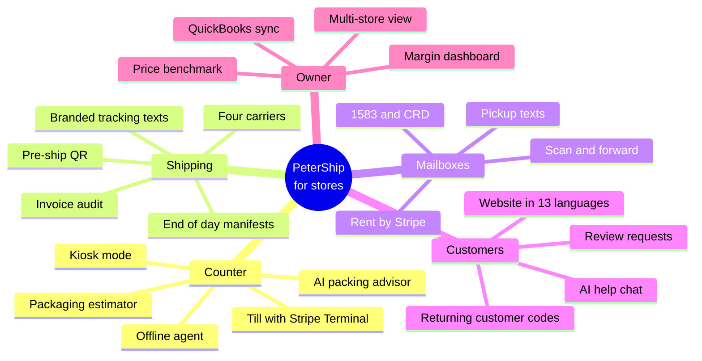
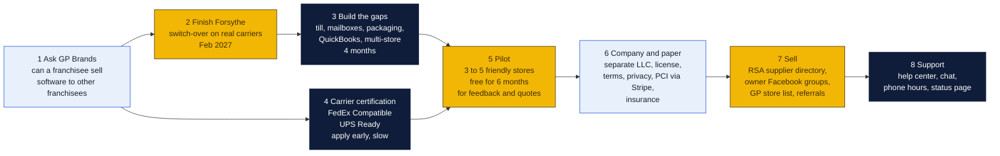
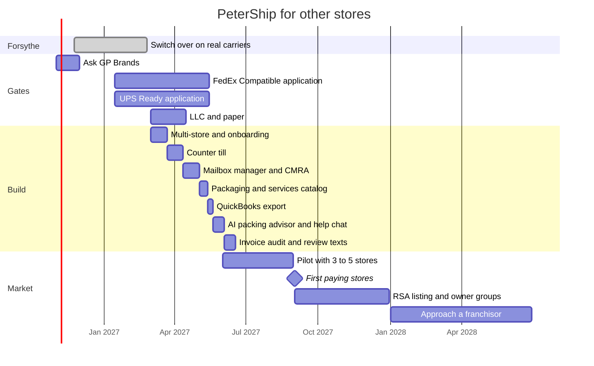
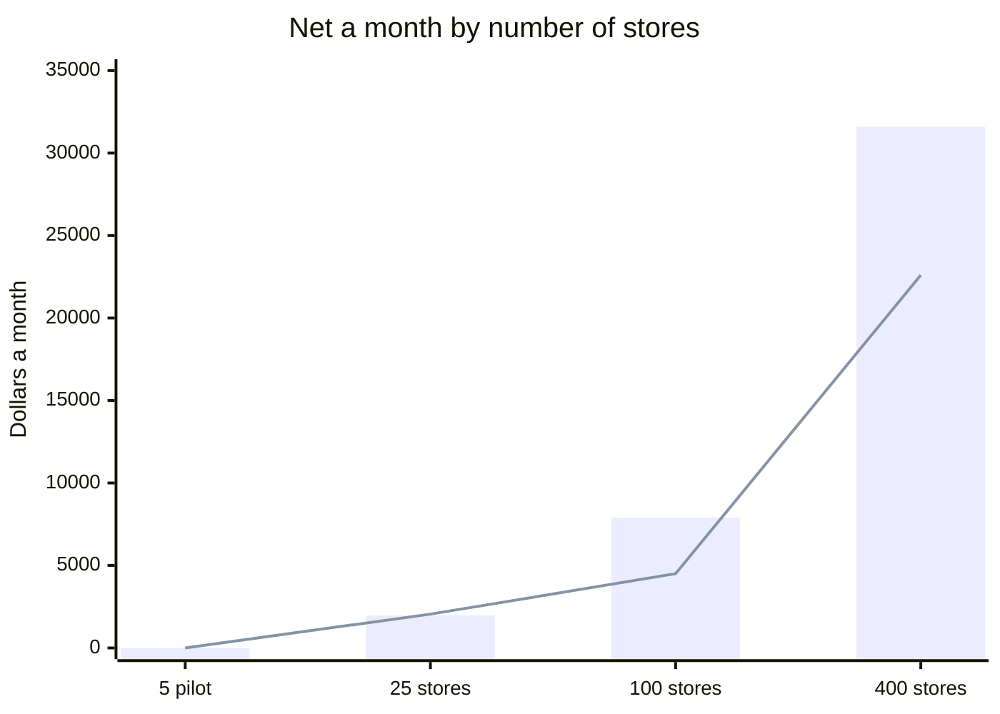
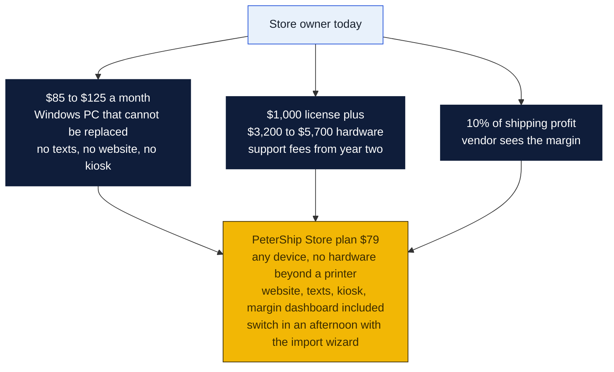

# PeterShip for other shipping stores

The plan for turning PeterShip from the Forsythe store's own shipping client into a product other pack-and-ship stores pay for every month. What the market looks like, who we would be up against, what the software still needs before a stranger can run a store on it, the features nobody else has, what it would take to sell and support it, and what it could earn.

Short version: there are roughly 10,000 pack-and-ship counters in the United States running on two Windows programs from the 2000s that cost $85 to $125 a month plus hardware, or on e-commerce tools that were never built for a walk-in customer. A browser-based client at $49 to $99 a month that already does rating, labels, tracking, drop-offs and reports, and adds things none of them have, is a real product. Fifty stores is about $4,000 a month. Two hundred is a business. The gates are GP Brands' blessing for the Goin' Postal stores, carrier certification, and the four features a store cannot live without that PeterShip does not have yet: a counter till, mailbox management, packaging estimates and accounting export.

Everything below is estimated from public sources, linked at the end. Nothing is a quote.

### How to read the charts

Every chart in this repo uses the same three colors, so once you know them you can read any of them.

| Mark | Meaning |
|---|---|
| Solid arrow `-->` | Data or a person moves this way, or this happens next |
| Dotted arrow `-.->` | Only sometimes: when keys are set, when a condition holds, or a later plan |
| Words on an arrow | What is sent or the condition, for example "when keys set" |
| Cylinder | A database or stored records (KV, D1, a table) |
| Diamond with a question in it | A decision. Follow the arrow whose label matches the answer; there is one arrow out per answer |
| Slanted box (parallelogram) | Something typed in or handed out: a form, a scan, a printed slip |
| Circle in the middle of a mindmap | The topic; the branches around it are its parts |
| Rounded box with `/path` | A page on the website; `/counter/...` pages are staff only |
| Box with a thick or dashed border, or a big frame around boxes | A group: everything inside runs in the same place |
| ✅ 🔨 ⏳ ⏸ in a box | Done, being built, not started, waiting on someone |

Other chart kinds you will meet: a **state diagram** shows the statuses one thing passes through, read along the arrows. A **sequence diagram** reads top to bottom, each vertical line is one party and each arrow is one message. A **gantt** is a calendar of who does what when. A **mindmap** is a topic in the middle with its parts around it. A **pie** or **bar chart** is just numbers. GitHub draws all of these on its own; if a chart shows as plain text, you are viewing the file somewhere that does not render Mermaid, and the raw text still reads top to bottom.

## The market

Three groups we can actually sell to, in the order to go after them:

| Segment | Size | Who decides | Why they would switch | How hard |
|---|---|---|---|---|
| **Goin' Postal stores** | about 360 | Each owner, if GP Brands allows it | We are one of them. Same Rate Pro pain, same carriers, same franchise rules. A sibling store's word carries. | Easy to reach, one hard yes needed from GP Brands |
| **Independents** | 3,000 to 4,000 | The owner | Paying $85 to $125 a month for PostalMate or a $1,000 license plus $3,200 to $5,700 of ShipRite hardware. No one has offered them a modern browser product at half the price with a self-serve kiosk and texts. | No gatekeeper. Hard to find them one at a time; RSA's supplier directory and Facebook owner groups are where they gather. |
| **Other franchise brands** | Annex about 800, PostNet about 770 | The franchisor's head office | A single contract could bring hundreds of stores. | A sales cycle of a year or more, and they may own or resell their own software. Later. |

The UPS Store is not a customer. Its 5,000 locations run UPS's own system by contract.

## Who we are up against

| Product | What it is | What a store pays | Weak spot |
|---|---|---|---|
| **PostalMate** (PC Synergy) | The incumbent. Windows program since the 1990s. Shipping, POS, mailbox manager, QuickBooks sync. FedEx Compatible. | $85 to $125 a month depending on the source, plus about $295 to start | Windows only, one PC, the POS is described as dated by its own users. One reviewer: "once the gold standard, now resting on their laurels." |
| **ShipRite** | The other incumbent. Windows, sold with hardware bundles. | About $1,000 license, $3,200 to $5,700 hardware, annual support from year two | Big up-front cost. Installed software. Training billed at $45 an hour. |
| **PostalPoint** | The one modern rival. Local-first Mac, Windows and Linux app, built-in POS, mailbox manager, 1583 forms, kiosk mode. | 10% of shipping profit, capped at $100 a month | New and small. Takes a cut of profit, which owners dislike. Installed app, not a browser. No customer-facing website or texts. |
| **PostScan Mail Shipper** | Cloud, pay per label, ASO support. | No subscription, pay as you go on their carrier rates | Uses their rates and their merchant account, so the store's own carrier discounts and margin control are gone. |
| **Easyship, Shippo, ShipStation, Pirate Ship** | E-commerce label tools. | $0 to $350 a month plus cents a label | Built for a seller shipping their own orders, not a counter with a stranger standing at it. No POS, no mailbox, no walk-in pricing, no declared value upsell. |
| **GP Rate Pro** | Goin' Postal's own quoting tool. | Unknown, part of the franchise | Quoting only. No labels, tracking or customer-facing anything. |

Where PeterShip sits: browser-based on any device, flat price under every incumbent, and the only one that also runs the store's public website, customer self-service and marketing.

## What a store needs that PeterShip does not have yet

PeterShip was built for one store that keeps its till on the Goin' Postal POS. A stranger's store needs the whole counter. These are the gaps, biggest first.

```mermaid
flowchart LR
  subgraph HAVE["Built, running in mock mode"]
    direction TB
    H1["Rating, 4 carriers"]:::store
    H2["Labels, print queue,<br/>printer agent"]:::store
    H3["Tracking, poll,<br/>exceptions, texts, email"]:::store
    H4["Drop-off capture"]:::store
    H5["Staff reports, margin"]:::store
    H6["Customer self-serve<br/>website, 13 languages"]:::store
    H7["Retail rules file"]:::store
  end
  subgraph NEED["Must build before selling"]
    direction TB
    N1["Counter till<br/>Stripe Terminal card reader<br/>cash drawer, receipts, Z report"]:::cloud
    N2["Mailbox manager<br/>CMRA, Form 1583, 1583-A<br/>quarterly CRD upload<br/>rent, renewals, pickup texts"]:::cloud
    N3["Packaging estimator<br/>boxes, materials, labor<br/>declared value, insurance"]:::cloud
    N4["Accounting export<br/>QuickBooks Online sync<br/>daily sales journal"]:::cloud
    N5["Other services as line items<br/>notary, fax, copies,<br/>keys, passport photos"]:::cloud
    N6["Carrier compliance<br/>end-of-day manifests<br/>FedEx Compatible and UPS Ready<br/>ASO and FASC rules"]:::cloud
    N7["Multi-store<br/>store_id on every row<br/>onboarding wizard, billing"]:::cloud
  end
  HAVE --> NEED
  classDef store fill:#f2b705,stroke:#3b2c00,color:#3b2c00
  classDef cloud fill:#0f1d3a,stroke:#0f1d3a,color:#ffffff
  classDef you fill:#e8f1fb,stroke:#1d4ed8,color:#17202d
```

| Gap | Why a store cannot live without it | Build | Notes |
|---|---|---|---|
| **Counter till** | Every incumbent includes a POS. A store will not run two systems at the counter. | 3 weeks | Stripe Terminal for cards (a $59 to $249 reader), cash drawer and receipt printer through the existing printer agent, an end-of-day Z report, refunds, tax by line. Stripe's 2.7% plus 5 cents in person is in line with what stores pay today. |
| **Mailbox manager** | Mailbox rental is a third of many stores' income, and USPS rules make it paperwork-heavy. | 3 weeks | Rent and renewals through Stripe Billing, Form 1583 filled and signed on the tablet, 1583-A for the store, the quarterly CMRA Customer Registration Database upload USPS now requires, pickup texts when mail arrives, a box-full flag. PostalPoint and PostalMate both have this; we match it and add texts and online renewal. |
| **Packaging estimator** | Pack-and-ship means packing. Staff need a price for a box, foam and ten minutes of labor in one tap. | 1 week | A table of boxes and materials with cost and price, a labor rate, a crating option. Feeds the retail rules so the quote shows one total. |
| **Accounting export** | Owners and their accountants live in QuickBooks. | 1 week | QuickBooks Online API: a daily sales journal, deposits by payment type, sales tax. CSV fallback for everyone else. |
| **Other services** | A counter sells notary, fax, copies, keys, passport photos and shredding. | 3 days | A service catalog per store with prices and tax flags. Rings through the till. |
| **Carrier compliance** | A store that is a FedEx Authorized ShipCenter or UPS Authorized Shipping Outlet must use an approved automated shipping system. | 2 weeks of code, months of waiting | Apply for FedEx Compatible and UPS Ready certification. End-of-day manifests are already planned. Without the badges, FASC and ASO stores cannot switch. Start the applications early; they are the long pole. |
| **Multi-store** | One install, many stores, each with its own carriers, prices, staff, data and bank account. | 2 weeks | A `store_id` column on every table, store-scoped logins, Cloudflare for SaaS custom hostnames, Stripe Connect so each store is paid directly. The monetization plan already sketches this. |
| **Onboarding and billing** | A store signs up, pays, connects carriers and prints its first label without a phone call. | 2 weeks | A wizard: store facts, carrier credentials, printer agent download, import of the price list, 14-day trial, Stripe subscription. |

About four months of build on top of the Forsythe switch-over, with Claude Code doing most of the typing. Carrier certification runs in parallel and may take longer.

## Features nobody else has

This is why a store switches rather than merely saves money. Every item is a feature switch on what already runs on Cloudflare, not a new system.

| Feature | What it does | Who has it today | Build |
|---|---|---|---|
| **Customer pre-ship with a QR code** | The customer rates, pays and gets a code on their phone at home. Staff scan it and print. Two minutes at the counter instead of ten. | No one. Built for Forsythe. | Done |
| **The store's whole website included** | Hours, services, ship, track, drop-off, business cards, in 13 languages with readability switches. Most stores have a Facebook page and nothing else. | No one | Done, make it per-tenant |
| **Thirteen languages at the counter** | Staff screen in English, customer-facing screen and texts in the customer's language. Monroe's Spanish and Vietnamese customers are not unusual. | No one | Done for the site, extend to counter |
| **Branded tracking texts and emails** | Every shipment sends updates with the store's name, not the carrier's. The customer remembers the store. | Partly: PostalPoint has pickup texts, no one has branded tracking | Done |
| **Margin dashboard** | What customers paid, what carriers charged, margin by carrier, service, hour and weekday. Owners today reconcile this in a spreadsheet. | No one shows margin live | Done |
| **AI packing advisor** | Staff photograph the item on the counter. The model suggests box size, materials, fragile handling and a declared value from the description, then fills the packaging estimate. | No one | 1 week with the Claude API, pennies a call |
| **AI help chat for customers and staff** | Answers "how do I ship a car battery," "what does a mailbox cost," "why did this label fail," in every language, from the store's own rules and the carrier guides. Hands off to the counter when stuck. | No one | 1 week, agenda item 47 already plans it |
| **Carrier invoice audit** | Compares the carrier's weekly invoice to what the store was quoted, flags surcharges and late deliveries, files the refund claims. Refund Retriever charges a share of refunds for this; built in it is free. | Third-party services only | 2 weeks |
| **Returning-customer marketing** | Ties into the Coupon Counter: who came back, which code brought them, cost per customer, a text to lapsed customers with a code. | No one in shipping software | Done for Forsythe, make per-tenant |
| **Self-serve kiosk mode** | A tablet on the counter where a customer rates and pays while staff pack the last order. | PostalPoint only | 1 week, the ship page already is one |
| **Offline counter** | The printer agent on the store PC caches rates and queues labels through an internet outage, syncs when back. | PostalPoint claims it, incumbents do | 2 weeks |
| **Store network hand-off** | A customer at one PeterShip store can pick up or drop at another. Franchise owners with several stores see all of them in one view. | Franchisor systems only | 1 week once multi-store exists |
| **Anonymous price benchmark** | Opt-in. Shows a store where its margin on a 5 lb UPS Ground label sits against other PeterShip stores in its region, without naming them. | No one | 3 days |
| **Mailbox with a scan** | Mailbox customers get a photo of each envelope by text and can ask the store to open, scan, forward or shred. Anytime Mailbox charges stores for this; built in it is a $5 a month upsell the store keeps. | Anytime Mailbox, iPostal1 as separate services | 2 weeks |
| **Review request after delivery** | When tracking shows delivered, one text: "Delivered. Mind leaving us a review?" with the store's Google link. Stores live and die on Google reviews. | No one | 2 days |
| **Business accounts and seller API** | Local sellers get a login, invoice billing, pickups and an API key. Already in the monetization plan. | Easyship has an API, no retail product does | 3 weeks |

## What it would take

Beyond the code.

| Piece | What it means | Cost | Who |
|---|---|---|---|
| **GP Brands** | The franchise agreement may bar selling to other franchisees or require Rate Pro. One conversation settles whether the 360 Goin' Postal stores are a market or off limits. Independents are open either way. | $0 | Rin, issue 11 |
| **A separate company** | PeterShip should be its own LLC, not the store. Keeps liability, taxes and a possible sale clean. Louisiana LLC filing is about $100. | about $500 with a registered agent | Owners, a lawyer for an hour |
| **Paper** | Software license, terms of service, privacy policy, a data processing agreement for stores in states with privacy laws, a refund rule. Templates adapted by a lawyer. | $1,500 to $3,000 one time | Lawyer |
| **PCI** | Card data never touches our servers: Stripe Terminal and Stripe Checkout handle it. That keeps PCI to the self-assessment questionnaire. | $0 | Built in |
| **CMRA liability** | Mailbox paperwork is the store's legal duty, but the software must get the forms and the quarterly upload right. Get a postal-rules consultant to review once. | about $1,000 | Consultant |
| **Carrier certification** | FedEx Compatible and UPS Ready programs. Free to apply, months of testing and paperwork. Required for FASC and ASO stores. | $0 plus time | Developer |
| **Insurance** | Tech errors and omissions, about $1,000 to $2,500 a year at this size. | $2,000 a year | Owners |
| **Support** | Email and chat during store hours, phone for outages, a help center written from the README. Up to about 50 stores the owners and Claude Code can carry it. Past that, one support hire at about $45,000 a year. | $0 then $45,000 a year | Owners, then a hire |
| **Sales** | A listing in RSA's supplier directory, posts in the owner groups, a demo store anyone can click around, a referral credit of one free month per store referred, a booth at the next RSA or franchise gathering. | $500 to $3,000 a year | Owners |
| **Status page and uptime** | Cloudflare's uptime is not the question; our code is. A status page, error alerts to a phone, and a written promise of 99.9%. | $0 | Developer |

## Timeline

First paying stores about September 2027, eleven months from now. Carrier certification is the risk to that date.

## Pricing

Flat, under every incumbent, no cut of the store's profit.

| Plan | A month | Includes | For |
|---|---|---|---|
| **Counter** | $49 | Rating, labels, tracking, drop-offs, reports, texts at cost, the website, 2 staff logins | A one-person store that keeps its own POS |
| **Store** | $79 | Counter plus the till, mailbox manager, packaging estimator, QuickBooks, unlimited staff | Most stores. The plan we sell. |
| **Pro** | $129 | Store plus AI packing advisor, invoice audit, mailbox scanning, business accounts, seller API, multi-store view | Busy stores and owners with more than one |
| **Franchise** | ask | Pro for every store plus a head-office view, brand templates, one invoice | A franchisor |

Add-ons the store resells and keeps: texts at a cent, mailbox scanning at $5 a box, the card designer at $29 a month. One free month per referral. Annual pay gets two months free.

Why not a share of profit like PostalPoint: owners hate it, it rises with their success, and it needs us to see their margin. Why not per label: unpredictable for the store and for us. Flat and cheap is the pitch.

## Revenue

Four stages. Store plan average of $79, with a fifth of stores on Pro and a fifth on Counter so the blended figure stays near $79. Cloudflare and Stripe costs from the monetization plan.

| Stage | Stores | Subscriptions a month | Add-ons a month | Costs a month | Net a month | Net a year |
|---|---|---|---|---|---|---|
| **Pilot** | 5 | $0 (free for feedback) | $0 | $10 | -$10 | -$120 |
| **Goin' Postal friends** | 25 | $1,975 | $150 | $75 | **$2,050** | $24,600 |
| **Independents** | 100 | $7,900 | $800 | $4,200 (support hire, hosting, Stripe) | **$4,500** | $54,000 |
| **A franchisor signs** | 400 | $31,600 | $4,000 | $13,000 (two support, a developer part-time, hosting, Stripe, insurance) | **$22,600** | $271,000 |

Bars are subscription revenue. The line is what is left after costs.

How the costs are worked out:

- **Hosting.** Cloudflare Workers Paid $5, usage $5 to $40, a $20 paid zone for custom hostnames past ten stores. Under $100 a month even at 400 stores. Cloudflare does not bill bandwidth.
- **Stripe.** 2.9% plus 30 cents on each subscription: about $2.60 per store per month.
- **Texts.** Passed through at cost.
- **Support.** The owners up to 50 stores. One hire at 100 stores, $45,000 a year, about $3,750 a month. Two at 400, plus a part-time developer at about $4,000 a month.
- **Insurance, legal, sales.** About $400 a month averaged.

What it means: 25 Goin' Postal stores alone would more than cover a car payment and the Forsythe store's rent. 100 stores is a salary. 400 needs a franchisor and becomes a company.

For scale: PostalMate at $95 a month across a few thousand stores is a business of several million dollars a year, built on one Windows program. The market has paid that price for twenty years.

## Why a store would say yes

The three sentences for the pitch: it runs in a browser on whatever you have. It costs less than what you pay now and does more. One of us runs a store on it every day.

## Risks

- **GP Brands says no.** Then the Goin' Postal segment is closed and the plan starts with independents, who are harder to reach but have no gatekeeper. The plan still works, slower.
- **Carrier certification drags.** FASC and ASO stores cannot switch without it. Sell to stores that ship on their own carrier accounts first; most independents do.
- **PostalPoint moves first.** A one-person company with the same idea and a head start on the till and mailboxes. Our edge is the customer-facing half: website, languages, texts, QR, AI. Ship those loud.
- **Support eats the margin.** A store with a stuck label at 5 pm on a Friday calls. Build the help center and the status page before store ten, not after.
- **Churn.** Switching software is painful, which keeps churn low once a store is in, but also makes them slow to come. The import wizard and the free pilot are how we lower the wall.
- **Compliance mistakes.** A wrong 1583 or a missed CRD upload is the store's USPS problem and our reputation problem. Pay for the consultant review.
- **One developer.** Today that is one person and Claude Code. Document everything, keep the adapters isolated, and plan the part-time developer at 100 stores.
- **Data.** Stores' customers' addresses and phone numbers live in our D1. Encrypt at rest (Cloudflare does), scope every query by `store_id`, and never let one store see another's rows. Test that in CI.

## Decisions for Rin

1. Ask GP Brands the one question: may a franchisee sell shipping software to other franchisees, and must franchisees use Rate Pro? Everything else waits on nothing but that.
2. Agree to a separate LLC for PeterShip once the Forsythe switch-over is done.
3. Name three to five store owners who would pilot it free for six months and say so publicly afterward.
4. Pick the price: $79 for the Store plan, or something else.
5. Decide whether the counter till replaces the Goin' Postal POS at Forsythe too, which would make Forsythe the first full reference store.

## Sources

- Market size: [Retail Shipping Associates, over 8,000 members](https://www.rscentral.org/About-Us); [a partner page claiming RSA covers 70% of the market](https://www.refundretriever.com/partner-rs-associates). The 10,000 to 11,000 total is that claim worked backwards and should be treated as a rough figure.
- Franchise counts: [Annex Brands, over 800 locations after buying Postal Connections, May 2026](https://www.annexbrands.com/news/2026-05-01/annex-brands-expands-national-footprint-overnight-acquisition-postal-connections); [Annex 2025 franchise review with brand breakdown](https://www.franchisechatter.com/2025/08/03/annex-brands-postalannex-pak-mail-aim-mail-etc-franchise-review-2025-costs-fees-news-average-revenues-and-or-profits/); [PostNet about 768 and Pak Mail counts](https://www.franchisechatter.com/2018/02/03/10-best-postal-mailbox-business-center-franchises-2018/); [GP Brands, 360 Goin' Postal stores](https://www.cbinsights.com/company/gp-brands). The Goin' Postal count conflicts across sources from 150 to 360.
- PostalMate pricing and features: [Capterra, $85 a month](https://www.capterra.com/p/182299/PostalMate/); [SourceForge, $95 a month plus $295](https://sourceforge.net/software/product/PostalMate/); [FedEx Compatible listing](https://www.fedex.com/en-us/compatible/find-a-solution/pc-synergy-postalmate.html); [Capterra reviews, including the "resting on their laurels" review](https://www.capterra.com/p/182299/PostalMate/reviews/); [PostalPoint's comparison claiming $125 a month](https://postalpoint.app/posts/vs-postalmate), a competitor's page.
- ShipRite pricing: [POS hardware packages, $3,200 to $5,699 excluding license](https://shipritenext.com/pos-packages/); [FedEx listing, starting at $1,000](https://www.fedex.com/en-us/compatible/find-a-solution/shiprite.html); [ShipDesk comparison on support fees](https://www.postscanmail.com/comparison/shipdesk-vs-shiprite.html), a competitor's page; [ShipRite v10 manual, training at $45 an hour](https://support.shipritesoftware.com/SR_Manuals/ManualV10.pdf).
- PostalPoint: [pricing, 10% of shipping profit capped at $100](https://postalpoint.app/); [features](https://postalpoint.app/features); [FAQ](https://postalpoint.app/faq); [mailbox management](https://postalpoint.app/posts/mailbox-management-software).
- PostScan Mail Shipper: [retail shipping software page](https://www.postscanmail.com/services/retail-shipping-software.html).
- E-commerce tools: [multi-carrier software pricing 2026](https://pango.ai/resources/multi-carrier-shipping-software-pricing); [Shippo vs Pirate Ship vs ShipStation](https://ecommerceparadise.com/shippo-vs-pirate-ship-vs-shipstation-2026/); [Easyship alternatives](https://wiserreview.com/blog/easyship-alternatives/).
- FedEx Authorized ShipCenter requirements, including an approved automated shipping system: [FASC new store training](https://www.fedex.com/content/dam/fedex/us-united-states/shipping/upload/FASC_New_Store_Training_General.pdf); [RSA FedEx program page](https://www.rscentral.org/Programs/FedEx).
- CMRA rules: [USPS Federal Register notice on the CMRA registry, December 2022](https://govinfo.gov/content/pkg/FR-2022-12-23/pdf/2022-28026.pdf).
- Internal: [PeterShip plan](../README.md), [what it saves](../costs/README.md), [monetization plan](../../monetization/README.md), [site costs](../../site/costs/README.md).
