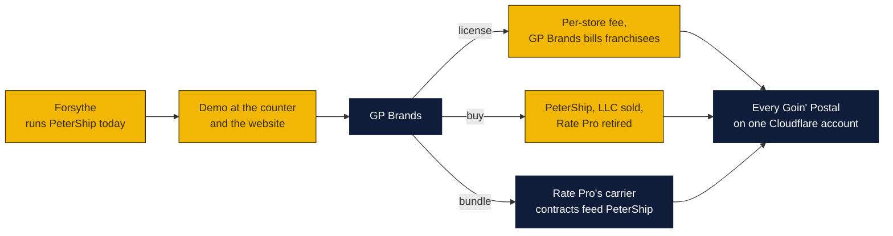

# Selling PeterShip to Goin' Postal: the GP Rate Pro replacement

The agenda's exit is an Auctane or a Shopify. There is a nearer buyer: Goin' Postal Franchise Corporation (GP Brands), which sells every franchisee the quoting software the Forsythe counter runs today, GP Rate Pro. If PeterShip is better than Rate Pro, GP Brands is the one buyer that already has the distribution, the stores and the reason. Written October 29, 2026 at the owners' request. Agenda item 59.

### How to read the charts

| Color | Meaning |
|---|---|
| Yellow | PeterShip and the owners |
| Navy | GP Brands, Rate Pro, the carriers |
| Light blue | Decisions for Peter and Rin |

## What GP Rate Pro is

From FedEx's compatible-provider listing and what the counter uses: quoting and processing software for retail shipping stores, sold by Goin' Postal Franchise Corporation, giving published rates, retail rates and actual cost for FedEx, UPS, USPS and DHL, with drop-off tracking capture, reports, third-party insurance and customer management. FedEx lists it for stores at 200 parcels a day and up. It is a Windows program on the counter PC. It has no rate export and no API (issue 11), which is why the website's prices and the counter's did not match until the retail rules were rebuilt in PeterShip.

That description is also PeterShip's feature list, plus everything Rate Pro does not have.

## Where PeterShip is already past Rate Pro

| Rate Pro | PeterShip | Agenda |
|---|---|---|
| Counter quoting on one PC | Counter quoting on any tablet or phone, offline-resilient, in 14 languages, plus the same prices on the store's website, paid online by card | N1, N7, T6, item 41 |
| Four carriers through its own rate tables | Four carrier adapters plus Easyship as a bridge, retail rules the owner edits with a preview, address validation, a packing advisor, a Pirate Ship benchmark on every quote | N3, T2, T4, T26 |
| Drop-off capture | Drop-off capture with a printed and texted receipt, a carrier handed-over button, and a returns form customers fill in before they arrive | N4, item 27 |
| Reports | Reports by day, carrier, service, hour and weekday, the buyer's block (by week, payment mix, accounts, mailbox churn, claims), end-of-day close with the cash drawer, carrier invoice audit, full export | N10, N11, T10, T18, T24 |
| Customer management | Customers with history, notes, business accounts with discounts, monthly statements with Stripe invoices, pickups, a returns portal per account, customer logins online | N2, T1, T15, T20, T22 |
| Third-party insurance | Insurance and add-ons priced from the owner's catalog, claims from open to refunded, intake photos | N6, T13, T17 |
| Nothing | Tracking with customer emails and texts, exceptions list, printer agent, print queue, staff logins with an audit log, a public API with an OpenAPI spec, Shopify and Square connectors, batch shipping from any marketplace export, fulfillment with stock on the shelf, mailbox subscriptions, business cards, agent payments | the rest |

What Rate Pro has that PeterShip does not yet: live carrier accounts (issue 12, the owners' keys), a decade of edge cases, and GP Brands' trust.

## The pitch, in the order to say it

1. **It is what you sell, rebuilt for the web.** Every franchisee runs it from a browser on any device; no install, no Windows PC, one update for every store at once. Multi-store runs on the same Cloudflare account at a few dollars a store a month (`../for-other-stores/`).
2. **The store's website and counter agree.** Customers quote and pay online with the franchisee's own prices; the counter sees the same queue. Rate Pro has no website.
3. **It makes the store money Rate Pro cannot.** Mailbox subscriptions, business accounts billed monthly, returns portal, fulfillment for local sellers, card upsells, add-ons, the online fee. Every one is a line on the monetization plan with the Forsythe numbers.
4. **It is proven at a Goin' Postal.** Forsythe runs it. Any GP Brands person can stand at the counter and watch.
5. **It is yours to own if you want it.** The deal shapes below.

## Deal shapes

| Shape | What GP Brands gets | What the owners get | When it fits |
|---|---|---|---|
| **License to the franchise** | The right to offer PeterShip to every franchisee as the Rate Pro successor; GP Brands bills stores | A per-store fee each month (the `for-other-stores` plan prices $49 to $99 a store) with GP Brands keeping a share, and PeterShip, LLC keeps the code | GP Brands wants the product without buying a company |
| **Acquisition** | The company (PeterShip, LLC, item 57), the code, the name, the Forsythe deployment, William's time for a transition | A price; the LLC is what makes this signable | GP Brands wants to own its software again, as it owns Rate Pro |
| **Exclusive license with a buy option** | Exclusivity among shipping franchises for a term, a fixed price to buy outright later | Monthly minimums plus the option price | The usual middle path |
| **Rate Pro bundle** | PeterShip replaces Rate Pro store by store, Rate Pro's rate tables and carrier contracts feed PeterShip's adapters | The carrier rates problem (issue 12, item 54) solved by GP Brands' own agreements | The one that makes PeterShip's rates lowest fastest |

Whatever the shape, the franchise agreement question in issue 11 is answered by it: PeterShip sold through GP Brands cannot breach GP Brands' agreement.

## Before the conversation

1. **The LLC** (item 57), so there is a company to license from or sell.
2. **Live carrier keys at Forsythe** (issue 12), so the demo buys real labels. A demo on mock rates is a toy.
3. **Thirty days of real numbers** on the reports page: labels, margin, mailbox revenue, accounts. The buyer's block exists for this.
4. **The second store** (item 51, West Carroll) or at least the multi-store demo (T23), so "every franchisee" is a thing they can see, not a slide.
5. **A one-page leave-behind**, in the counter flyer's style, with the table above and the Forsythe numbers.
6. **The ask to GP Brands, in writing**, which also asks the issue 11 questions (franchise agreement, Rate Pro export) so the two conversations are one.

## Risks

- GP Brands may see PeterShip as a breach of the franchise agreement before it sees it as an asset. Lead with the agreement question and the offer, not with the deployment.
- Rate Pro may be a licensed third-party product rather than GP Brands' own code; then the counterparty for a bundle is that vendor, and GP Brands is a channel.
- An exclusive license to GP Brands closes the Auctane and Shopify doors for its term. Price that in, or keep exclusivity to shipping franchises only.
- A franchise corporation moves slowly. Keep selling to local accounts and the other exits while it thinks.

## Decisions for Peter and Rin

1. Open the conversation with GP Brands now, with the franchise-agreement question in issue 11, or after the LLC and the live keys?
2. Which deal shape to lead with: license, or sale?
3. Is exclusivity to Goin' Postal acceptable for a term, and at what minimum?
4. Who makes the approach: Peter as the franchisee GP Brands knows, with William for the demo?

Sources: [FedEx compatible provider, Goin' Postal](https://www.fedex.com/en-us/compatible/find-a-solution/goin-postal.html), [issue 11, GP Rate Pro export or API](https://github.com/wbp318/goin-postal-forsythe/issues/11), [Goin' Postal franchise review](https://www.franchisegrade.com/franchises/goin-postal), [GP Rate Pro listing](https://gp-rate-pro.software.informer.com/).
