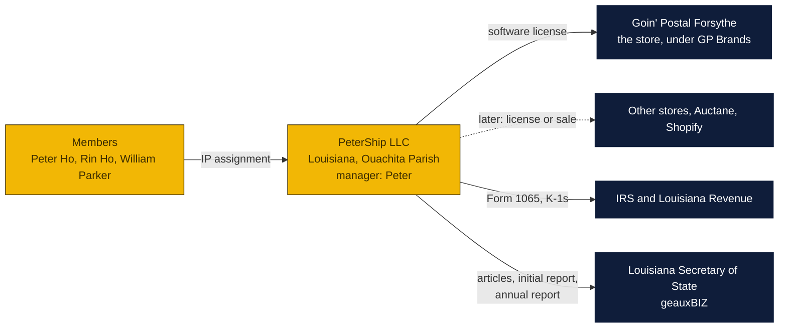

# PeterShip LLC: the plan and the papers

How to put PeterShip into a company of its own, so the software has an owner that can sign a license, open a bank account, take an acquirer's offer and outlive any one person. Written October 29, 2026 at the owners' request. The members and their domiciles come from [`../LICENSE`](../LICENSE).

**These are drafts, written by the site's AI assistant, not by a lawyer.** A Louisiana attorney should read the operating agreement and the IP assignment before anyone signs. Filing fees and tax rules were checked online on the date above; confirm them on the Secretary of State's and the Department of Revenue's own sites.

### How to read the charts

| Color | Meaning |
|---|---|
| Yellow | The company and its members |
| Navy | The State, the IRS, banks and outside parties |
| Light blue | Decisions for Peter and Rin |

## The people

| Member | Domicile (from the license) | Role proposed |
|---|---|---|
| Peter Ho | Ouachita Parish, Louisiana | Manager, and the registered agent if he wants to be |
| Rin Ho | Ouachita Parish, Louisiana | Member |
| William Parker | East Carroll Parish, Louisiana | Member, the one who writes the software |

The company's domicile is Louisiana, with its registered office in Ouachita Parish, where two of the three members live and where the store is: 1800 Forsythe Ave Ste 2, Monroe, LA 71201, unless the owners want a different address on the public record.

## Why an LLC, and why now

- **Something to sell.** The goal in the agenda is to sell PeterShip to an Auctane or a Shopify. A buyer buys a company, or buys the assets of one; it does not buy code owned jointly by three people with no paper between them.
- **One owner of the code.** Today the license names three Owners who each hold the copyright. The IP assignment moves it into the company, and the company licenses it back to the Forsythe store and, later, to other stores.
- **A wall between the store and the software.** Goin' Postal Forsythe is a franchise under GP Brands' agreement; PeterShip is not. Keeping the software in its own company keeps the franchise agreement's reach (issue 11) away from the thing the owners want to sell.
- **Liability.** If a label is wrong, a package lost through a software bug, or a carrier's API misused, the claim lands on the company, not on three households.

## Forming it, step by step

| Step | What | Who | Cost | Notes |
|---|---|---|---|---|
| 1 | Pick and reserve the name on geauxBIZ: **PeterShip, LLC** (or **PeterShip Software, LLC** if the plain name is taken) | Peter | Reservation is a small fee; the search is free | Louisiana requires the name to be reserved before filing online. "LLC" or "L.L.C." must be in it |
| 2 | Decide the membership percentages and the capital each member puts in | Peter, Rin, William | | Decision 1 below. Written into the operating agreement before anything is filed |
| 3 | Sign the operating agreement ([`operating-agreement.md`](operating-agreement.md)) | All three | Attorney review, a few hundred dollars | Not filed with the State; it is the contract between the members |
| 4 | File the Articles of Organization (Form 365) with the Initial Report (Form 973) and the registered agent's notarized acceptance, on geauxBIZ | Peter | $125 for the articles since October 1, 2026, plus the online service charge | [`articles-and-initial-report.md`](articles-and-initial-report.md) lists every field |
| 5 | Get the EIN from the IRS online | Peter | Free | Same day |
| 6 | Sign the IP assignment ([`ip-assignment.md`](ip-assignment.md)) and the software license to the store ([`software-license-to-store.md`](software-license-to-store.md)) | All three; Peter signs for the store | Attorney review | The assignment is dated after the LLC exists |
| 7 | Open the bank account; move the Cloudflare, GitHub, Stripe and carrier accounts to the company's name as each comes up for renewal | Peter | | The Cloudflare account that hosts PeterShip should be the company's, so a buyer gets the deployment with the code |
| 8 | Register with Louisiana Revenue for whatever applies (a software license fee to the store is not sales-taxable in Louisiana as a service, but a sold copy might be; ask the accountant) | Accountant | | |
| 9 | Annual report every year on the anniversary | Peter | $35 a year since October 1, 2026 | geauxBIZ reminds by email |

## Taxes, in one paragraph

A three-member LLC is a partnership for federal tax unless it elects otherwise: the company files Form 1065 and each member gets a K-1 for their share, taxed on their own return. Louisiana follows that. The Louisiana corporate franchise tax was repealed for periods from January 1, 2026, so there is no franchise tax on the LLC. An S-corporation election becomes worth considering only when the company pays real salaries; not now. The accountant who does the store's books should do the LLC's first return.

## What the company owns and does on day one

- The PeterShip code (everything the license covers), its documentation, designs, tests, the `shipping-client/` plans and the name.
- A license to Goin' Postal Forsythe to run it, at a fee the owners set (even a nominal one makes the relationship real on paper), with the store's data staying the store's.
- Nothing else: no employees, no lease, no debt. The members keep working as they do now.

## Decisions for Peter and Rin

1. **Membership percentages.** Three equal shares is the simplest. If the split should reflect that Peter runs the store, Rin invested, and William writes the code, say the numbers; the operating agreement has a blank for them. Capital contributions can be money, the code (valued), or nothing yet.
2. **Manager.** The draft makes Peter the manager, with the three biggest decisions (selling the company, licensing PeterShip to anyone other than the store, taking on debt) needing all members. Keep that or change it.
3. **Registered agent.** Peter at the store address, or a paid service ($100 to $300 a year) so the home address is never on the public record. The store address is already public, so Peter at the store is the easy answer.
4. **The license fee the store pays the company.** Nominal ($1 a year) until PeterShip earns from anyone else, or a real figure from the start.
5. **The name.** PeterShip, LLC, if available.

Sources: [Louisiana LLC costs, 2026 fee change](https://www.zenind.com/help/post/louisiana-llc-cost-in-2026-filing-fees-annual-costs-and-hidden-expenses), [TRUiC, cost to form a Louisiana LLC](https://www.howtostartanllc.com/louisiana-llc/cost-to-form), [LLC University, Louisiana LLC costs](https://www.llcuniversity.com/louisiana-llc/costs/), [Inc Authority, Louisiana LLC step by step](https://www.incauthority.com/blog/louisiana-llc/), [UpCounsel, Louisiana LLC rules and taxes](https://www.upcounsel.com/louisiana-llc-rules), [FindLaw, forming an LLC in Louisiana](https://www.findlaw.com/state/louisiana-law/forming-an-llc-in-louisiana.html), [Stripe, incorporating in Louisiana](https://stripe.com/fr-ca/resources/more/how-to-incorporate-in-louisiana).
