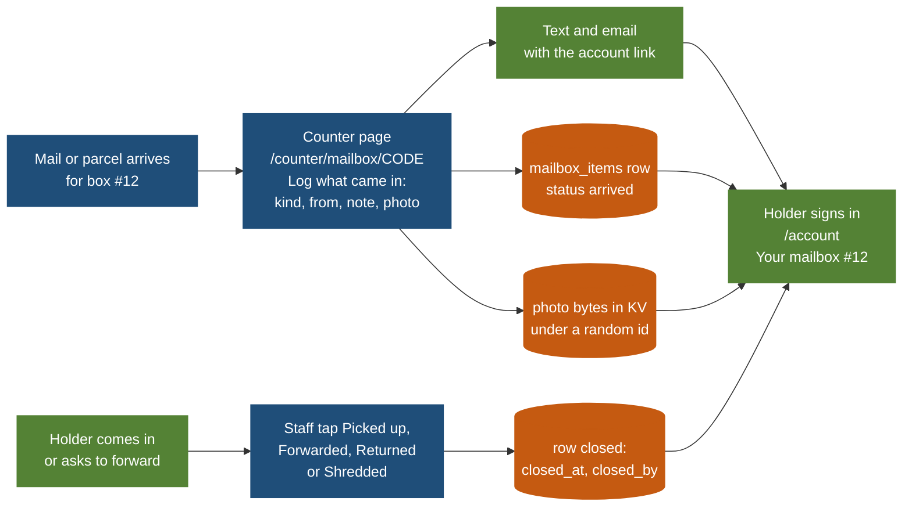
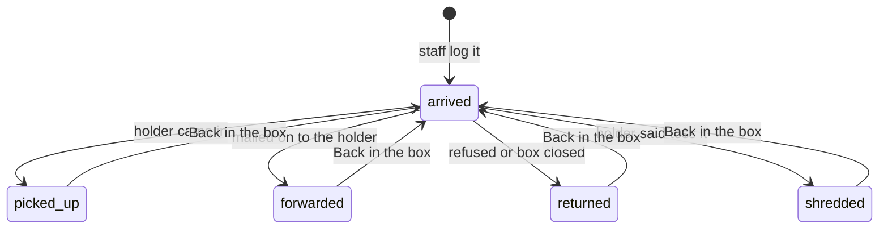

# Mailbox mail log: Informed Delivery for Goin' Postal boxes

The store is adding physical mailboxes. USPS Informed Delivery shows a home customer a scan of each
envelope before the carrier arrives. This is the same promise for a Goin' Postal box: every piece of
mail or parcel that staff put in a box gets a row, a photo when they take one, and a text or email;
the holder signs in on the website and sees what is waiting, what was picked up, and what left the
box some other way. Built as PeterShip to-do **T33**, released **v1.75.0** on November 5, 2026; open-and-scan added in **v1.76.0** the same night.

Related: [`site/README.md`](../../site/README.md) (the running code), the mailbox subscription
pages (v1.47.0) and the one-tap notices (T12, v1.50.0) they build on, and
[`monetization/README.md`](../../monetization/README.md) for the subscription revenue.

## Where it runs, and why not AWS

The question was "a database in AWS or wherever they can log in and see this." The answer is the
database PeterShip already has: Cloudflare D1 for the rows and Cloudflare KV for the photos, behind
the same website the customer already signs in to with a magic link.

| Option | What it would take | Monthly cost | Verdict |
| --- | --- | --- | --- |
| **Cloudflare D1 + KV, inside PeterShip** (what shipped) | One table, two API actions, a card on the account page and one on the counter page. Same PIN, same audit log, same export, same 14 languages, same magic-link sign-in | $0 at this size: D1's free tier is 5 GB and 5 million reads a day; a year of photos at 150 KB each for 60 boxes is under 1 GB of KV | **Done** |
| AWS: DynamoDB or RDS, S3 for photos, Cognito for sign-in, a Lambda API, a second front end | A second account, a second deploy, a second login for the customer, IAM to get right, and nothing it does better for 60 boxes | $15 to $40 a month for RDS alone, or near zero on DynamoDB plus engineering time | Not worth a second platform; revisit only if the store ever leaves Cloudflare |
| A Google Sheet or Airtable staff fill in | Nothing to build, but no photos tied to a holder, no sign-in for the customer, nothing on the receipt, nothing in the export | $0 to $20 | Fine for a week of trial, not for a product the ULM flyer advertises |

The rows are in `mailbox_items` in [`site/db/schema.sql`](../../site/db/schema.sql); the owners
re-run the schema once on the live database (it only adds). The photos are in the `ORDERS` KV
namespace under unguessable ids, the same place and the same rule as intake photos, and they expire
after a year.

## What the holder sees

Sign in at `/account` with the same email used to buy the box. A **Your mailbox #12** card shows the
box, its size and status, the renewal date, the full street address with the box number, then:

- **In your box now**: each piece, newest first, with the photo (tap to open full size), what it is
  (letter, package, magazine, something else), who it is from, the staff note and the date.
- **Picked up and gone**: the last twenty pieces that left the box, with how (picked up, forwarded,
  returned to sender, shredded) and when.

The text and email that go out when staff log a piece end with "See what is in your box:" and the
account link, so the customer taps straight through.

**Open-and-scan (v1.76.0).** Each piece waiting has **Ask for a scan** with the fee next to it
(`scan_fee` in `site/src/data/mailboxes.json`, $2 until the owners say otherwise, $0 makes it free).
Staff see **SCAN REQUESTED** on the row and a **Scans asked for** list at the top of
`/counter/mailboxes`, open the piece, scan it on the counter scanner or photograph the pages, and
**Upload scan** (JPEG, PNG or PDF up to 4 MB). The holder gets the text and email again, and the row
now says **Read the scan**. Staff can upload a scan without a request, for the holder who phoned.
The fee is taken at the counter or put on a business account's statement; nothing is charged by the
software yet.

## What staff do

On `/counter/mailbox/CODE`, under the existing Form 1583 and box-number steps, a **Log what came in**
card: pick letter, package, magazine or something else, type who it is from as printed on the piece,
an optional note, take a photo with the tablet camera (shrunk to 1280 px in the browser, same as
intake photos), leave **Text and email the holder** ticked, press **Put it in the box**. The row
appears under **In the box** with four buttons: **Picked up**, **Forwarded**, **Returned**,
**Shredded**. Closed rows move to **Left the box** with a **Back in the box** button for mistakes.
`/counter/mailboxes` has a **Waiting** column with the count per box, so the morning glance shows
whose box is filling up.

The older one-tap **Mail in** and **Package in** buttons stay: they send the text without a row, for
the days nobody has time to photograph. Every action is audited as `mailbox.item` or
`mailbox.item.<status>` and the table is in `/counter/export`.

## How it compares with Informed Delivery

| | USPS Informed Delivery | Goin' Postal mailbox log |
| --- | --- | --- |
| What is shown | A grayscale scan of the front of letter-size mail, automated at the plant | A colour photo staff take, of letters and parcels, with the sender typed in |
| Parcels | Tracking status only | Logged the same way as letters, with the photo |
| When | The morning of delivery | The moment it goes in the box, with a text |
| What happened to it after | Nothing | Picked up, forwarded, returned, shredded, with the date and who did it |
| Open-and-scan | No | Yes: the holder asks on the account page, staff upload an image or PDF, $2 |
| Forwarding | No | Not yet: see the decisions below |

## Decisions for Peter and Rin

1. **Photograph everything, or only parcels and anything that looks important?** A photo of every
   envelope is the Informed Delivery feel and takes about five seconds a piece. The form works either
   way; the lead text on the counter page can say which.
2. **Scan fee and forwarding.** Open-and-scan is built (v1.76.0) at $2 in `mailboxes.json`;
   competitors charge $2 to $5, so confirm or change it, and say whether it should be charged by card
   on the account page (a Stripe line like the add-ons) rather than at the counter. Forwarding ("mail
   me this week's pile") is the same shape and the next T-item if wanted: postage plus $3 to $5.
3. **How long to keep the photos.** Now a year, then KV drops them (the row stays). Thirty days is
   enough for most holders and keeps the storage bill at zero forever.
4. **Shred rules.** Staff can mark a piece shredded today. A written policy (how many days unclaimed,
   junk mail only unless the holder asked) belongs on the mailbox agreement so nobody argues later.
5. **Re-run the schema** on the live D1 once (issue filed alongside the release).

## What is built

| Step | What | Where | Status |
| --- | --- | --- | --- |
| 1 | `mailbox_items` table, store functions with D1 and memory branches, in the export | `site/db/schema.sql`, `site/src/shipping/store.ts` | ✅ v1.75.0 |
| 2 | Photos in KV, served at `GET /api/mailbox?photo=ID` | `site/src/lib/photos.ts`, `site/src/pages/api/mailbox.ts` | ✅ v1.75.0 |
| 3 | Staff actions `item` and `item_status`, audited | `site/src/pages/api/mailbox.ts` | ✅ v1.75.0 |
| 4 | Log what came in, In the box, Left the box on the box page; Waiting column on the list | `site/src/pages/counter/mailbox/[code].astro`, `mailboxes.astro` | ✅ v1.75.0 |
| 5 | Your mailbox card on the account page, 14 languages | `site/src/pages/account/index.astro`, `i18n/strings.ts`, `staff3.ts` | ✅ v1.75.0 |
| 6 | Text and email carry the account link | `site/src/lib/mailboxNotify.ts` | ✅ v1.75.0 |
| 7 | Open-and-scan: Ask for a scan on the account page, Scans asked for on the counter list, Upload scan (image or PDF), Read the scan, fee in `mailboxes.json` | `account/index.astro`, `api/account.ts` `mailbox_scan`, `api/mailbox.ts` `scan`, `counter/mailboxes.astro` | ✅ v1.76.0 |
| 7b | Forwarding requests with postage plus a fee | | ⏳ decision 2 |
| 7c | Charge the scan fee by card on the account page | | ⏳ decision 2 |
| 8 | Holder-side notification preferences (text only, email only, off) | | ⏳ after 7 |
