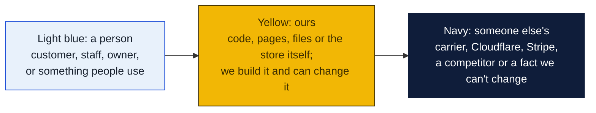
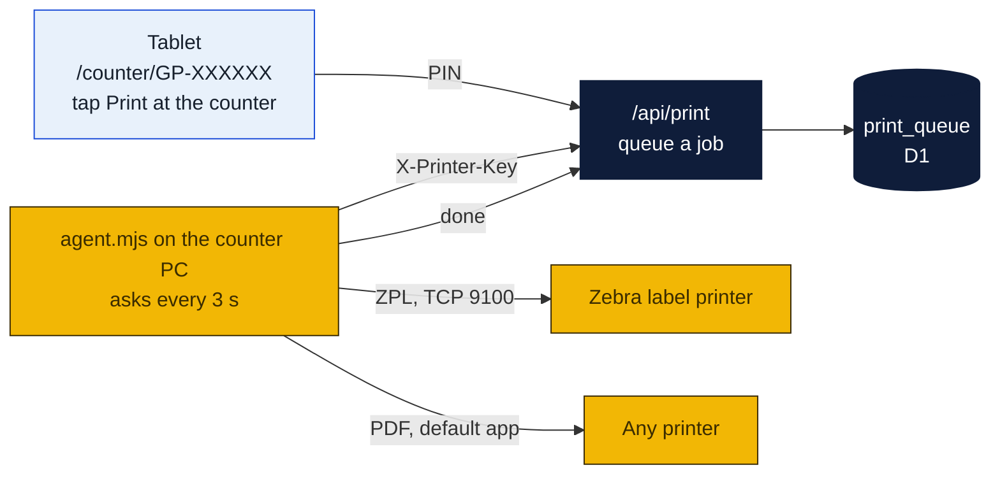

# PeterShip printer agent

A small program for the counter PC. It watches the website's print queue and sends each job to the label printer, so a staff tap on the tablet prints at the counter without the browser ever talking to a printer. This is the "printer agent" from Phase 3 of [the PeterShip plan](../README.md), prototyped early because printing is the fiddliest part of any shipping client.

### How to read the charts

Every chart in this repo uses the same three colors, so once you know them you can read any of them.



| Mark | Meaning |
|---|---|
| Solid arrow `-->` | Data or a person moves this way, or this happens next |
| Dotted arrow `-.->` | Only sometimes: when keys are set, when a condition holds, or a later plan |
| Words on an arrow | What is sent or the condition, for example "when keys set" |
| Cylinder | A database or stored records (KV, D1, a table) |
| Diamond with a question in it | A decision. Follow the arrow whose label matches the answer; there is one arrow out per answer |
| Slanted box (parallelogram) | Something typed in or handed out: a form, a scan, a printed slip |
| Circle in the middle of a mindmap | The topic; the branches around it are its parts |
| Rounded box with `/path` | A page on the website; `/counter/...` pages are staff only |
| Box with a thick or dashed border, or a big frame around boxes | A group: everything inside runs in the same place |
| ✅ 🔨 ⏳ ⏸ in a box | Done, being built, not started, waiting on someone |

Other chart kinds you will meet: a **state diagram** shows the statuses one thing passes through, read along the arrows. A **sequence diagram** reads top to bottom, each vertical line is one party and each arrow is one message. A **gantt** is a calendar of who does what when. A **mindmap** is a topic in the middle with its parts around it. A **pie** or **bar chart** is just numbers. GitHub draws all of these on its own; if a chart shows as plain text, you are viewing the file somewhere that does not render Mermaid, and the raw text still reads top to bottom.



Only outbound requests from the shop. No port forwarding, no printer drivers in the browser, and the tablet needs nothing installed.

## Set up (once, on the counter PC)

1. Install Node.js 22 or newer ([nodejs.org](https://nodejs.org), or `winget install OpenJS.NodeJS.LTS`).
2. Copy this folder to the PC, for example `C:\PeterShip\printer-agent`.
3. Copy `printer-agent.example.json` to `printer-agent.json` and fill it in:

| Field | What to put |
|---|---|
| `site` | The website, `https://goinpostalforsythe.com` in production, `http://localhost:4321` for testing |
| `key` | The same long random string set as `PRINTER_KEY` on the website (`npx wrangler secret put PRINTER_KEY`, or `.dev.vars` locally) |
| `printer` | Which queue this PC serves. `counter` unless there is a second station |
| `zebra.host` | The label printer's IP address if it is on the network (print a config label from the printer to find it). Port 9100 |
| `zebra.share` | Or, for a USB Zebra plugged into this PC: share the printer in Windows Settings and put `\\\\THIS-PC\\Zebra` here |
| `pdf.spool` | Folder for downloaded PDF labels. Defaults to `spool` next to the agent |
| `pdf.app` | Leave blank to print PDFs with Windows' default PDF app. Or a path to SumatraPDF for silent printing |
| `track_poll_minutes` | How often the agent asks the site to refresh tracking for open shipments. 10 by default, 0 to turn it off |

4. Test the printer without the website:

```
node agent.mjs --test
```

A label saying "PeterShip test label" with a barcode should come out. If nothing prints, the problem is between the PC and the printer, not the website: check the IP or share name.

5. Run the agent:

```
node agent.mjs
```

Leave the window open. To start it with Windows, create a shortcut to `node C:\PeterShip\printer-agent\agent.mjs` in the Startup folder (`shell:startup`), or register it with Task Scheduler to run at log-on.

## How a label gets printed

1. Staff open the order on the tablet (scan the customer's QR or go to `/counter/GP-XXXXXX`), type the PIN and tap **Print at the counter**.
2. The website puts a job in the `print_queue` table: ZPL if the carrier returned it, otherwise the PDF URL. Drop-off receipts arrive the same way as 4 by 6 ZPL (kind `receipt`) and print on the Zebra unless a separate `receipt` printer is configured.
3. The agent picks the job up within three seconds, prints it, and marks it done.
4. If a job fails five times (printer off, out of labels) it is skipped with a message in the agent window, and the label can still be opened and printed from the counter page by hand.

## Tracking refresh

While it runs, the agent also calls `POST /api/track-poll` every ten minutes, which makes the site ask each carrier about every open shipment not checked in the last fifteen minutes. That is what keeps the `/track` page and the staff exceptions list current during the day. A scheduled GitHub Action does the same every thirty minutes for the hours the PC is off.

## Troubleshooting

| Symptom | Cause |
|---|---|
| `the website rejected the printer key` | `key` in the JSON file does not match `PRINTER_KEY` on the website |
| `no printer configured` | Both `zebra.host` and `zebra.share` are blank |
| `printer 192.168.x.x timed out` | Wrong IP, printer asleep, or not on the same network. Print a config label from the printer to see its address |
| Test label prints, real labels blank or garbled | The carrier sent a PDF and the job went to the Zebra as raw bytes. Check the kind in the agent log; PDFs need `pdf.app` or the default PDF app |
| PDF opens on screen instead of printing | Windows has no default PDF printer set. Install SumatraPDF and put its path in `pdf.app`; it prints silently |

## Mock mode

With no carrier keys the website returns a fake label with no ZPL and a placeholder PDF URL, so the queue and the agent can be exercised end to end; the PDF step will fail on the download, which is expected until a real carrier answers.
