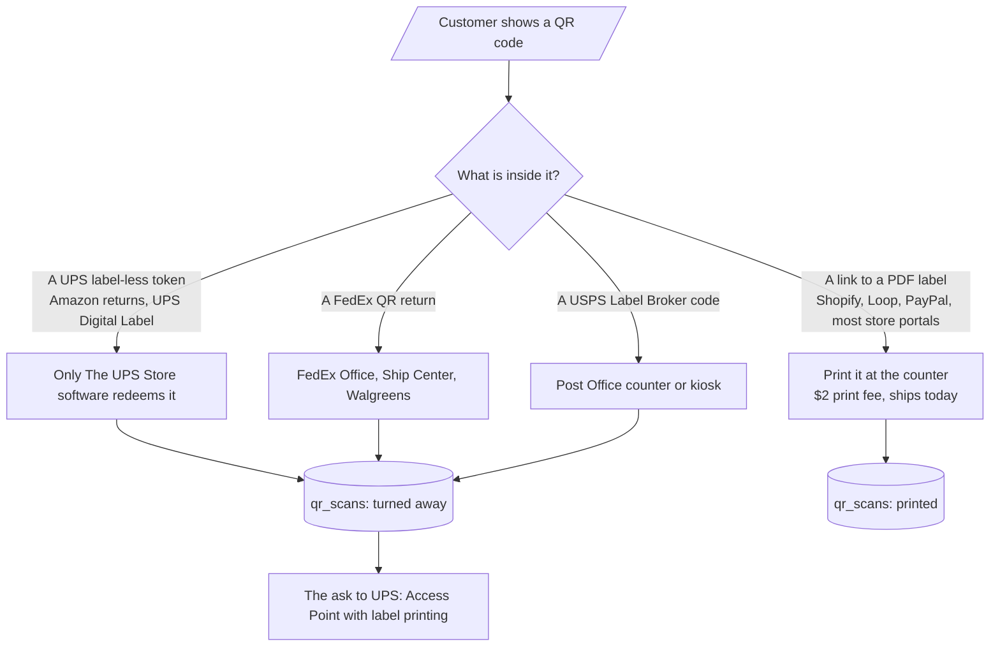
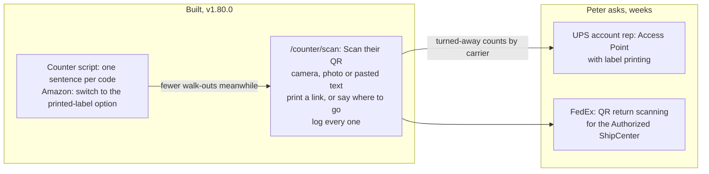
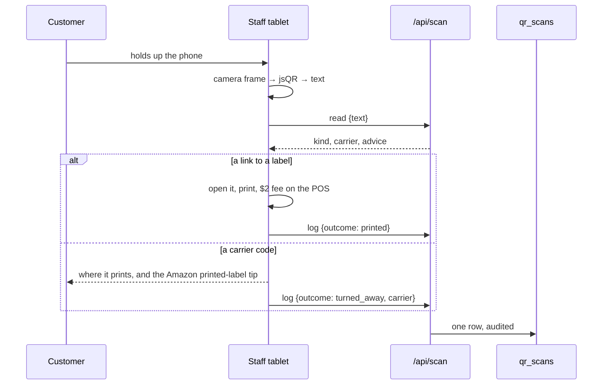

# QR returns: printing the codes customers bring in

Customers walk into Goin' Postal Forsythe with a QR code on their phone instead of a label, and the store
has to send them to The UPS Store. This folder is the plan to stop that: what the codes are, what the
store can print today, what it has to ask UPS and FedEx for, and the counter tool that logs every one so
the ask has numbers behind it.

## What a QR code on a phone actually is

A label-less code is not a label in disguise. It is a token the carrier redeems inside its own retail
software, which it gives to its own network: The UPS Store for UPS, FedEx Office and Walgreens for
FedEx, Post Offices with Label Broker for USPS. An Authorized Shipping Outlet (which Goin' Postal is for
UPS) and an Authorized ShipCenter (for FedEx) are not given that software. There is no API that redeems
someone else's token, so PeterShip cannot build around it: the fix for those codes is the program.

Sources: [an ASO on why it cannot scan Amazon QR codes](https://islandshipcenter.com/lets-talk-about-amazon-returns-shall-we/),
[ASO versus The UPS Store](https://mysticalsupplies.com/blog/the-difference-between-a-ups-authorized-shipping-outlet-aso-and-the-ups-store-what-you-need-to-know/),
[FedEx QR code locations](https://local.fedex.com/en-us/qr-code-locations), [a FedEx ShipCenter on QR returns](https://fedex.neighborhoodparcel.com/qr-code-returns-and-amazon-shipments/),
[USPS Label Broker](https://www.usps.com/ship/label-broker.htm).

## Three layers

1. **The ask (Peter, now).** UPS runs the Access Point program by contract and decides per location.
   Some Access Points (the CVS and Michaels kind) print labels from QR codes; that is the version to ask
   for. The pitch is volume: how many QR customers walk in and have to walk back out. The same ask goes
   to FedEx for the ShipCenter. Issue 22 has the script for the call; Peter applied on Nov 5 2026. The FedEx ask is issue 21.
2. **The scan tool (built).** `/counter/scan`. The tablet camera reads the code in the browser (jsQR),
   or a photo of it, or the text pasted in. `/api/scan` says what it is: a link to a label (open it and
   print, charge the $2 return-label fee from the add-on catalog), a UPS, FedEx or USPS code (say where
   to go), an Amazon link, or something else. Every one is logged in `qr_scans` with the outcome:
   printed, turned away, or the customer emailed a label instead. The page shows the last 30 days:
   sent elsewhere by carrier, printed here. That table is the evidence for layer 1.
3. **The counter script (on the page).** One sentence per code, so the next customer does not leave:
   for an Amazon return, reopen it in the Amazon app, pick the printed-label option, and email or show
   the PDF; the store prints it and the package goes out today. For any other seller, ask for the
   printable label by email.

## What the counter does, step by step

## Decisions for Peter and Rin

1. **Who calls UPS, and when.** Applied Nov 5 2026; the rep's name and the answer go in issue 22. Take the 30-day counts
   from `/counter/scan` to the call; a month of logging first makes the number real.
2. **The print fee.** `return-label` in the add-on catalog is $2. A label-less customer who switches
   to a printed label pays that; say if it should be free for the first month to win them back.
3. **Sign in the window.** "Bring your QR code or email us your label: we print it and ship it today."
   The sign is agenda item 27's other half.

## What is built

| Step | What | Where | Status |
| --- | --- | --- | --- |
| 1 | `qr_scans` table, store functions, in the export | `site/db/schema.sql`, `site/src/shipping/store.ts` | ✅ v1.80.0 |
| 2 | The reader: link, UPS, FedEx, USPS, Amazon, other, with the counter script | `site/src/lib/qr.ts` | ✅ v1.80.0 |
| 3 | `/api/scan`: read, log, stats; PIN, audited | `site/src/pages/api/scan.ts` | ✅ v1.80.0 |
| 4 | `/counter/scan`: camera, photo, paste; outcome buttons; 30-day counts | `site/src/pages/counter/scan.astro` | ✅ v1.80.0 |
| 5 | The ask to UPS: Peter applied for the Access Point program Nov 5 2026 | issue 22 | 🔨 Applied, waiting on UPS |
| 5b | The ask to FedEx for the ShipCenter | issue 21 | ⏳ Peter |
| 6 | Redeeming label-less codes in PeterShip | | ⏸ Not possible without the carrier's program |
