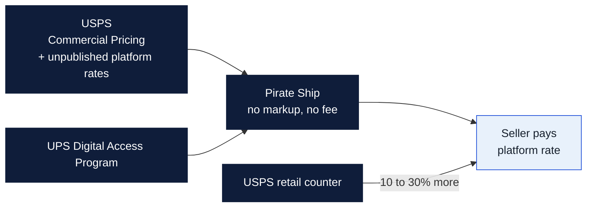
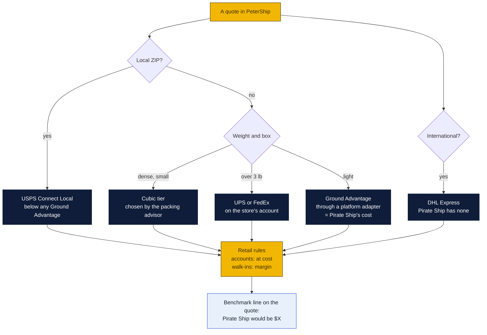

# Rates below Pirate Ship

How a single Goin' Postal store can quote less than Pirate Ship, where it cannot, and what to build so PeterShip proves it on every quote. Written October 29, 2026 at the owners' request.

### How to read the charts

| Color | Meaning |
|---|---|
| Yellow | The store: its accounts, its counter, its rules |
| Navy | Outside systems: USPS, UPS, FedEx, Pirate Ship, platforms |
| Light blue | Decisions and numbers for Rin |

## What Pirate Ship actually is

Pirate Ship sells USPS and UPS labels online with no markup, no monthly fee and no volume minimum. Its prices come from two places:

- **USPS.** Pirate Ship is a USPS postage platform, so every label gets USPS Commercial Pricing, roughly 10 to 30 percent under the counter price on Ground Advantage, and on top of that USPS lets platforms sell at unpublished rates below the Commercial list. Pirate Ship's own 2026 notice says it cannot publish the rates it charges because they sit under the listed Commercial prices. One 2026 comparison puts a 1 lb Ground Advantage label to zone 5 at $10.15 at the counter, $9.20 on usps.com, and $7.50 on Pirate Ship.
- **UPS.** Pirate Ship resells UPS through the UPS Digital Access Program, the discount UPS gives every platform's small shippers without an account. Over about 3 lb, UPS Ground Saver through Pirate Ship often beats USPS.

Both are platform rates. A single store cannot get them by walking into a post office or opening a UPS account. That is the whole problem.

## The honest answer on USPS

On the identical USPS label, same service, same weight, same zone, the store cannot buy postage cheaper than Pirate Ship. The only thing under platform rates is a Negotiated Service Agreement with USPS, and those are contracts for shippers at hundreds of thousands of dollars of postage a year, filed one by one with the Postal Regulatory Commission. The store will not get one; the franchise as a whole might, which is a GP Brands conversation (see below).

What the store can do on USPS is **match** Pirate Ship, by buying its labels through a postage platform's API instead of at retail. EasyPost, Shippo and ShipStation carry the same kind of below-Commercial USPS rates Pirate Ship does, and they have APIs, which Pirate Ship does not. PeterShip already has a provider adapter model, so a platform adapter is one more file beside the direct carrier adapters. Then the store's cost on USPS is a platform rate, and the retail rules decide what sits on top.

## Where the store can beat Pirate Ship

| Lever | Why it works | How much | What it needs |
|---|---|---|---|
| **UPS and FedEx on the store's own account** | Digital Access Program rates are generic. A negotiated account, especially one aggregated across the Goin' Postal franchise, can beat them on Ground over 3 lb, on residential surcharges and on larger boxes. | Carrier-specific; the Presque Isle franchisee called the chain's FedEx and UPS discounts "deep" | The account numbers and the discount schedule from Rin or GP Brands, loaded into PeterShip's direct adapters (T14) |
| **USPS Connect Local** | Next-day (some places same-day) delivery of packages entered at the local post office, priced from about $4 for under 5 lb, 4.9 percent higher since January 2026. Pirate Ship does not offer it. For a Monroe seller sending to Monroe, West Monroe, Ruston or Bastrop it is cheaper than any Ground Advantage label. | Roughly half of a zone 1 Ground Advantage label | A USPS Connect Local agreement for the store and a `connect-local` service in the USPS adapter; the packing advisor routes local ZIPs to it |
| **Cubic pricing by default** | Ground Advantage and Priority Mail Cubic price by box size, not weight, for dense packages up to 20 lb; 2026 raised the maximum length to 22 in. Pirate Ship offers it, but most sellers never pick it. PeterShip's packing advisor (T2) already knows the box; it can pick the cubic tier every time. | Often $1 to $4 a label on small heavy boxes | Cubic tiers in the rating engine and the advisor choosing them |
| **International through DHL Express** | Pirate Ship is domestic only. The store's DHL account (or Easyship until then) wins every international quote by default. | Whole-category win | Already in PeterShip |
| **Labels at cost for accounts** | Pirate Ship's margin is zero, so an account price above cost loses on price. The store can set its retail rules to cost plus zero on USPS for business accounts and make its money on what Pirate Ship cannot sell: boxes, packing, insurance, pickups, mailboxes, drop-off receipts. | Matches Pirate Ship on the label; the store earns $2 to $10 on the visit | A rule per account scope in the retail rules (today the discount is a percent off retail; add "at cost") |
| **No printer, no tape, no trip to the post office** | Pirate Ship customers print their own labels and drive to the post office. The store prints, packs, scans and gives a receipt. For a seller doing ten a week, that is an hour. | Not a rate, but it is why they will pay the same price here | Already built: batch shipping (T11), drop-off receipts (N4) |

## What does not work

- **Consolidators** (DHL eCommerce, OSM Worldwide, UniUni) want pallets a day, not a store's stack, and USPS has been ending the consolidator discounts they lived on.
- **Reselling Easyship** below Pirate Ship. Easyship's USPS rates are platform rates with Easyship's cut; they land at or above Pirate Ship.
- **A bigger retail markup on walk-ins to subsidise accounts.** Walk-ins compare to the post office counter, not to Pirate Ship, and the retail rules already price them. Keep the two scopes separate.

## The order to do it in

1. **Ask Rin for the UPS and FedEx discount schedules** on the store's accounts, and ask GP Brands whether the franchise has an aggregated agreement (issue 11 already opens the franchise conversation). Those two numbers decide how much of the table above is real.
2. **Apply for USPS Connect Local** at the Monroe post office. It is a local agreement, not a national one.
3. **Add a platform adapter** (EasyPost or Shippo) to PeterShip for USPS, so the store's USPS cost is a platform rate. One provider file, the same shape as the Easyship adapter.
4. **Add cubic tiers and a Connect Local service** to the rating engine, and let the packing advisor pick them.
5. **Add an "at cost" rule scope** for business accounts in the retail rules.
6. **Put a Pirate Ship benchmark on every quote.** Pirate Ship publishes its USPS rate tables; keep the current table in `site/src/data/benchmarks.json`, and show "Pirate Ship: $X" beside the store's price on the counter quote, the account's online quote and the batch page. Make it a report: percent of quotes at or under the benchmark, by week. That is the proof the sales conversation needs, and it is the line an acquirer asks for.

Steps 3 to 6 are to-do items T16 and T26 in the agenda. Steps 1 and 2 are the owners'.

## Decisions for Peter and Rin

1. Are USPS labels for business accounts sold at cost, with the money made on the visit? (Recommended.)
2. Which platform for USPS postage: EasyPost or Shippo? Both have per-label fees under a nickel at the store's volume; the choice is whichever gives a quicker USPS approval.
3. Is GP Brands asked about an aggregated UPS and FedEx agreement now, with the franchise-agreement question in issue 11?

Sources: [Pirate Ship 2026 USPS rate changes](https://support.pirateship.com/en/articles/13216719-2026-usps-rate-changes), [Pirate Ship vs USPS direct 2026](https://thriftflipping.com/blog/article-184-pirate-ship-vs-usps-direct-2026.html), [Pirate Ship rate guide 2026](https://thriftflipping.com/blog/article-165-pirate-ship-rate-guide-2026.html), [USPS Ground Advantage for business](https://www.usps.com/business/ground-advantage.htm), [USPS commercial rates explained](https://www.ship.com/post/usps-commercial-rates-explained), [Federal Register, Ground Advantage NSAs](https://www.federalregister.gov/documents/2026/07/29/2026-15238/product-change-priority-mail-and-usps-ground-advantage-negotiated-service-agreements), [USPS Connect Local launch](https://tech.co/news/us-postal-service-connect-local-business-shipping), [Connect Local 2026 price change](https://www.govinfo.gov/content/pkg/FR-2025-11-19/html/2025-20281.htm), [Pirate Ship alternatives](https://www.ship.com/post/best-pirate-ship-alternatives), [USPS ending consolidator discounts](https://www.nbcchicago.com/news/national-international/usps-ending-discounts-shipping-consolidators/3545599/), [a Goin' Postal franchisee on chain discounts](https://thecounty.me/?p=13263).
