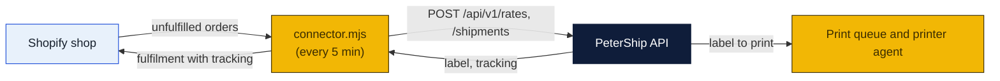

# Shopify connector

A small program that ships a Shopify store's orders through PeterShip. It runs on any machine with Node 24 (the counter PC beside the printer agent, or the merchant's own laptop), pulls the shop's **unfulfilled orders**, buys a label for each through the [public API](../api/README.md), and writes the tracking number back to Shopify as a **fulfilment**, which makes Shopify send the customer its shipping-confirmation email.



Chart legend: a **rectangle** is a step or a thing; **dark blue** runs in Cloudflare, **gold** runs on a PC, **light blue** is someone else's system; an **arrow** is data moving.

## What the merchant needs

1. **A PeterShip API key** for their business account, made by a manager on Staff → Accounts (label it `Shopify`).
2. **A Shopify custom app** for their shop: Shopify admin → Settings → Apps and sales channels → Develop apps → Create an app. Give it the Admin API scopes `read_orders`, `write_fulfillments`, `read_fulfillments`, `read_merchant_managed_fulfillment_orders`, `write_merchant_managed_fulfillment_orders`. Install it and copy the **Admin API access token** (`shpat_...`). It is shown once.
3. **A parcel rule.** Shopify orders carry weights but not box sizes; the connector uses a default box and the order's total weight, with per-product overrides in the config file.

## Setup

```bash
cd shipping-client/shopify-connector
cp config.example.json config.json      # fill it in, see below
node connector.mjs --once               # ship whatever is waiting, print what happened, exit
node connector.mjs                      # keep running, every 5 minutes
```

`config.json`:

| Key | Meaning |
|---|---|
| `petership_url` | The store site, `https://goinpostalforsythe.com` |
| `petership_key` | The `psk_...` key |
| `shop` | `bayou-candles.myshopify.com` |
| `shopify_token` | The `shpat_...` custom-app token |
| `service` | Preferred service: `cheapest` (default), `fastest`, or a `rate_id` like `usps-ground-advantage` |
| `default_parcel` | Box and weight used when nothing better is known: `{ "length_in": 10, "width_in": 8, "height_in": 4, "min_weight_lb": 0.5 }` |
| `products` | Optional overrides by SKU: `{ "CANDLE-L": { "length_in": 6, "width_in": 6, "height_in": 6, "weight_lb": 1.2 } }` |
| `insure_over_usd` | Insure orders worth more than this (0 turns it off) |
| `tag` | Shopify tag written on orders the connector shipped, default `petership` |
| `dry_run` | `true` quotes but never buys or fulfils; good for the first run |

Anything secret can also come from the environment instead of the file: `PETERSHIP_KEY`, `SHOPIFY_TOKEN`.

## What one pass does

1. Asks Shopify for open, paid, unfulfilled orders without the `petership` tag.
2. For each, builds the recipient address from the shipping address and the parcel from line-item weights or the config.
3. Calls `/rates`; picks by `service`; calls `/shipments` with `reference: "Shopify #1042"`.
4. Creates the fulfilment on Shopify with the tracking number, carrier and the PeterShip tracking link, and tags the order.
5. Prints one line per order. An order that fails (bad address, international, rate problem) is skipped with the reason and tried again next pass; nothing is bought twice because the tag is written only after a label exists, and an order that already carries a fulfilment is never touched.

The label itself prints at the store through the print queue like any other label, or the merchant fetches `label_url` from the API if they print at their own place.

## Running it all the time

- **Windows:** the same pattern as the printer agent, a scheduled task at log-on running `node connector.mjs` in this folder; see `shipping-client/printer-agent/install-windows.ps1` for the shape.
- **Mac:** a launchd plist like the printer agent's `com.petership.printer-agent.plist`, with the program swapped.
- Or, since it only talks to two web APIs, a Cloudflare Worker cron later; the code uses only `fetch`.

## The path to a listed Shopify app

Today the merchant makes a custom app in their own admin and pastes a token. A **public app** in the Shopify App Store would instead let a merchant click Install, approve the scopes (OAuth), and have PeterShip appear as a carrier and fulfilment service inside Shopify with no file to edit. That takes a Shopify Partner account, an OAuth flow on the store site (`/api/shopify/install` and `/callback`, storing the shop's token per account), Shopify's app review, and webhooks from Shopify (`orders/create`) instead of polling. The connector's logic carries over unchanged; only how the token arrives differs. It is worth doing when a second merchant asks.
