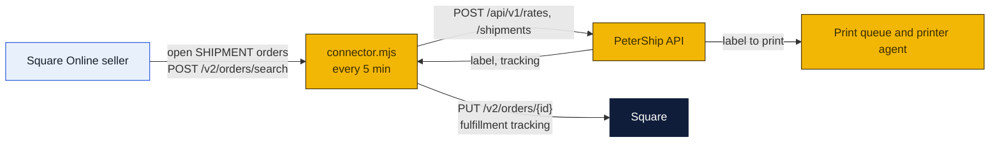

# Square connector

A small program that ships a Square Online seller's orders through PeterShip (to-do T28, the first live marketplace connector after Shopify). It runs on any machine with Node 24: the counter PC beside the printer agent, or the seller's own laptop. Every five minutes it asks Square for open shipment orders, buys each label through the PeterShip public API at the seller's account rates, and writes the carrier and tracking number back onto the Square order so the customer's confirmation shows it.

### How to read the charts

| Color | Meaning |
|---|---|
| Yellow | Ours: this program, PeterShip |
| Navy | Square and the carriers |
| Light blue | People |



## What the seller needs

1. **A PeterShip API key** for their business account, made by a manager on Staff → Accounts (label it `Square`).
2. **A Square access token.** Square developer dashboard (developer.squareup.com), an application in the seller's own account, and under Credentials the **production access token** with the `ORDERS_READ` and `ORDERS_WRITE` permissions. No app review is needed for a seller's own token; that is why Square comes first.
3. **The location id(s)** from the same dashboard, or `GET /v2/locations`.
4. **A parcel rule.** Square orders carry no weights, so the connector uses a default box and a weight per item, with overrides by item name, variation name or catalog object id in the config.

## Setup

```bash
cd shipping-client/square-connector
cp config.example.json config.json      # fill it in, see below
node connector.mjs --once               # ship whatever is waiting, print what happened, exit
node connector.mjs                      # keep running, every 5 minutes
```

| Key | Meaning |
|---|---|
| `petership_url`, `petership_key` | The store site and the `psk_...` key |
| `square_token` | The seller's access token; `square_env` `production` or `sandbox` |
| `location_ids` | The Square location(s) whose orders to ship |
| `service` | `cheapest` (default), `fastest`, or a `rate_id` like `usps-ground-advantage` |
| `default_parcel` | Box, a floor weight, and a weight per item used when nothing better is known |
| `products` | Overrides keyed by item name, variation name or catalog object id |
| `insure_over_usd` | Insure orders worth more than this (0 turns it off) |
| `dry_run` | `true` quotes but never buys or writes back; good for the first run |

Secrets can come from the environment instead: `PETERSHIP_KEY`, `SQUARE_TOKEN`.

## What one pass does

1. `POST /v2/orders/search` for OPEN orders with a SHIPMENT fulfillment in PROPOSED, RESERVED or PREPARED state, oldest first.
2. Skips any order already in `shipped.json` (written beside the config) or whose fulfillment already has a tracking number.
3. Builds the recipient from the fulfillment's `shipment_details.recipient` and the parcel from the config; calls `/rates`, picks by `service`, calls `/shipments` with `reference: "Square <reference id>"`.
4. `PUT /v2/orders/{id}` with the order's `version` and the fulfillment's `uid`: state PREPARED, the carrier, tracking number, the PeterShip tracking link and a shipping note. Square then shows the tracking to the customer; the seller marks it shipped in their dashboard or lets Square do it when the carrier scans.
5. Prints one line per order. A failed order (bad address, international, no rate) is skipped with the reason and tried again next pass.

The label prints at the store through the print queue like any other, or the seller fetches `label_url` from the API if they print at their own place.

## Running it all the time

The same pattern as the Shopify connector and the printer agent: a scheduled task at log-on on Windows, a launchd plist on a Mac, or later a Cloudflare Worker cron, since it only uses `fetch`.

## Limits

- Domestic only; international Square orders are skipped with a note, bring them to the counter.
- One fulfillment per order; a split shipment is handled the first time only.
- Square tokens expire only when revoked, but an OAuth app (for other sellers to install without pasting a token) is the same step as the listed Shopify app, later.

Sources: [Square Orders API, fulfillments](https://developer.squareup.com/docs/orders-api/fulfillments), [Square, build with orders](https://developer.squareup.com/docs/orders-api/build-with-orders), [Square forum, tracking number via API](https://developer.squareup.com/forums/t/tracking-number-assigning-via-api/2471).
