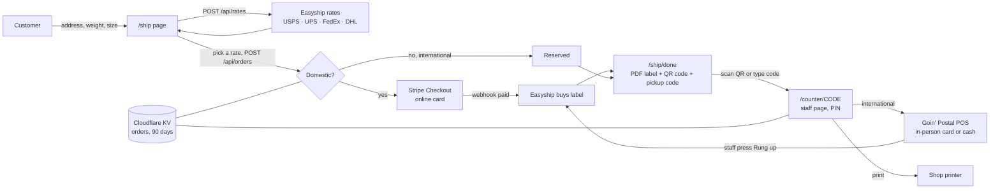

# site

The public website for Goin' Postal Forsythe, built with [Astro](https://astro.build) and deployed to Cloudflare. The marketing pages are plain static HTML. The shipping flow runs as a handful of Cloudflare functions. PHP is deliberately not used anywhere.

Rates and payments are separate systems that never talk to each other. Easyship quotes and buys labels through the store's existing account. Online, Stripe takes the card. In the shop, the Goin' Postal POS takes the card or cash, as it must, and staff press one button on the counter page to say so. The site is the only thing in between, so any side can be swapped without touching the others.



## Pages and routes

| Route | Who | What |
|---|---|---|
| `/` | customers | Hero, services, hours, map |
| `/ship` | customers | Quote form, rate list, pay or reserve |
| `/ship/done?order=CODE` | customers | Label download, QR code, pickup code |
| `/contact` | customers | Formspree contact form |
| `/counter/CODE` | staff | Order details. For international: ring up on the POS, then press the button to buy the label. Mark printed. Needs the PIN |
| `POST /api/rates` | site | Re-quotes through Easyship, filtered to the four carriers |
| `POST /api/orders` | site | Re-quotes server side so prices cannot be edited, then Stripe or reserve |
| `POST /api/stripe-webhook` | Stripe | `checkout.session.completed` buys the label |
| `POST /api/counter` | staff page | `paid` and `printed` actions |
| `GET /api/mock-paid` | dev only | Stands in for Stripe when no key is set |

## Run it

```
cd site
npm install
cp .dev.vars.example .dev.vars
npm run dev
```

With `.dev.vars` left blank the site runs in mock mode: fake rates, fake label, Stripe skipped. Orders live in memory until restart. Fill in `EASYSHIP_TOKEN` with a `sand_` token to hit Easyship's sandbox, and the Stripe test keys to use real Checkout.

## Before launch

1. `src/data/store.ts`: street number, ZIP, phone, hours, Formspree ID, and the `origin` ship-from address.
2. Easyship: dashboard, APIs & Webhooks, Create API Connection, API version 2024-09, scopes `public.rate:read`, `public.shipment:write`, `public.label:write`. Use the `prod_` token in production.
3. Stripe: live secret key, and a webhook for `checkout.session.completed` pointed at `/api/stripe-webhook`. Paste its signing secret.
4. Cloudflare: `npx wrangler kv namespace create ORDERS`, paste the id into `wrangler.jsonc`, set `SITE_URL` to the real domain, then `npx wrangler secret put` for `EASYSHIP_TOKEN`, `STRIPE_SECRET_KEY`, `STRIPE_WEBHOOK_SECRET`, `COUNTER_PIN`.
5. Set the counter tablet or phone to open `/counter/` links from the camera, so scanning a customer's QR opens the order.

## Deploy

Connect the GitHub repo to Cloudflare Workers with root directory `site` and build command `npm run build`. The adapter writes `dist/` with the static pages and the worker.
