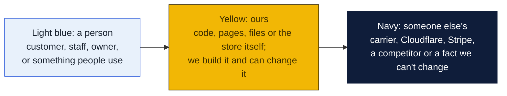
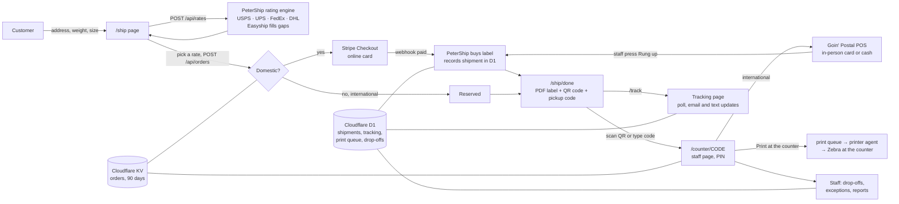
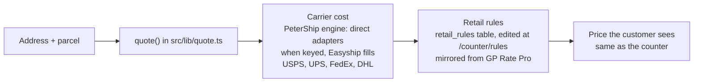
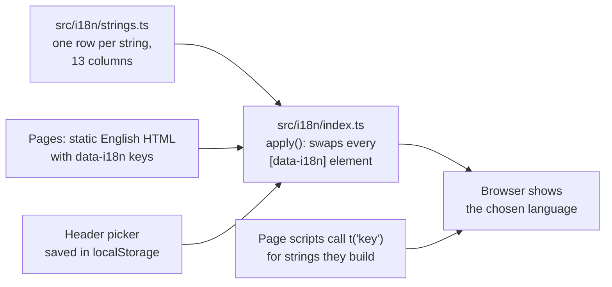
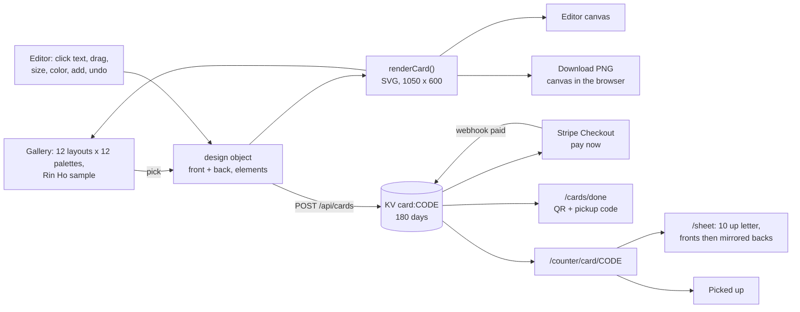

# site

The public website for Goin' Postal Forsythe, built with [Astro](https://astro.build) and deployed to Cloudflare. The marketing pages are plain static HTML. The shipping flow runs as a handful of Cloudflare functions. PHP is deliberately not used anywhere.

Rates and payments are separate systems that never talk to each other. PeterShip, the store's own shipping client in `src/shipping/`, quotes and buys labels: direct USPS, UPS, FedEx and DHL adapters when their keys are set, the store's Easyship account filling in until then. Online, Stripe takes the card. In the shop, the Goin' Postal POS takes the card or cash, as it must, and staff press one button on the counter page to say so. The site is the only thing in between, so any side can be swapped without touching the others.

### How to read the charts

Every chart in this repo uses the same three colors, so once you know them you can read any of them.



| Mark | Meaning |
|---|---|
| Solid arrow `-->` | Data or a person moves this way, or this happens next |
| Dotted arrow `-.->` | Only sometimes: when keys are set, when a condition holds, or a later plan |
| Words on an arrow | What is sent or the condition, for example "when keys set" |
| Cylinder | A database or stored records (KV, D1, a table) |
| Diamond with a question in it | A decision. Follow the arrow whose label matches the answer; there is one arrow out per answer |
| Slanted box (parallelogram) | Something typed in or handed out: a form, a scan, a printed slip |
| Circle in the middle of a mindmap | The topic; the branches around it are its parts |
| Rounded box with `/path` | A page on the website; `/counter/...` pages are staff only |
| Box with a thick or dashed border, or a big frame around boxes | A group: everything inside runs in the same place |
| ✅ 🔨 ⏳ ⏸ in a box | Done, being built, not started, waiting on someone |

Other chart kinds you will meet: a **state diagram** shows the statuses one thing passes through, read along the arrows. A **sequence diagram** reads top to bottom, each vertical line is one party and each arrow is one message. A **gantt** is a calendar of who does what when. A **mindmap** is a topic in the middle with its parts around it. A **pie** or **bar chart** is just numbers. GitHub draws all of these on its own; if a chart shows as plain text, you are viewing the file somewhere that does not render Mermaid, and the raw text still reads top to bottom.



## Pages and routes

| Route | Who | What |
|---|---|---|
| `/` | customers | Hero, services, hours, map |
| `/ship` | customers | Quote form, rate list, pay or reserve. Optional text updates: tick the box and give a mobile number |
| `/ship/done?order=CODE` | customers | Label download, QR code, pickup code, link to tracking |
| `/track?q=CODE` | customers | Tracking page: pickup code or carrier tracking number, status and history, no login |
| any page | customers | Language picker, text size (5 steps) and high contrast switches in the header, all remembered per device |
| `/cards` | customers | Vistaprint-style card designer: 12 layouts, 12 color schemes, 6 typefaces, click-to-edit text on the card, drag, resize, add text and images, front and back, undo and redo, PNG download, pay by card on Stripe and pick up in the shop |
| `/cards/done?order=CODE` | customers | Order confirmation with a QR code and pickup code |
| `/contact` | customers | Formspree contact form |
| `/counter/card/CODE` | staff | Card order, already paid online: preview both sides, print sheet, mark printed, mark picked up. Unpaid orders are flagged do not print |
| `/counter/card/CODE/sheet` | staff | Print-ready 10-up US letter sheet, fronts then mirrored backs |
| `/counter/queue` | staff | The quote queue: every quote reserved online and every walk-up staff typed in, oldest first, with Buy label, Print at the counter, Mark printed, Void and Cancel on one screen. Walk-up form quotes with the same engine as the website, and has a return mode: the sender's address is typed in, the package comes to the store or to a local business, and Email label sends it to the sender. Refreshes itself every thirty seconds. PIN |
| `/counter/customers` | staff | Customer lookup with notes on each customer: search by name, phone or email; shipment history with tracking status; address book with Ship here again (fills the walk-up form); returning badge; CSV of everyone keyed by phone. PIN |
| `/counter/accounts` | staff to list, manager to manage | Business accounts: open an account on a customer with a business name and a discount, see unbilled bill-to-account shipments, issue the month's statement (emailed, with a Stripe invoice link when Stripe is set up), mark it paid. The walk-up form offers Bill to account; the online Ship page applies the discount when the account's email is used |
| `/counter/close` | staff, manager to close | End of day: labels sold, add-ons, counter versus online takings, what the POS should show for PeterShip's part, voids and the refunds still owed with where to refund them, drop-offs accepted and handed over, open quotes and exceptions. Close the day to freeze the figures under a name with a note, print the Z-report at the counter or from the browser, reprint past closes |
| `/counter/invoices` | manager | Carrier invoice audit: open the carrier's invoice CSV, confirm the tracking and amount columns, and every line is matched to our shipment. Overcharges, voided labels still billed, lines billed twice and numbers that are not ours come out on top with the amount to dispute. Save the audit, mark lines as disputed with a note, download the flagged lines, and a sample invoice to try it with |
| `/counter/staff` | owner | People and the audit log: add a person with their own PIN and role (counter, manager, owner), change roles, deactivate, reset a PIN; every buy, print, void, cancel, email, drop-off, price change and staff change listed newest first with the name, filterable by person. Managers can read the log |
| `/counter/rules` | owner | Price rules and, in a second section, the add-ons catalog (boxes, packing, services) and the insurance terms (carrier-included cover, per $100, minimum, maximum). Price rules: on/off, round to .99, default, per-carrier and per-service percent, flat fee or fixed price. Preview shows carrier cost, price now and price after for a sample box. Saved to D1 and used by the next quote, no deploy. Staff PIN views; `OWNER_PIN`, when set, is needed to save |
| `/counter/CODE` | staff | Order details. For international and walk-ups: ring up on the POS, then press the button to buy the label. Print at the counter (queues for the printer agent), mark printed, void the label, cancel an unbought quote. Needs the PIN |
| `/counter/dropoff` | staff | Drop-off capture: scan a prepaid or return package's barcode, record it with the time, mark a carrier's pickup. Prints a receipt at the counter (ticked by default, remembered per tablet) and can text it to the customer; Print again and Text again on each recent row. PIN |
| `/counter/receipt/ID` | staff | One drop-off receipt for printing from the browser or showing on the tablet, with Print at the counter. PIN |
| `/counter/reports` | staff | Shipments, paid, cost and margin by day, carrier and service; busiest hours and days; returning customers; drop-offs; CSV download for reconciling the carrier invoice. PIN |
| `/counter/exceptions` | staff | Shipments needing a human: carrier exceptions, returns, never scanned after three days, not moving for a week. Check carriers now runs the poll. PIN |
| `POST /api/rates` | site | Rating engine: every configured carrier in parallel, Easyship fills gaps, retail rules, cached five minutes. Returns service, price and days only, plus `extras` (the insurance fee for the declared value and the active add-on catalog) and `packing` (billable weight per carrier, whether size rather than weight sets the price, the smallest stocked box that fits, and a smaller box that would cut the billed weight) and `address` (errors and warnings from the ZIP, PO box, military and apartment checks; a PO box or military address drops UPS and FedEx from the list) |
| `POST /api/compare` | staff | Every provider's rates side by side for the parity test. PIN |
| `POST /api/orders` | site | Re-quotes server side so prices cannot be edited, prices `insure` and `addons` from the catalog, then Stripe (one line per item) or reserve |
| `POST /api/stripe-webhook` | Stripe | `checkout.session.completed` buys the label for a `GP-` order or marks a `CD-` card order paid |
| `POST /api/counter` | staff pages | `paid` (buy the label after the POS), `bill` (buy the label and put it on the business account's next statement), `printed`, `void` (cancels the label with the carrier) and `cancel` (drops a quote with no label), both needing a `reason` that is saved on the order and in the audit log, and `email` (sends the label, tracking and instructions to an address, for returns and print-at-home) actions, PIN |
| `POST /api/queue` | staff page | `list` (open quotes oldest first, plus the last day's finished ones), `create` (a walk-up: re-quoted on the server, saved as reserved; with `kind: "return"` the typed `origin` is the far end and the destination is the store or another address) and `order` (one order's details to prefill the walk-up form), PIN |
| `POST /api/notes` | staff pages | `list` and `add` notes on a customer or an order, with the signed-in name |
| `POST /api/accounts` | staff pages | `list` (any staff), `get`, `add`, `update`, `statement`, `paid`, `customers`, `addkey`, `revokekey` (manager or owner) |
| `/api/v1/*` | business accounts' software | The public API: `me`, `rates`, `shipments` (create, list, get, void), Bearer API key made on the accounts page, every label billed to the account with its discount; `shipment.tracking` webhooks signed with HMAC-SHA256. Reference in [`shipping-client/api/`](../shipping-client/api/README.md); a Shopify connector in [`shipping-client/shopify-connector/`](../shipping-client/shopify-connector/README.md) |
| `POST /api/close` | staff page | `figures` (the day, live), `close` (freeze and optionally print, manager or owner), `list`, `get`, `zpl` (reprint) |
| `POST /api/invoices` | manager page | `audit` (rows in, matched lines and a summary out, `save: true` keeps it), `list`, `get`, `dispute`, `csv` and `sample` |
| `POST /api/staff` | staff pages | `me` (who this PIN is), `list`, `add`, `update` (owner), `audit` (manager or owner) |
| `POST /api/addons` | owner page | `get`, `file` and `save` for the add-ons catalog and insurance terms. Staff PIN, or `OWNER_PIN` to save |
| `POST /api/rules` | owner page | `get` (rules in force and their source), `file` (the JSON file's rules), `preview` (a draft applied to a real quote, nothing stored) and `save` (replace all, validated). Staff PIN, or `OWNER_PIN` to save |
| `POST /api/customers` | staff page | `search` (name, email or phone digits; also unlinked walk-ups by name), `get` (customer, every quote, address book) and `export` (CSV), PIN |
| `GET /api/track?q=` | site | Public: shipment status and events by pickup code or tracking number, refreshed from the carrier when older than fifteen minutes |
| `POST /api/print` | staff page, printer agent | `queue` (PIN) puts a label in the print queue; `status` (PIN) returns the agent's heartbeat and the jobs it gave up on; `retry` (PIN) puts one back. `GET`, `done`, `heartbeat` and `failed` (header `X-Printer-Key`) are what the counter PC's [printer agent](../shipping-client/printer-agent/README.md) calls |
| `POST /api/dropoff` | staff page | `accept` (with `receipt` and `text` flags), `lookup`, `recent`, `handed`, `get`, `receipt` (re-queue the slip) and `text` (re-send it) actions, PIN |
| `POST /api/track-poll` | printer agent, GitHub Action, staff page | Refreshes tracking for open shipments older than fifteen minutes and sends customer updates for anything new. `X-Printer-Key` header or PIN |
| `POST /api/exceptions` | staff page | The exceptions list, PIN |
| `POST /api/reports` | staff page | `from` and `to` days, up to a year; `format: "csv"` for the shipment rows. PIN |
| `GET /api/mock-paid` | dev only | Stands in for Stripe when no key is set |
| `POST /api/cards` | site | Saves a card order (design sanitized server side, logo must be a PNG, JPG or SVG data URL under 400 KB) and starts Stripe Checkout |
| `PUT /api/cards` | staff page | `printed` and `picked_up` actions, PIN |

## Where prices come from

Customers see one retail price per service and never a vendor name. Behind that:



- **Cost** comes from PeterShip's rating engine in `src/shipping/`: direct USPS, UPS, FedEx and DHL adapters that each switch on when their keys are present, with the store's Easyship account filling in any carrier that has no keys yet. Today no direct keys are set, so Easyship answers for all four in one call. See [`shipping-client/README.md`](../shipping-client/README.md). The provider name appears nowhere a customer can see: not in page text, the demo note, the demo label, or the API response.
- **Price** is cost plus the store's retail rules, which mirror GP Rate Pro, the system the shop quotes with at the counter. The owners edit them at `/counter/rules`; they are stored in the `retail_rules` table and `src/data/ratepro.json` is only the starting point until the first save. Rules are percent over cost plus a flat fee, per carrier or per service, or a fixed price per service, with optional rounding to .99. A service rule beats a carrier rule, which beats the default. With the switch off cost passes through unchanged. The five-minute rate cache stores cost, not price, so a saved change shows on the next quote.
- **Who is signed in.** Every staff API takes a PIN and resolves it through `src/lib/auth.ts`: a personal PIN from the `staff` table (hashed, 4 to 8 digits, with a role), or one of the two shared secrets, which sign in as "Counter (shared PIN)" and "Owner (shared PIN)" so a fresh install works before anyone is added. Owners save prices and manage staff; managers also read the audit log; counter staff do everything else. Each change is written to `audit_log` with the name. Once everyone has a personal PIN the shared secrets can be removed.
- **Another store.** The code is store-agnostic: `src/data/store.ts` holds the Forsythe facts as defaults and lays the `STORE_JSON` secret over them, so a second store is the same repo deployed again with its own KV, D1, secrets and a facts file in `stores/`. `python scripts/new-store.py <slug> ...` writes the file and prints every command; `wrangler.jsonc` has an `env` block per store. Prices, add-ons, staff and accounts are per store already, because they live in that store's database.
- **When the internet drops.** A service worker (`public/counter-sw.js`, staff pages only) serves the last copy of any `/counter/` page this browser opened, so the screens still come up. The queue shows the list as it last was with the time and a red line; the drop-off page keeps scans in an outbox on the device, says how many are waiting, and sends them with their real scan time (marked "scanned while offline") as soon as the connection is back, in order. Labels cannot be bought offline: the carriers are online services.
- **Address checks** (`src/lib/address.ts`) run on every quote and before every label: the ZIP's shape, whether its first three digits belong to the state typed (a table of USPS prefix ranges per state), PO boxes (UPS and FedEx cannot deliver to them, so only USPS is offered), military and territory addresses, a street line with no number, and an apartment building with no unit. Errors stop an online order; at the counter staff can read the error and press Use this address anyway. The carriers' own address APIs plug into `validateWithCarrier()` once the keys exist.
- **Packing advice** rides along with every quote (`src/lib/packing.ts`). Box inner sizes are read from the catalog names ("up to 16 x 12 x 10 in"), so a new box on the Prices page joins the advice with no code change as long as the three numbers stay in the name. The Ship page shows one line when size is setting the price; the walk-up form shows the billable weights, the smallest box that fits and a Use this box button that fills the box add-on and the dimensions and re-quotes.
- **Insurance and add-ons** sit under the label on the total. The carrier's included cover (default $100) costs nothing; above it the fee is per $100 with a minimum, capped at a maximum declared value. Boxes, packing and services are a catalog with a price each. Both are edited at `/counter/rules` and stored in the `addons` table, with `src/data/addons.json` as the seed. The Ship page offers insurance; the walk-up form offers insurance and the catalog; the order's `total` is label plus extras, and that is the number Stripe charges and the POS must ring. Lines sold are kept in `order_addons` for the reports.
- **Wiring Rate Pro itself:** if GP Brands or the vendor provides an export or an API (issue 11), it plugs in at `src/lib/pricing.ts`, the one place that turns cost into price. Nothing else changes.

## Easy to read for older customers

Many of the store's customers are older, so the whole site is set up for them without taking anything away.

- **Text size switch** in the header: five steps, A− to A+++ (16 to 28 px base). The default is one step up from normal. Remembered on the device.
- **High contrast switch** in the header, on by default: black on white, strong borders, no greys, blue links. Turning it off is remembered on the device.
- Base type is 18 px with 1.6 line height. Buttons, inputs, menus and tabs are at least 44 to 52 px tall so they are easy to tap.
- Links are underlined, not just colored. The keyboard focus ring is a thick yellow outline. A "Skip to content" link appears on the first Tab press.
- Form labels sit above their boxes in bold. Error messages are boxed in red with dark text, not just colored text.
- Chosen rates and chosen layouts get a thick outline plus a tinted background, so the selection does not rely on color alone.
- Lines are capped at about 70 characters. Motion is turned off for people who have asked their system to reduce it.
- On phones the big buttons stack full width.

The staff counter pages get the same styles. Nothing was removed; every feature is where it was.

## What it costs

Every service, its price, and monthly estimates at three volumes are in [`costs/README.md`](costs/README.md). Short version: $0 a month plus about $11 a year for the domain, and Stripe's 2.9% plus 30 cents on each online payment.

## Languages

Every page, customer and staff, can be read in 14 languages from the picker in the header: English, Spanish as spoken in the Dominican Republic, Vietnamese, Lao, Khmer (Cambodian), Korean, Mandarin (Simplified Chinese), Cantonese (Traditional Chinese), Japanese, Thai, Brazilian Portuguese, Dutch, Afrikaans and French as spoken in Quebec. The choice is remembered on the device and the first visit follows the browser's language.



Pages are built once in English. In the browser, every element tagged `data-i18n="key"` gets its text swapped from `src/i18n/strings.ts` (customer strings) and `src/i18n/staff.ts`, `staff2.ts`, `staff3.ts` (the `st.` keys for the counter pages), and page scripts call `t('key')` for the strings they build themselves, or `tf('key', { id })` when the string has a slot. Adding a language is one new column in each file plus one entry in `LANGS`. Adding a string is one new row. The staff tables re-render on the `langchange` event, so switching the picker mid-shift changes the queue in place. Printed receipts, the thermal label and the label email stay in English because they leave the building. The translations were written by the AI assistant and should be checked by native speakers (issue 10).

## Business card designer

Everything runs in the browser. A design is a plain object: a template id, a typeface, and a front and back side, each with a background color and a list of elements. An element is either text (position, width, size, bold, italic, color, alignment) or an image (position, size, data URL). Colored bars, bands, circles and triangles are just images made from tiny SVG data URLs, so the customer can move or delete them like anything else. `renderCard()` in `src/lib/cards.ts` turns a design into SVG, and the same function draws the editor canvas, the gallery thumbnails, the saved order and the counter's print sheet, so what the customer sees is exactly what prints. `makeTemplate()` builds a starting design from a layout, a palette and a set of details. The gallery shows every layout with Rin Ho's sample details in the chosen color; the editor starts from the same layout with grey placeholder text that is dropped from the print if never edited. Cards are 3.5 by 2 inches at 300 dpi with a dashed safe-area guide. The design is kept in the browser's local storage so a refresh does not lose it. Server-side sanitizing caps element counts and text lengths, requires hex colors, and only accepts PNG, JPG or SVG data URLs under 400 KB for images.



Prices per quantity are in `PRICES` in `src/lib/cards.ts` and are placeholders until the owners confirm them.

## Run it

```
cd site
npm install
cp .dev.vars.example .dev.vars
npm run dev
```

`npm run check` type-checks every page, API and library file with Astro's checker, `npm run test:unit` runs the Vitest suite in `tests/` (dimensional weight, retail rules, insurance and add-ons, the packing advisor, address checks, the invoice matcher, receipts and the Z-report, PINs and roles, and the whole store against its memory fallback: customers, queue, shipments, tracking, reports, day figures, staff, audit, rules, add-ons, notes, print failures, heartbeat, accounts, statements and invoice audits), and `npm test` runs the check, the tests and the build together; the CI workflow runs all three on every push, plus a syntax check of the printer agent and the Python scripts and a parse of `db/schema.sql`. Run `npm run db:local` once to create PeterShip's tables in the local D1 database (shipments, tracking, print queue, drop-offs); without it those routes answer with a database error. With `.dev.vars` left blank the site runs in mock mode: fake rates, fake label, Stripe skipped. Orders live in memory until restart; the D1 records live in `.wrangler/`. Fill in `EASYSHIP_TOKEN` with a `sand_` token to hit Easyship's sandbox, and the Stripe test keys to use real Checkout.

## Before launch

1. `src/data/store.ts`: phone, hours, Formspree ID, and the phone in the `origin` ship-from address. The address 1800 Forsythe Ave Ste 2, Monroe, LA 71201 is already in.
2. Easyship: dashboard, APIs & Webhooks, Create API Connection, API version 2024-09, scopes `public.rate:read`, `public.shipment:write`, `public.label:write`. Use the `prod_` token in production.
3. Stripe: live secret key, and a webhook for `checkout.session.completed` pointed at `/api/stripe-webhook`. Paste its signing secret.
4. Cloudflare: `npx wrangler kv namespace create ORDERS` and `npx wrangler d1 create goin-postal`, paste both ids into `wrangler.jsonc`, run `npm run db:remote`, set `SITE_URL` to the real domain, then `npx wrangler secret put` for `EASYSHIP_TOKEN`, `STRIPE_SECRET_KEY`, `STRIPE_WEBHOOK_SECRET`, `COUNTER_PIN`, `PRINTER_KEY`, and for customer updates `RESEND_API_KEY`, `MAIL_FROM` (on a domain verified at Resend), `STAFF_EMAIL`, `TWILIO_ACCOUNT_SID`, `TWILIO_AUTH_TOKEN`, `TWILIO_FROM`. Leave the update keys out and messages are logged, not sent.
6. Counter PC: set up the [printer agent](../shipping-client/printer-agent/README.md) with the same `PRINTER_KEY`, so Print at the counter reaches the label printer. It also refreshes tracking every ten minutes while it runs.
7. GitHub: repository secrets `TRACK_POLL_URL` (the site's `/api/track-poll`) and `PRINTER_KEY`, and the repository variable `TRACK_POLL_ENABLED=true`, so tracking refreshes every thirty minutes when the shop PC is off.
5. Set the counter tablet or phone to open `/counter/` links from the camera, so scanning a customer's QR opens the order.

## Deploy

Connect the GitHub repo to Cloudflare Workers with root directory `site` and build command `npm run build`. The adapter writes `dist/` with the static pages and the worker.
