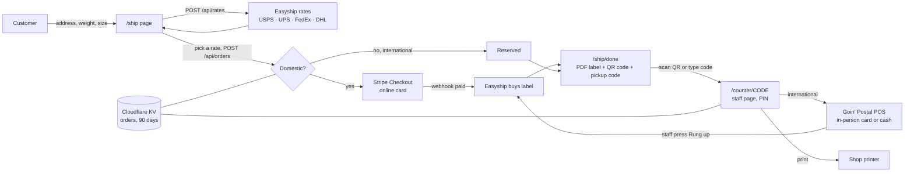
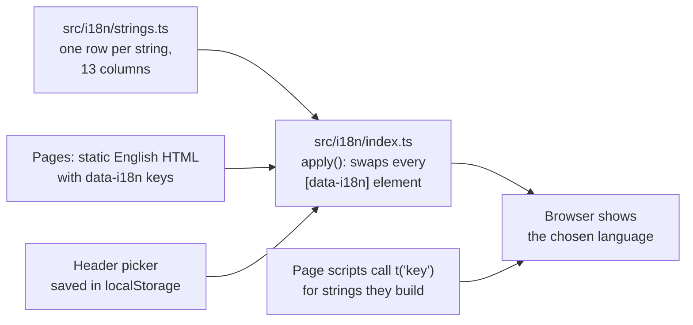
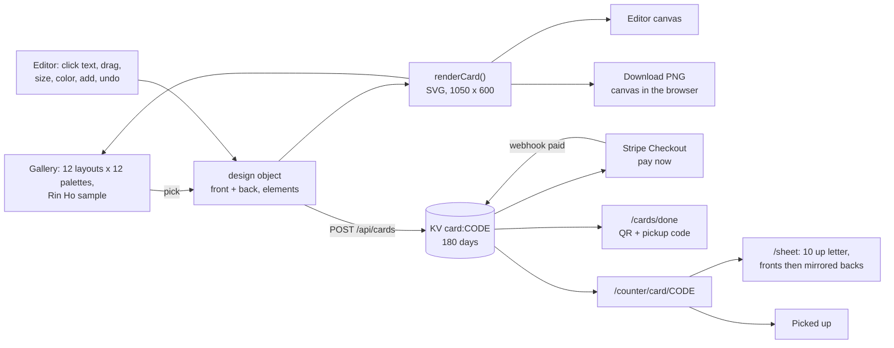

# site

The public website for Goin' Postal Forsythe, built with [Astro](https://astro.build) and deployed to Cloudflare. The marketing pages are plain static HTML. The shipping flow runs as a handful of Cloudflare functions. PHP is deliberately not used anywhere.

Rates and payments are separate systems that never talk to each other. Easyship quotes and buys labels through the store's existing account. Online, Stripe takes the card. In the shop, the Goin' Postal POS takes the card or cash, as it must, and staff press one button on the counter page to say so. The site is the only thing in between, so any side can be swapped without touching the others.



## Pages and routes

| Route | Who | What |
|---|---|---|
| `/` | customers | Hero, services, hours, map |
| `/ship` | customers | Quote form, rate list, pay or reserve |
| `/ship/done?order=CODE` | customers | Label download, QR code, pickup code |
| any page | customers | Language picker in the header, 13 languages, remembered per device |
| `/cards` | customers | Vistaprint-style card designer: 12 layouts, 12 color schemes, 6 typefaces, click-to-edit text on the card, drag, resize, add text and images, front and back, undo and redo, PNG download, pay by card on Stripe and pick up in the shop |
| `/cards/done?order=CODE` | customers | Order confirmation with a QR code and pickup code |
| `/contact` | customers | Formspree contact form |
| `/counter/card/CODE` | staff | Card order, already paid online: preview both sides, print sheet, mark printed, mark picked up. Unpaid orders are flagged do not print |
| `/counter/card/CODE/sheet` | staff | Print-ready 10-up US letter sheet, fronts then mirrored backs |
| `/counter/CODE` | staff | Order details. For international: ring up on the POS, then press the button to buy the label. Mark printed. Needs the PIN |
| `POST /api/rates` | site | Re-quotes through Easyship, filtered to the four carriers |
| `POST /api/orders` | site | Re-quotes server side so prices cannot be edited, then Stripe or reserve |
| `POST /api/stripe-webhook` | Stripe | `checkout.session.completed` buys the label for a `GP-` order or marks a `CD-` card order paid |
| `POST /api/counter` | staff page | `paid` and `printed` actions |
| `GET /api/mock-paid` | dev only | Stands in for Stripe when no key is set |
| `POST /api/cards` | site | Saves a card order (design sanitized server side, logo must be a PNG, JPG or SVG data URL under 400 KB) and starts Stripe Checkout |
| `PUT /api/cards` | staff page | `printed` and `picked_up` actions, PIN |

## Languages

Every customer page can be read in 13 languages from the picker in the header: English, Spanish as spoken in the Dominican Republic, Vietnamese, Lao, Khmer (Cambodian), Korean, Mandarin (Simplified Chinese), Cantonese (Traditional Chinese), Japanese, Thai, Brazilian Portuguese, Dutch and Afrikaans. The choice is remembered on the device and the first visit follows the browser's language.



Pages are built once in English. In the browser, every element tagged `data-i18n="key"` gets its text swapped from `src/i18n/strings.ts`, and page scripts call `t('key')` for the strings they build themselves, such as the Pay button and the rate list. Adding a language is one new column in that file plus one entry in `LANGS`. Adding a string is one new row. The translations were written by the AI assistant and should be checked by native speakers (issue 10). Staff counter pages stay in English.

## Business card designer

Everything runs in the browser. A design is a plain object: a template id, a typeface, and a front and back side, each with a background color and a list of elements. An element is either text (position, width, size, bold, italic, color, alignment) or an image (position, size, data URL). Colored bars, bands, circles and triangles are just images made from tiny SVG data URLs, so the customer can move or delete them like anything else. `renderCard()` in `src/lib/cards.ts` turns a design into SVG, and the same function draws the editor canvas, the gallery thumbnails, the saved order and the counter's print sheet, so what the customer sees is exactly what prints. `makeTemplate()` builds a starting design from a layout, a palette and a set of details. The gallery shows every layout with Rin Ho's sample details in the chosen color; the editor starts from the same layout with grey placeholder text that is dropped from the print if never edited. Cards are 3.5 by 2 inches at 300 dpi with a dashed safe-area guide. The design is kept in the browser's local storage so a refresh does not lose it. Server-side sanitizing caps element counts and text lengths, requires hex colors, and only accepts PNG, JPG or SVG data URLs under 400 KB for images.



Prices per quantity are in `PRICES` in `src/lib/cards.ts` and are placeholders until the owners confirm them.

## Run it

```
cd site
npm install
cp .dev.vars.example .dev.vars
npm run dev
```

With `.dev.vars` left blank the site runs in mock mode: fake rates, fake label, Stripe skipped. Orders live in memory until restart. Fill in `EASYSHIP_TOKEN` with a `sand_` token to hit Easyship's sandbox, and the Stripe test keys to use real Checkout.

## Before launch

1. `src/data/store.ts`: phone, hours, Formspree ID, and the phone in the `origin` ship-from address. The address 1800 Forsythe Ave Ste 2, Monroe, LA 71201 is already in.
2. Easyship: dashboard, APIs & Webhooks, Create API Connection, API version 2024-09, scopes `public.rate:read`, `public.shipment:write`, `public.label:write`. Use the `prod_` token in production.
3. Stripe: live secret key, and a webhook for `checkout.session.completed` pointed at `/api/stripe-webhook`. Paste its signing secret.
4. Cloudflare: `npx wrangler kv namespace create ORDERS`, paste the id into `wrangler.jsonc`, set `SITE_URL` to the real domain, then `npx wrangler secret put` for `EASYSHIP_TOKEN`, `STRIPE_SECRET_KEY`, `STRIPE_WEBHOOK_SECRET`, `COUNTER_PIN`.
5. Set the counter tablet or phone to open `/counter/` links from the camera, so scanning a customer's QR opens the order.

## Deploy

Connect the GitHub repo to Cloudflare Workers with root directory `site` and build command `npm run build`. The adapter writes `dist/` with the static pages and the worker.
