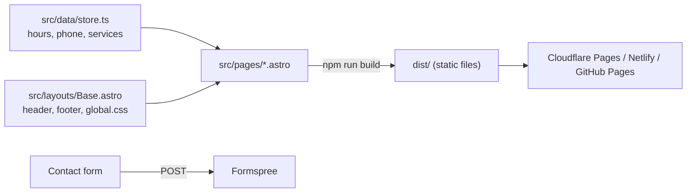

# site

The public website for Goin' Postal Forsythe, built with [Astro](https://astro.build). It builds to plain HTML, CSS and a little JavaScript, so there is no server-side code and nothing to patch. PHP is deliberately not used.



## Run it

```
cd site
npm install
npm run dev
```

Then open the URL it prints (normally http://localhost:4321).

## Before launch

Everything the owners need to confirm is marked `TODO` in `src/data/store.ts`: street number, ZIP, phone, hours, and the Formspree form ID. The map embed in `src/pages/index.astro` should point at the exact storefront.

## Deploy

Push to GitHub and connect the repo to Cloudflare Pages with root directory `site`, build command `npm run build`, output `dist`. Netlify and Vercel use the same three settings.
