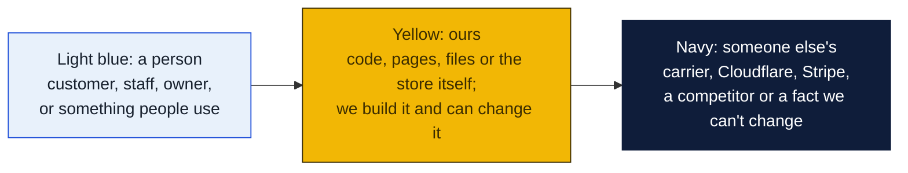
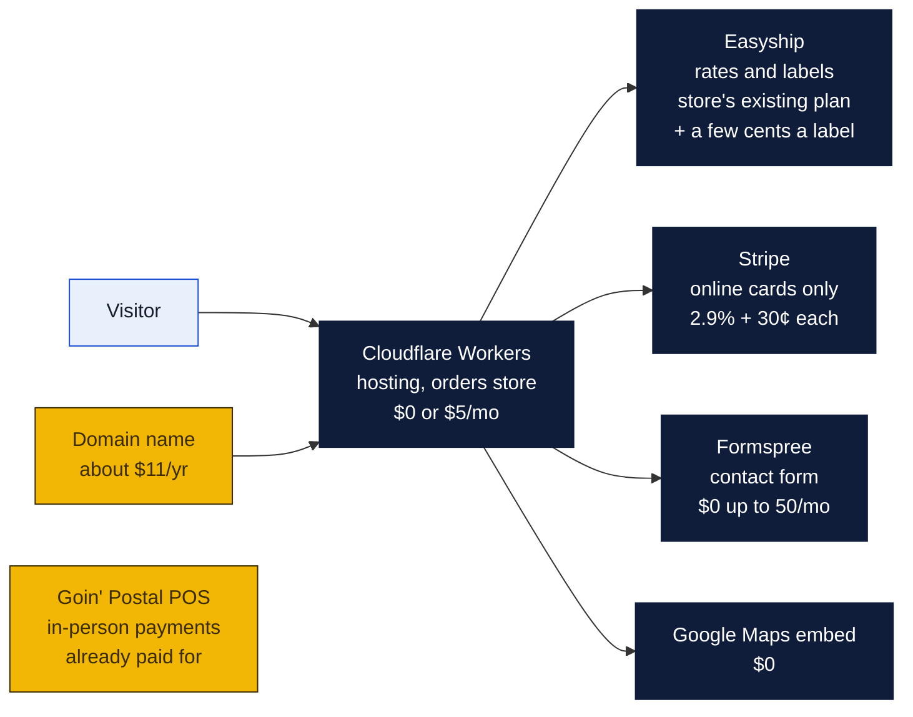

# What the website costs

Every service the site touches, what it charges, and what that adds up to at a few monthly volumes. Prices were checked on October 21, 2026 against the sources at the bottom. Where sources disagreed, the higher figure is used so the estimate errs on the safe side. Confirm each one in the vendor's own dashboard before budgeting.

### How to read the charts

Every chart in this repo uses the same three colors, so once you know them you can read any of them.

| Mark | Meaning |
|---|---|
| Solid arrow `-->` | Data or a person moves this way, or this happens next |
| Dotted arrow `-.->` | Only sometimes: when keys are set, when a condition holds, or a later plan |
| Words on an arrow | What is sent or the condition, for example "when keys set" |
| Cylinder | A database or stored records (KV, D1, a table) |
| Rounded box with `/path` | A page on the website; `/counter/...` pages are staff only |
| Box with a thick or dashed border, or a big frame around boxes | A group: everything inside runs in the same place |
| ✅ 🔨 ⏳ ⏸ in a box | Done, being built, not started, waiting on someone |

Other chart kinds you will meet: a **state diagram** shows the statuses one thing passes through, read along the arrows. A **sequence diagram** reads top to bottom, each vertical line is one party and each arrow is one message. A **gantt** is a calendar of who does what when. A **mindmap** is a topic in the middle with its parts around it. A **pie** or **bar chart** is just numbers. GitHub draws all of these on its own; if a chart shows as plain text, you are viewing the file somewhere that does not render Mermaid, and the raw text still reads top to bottom.

## Fixed costs

| Item | Cost | Notes |
|---|---|---|
| Cloudflare Workers, Free plan | $0/mo | 100,000 requests a day. Orders store (KV): 100,000 reads, 1,000 writes a day, 1 GB. Enough for this site until it is doing hundreds of orders a day. |
| Cloudflare Workers, Paid plan | $5/mo | Only if the free limits are ever hit. 10 million requests a month, KV 10 million reads and 1 million writes a month. No bandwidth charges on either plan. |
| Domain name (.com) | about $10.50/yr | Cloudflare Registrar sells at cost, reported between $9.15 and $10.46 a year. Other registrars run $12 to $20. One-time setup, renews yearly. |
| Formspree, Free | $0/mo | 50 contact-form messages a month, 30 days of history. |
| Formspree, paid | $10 to $15/mo | Only if the contact form gets more than 50 messages a month. Sources disagree on the entry tier: $10/mo for 1,000 or $15/mo for 200. Alternative: point the form at a Cloudflare function and pay nothing. |
| Google Maps embed | $0 | The iframe embed on the home page has no API key and no charge. |
| Easyship plan | $0 to $29/mo | The store already has an account, so this is whatever Rin already pays. The API itself has no subscription on the free pay-as-you-go plan. See per-use below. |
| Stripe | $0/mo | No monthly fee. Per-charge only. |
| Goin' Postal POS | already paid | In-person payments run on it. The site does not add to it. |
| GitHub | $0 | Public repo, free Actions minutes cover CI. |
| SSL certificate | $0 | Included with Cloudflare. |

**Baseline: $0 a month plus about $11 a year for the domain.** The paid Cloudflare and Formspree tiers are there if volume grows, not needed to launch.

## Per-use costs

| Event | Cost | Who pays |
|---|---|---|
| Domestic label paid online | Stripe 2.9% + $0.30 of the label price | Store, out of the label price, unless passed on (issue 8) |
| Business cards paid online | Stripe 2.9% + $0.30 of the card price | Store, same |
| International card on Stripe | extra 1.5%, plus 1% if currency conversion | Not expected: international shipping is rung up on the POS |
| Easyship label through the store's own carrier accounts | $0.03 to $0.05 a label depending on plan; free plan may not allow linked carriers | Store |
| Easyship label on Easyship's own rates | $0 per label, Easyship's margin is inside the postage | Store |
| Easyship rate quote by API | $0.01 per call on overage of the free plan; included on paid plans | Store. Every quote on `/ship` is one call, and the order step re-quotes once more |
| Refund on Stripe | the 2.9% + $0.30 is not returned | Store |
| Postage itself | whatever the carrier charges | Customer, inside the label price |

## What a month looks like

Assumes an average online domestic label of $15 and an average card order of $40, with Easyship on a paid plan at 5 cents a label and 1 cent a rate quote. Postage is excluded because the customer pays it inside the label price.

| Monthly volume | Stripe | Easyship | Cloudflare | Formspree | Total site cost |
|---|---|---|---|---|---|
| Quiet: 20 labels, 5 card orders, 100 quotes | $22.00 | $2.00 | $0 | $0 | **$24** |
| Steady: 100 labels, 20 card orders, 500 quotes | $102.70 | $10.00 | $0 | $0 | **$113** |
| Busy: 300 labels, 60 card orders, 1,500 quotes | $308.10 | $45.00 | $0 to $5 | $0 to $15 | **$353 to $373** |

How each line is worked out, with a label fee of $0.735 (2.9% of $15 plus $0.30) and a card-order fee of $1.46 (2.9% of $40 plus $0.30):

- Quiet: 20 labels × $0.735 = $14.70; 5 card orders × $1.46 = $7.30; Stripe $22.00. Easyship 20 × $0.05 + 100 × $0.01 = $2.00. **Total $24.00.**
- Steady: 100 × $0.735 = $73.50; 20 × $1.46 = $29.20; Stripe $102.70. Easyship 100 × $0.05 + 500 × $0.01 = $10.00. **Total $112.70.**
- Busy: 300 × $0.735 = $220.50; 60 × $1.46 = $87.60; Stripe $308.10. Easyship 300 × $0.05 + 1,500 × $0.01 = $45.00. Cloudflare $0 to $5. Formspree $0 to $15. **Total $353 to $373.**

Revenue in the same months, before postage and card stock: quiet $500, steady $2,300, busy $6,900. Site cost runs 4 to 5 percent of online revenue, nearly all of it Stripe.

## Ways to pay less

- **Pass the Stripe fee on.** A 3 percent "online convenience" line, or rounding label prices up a dollar, covers it. Issue 8.
- **Keep Easyship on the free plan** if the store's own carrier accounts are not needed for online labels. Then labels cost nothing per label but use Easyship's rates, which may be higher than the store's negotiated ones. Rin should compare.
- **Formspree to zero.** The contact form can post to a tiny Cloudflare function that emails the store. Worth doing if messages ever pass 50 a month.
- **Nothing to pay for traffic.** Cloudflare does not bill bandwidth, so a busy promo or a viral post costs nothing extra.

## Not on this list

- **Design and build time.** Already spent.
- **A label printer, card stock, and the counter tablet.** Shop equipment, not site costs. Issue 5 covers the printer and scanner.
- **Business card paper and ink.** Per order, set by the shop. Issue 9.
- **Postage.** Paid by the customer inside the label price.
- **Translations.** Written already. A native-speaker review (issue 10) is time, not money, unless a translator is hired.

## Sources

Checked October 21, 2026. Numbers that conflicted between sources are noted.

- Cloudflare Workers plans and KV limits: [Workers pricing](https://developers.cloudflare.com/workers/platform/pricing/), [KV pricing](https://developers.cloudflare.com/kv/platform/pricing). Third parties list the paid plan at 10 million requests; Cloudflare's own page shows 20 million in one table and 10 million in another.
- Cloudflare Registrar at-cost domains: [announcement](https://www.bleepingcomputer.com/news/technology/cloudflare-becomes-a-registrar-sells-domains-at-cost/), [.com price listing](https://www.whtop.com/plans/cloudflare.com/135912) ($10.46), [second listing](https://vpsranking.com/domain/cloudflare/) ($9.15).
- Easyship plans and label fees: [Easyship API announcement](https://www.easyship.com/blog/easyships-upgraded-global-shipping-api-for-ecommerce) (free pay-as-you-go API, $0.01 per rate call), [plan review](https://findstack.com/products/easyship/reviews?page=7) (Plus $29, Premier $69, Scale $99; $0.05, $0.04, $0.03 per label on linked accounts), [second review](https://ecommerceparadise.com/blogs/guides/easyship-review) (claims no per-label fee). The per-label fee for linked carriers is the figure to confirm with Easyship.
- Stripe: [2026 fee breakdown](https://www.wearefounders.uk/a-guide-to-stripe-fees-in-2025-what-founders-need-to-know/), [October 2026 check of stripe.com/pricing](https://devtoollab.com/blog/stripe-alternatives). 2.9% + $0.30 domestic, +1.5% international, +1% conversion.
- Formspree: [free plan limits](https://splitforms.com/formspree-free-plan-limits) (50 a month), [pricing comparison](https://splitforms.com/formspree-pricing). Paid tiers conflict ($10 for 1,000 versus $15 for 200). The comparison pages are published by a competitor.
